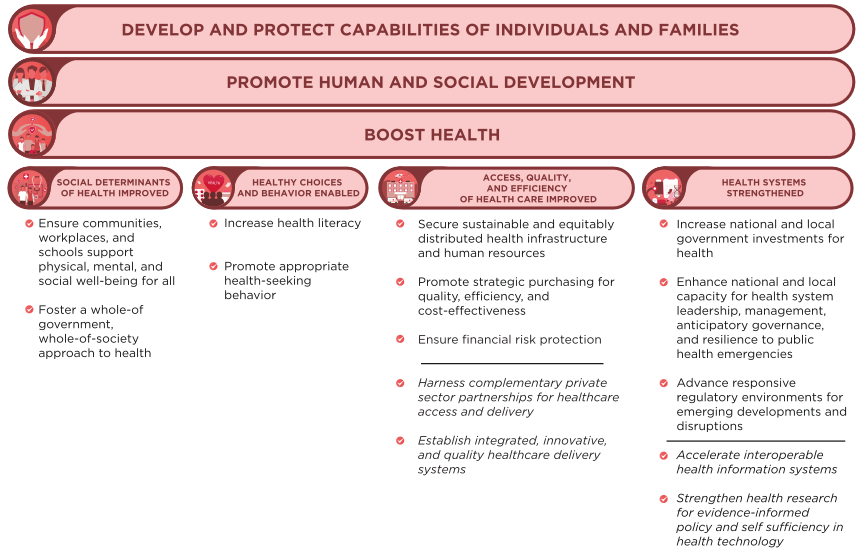
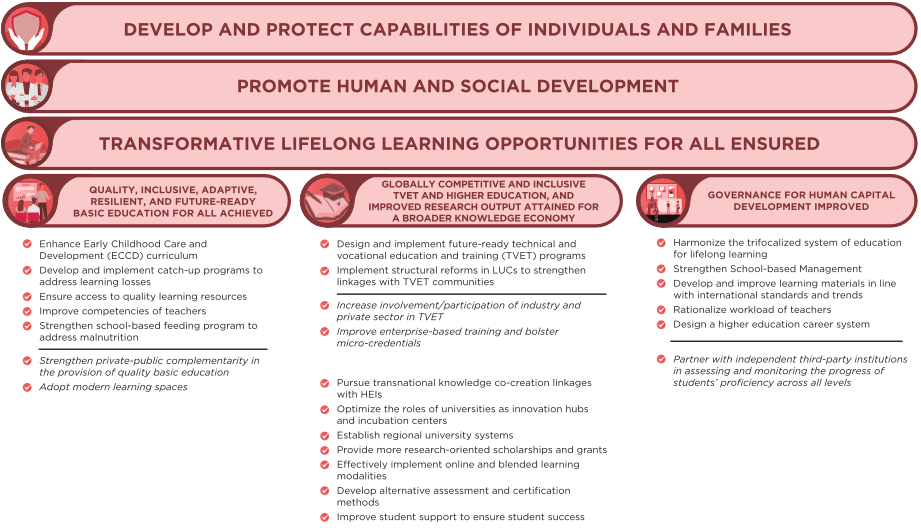
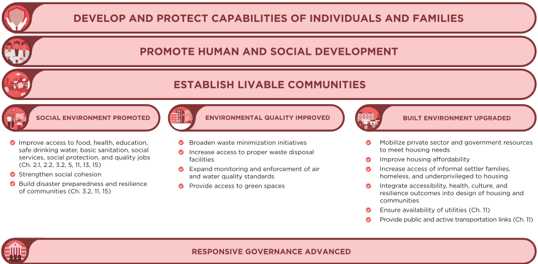

## PART II

Develop and Protect Capabilities of Individuals and Families

## Promote Human and Social Development

## PROMOTE HUMAN AND SOCIAL DEVELOPMENT

By 2028, Filipinos are envisioned to have long and healthy lives in livable communities with enough opportunities for high-quality lifelong learning for them to become healthy, smart, and innovative people. These communities should support the overall well-being of Filipinos by guiding them to make healthy choices and ensuring access to health services. Transformative lifelong learning opportunities are also instrumental in developing the capabilities of Filipino families and leading them to achieve their full potential. Finally, these efforts are enabled by an upgraded plan for human settlements that provide equitable, inclusive, and resilient environments and promote economic vitality. This chapter lays down the lessons learned from previous efforts in human and social development as well as key transformational strategies that boost the health and well-being of Filipinos, improve education and lifelong learning, and establish livable communities.

This chapter presents the challenges facing the health sector and the outcomes to be pursued to address these challenges during the Plan period. It consists of three subchapters with the following outcomes. In subchapter 2.1: (a) social determinants of health improved; (b) healthy choices and behavior enabled; (c) access, quality, and efficiency of health care improved; and (d) health systems strengthened. In subchapter 2.2: (a) quality, inclusive, adaptive, resilient, and future-ready basic education for all achieved; (b) globally competitive and inclusive technical and vocational education and training and higher education, and improved research output attained for a broader knowledge economy; and (c) governance for human capital development improved. In subchapter 2.3: (a) social environment promoted; (b) environmental quality improved; (c) built environment upgraded; and (d) responsive governance advanced.

## Subchapter 2.1 Boost Health

Ensuring that Filipinos are healthy is fundamental to the transformational goals of AmBisyon Natin 2040 and the current administration's socioeconomic agenda. By 2028, Filipinos throughout the country will enjoy longer and healthier lives, because they live, work, and learn in communities, workplaces, and schools that better support their well-being; they are guided to make healthy choices; and they are assured access, with financial protection, to quality health services when needed.

## Assessment and Challenges

While gains were made in several key health outcomes pre-pandemic, overall progress was mixed. Pandemic-related disruptions to service delivery and demand created additional backlogs, which further challenged health system capacities. Estimates on average life expectancy at birth increased in 2015 to 2020 relative to 2010 to 2015, but these still fell below target.

Mortality rates among neonates, infants, and children under five remained virtually unchanged between 2017 and 2022. The maternal mortality ratio increased to 144 per 100,000 live births (LB) in 2020 from 108 in 2018, 1 in part likely due to pandemic-related obstacles to accessing prenatal care and facility-based deliveries. 2 Although the prevalence of modern family planning (MFP)

use among women of reproductive age slightly decreased by 0.6 percentage points (ppt) between 2017 and 2022, the fertility rate decreased from 2.7 children per woman in 2017 to 1.9 in 2022. Moreover, LB among adolescent mothers aged 15-19 years old also decreased from 47 per 1,000 women in 2017 to 25 in 2022.

Slow progress was seen in childhood nutrition outcomes, with potentially lifelong health, education, and, ultimately, economic effects. From 2015 to 2021, the prevalence of stunting among children under five years old decreased from 33.4 to 26.7 percent and wasting from 7.1 to 5.5 percent while overweight remained at 3.9 percent. However, the rate of decline in stunting prevalence has been relatively slow compared to other countries with similar levels of income. 3

Childhood immunization coverage has remained under target. Although the proportion of fully immunized children (with basic antigens) increased by two ppt in 2022 compared to the 2017 baseline of 70 percent, it still did not meet the 95 percent target. This led to inadequate protection from vaccine-preventable diseases and their consequences for millions of children. 4 Basic vaccination coverage is worse among low-income households than middle- to high-income households. This is likely due to a combination of low demand and obstacles to supply, despite basic vaccination being required for conditional cash transfers. 5 Parental hesitancy has also been cited as a factor. 6 Since 2020, the diversion of human and other resources toward higher-priority coronavirus disease (COVID-19) vaccination programs hampered the immunization of children.

The triple burden of diseasecommunicable diseases, noncommunicable diseases (NCD), and globalization-related health conditions like pandemicscontinue to be a priority public health concern. NCDs related to unhealthy lifestyles and environments and an increasingly ageing population are currently the leading cause of mortality among Filipino adults-and the burden is increasing. 7 Communicable diseases also remain a challenge. Active case-finding and mandatory notification contributed to a rise in recorded incidence of tuberculosis (TB) from 2016 to 2020, but this may also have been due to a true increase in cases. 8, 9

Conditions directly related to urbanization, globalization, and the environment are also growing in importance, with disproportionate vulnerability among poor households and marginalized communities. Even with the passage of the Mental Health Act (Republic Act 11036), which mandates the provision of mental health services, only 1.4 percent of the Current Health Expenditure (CHE) in 2021 went to mental and behavioral disorders, and neurological conditions. Thus, access to public mental health services remains limited for vulnerable households. 10 Health risks from poor air quality and congested living conditions are increasing, especially in urbanized areas. 11 Incremental increases in temperature and changing rainfall regimes impact health directly and affect livelihood, further exacerbating poverty-driven health impacts. 12

Major health sector reforms and plans intended to improve financial protection and access to healthcare services are being pursued, but significant obstacles to implementation remain. Since 2017, several laws and plans have been passed, such as: the Universal Health Care (UHC) Law (RA 11223), Mental Health Act (RA 11036), National Integrated Cancer Control Law (RA 11215), First 1,000 Days Law (RA 11148), New Sin Tax Reform Law of 2020 (RA 11467), Mandatory Reporting of Notifiable Diseases and Health Events of Public Health Concern Act (RA 11332), the Philippine Health Facilities Development Plan (PHFDP 2020-2040), and the National Human Resources for Health Master Plan (NHRHMP 2020-2040).

The effectiveness of these reforms is limited by fragmented health systems that hamper coordinated planning and services, inequitable access to quality primary- and higher-level health care services, and a lack of sustained financing for local health interventions. 13 Moreover, high variations in local government unit (LGU) investments and actions for health persist, with damaging effects on already-vulnerable communities and populations. 14

There are sustained and growing gaps in absolute number and inequitable distribution of health infrastructure and human resources for health. 15 The shortfall impedes progress in implementing No Co-payment policies in both private and government hospitals, prevents delivery systems from adjusting quickly to surges in health demand, and further compromises health outcomes in already-vulnerable communities. Factors affecting the maldistribution of health workers include disparities in pay between private and public sectors, within the public sector, and between national and local levels; limited capacity of LGUs to hire health and nutrition workers; and poor working conditions. 16

Gains from previously enacted health system reforms in health care financing and service delivery are not yet maximized. For example, while the Sin Tax Law increased revenues available for public health programs, 17,18 the large health benefits gained from decreased consumption of harmful products 19 are more significant. Conditional cash transfers continue to be a viable mechanism for leveraging health promotion, promoting preventive behaviors, and accessing primary healthcare among poor households. 20

Addressing implementation delays in UHC financing and catching up on programs of other reforms will be crucial to reach health sector targets (See Box 2.1). In 2021, total health spending reached its highest ever share of gross domestic product (GDP) and out-ofpocket (OOP) payments spending dropped to its lowest. However, OOP share in CHE remained high at 41.5 percent.

Although government and compulsory contributory health care financing schemes were the largest source of health financing in the country, the contribution of social health insurance to CHE in 2021 was only 13.6 percent, lower than its share of 17.2 percent in 2017. CHE for preventive care increased from 9.2 percent in 2017 to 14.9 percent in 2021, but curative care still accounts for the highest share of CHE at 46.3 percent in 2021. Moreover, families in the two poorest income quintiles still accounted for 30.5 percent of CHE.

Finally, despite the urgent need for support for health information systems and innovation, only 1.3 percent of health capital formation expenditure in 2021 went into information and communications technology equipment, intellectual property products, and computer software and databases.

## Box 2.1. COVID-19 in the Philippines: Impacts and Health Sector Challenges

Since the first confirmed COVID-19 case on January 31, 2020, the country has recorded over 4 million cases. COVID-19 was reported as the third leading cause of mortality in 2021. As of November 1, 2022, a total of 73.55 million Filipinos have been fully vaccinated against COVID-19, with 20.6 million Filipinos covered with an additional dose.

Beyond its health effects, the pandemic also had major economic impacts, including increased spending for health as evidenced in the 2021 Philippine National Health Accounts; reduced economic activities; and increased national debt. At the health system level, redirected investments and efforts to address the COVID-19 pandemic delayed the implementation of key UHC reforms and accumulated backlogs in healthcare service delivery that will require additional resources to catch-up.

Post-pandemic, the health sector needs to simultaneously address three critical challenges: (a) managing the endemic phase of COVID-19; (b) catching up with backlog and recovery from long-term COVID-19 health and system effects; and (c) ensuring resilience to future threats from emerging and re-emerging infectious diseases.

## References:

DOH. (2022). COVID-19 Case Tracker. https://doh.gov.ph/covid19tracker

DOH. (2022). COVID-19 Vaccination Dashboard. https://doh.gov.ph/vaccines

Panelo, C. (2022): "Investing in UHC post-pandemic" Presented at PHCON 2022, annual conference of the Philippine Society for Public Health Physicians. 30 September 2022

UNFPA. (2020). https://philippines.unfpa.org/en/news/significant-rise-maternal-deaths-and-unintended-pregnancies-feared-because-covid-19-unfpa-and

## Strategy Framework

While health care services are essential to health, it is a relatively weak determinant. Socioeconomic factors, the physical environment, and health-related behaviors account for 80 to 90 percent of modifiable contributors to population health outcomes. 21,22 The social determinants of health can be addressed through collaborative whole-of-government and whole-of-society interventions that promote healthy schools, communities, and workplaces, and enable healthy lifestyles through improved health literacy and health-seeking behavior. Addressing persistent and growing gaps in the access to and quality of healthcare services, ensuring that health care is equitably distributed, and improving financial risk protection, especially for disadvantaged populations, are needed to improve the remaining health care-related contributors to health outcomes.

The strategy framework (See Figure 2.1) is built on the vision of a holistic approach to improve health outcomes, reduce health inequities where they exist, and achieve UHC. The crucial contribution of non-health government agencies and non-government health system stakeholders to attain societal health objectives is also highlighted. The first pillar describes a society that promotes physical, mental, and social well-being for all Filipinos, especially those living in vulnerable households and communities. The second pillar focuses on empowering individuals and households to make appropriate choices regarding their own health and seeking care when needed. The third pillar describes the health care delivery system, both public and private, that Filipinos should be able to access. The last pillar emphasizes crucial capacitating measures for the health system that need to be bolstered to support the other outcomes.

Figure 2.1 Strategy Framework to Boost Health

## Strategies

## Outcome 1: Social determinants of health improved

Ensure communities, workplaces, and schools support physical, mental, and social well-being for all

The social determinants of health refer to "non-medical factors that influence health outcomes." 23 Settings that promote well-being and make health-promoting opportunities and alternatives available to households require collaborative and coordinated action between national and local governments, as well as government and private entities.

Strategies include enabling active transport environments, livable communities, and efficient transportation; promoting safe and conducive working and learning spaces for all Filipinos; and ensuring access to safe drinking water, basic sanitation, and nutritious food choices (See Subchapters 2.2 and 2.3 and Chapters 3 and 12).

## Foster a whole-of-government, whole-of-society approach to health

Some of the key non-health drivers of health outcomes such as attainment of gender equality, and improvement in education and household income will need strong, sustained, multisectoral, and multistakeholder action. Multisectoral and multistakeholder approaches are also needed to intensify health promotion activities. Within the government, inter-agency collaboration will also be strengthened, such as but not limited to healthy public policies; healthy communities with the Department of the Interior and Local Government (DILG) on nutrition and physical activity, and environmental health; healthy schools with education agencies on comprehensive sexuality education, mental health, and healthy lifestyle; Nutriskwela Community Radio Network Program with the National Nutrition Council (NNC); and healthy workplaces with the Department of Labor and Employment and Civil Service Commission on nutrition and physical activity, and mental health.

## Outcome 2: Healthy choices and behavior enabled

## Increase health literacy

Health literacy describes the ability to access, appraise, and correctly apply health information. It is key to patient empowerment, healthy behaviors, and appropriate self-care. Well-designated, targeted, gender- and culture-sensitive social and behavior change communication campaigns using multiple communication media will continuously be implemented to encourage individuals and households to live healthily and make good choices for health. Existing platforms, such as but not limited to the Pantawid Pamilyang Pilipino Program's Family Development Sessions, will be maximized for health promotion and advocacy among poorer households. Market-segmented and innovative demandgeneration strategies will be pursued for primary services like immunization, MFP, and maternal health.

## Promote appropriate health-seeking behavior

Households and individuals will be empowered with the knowledge and resources to recognize when medical care is necessary, and to seek care at the appropriate levels when needed. National patient navigation and referral systems will ensure a continuum of appropriate and coordinated care from primary to tertiary and across geopolitical networks. Facilitating the registration of Filipinos to public or private primary care providers of their choice can promote the efficient use of health services and reduce wastage at other levels of care.

## Outcome 3: Access, quality, and efficiency of health care improved

## Secure sustainable and equitably distributed health infrastructure and human resources

The PHFDP 2020-2040 and NHRHMP 2020-2040 contain several strategies that will be implemented to address the large and growing gap in these crucial inputs to health care services. Increasing the number, improving the distribution, and assuring the quality of hospitals, including establishing regional specialty centers, are ongoing priorities. Infrastructure investments will also be prioritized to improve primary health and community facilities, supplies and equipment, and information technology systems (See Chapter 12). This also includes national and local support to enhancing technical service capabilities of primary health care (PHC) and community workers for increased responsiveness to local health needs.

The NHRHMP, the Magna Carta for Public Health Workers (RA 7305), Nursing Practice Act (RA 9173), and Barangay Health Workers and Benefits Act (RA 7883) all emphasize that improving the number and distribution of human resources for health (HRH) is highly dependent on improving the welfare of the HRH workforce-including nutrition and community health workers. This is done by providing standardized and competitive compensation, protection, benefits, and incentives and ensuring gender equality in the health workforce. Needs-based HRH forecasting and production approaches will be applied, in cooperation with the Commission on Higher Education (CHED), the Professional Regulation Commission, and health professional organizations. Partner institutions for clinical rotations and expanded scholarships and training fellowships with return service agreements will also help increase HRH supply.

## Promote strategic purchasing for quality, efficiency, and cost-effectiveness

Strategic purchasing refers to an evidence-based process of linking payments from pooled health funds to information on provider performance and population health needs. 24 This includes adopting provider payment arrangements that incentivize patient-centered PHC and create incentives for improving quality and efficiency in health service delivery. Timely, rigorous, and transparent health technology assessment processes will also be ensured and supported for the adoption of cost-effective technologies.

## Ensure financial risk protection

Filipinos who require health care services and technology must not experience financial hardship when accessing care. Securing predictable, sustainable, and equitably financed funding for UHC reforms is critical. Pooling public funds for health can streamline financing for the delivery of population- and individual-based health services. Shifting a portion of OOP to pooled health financing schemes that include both social and private health insurance and government funds can maximize the redistributive capacity of pooled health funds. In parallel, awareness of social health insurance benefits and membership obligations will be enhanced, along with the adoption of transparent and fixed co-payment and co-insurance policies.

## Harness complementary private sector partnerships for health care access and delivery

The COVID-19 pandemic highlighted the complementary strengths and innovations in the private sector. These will be harnessed to address gaps in public service and health technology delivery systems. A framework and guide that allow and encourage private entities to contribute to the implementation of national and local health programs will be established.

## Establish integrated, innovative, and quality health care delivery systems

Effective managerial, informational, and financial integration of private and public service delivery systems across national and local boundaries can maximize economies of scale, enable more comprehensive planning, and promote efficient health spending. At the most fundamental level, this means ensuring the accessibility of gender- and culture-sensitive PHC services across the life stages and different levels of care, providing integrated packages of health, nutrition, immunization, family planning (FP), tuberculosis (TB), human immunodeficiency virus (HIV)/ acquired immunodeficiency syndrome (AIDS), and adolescent health services, among others. Delivery systems will also ensure availability, accessibility, and affordability of safe, efficacious, and quality essential medicines and other needed health technologies.

Moreover, access interventions will prioritize geographically isolated and disadvantaged areas, marginalized populations, and indigenous peoples communities. Multisectoral partnerships with resolved payment mechanisms will be pursued to deliver telemedicine, capability support for community health care workers, remote health care services, and other innovations for health. Emergency medical services including paramedic, ambulance, and other patient transport services are also crucial to reaching more underserved and unserved areas with timely health care.

## Outcome 4: Health systems strengthened

## Increase national and local government investments for health

The PHC system is crucial to the implementation of the UHC. Significant investments are necessary to ensure sustainable human and material resources for PHC. As the potential resource base of LGU allotment has increased given the Mandanas-Garcia Ruling, safeguards will be established to ensure continuous and sustained LGU investments for health. Shifting to matching grants, performance-based grants, and similar incentive schemes will help steer spending for health and improve LGU capacity to deliver both population and individual-based health services, as well as increase accountability to local health systems.

Implementation of the Special Health Fund to pool resources for health at the province or city level will enable both the national and local governments to maximize economies of scale and pursue more strategic planning, allocation, and management of local resources. Increases in health investments will also be matched with investments in HRH. To allow LGUs to hire more local health personnel, the Personnel Services cap in the Local Government Code will be adjusted. At the national level, sustainable financing arrangements in support of UHC will be pursued and both available and emerging financing opportunities will be maximized.

Enhance national and local capacity for health system leadership, management, anticipatory governance, and resilience to public health emergencies

This includes strengthening technical and policy expertise, and increasing public financial management capabilities, including in Philippine Health Insurance Corporation (PhilHealth) and other national agencies critical to UHC implementation. Resilience to public health emergencies will be increased by enhancing LGU capacity and capability for basic epidemiology, disease surveillance, and event-based surveillance. Health system structures that contribute to the ability to respond quickly to diseases of public health concern, such as the Center for Disease Control and Prevention (CDC) and the Philippine Public Health Laboratory System, will be established and strengthened.

## Advance responsive regulatory environments for addressing emerging developments and disruptions

Specific strategies include facilitating regulatory pathways and adopting sandbox approaches to regulation, especially for emerging developments, emergency medicines, technologies, business models, and innovations. Regulatory sandboxes and partnerships between publicly funded health care providers and private small and medium enterprises (SME) and startups make it easier to innovate and test new technologies and health delivery models for equity (See Chapter 8). Responsiveness can also be encouraged by institutionalizing periodic horizon scanning for new developments, to draw out their policy and long-run ethical implications among health system stakeholders. Risk-based regulation is particularly important for actions addressing health consequences of climate change.

## Accelerate interoperable health information systems

Well-designed health information systems (HIS) and institutionalized application of health care analytics enable health sector governance by allowing evidence-informed clinical and policy decision-making, increasing responsiveness, promoting transparency and accountability, multiplying productivity, and decreasing operational wastage. An enabling environment for sector-wide application of digital technologies for health will be fostered through implementation of the components of the Philippine eHealth Strategic Framework and Plan. Multisectoral engagements will be maximized for investments in physical technology and software platforms, services, and applications to support health information exchange. Other priority areas include improving the National Health Insurance Program information systems, to manage enrollment, collection, and claims processing, and streamlining licensing and permit processes with the Department of Health (DOH), PhilHealth, Food and Drug Administration, and other government institutions, to address some barriers to health facility and technology access.

## Strengthen health research for evidence-informed policymaking and self-sufficiency in health technology

Robust health research ensures the best available evidence to guide and inform policymakers in the selection of possible strategies to achieve health system goals.

It can also lead to self-sufficiency in health technology by ensuring that health investments are prioritized for highvalue innovations-including traditional, complementary, and alternative health care products and services-that improve the quality of life of Filipinos. As such, promoting institutionalization of decision-making based on health research, development, and innovation (RDI) will be a priority. Increased, dedicated, and conditioned funding will focus on health RDI that: (a) translate basic health research into practical aspects; (b) promote low-cost and climate-resilient innovations for remote populations and vulnerable sectors based on projected health needs and service delivery gaps in the medium term; and (c) improve capacity for high quality local vaccine and medicine development and production (See Chapter 8).

## Legislative Agenda

Table 2.1.1 presents the priority legislative agenda that will complement and support the strategies to further improve and boost health outcomes.

Table 2.1.1 Legislative Agenda to Boost Health

| LEGISLATIVE AGENDA                                                         | RATIONALE/KEY FEATURES                                                                                                                                                                                                                                                                                                                                                                                                                                                                                                                                                                               | RESPONSIBLE AGENCY                                                                                        |
|----------------------------------------------------------------------------|------------------------------------------------------------------------------------------------------------------------------------------------------------------------------------------------------------------------------------------------------------------------------------------------------------------------------------------------------------------------------------------------------------------------------------------------------------------------------------------------------------------------------------------------------------------------------------------------------|-----------------------------------------------------------------------------------------------------------|
| Trans Fat Elimination                                                      | The proposed measure will ban all forms of industrial trans fatty acids; prohibit the sale, manufacture, importation, and distribution of partially hydrogenated oils and oil and fats with high trans-fat acid content.                                                                                                                                                                                                                                                                                                                                                                             | Department of Health (DOH), Food and Drug Administration, and Department of Science and Technology (DOST) |
| Establishment of a Medical Reserve Corps (MRC)                             | The MRC will include licensed physicians, medical degree holders, students who have completed four years of a medical course, registered nurses, and licensed allied health professionals who may be called upon to assist the national government, its agencies and instrumentalities, and the LGUs in addressing the medical needs of the public. The President will have the authority to order the nationwide mobilization of the MRC to complement the Armed Forces of the Philippines Medical Corps in case of declaration of a state of war, state of lawless violence, or state of calamity. | DOH                                                                                                       |
| Establishment of Specialty Centers                                         | This bill seeks to establish specialty centers that will provide and improve access to specialized health care services.                                                                                                                                                                                                                                                                                                                                                                                                                                                                             | DOH                                                                                                       |
| Creation of the Philippine Center for Disease Control and Prevention (CDC) | The following are the key features of the proposed measure: (a) creation of the CDC under the DOH for policy and program coordination; (b) ensuring the health system is well prepared to forecast, prevent, monitor, and control diseases, injuries, and disabilities both of national and international concern; (c) recentralization of local epidemiology and surveillance units; (d) strengthening epidemiology, public health surveillance, and research capacities; and (d) ensuring investments to better equip the country in response to public health emergencies.                        | DOH                                                                                                       |
| Creation of the Virology and Vaccine Institute of the Philippines          | This Institute will be an attached agency of the Department of Science and Technology and will serve as the country's principal virology laboratory, providing investigations, research, and technical coordination of the entire network of virology laboratories across the country (See Chapter 8).                                                                                                                                                                                                                                                                                               | DOST                                                                                                      |

## Results Matrix

Table 2.1.2 presents the indicators and targets to achieve results for boosting health.

Table 2.1.2 Results Matrix: Boost Health

| INDICATOR                                                                                                                                                                                | BASELINE (YEAR)                                  | ANNUAL TARGETS - 2023                            | ANNUAL TARGETS - 2024                            | ANNUAL TARGETS - 2025                            | ANNUAL TARGETS - 2026                            | ANNUAL TARGETS - 2027                            | ANNUAL TARGETS - 2028                            | MEANS OF VERIFICATION                                              | RESPONSIBLE AGENCY/ INTER-AGENCY BODY                                                                                   |
|------------------------------------------------------------------------------------------------------------------------------------------------------------------------------------------|--------------------------------------------------|--------------------------------------------------|--------------------------------------------------|--------------------------------------------------|--------------------------------------------------|--------------------------------------------------|--------------------------------------------------|--------------------------------------------------------------------|-------------------------------------------------------------------------------------------------------------------------|
| Subchapter 2.1: Boost Health (Impact Indicators)                                                                                                                                         | Subchapter 2.1: Boost Health (Impact Indicators) | Subchapter 2.1: Boost Health (Impact Indicators) | Subchapter 2.1: Boost Health (Impact Indicators) | Subchapter 2.1: Boost Health (Impact Indicators) | Subchapter 2.1: Boost Health (Impact Indicators) | Subchapter 2.1: Boost Health (Impact Indicators) | Subchapter 2.1: Boost Health (Impact Indicators) | Subchapter 2.1: Boost Health (Impact Indicators)                   | Subchapter 2.1: Boost Health (Impact Indicators)                                                                        |
| Average life expectancy increased (years)                                                                                                                                                | Average life expectancy increased (years)        | Average life expectancy increased (years)        | Average life expectancy increased (years)        | Average life expectancy increased (years)        | Average life expectancy increased (years)        | Average life expectancy increased (years)        | Average life expectancy increased (years)        | Population Projections and Civil Registration and Vital Statistics | Department of Health (DOH)                                                                                              |
| Male                                                                                                                                                                                     | 69.63 (2020)                                     |                                                  |                                                  |                                                  |                                                  |                                                  | 71.14                                            | Population Projections and Civil Registration and Vital Statistics | Department of Health (DOH)                                                                                              |
| Female                                                                                                                                                                                   | 75.91 (2020)                                     |                                                  |                                                  |                                                  |                                                  |                                                  | 77.42                                            | (CRVS)                                                             | Department of Health (DOH)                                                                                              |
| Maternal mortality ratio decreased (per 100,000 live births)                                                                                                                             | 144 (2020)                                       | 87                                               | 84                                               | 81                                               | 78                                               | 76                                               | 74                                               | Philippine Statistics Authority Estimates                          | DOH                                                                                                                     |
| Neonatal mortality rate decreased (per 1,000 live births)                                                                                                                                | 15 (2022)                                        | 10.54                                            | 9.96                                             | 9.38                                             | 8.81                                             | 8.23                                             | 7.65                                             | National Demographic and Health Survey (NDHS)                      | DOH                                                                                                                     |
| Infant mortality rate decreased (per 1,000 live births)                                                                                                                                  | 22 (2022)                                        | 15.83                                            | 14.97                                            | 14.11                                            | 13.25                                            | 12.38                                            | 11.52                                            | NDHS                                                               | DOH                                                                                                                     |
| Under-5 mortality rate decreased (per 1,000 live births)                                                                                                                                 | 26 (2022)                                        | 24.09                                            | 23.61                                            | 23.12                                            | 22.64                                            | 22.15                                            | 21.67                                            | NDHS                                                               | DOH                                                                                                                     |
| Premature mortality rate attributed to cardiovascular disease, cancer, diabetes, and chronic respiratory diseases decreased (number of deaths per 1,000 population aged 30-70 years old) | 4.6 (2020)                                       | 3.22                                             | 2.76                                             | 2.30                                             | 1.84                                             | 1.38                                             | 0.92                                             | CRVS                                                               | DOH                                                                                                                     |
| Death rate due to road traffic accidents decreased (per 100,000 population)                                                                                                              | 8.0 (2020)                                       | 5.63                                             | 4.84                                             | 4.05                                             | 3.26                                             | 2.47                                             | 1.68                                             | CRVS                                                               | Department of Transportation, Metropolitan Manila Development Authority, Department of Public Works and Highways (DPWH) |
| Tuberculosis (TB) incidence decreased (per 100,000 population)                                                                                                                           | 650 (2021)                                       | Decreasing                                       | Decreasing                                       | Decreasing                                       | Decreasing                                       | Decreasing                                       | Decreasing                                       | World Health Organization Global TB Report                         | DOH                                                                                                                     |

| INDICATOR                                                                                                                                                            | BASELINE - (YEAR)                                 | ANNUAL TARGETS - 2023                             | ANNUAL TARGETS - 2024                             | ANNUAL TARGETS - 2025                             | ANNUAL TARGETS - 2026                             | ANNUAL TARGETS - 2027                             | ANNUAL TARGETS - 2028                             | MEANS OF - VERIFICATION                           | RESPONSIBLE AGENCY/ INTER-AGENCY - BODY                                                                                            |
|----------------------------------------------------------------------------------------------------------------------------------------------------------------------|---------------------------------------------------|---------------------------------------------------|---------------------------------------------------|---------------------------------------------------|---------------------------------------------------|---------------------------------------------------|---------------------------------------------------|---------------------------------------------------|------------------------------------------------------------------------------------------------------------------------------------|
| Outcome 1: Social determinants of health improved                                                                                                                    | Outcome 1: Social determinants of health improved | Outcome 1: Social determinants of health improved | Outcome 1: Social determinants of health improved | Outcome 1: Social determinants of health improved | Outcome 1: Social determinants of health improved | Outcome 1: Social determinants of health improved | Outcome 1: Social determinants of health improved | Outcome 1: Social determinants of health improved | Outcome 1: Social determinants of health improved                                                                                  |
| Safe water supply coverage increased (% families) a                                                                                                                  | 91.60 (2020)                                      | 93.28                                             | 94.12                                             | 94.96                                             | 95.80                                             | 96.64                                             | 97.48                                             | Annual Poverty Indicator Survey (APIS)            | Metropolitan Waterworks and Sewerage System (MWSS), Water Districts (WDs), Rural Water Systems (WS), Water Service Providers (WSP) |
| Access to basic sanitation increased (% families) b                                                                                                                  | 93.90 (2020)                                      | 95.12                                             | 95.73                                             | 96.34                                             | 96.95                                             | 97.56                                             | 98.17                                             | APIS                                              | MWSS, WDs, Rural WS, WSP                                                                                                           |
| Percentage of targeted communities, schools, and workplaces recognized as Healthy Settings increased (%)                                                             | 0 (2022)                                          | 10                                                | 20                                                | 30                                                | 40                                                | 50                                                | 60                                                | DOH Admin Data                                    | DOH                                                                                                                                |
| Percentage of women (aged 18-49 years old) completing Grade 12 or higher increased (%)                                                                               | 48.5 (2022)                                       | Increasing                                        | Increasing                                        | Increasing                                        | Increasing                                        | Increasing                                        | Increasing                                        | NDHS                                              | Department of Education, Commission on Higher Education, Technical Education and Skills Development Authority                      |
| Prevalence of stunting among children under 5 years of age decreased (%) c                                                                                           | 26.7 (2021)                                       | 25.2                                              | 23.8                                              | 22.3                                              | 20.8                                              | 19.4                                              | 17.9                                              | Expanded National Nutrition Survey                | National Nutrition Council                                                                                                         |
| Poverty incidence decreased (%) d                                                                                                                                    | 18.1 (2021)                                       | 16.0-16.4                                         |                                                   | 12.9-13.2                                         |                                                   | 10.0-10.3                                         | 8.8-9.0                                           | Family Income and Expenditure Survey (FIES)       |                                                                                                                                    |
| Outcome 2: Healthy choices and behavior enabled                                                                                                                      | Outcome 2: Healthy choices and behavior enabled   | Outcome 2: Healthy choices and behavior enabled   | Outcome 2: Healthy choices and behavior enabled   | Outcome 2: Healthy choices and behavior enabled   | Outcome 2: Healthy choices and behavior enabled   | Outcome 2: Healthy choices and behavior enabled   | Outcome 2: Healthy choices and behavior enabled   | Outcome 2: Healthy choices and behavior enabled   | Outcome 2: Healthy choices and behavior enabled                                                                                    |
| Percentage of Filipinos with functional health literacy increased (%)                                                                                                | 25.02 (2021)                                      | 32                                                | 39                                                | 46                                                | 53                                                | 59                                                | 66                                                | Health Literacy Survey                            | DOH                                                                                                                                |
| Proportion of women aged 15-49 years who make their own informed decisions regarding sexual relations, contraceptive use, and reproductive health care increased (%) | 82.3 (2022)                                       | Increasing                                        | Increasing                                        | Increasing                                        | Increasing                                        | Increasing                                        | Increasing                                        | NDHS                                              | DOH, Commission on Population and Development                                                                                      |

| INDICATOR                                                                                                                                                                 | BASELINE - (YEAR)                                                          | ANNUAL TARGETS - 2023                                                                                                                              | ANNUAL TARGETS - 2024                                                                                                        | ANNUAL TARGETS - 2025                                              | ANNUAL TARGETS - 2026                                              | ANNUAL TARGETS - 2027                                              | ANNUAL TARGETS - 2028                                              | MEANS OF VERIFICATION                                              | RESPONSIBLE AGENCY/ INTER-AGENCY - BODY                            |
|---------------------------------------------------------------------------------------------------------------------------------------------------------------------------|----------------------------------------------------------------------------|----------------------------------------------------------------------------------------------------------------------------------------------------|------------------------------------------------------------------------------------------------------------------------------|--------------------------------------------------------------------|--------------------------------------------------------------------|--------------------------------------------------------------------|--------------------------------------------------------------------|--------------------------------------------------------------------|--------------------------------------------------------------------|
| Outcome 3: Access, quality, and efficiency of health care improved                                                                                                        | Outcome 3: Access, quality, and efficiency of health care improved         | Outcome 3: Access, quality, and efficiency of health care improved                                                                                 | Outcome 3: Access, quality, and efficiency of health care improved                                                           | Outcome 3: Access, quality, and efficiency of health care improved | Outcome 3: Access, quality, and efficiency of health care improved | Outcome 3: Access, quality, and efficiency of health care improved | Outcome 3: Access, quality, and efficiency of health care improved | Outcome 3: Access, quality, and efficiency of health care improved | Outcome 3: Access, quality, and efficiency of health care improved |
| Percent of provinces with adequate bed-to-population ratios increased (%)                                                                                                 | 33.3 (2021)                                                                | 35                                                                                                                                                 | 40                                                                                                                           | 45                                                                 | 50                                                                 | 55                                                                 | 60                                                                 | DOH Admin Data                                                     | DOH                                                                |
| Percent of provinces with adequate primary care facilities increased (%)                                                                                                  | 20.9 (2021)                                                                | 25                                                                                                                                                 | 30                                                                                                                           | 35                                                                 | 40                                                                 | 45                                                                 | 50                                                                 | DOH Admin Data                                                     | DOH                                                                |
| Percentage of identified cities and provinces with adequate HRHe-to-population ratio based on WHO reference ratios to achieve Sustainable Development Goals increased (%) | Medical Doctor (MD): 3 Registered Nurse (RN): 2 Registered Midwife (RM):82 | MD: 3 RN: 2 RM:82                                                                                                                                  | MD: 4 RN: 3 RM:83                                                                                                            | MD: 5 RN: 4 RM:84                                                  | MD: 6 RN: 5 RM:85                                                  | MD: 7 RN: 6 RM:86                                                  | MD: 8 RN: 7 RM:87                                                  | DOH Admin Data                                                     | DOH                                                                |
| Number of UHC Integration Sites that achieved the target number of Key Result Areas for a particular level in the Local Health Systems Maturity Levels                    | 0 (2022)                                                                   | At least 58 UHC- Integration Sites (IS) reached at least 70% of the Level 2 Local Health Systems (LHS) Maturity Level (ML) Key Results Areas (KRA) | At least 58 UHC-IS reached 100% of the Level 2 LHS ML KRA; At least 58 UHC-IS reached at least 70% of the Level 3 LHS ML KRA | At least 58 UHC-IS reached 100% of the Level 3 LHS ML KRA          | TBD*                                                               | TBD*                                                               | TBD*                                                               | DOH Admin Data                                                     | DOH                                                                |
| Household OOP health spending as percentage of CHE decreased (%)                                                                                                          | 41.5 (2021)                                                                | 37.7                                                                                                                                               | 35.8                                                                                                                         | 33.8                                                               | 31.9                                                               | 30.0                                                               | 28.1                                                               | Philippine National Health Accounts                                | DOH, PhilHealth                                                    |
| Outcome 4: Health systems strengthened                                                                                                                                    | Outcome 4: Health systems strengthened                                     | Outcome 4: Health systems strengthened                                                                                                             | Outcome 4: Health systems strengthened                                                                                       | Outcome 4: Health systems strengthened                             | Outcome 4: Health systems strengthened                             | Outcome 4: Health systems strengthened                             | Outcome 4: Health systems strengthened                             | Outcome 4: Health systems strengthened                             | Outcome 4: Health systems strengthened                             |
| Percent of health facilities with paperless electronic medical record (EMR) and regularly submit data increased (%)                                                       | 80% of public facilities only (2019)                                       | 85% of public health facilities                                                                                                                    | 100% of public health facilities                                                                                             | 40% of private health facilities                                   | 60% of private health facilities                                   | 80% of private health facilities                                   | 100% of private health facilities                                  | DOH Admin Data                                                     | DOH, PhilHealth                                                    |
| Percentage of functional regional and local Epidemiology and Surveillance Units increased (%)                                                                             | 41 (2019- 2020)                                                            | 51                                                                                                                                                 | 59                                                                                                                           | 67                                                                 | 75                                                                 | 83                                                                 | 100                                                                | DOH Admin Data                                                     | DOH                                                                |

Note: The targets will be based on the Executive Order on Integration, which will be issued by the President following the evaluation study on the overall benefits of the local health system integration by Joint Congressional Oversight Committee on UHC.

a,b/ See Chapter 12: Safe water supply sources include piped water, boreholes or tube wells, protected dug wells, protected springs, rainwater, and packaged or delivered water. This indicator covers the use of improved sanitation facilities such as flush or pour flush to piped sewer systems, septic tanks, or pit latrines; and ventilated improved pit latrines, composting toilets or pit latrines with slabs, shared or not shared with other households.

c/ See Chapter 3.

d/ Headline indicator.

## Subchapter 2.2 Improve Education and Lifelong Learning

Filipinos are also envisioned to be smart and innovative with learning poverty substantially addressed. Filipino learners have access to high-quality lifelong learning opportunities that develop adequate competencies and character qualities which will allow them to thrive in society and the world of work. Transformative lifelong learning opportunities will be instrumental in developing and protecting the capabilities of families to ensure that all Filipinos are able to realize their full potential to keep pace with the envisioned socioeconomic transformation.

## Assessment and Challenges

The Philippine education system is in urgent need of transformation. This has been the assessment of many studies on education over the past decades. In 1991, the Education Commission pointed out the looming crisis in the overall quality of education in the country. In 2022, over three decades later, a second Education Commission will be convened to address the education crisis. Education infrastructure continues to grapple with inadequacies in education perennials-classrooms, teachers, textbooks, facilities, and modern equipment-especially among marginalized communities.

Education policies have undermined better-performing private schools, as seen in the declining share in private school enrollment. 25 At the height of the pandemic, some private schools had to close due to low enrollment spurred by household income losses, and the exodus of private school teachers transferring to public schools. During school year (SY) 2020-2021, at the height of the pandemic, 656,712 learners transferred from private to public schools, which led to subsequent congestion in public schools. Meanwhile, in higher education, there is lack of complementarity where state universities and colleges (SUC), local universities and colleges (LUC), and private higher education institutions (HEI) offer the same degree programs. 26 Teacher education needs improvement, given the consistently low passing rate in the licensure examination for teachers (LET). These deep-seated challenges have severely affected the learning conditions of students over the past generations. The pandemic brought to the fore the issues that have been piling up through decades of incapacity and suboptimal investment in education (only 3.9% of GDP in 2020). 27

The results are alarming as the World Bank estimates learning poverty rate in the Philippines at 90.9 percent. 28 This means that nine out of ten 10-year-old Filipino children are unable to read and understand a simple text. There are also students who remain non-readers even in high school. 29 The proportion of learners achieving at least "Proficient" level in the 2018 National Achievement Test at the third and sixth grade is at 6.39 percent and 12.63 percent, respectively. The country's performance in international large-scale assessments (i.e., Programme for International Student Assessment [PISA] and Trends in International Mathematics and Science Study [TIMSS]) revealed serious challenges in the sector, as the Philippines ranks the lowest overall among all countries assessed. 30 Inequalities persist at the secondary education level. At the tertiary level, only 42 percent of the 451,962 who applied for professional licenses in 2019 passed their respective licensure examinations. The number of examinees also went down to 120,768 in 2021 with a 48 percent passing rate. This brings into question the country's capacity to meet the industry demand for

## Strategy Framework

Toward the ultimate goal of ensuring transformative lifelong learning for all, several areas must be addressed not only by quality human resources. The University of the Philippines, the national university, has fallen to the 801st to 1,000th ranking in the 2023 World University Rankings. 31 It is one of only three Philippine universities ranked within the top 1,500 in the world from a total of 1,975 HEIs in the country. 32

The time to transform the education system is now or the country risks missing out on the demographic dividend. This has become even more urgent with the learning losses brought about by the COVID-19 pandemic that are expected to result in lost productivity over the next decades if urgent action is not taken.

the government, but more importantly, with the support of the private sector and other stakeholders.

Figure 2.2 Strategy Framework to Improve Education and Lifelong Learning

## Strategies

## Outcome 1: Quality, inclusive, adaptive, resilient, and future-ready basic education for all achieved

## Enhance early childhood care and development curriculum

Early childhood care and development (ECCD) programs will be enriched by recalibrating the curriculum for preschool, focusing on the first 1,000 days of life. Partnerships between the ECCD Council and the National Nutrition Council will be institutionalized for the full implementation of Kalusugan at Nutrisyon ng Mag-Nanay Act (RA 11148). Barangay day care centers will be established in every barangay 33 to provide a conducive learning environment for preschoolers. Capacity building will be provided for day care workers and preschool teachers. Development of socioemotional skills and acquisition of healthy habits, such as good personal hygiene and eating nutritious food, will be emphasized to improve the resistance of learners to sickness and diseases.

## Develop and implement catch-up programs to address learning losses

Catch-up programs will be promoted to reduce, if not reverse, the negative effects on educational outcomes of prolonged distance learning during the COVID-19 pandemic. Access to Alternative Learning System will be expanded by establishing additional community learning centers in municipalities and cities. The role of guidance counselors in encouraging the students to stay in school will be enhanced.

## Ensure access to quality learning resources

The Department of Education (DepEd) and LGUs will ensure that all public school students have a full set of textbooks for their grade level and all teachers receive a full set of manuals. The National Education Portal (NEP) will be developed as the online repository for all quality-assessed learning materials for teachers and learners available for dissemination. Inclusive and interactive e-books with embedded videos, audio, and even sign language translations to attend to the needs of differently-abled children will be made available in the NEP. To respond better to class disruptions during emergency situations, self-learning modules shall be made available in print and digital form, in addition to the textbooks provided to schools. As a policy, the delivery of blended learning, utilizing both printed and digital resources will be promoted. The Special Education Fund will also be utilized to provide such learning resources.

## Improve competencies of teachers

Training on the adoption of open educational resources, gamification of learning, and other new pedagogical practices will be implemented to enhance the competencies of teachers. Pre- and in-service training of teachers will be revisited to ensure that capacity-building programs are up-to-date, agile, and responsive to emerging skills and other needs. The Excellence in Teacher Education Act (RA 11713) will be fully implemented. This law strengthens the Teacher Education Council, establishes scholarship for students in the teacher education program, and institutionalizes the National Educators' Academy of the Philippines as provider of quality professional development programs for in-service teachers, school leaders, and other teachingrelated personnel in all public and private basic education institutions.

## Strengthen the school-based feeding program to address malnutrition

Malnutrition-related cognitive impairments 34 will be reduced by promoting a regular diet of sufficient quantities and varieties of nutrient-dense food among children. With support from the LGUs, the school-based feeding program, including those of the barangay day care centers, will be improved and strengthened. This will be done according to the results of the assessments on its outcomes, especially in addressing malnutrition.

## Strengthen private-public complementarity in the provision of quality basic education

The voucher system will be expanded to promote complementarity between the public and private education systems and provide students more options on which school to attend. Private investment in basic education will be encouraged to prevent overcrowding and stretching the resources of public schools. Government spending on education will be increased to four to six percent of GDP in line with the Education 2030 Framework for Action. Quality of basic education will be improved by observing minimum standards of service delivery, such as maintaining ideal teacher-to-student ratio, providing adequate textbooks, and appropriately equipping libraries and laboratories, among others.

## Adopt modern learning spaces

Additional learning spaces will be set up in partnership with education stakeholders in the private and voluntary sectors-including civil society organizations (CSO), individual volunteers, philanthropists, and development practitioners-to address the current shortage of roughly 91,000 classrooms. Learning continuity will be ensured amidst possible future disruptions through the use of information and communication technology. This includes augmented reality, virtual reality, and Internet of Things. Learning spaces will be designed, configured, and equipped to emulate the classroom of the future. Equipping libraries with online learning management systems will be initiated in collaboration with LGUs drawing from the Special Education Fund, and with partners from the private sector and civil society. Inclusive Learning Resource Centers (ILRC) for differently abled learners will be set up in all cities and municipalities pursuant to RA 11650 or otherwise known as the Instituting a Policy of Inclusion and Services for Learners with Disabilities in Support of Inclusive Education Act. At the minimum, schools will be provided with water, sanitation, and hygiene facilities; electricity; and stable internet connectivity.

## Outcome 2: Globally competitive and inclusive TVET and higher education, and improved research output attained for a broader knowledge economy

## Design and implement future-ready TVET programs

Future-ready TVET programs will be designed and implemented to prepare trainees for the world of work, Fourth Industrial Revolution, and the global knowledge economy. Ladderized education programs will be promoted. Building on the gains of the enhanced science, technology, engineering, agriculture-fisheries, and mathematics (STEAM) strand, agri-entrepreneurship, tropical agriculture farming management, and modern agri-fisheries technologies will be included among the course offerings of technical-vocational institutes (TVI). The human resource complement of TVIs should also be scaled up and rightsized to ensure availability of trainers capable of implementing these new course offerings and pursuing wider clientele.

## Implement structural reforms in local universities and colleges to strengthen linkages with TVET communities

LGUs, particularly their LUCs, and polytechnic institutions will be tapped to deliver TVET programs responsive to the needs of local communities and expand opportunities for adult learning. This will be supported by capacity building programs for LUCs in setting up, managing, and implementing TVET programs and establishing linkages in the communities. Provinces with high poverty incidence will be given priority.

## Increase involvement/participation of industry and private sector in TVET

Industry participation in the design, development, implementation, and assessment of TVET programs will be intensified to respond to the needs of the national and international labor markets. Partnership with the private sector, particularly with critical industry players, will be built and strengthened through improving collaborative mechanisms. A customer relationship management system that will monitor existing and potential partners will be established 35 (See Chapter 4).

## Improve enterprise-based training and bolster micro-credentials

Enterprise-based training (EBT) will be expanded and promoted as a dominant mode of TVET delivery to improve workforce employability. This will involve enhancing and promoting EBT programs-such as dual training systems, apprenticeship, and learnership-and strengthening the Tulong Trabaho Act (RA 11230). Additionally, existing laws and guidelines will be reviewed to modify funding of training programs, from incentives to direct subsidies, and streamline EBT procedures. This will be done to boost participation from the private sector, especially in manufacturing (See Chapter 4).

## Pursue transnational knowledge co-creation linkages with higher education institutions

Public and private HEIs shall take an active part in transnational knowledge co-creation and research with their counterparts regionally and globally. The Transnational Higher Education Act (RA 11448) will be fully implemented to support the internationalization of Philippine HEIs. Additional mutual recognition agreements to facilitate the mobility of Filipino professionals within the Association of Southeast Asian Nations (ASEAN) countries and other countries and regions will be initiated (See Chapters 4 and 7). The higher education and TVET internationalization frameworks will be operationalized and implemented (See Chapter 8).

## Optimize the roles of universities as innovation hubs and incubation centers

The government shall create a strong national environment for innovation and knowledge creation to promote participation in the knowledge-based global economy and advance research in higher education. This will give opportunities for aspiring researchers to receive startup support and ensure that research outputs are supported for patenting and commercialization within HEIs. This strategy shall be all-inclusive, allowing small niche institutions to take part and strengthen their potential to ensure that research capacity is disseminated across all regions beyond large urban centers (See Chapter 8).

## Establish regional university systems

The integration of SUCs into regional university systems or specialized institutions will contribute to improved program delivery efficiency, reduce duplication, and foster complementarity between and among public and private HEIs. Various modalities of appropriate collaborative arrangements among SUCs shall be designed and implemented (e.g., research cooperation, faculty exchange, sharing of laboratory facilities, equipment, and other resources).

## Provide more research-oriented scholarships and grants

To achieve the goal of a knowledge-based economy, the government will establish a strong national ecosystem for innovation and knowledge production. It will continue and expand the provision of scholarships, including grants-in-aid programs, to encourage graduate students, research staff, and faculty of HEIs to pursue basic and applied research (See Chapter 8).

## Effectively implement online and blended learning modalities

The use of online and mixed learning modalities in higher education will be continued to promote learning continuity amidst possible future disruptions. Adult learning will be facilitated through the use of technologies such as online video-sharing platforms, learning management systems, and digital learning tools. Other options, such as television, radio, printed materials, and mobile training laboratories, will be made available in areas with limited internet connectivity. The development and implementation of massive open online courses will be promoted as an optional mode of learning for students who have difficulty accessing traditional education.

## Develop alternative assessment and certification methods

Standard assessment and certification methods may be ineffective in a distance learning setup. To evaluate student performance, identify skill gaps, and validate learned skills, alternative assessment and certification procedures-i.e., online assessment, micro-credentials, etc.-will be developed and institutionalized. The development of micro-credentials will be supported through the establishment of common standards that will ensure their quality, transparency, recognition, and international comparability (See Chapter 4).

## Improve student support to ensure student success

Higher education institutions shall strengthen their student affairs and services programs in order to provide them a peaceful, safe, secure, and healthy learning environment. The student support systems of HEIs shall ensure that their students can effectively transition from graduation to employment or entrepreneurship. Furthermore, the implementation of the student internship in the Philippines and abroad shall be improved so that students are able to translate their theoretical learnings to practice. HEIs shall ensure that they will produce lifelong learners who are locally responsive, innovative, and globally competitive.

## Outcome 3: Governance for human capital development improved

## Harmonize the trifocalized system of education for lifelong learning

Having three distinct agencies (i.e., DepEd, CHED, and Technical Education and Skills Development Authority [TESDA]) focusing on basic education, higher education and TVET, the trifocalized education system shall be rationalized. Coordination and harmonization among the pillars of the human capital development sector (i.e., DepEd, CHED, TESDA, Department of Science and Technology, Professional Regulation Commission [PRC], Department of Information and Communications Technology, Department of Labor and Employment, Department of Trade and Industry, and Department of Migrant Workers) shall be enhanced. The Philippine Qualifications Framework, Philippine Skills Framework, and ASEAN Qualification Reference Framework will be cascaded and promoted by the concerned agencies, especially DepEd, CHED, and TESDA. Qualification frameworks of other regions (e.g., European Qualifications Framework, Arab Qualifications Framework), especially regions with high job opportunities for Filipinos, will be given proper consideration. Partnerships with local and international institutions to enhance continuing professional development, career development support, credit transfer schemes and pathways, and equivalency systems will be initiated to facilitate standards comparability and professional mobility (See Chapter 4).

## Strengthen school-based management

Consistent with the overall thrust of local empowerment and decentralization, school-based management through the School Governing Council will be promoted to further deepen the link between the school and the community. School-based management grants of DepEd will be expanded and enhanced to augment funding for programs and projects that are more responsive in catering to the specific needs of individual schools.

## Develop and improve learning materials in line with international standards and trends

Learning materials shall be continuously updated and improved based on recent trends in international education frameworks and standards (e.g., promotion of civic education, Education for Sustainable Development, and global citizenship education with emphasis on human rights, gender equality and social inclusion, environmental sustainability, and social justice in the curriculum). The aligned competencies of systems thinking, anticipatory thinking, normative competence, strategic competence, and interpersonal competence will be the focus of curriculum and pedagogical development. SUCs and HEIs shall be utilized in developing learning materials that adopt new pedagogical practices across all levels. Continuous evaluation and updating of school textbooks shall be given specific attention. Appropriate approaches shall be used in developing mother tongue-based learning materials and will be piloted, assessed, and evaluated in selected schools.

## Rationalize workload of teachers

The workload of teachers will be reviewed to enable them to focus on teaching rather than preparing routine reports, performing administrative tasks, and being utilized by other agencies for program implementation as frontline government personnel. Teachers shall focus more on addressing the learning losses, coping with the new pedagogical practices, and enhancing their competencies through participation in capacity building interventions in accordance with international standards. The human resources complement of schools and other education institutions will be restructured (i.e., hiring more administrative and other non-teaching staff) to ensure effective and efficient service delivery without putting undue burden on the teachers.

## Design a higher education career system

A higher education career system will be designed and implemented for individuals occupying leadership positions in HEIs. This will entail capacity building interventions on leadership and technical skills needed for their positions. The career system shall create a roster of qualified candidates for university presidents that have competencies at par with national and international standards while insulating them from political partisanship.

Partner with independent third-party institutions in assessing and monitoring the progress of students' proficiency across all levels

Independent third-party organizations will be tapped to guarantee objective assessments of students' competencies at all education levels.

## Legislative Agenda

Table 2.2.1 presents legislative measures for consideration by Congress.

Table 2.2.1 Legislative Agenda to Ensure Lifelong Learning Opportunities for All

| LEGISLATIVE AGENDA                                                                                                                                                                                                                                                                                             | RATIONALE/KEY FEATURES                                                                                                                                                                                                                                                                                                                                                                                                                                                                                                                                                                                | RESPONSIBLE AGENCY                           |
|----------------------------------------------------------------------------------------------------------------------------------------------------------------------------------------------------------------------------------------------------------------------------------------------------------------|-------------------------------------------------------------------------------------------------------------------------------------------------------------------------------------------------------------------------------------------------------------------------------------------------------------------------------------------------------------------------------------------------------------------------------------------------------------------------------------------------------------------------------------------------------------------------------------------------------|----------------------------------------------|
| Review of the Country's Basic Education System toward Improving the Enhanced Basic Education Act of 2013                                                                                                                                                                                                       | The proposed law seeks to revisit the K-12 curriculum to make the graduates more readily employable, better equipped with critical thinking and problem-solving skills, and imbued with the skills and capacities needed to be productive and active citizens of the country.                                                                                                                                                                                                                                                                                                                         | Department of Education (DepEd)              |
| Expansion of the National Feeding Program in secondary schools                                                                                                                                                                                                                                                 | The proposed law addresses what is identified as among the biggest problems of the student population by expanding the coverage of the School-Based Feeding Program, as mandated by RA 11037, to include learners from Grades 7 to 12 to ensure that proper government interventions are in place for the youth in their formative and adolescent years.                                                                                                                                                                                                                                              | DepEd, National Nutrition Council            |
| Expansion of the Government Assistance to Students and Teachers in Private Education (GASTPE) to Elementary Level                                                                                                                                                                                              | In recognition of the complementary role of the private schools in providing basic education to Filipino learners, the measure aims to expand the existing government assistance for high school students and teachers in private education to include students in private schools in the kindergarten up to Grade 6 level. The Teacher Salary Subsidy is also proposed to be expanded to cover teachers employed in private elementary schools.                                                                                                                                                      | DepEd                                        |
| Strengthening of the Technical and Vocational Education and Training (TVET) in the Philippines by incorporating Apprenticeship and Dual Training System, providing for Continuous Training of the Unemployed, and Expanding the Provision of Enterprise-Based Education and Training                           | This proposed measure aims to incorporate the existing programs under the "Enterprise-Based Training Program" administered by the Technical Education and Skills Development Authority (TESDA) and expand the provision of training programs being implemented within companies. The program can be a mix of workplace training and classroom- based learning. Strengthening partnerships among local universities and colleges, TESDA, and TVET institutions are suggested to be highlighted to ensure that programs will cater to community needs and priorities, including agri- entrepreneurship. | TESDA                                        |
| Key legislations improving education infrastructure (See Chapter 12), reviving the Mandatory Reserve Officers Training Corps and/or integrating disaster risk response and management training in the curriculum of students (See Chapter 13), promoting upskilling and reskilling of labor force (See Chapter | 4), and advancing R&D and innovation (See Chapter 8).                                                                                                                                                                                                                                                                                                                                                                                                                                                                                                                                                 | DepEd, Commission on Higher Education, TESDA |

Also important for ensuring lifelong learning opportunities are key legislations improving education infrastructure (See Chapter 12), reviving the Mandatory Reserve

Students shall undergo a regular assessment that will be monitored and compared over time. The results of these assessments will serve as the foundation for developing more effective instructional strategies and interventions.

Officers Training Corps and/or integrating disaster risk response and management training in the curriculum of students (See Chapter 13), promoting upskilling and

## Results Matrix

Table 2.2.2 presents indicators and targets for lifelong learning opportunities.

Table 2.2.2 Results Matrix: Ensure Lifelong Learning Opportunities for All

| INDICATOR                                                                                            | BASELINE (2021)                                                                                                                | ANNUAL PLAN TARGETS - 2023                                                                           | ANNUAL PLAN TARGETS - 2024                                                                           | ANNUAL PLAN TARGETS - 2025                                                                           | ANNUAL PLAN TARGETS - 2026                                                                           | ANNUAL PLAN TARGETS - 2027                                                                           | ANNUAL PLAN TARGETS - 2028                                                                           | MEANS OF VERIFICATION                                                                                                                                                                                                                                                                       | RESPONSIBLE AGENCY/ INTER-AGENCY BODY   |
|------------------------------------------------------------------------------------------------------|--------------------------------------------------------------------------------------------------------------------------------|------------------------------------------------------------------------------------------------------|------------------------------------------------------------------------------------------------------|------------------------------------------------------------------------------------------------------|------------------------------------------------------------------------------------------------------|------------------------------------------------------------------------------------------------------|------------------------------------------------------------------------------------------------------|---------------------------------------------------------------------------------------------------------------------------------------------------------------------------------------------------------------------------------------------------------------------------------------------|-----------------------------------------|
| Subchapter 2.2 Improved Education and Lifelong Learning                                              | Subchapter 2.2 Improved Education and Lifelong Learning                                                                        | Subchapter 2.2 Improved Education and Lifelong Learning                                              | Subchapter 2.2 Improved Education and Lifelong Learning                                              | Subchapter 2.2 Improved Education and Lifelong Learning                                              | Subchapter 2.2 Improved Education and Lifelong Learning                                              | Subchapter 2.2 Improved Education and Lifelong Learning                                              | Subchapter 2.2 Improved Education and Lifelong Learning                                              |                                                                                                                                                                                                                                                                                             |                                         |
| 1. Learning poverty rate (%)                                                                         | 90.9 (2019)                                                                                                                    | Decreasing                                                                                           | Decreasing                                                                                           | Decreasing                                                                                           | Decreasing                                                                                           | Decreasing                                                                                           | Decreasing                                                                                           | International Large-Scale Assessment results, World Bank report NAT Results, Learner Information System, Enhanced Basic Education Information System                                                                                                                                        | Department of Education (DepEd)         |
| 2. Proportion of learners achieving at least "Proficient" in the National Achievement Test (NAT) (%) | 2. Proportion of learners achieving at least "Proficient" in the National Achievement Test (NAT) (%)                           | 2. Proportion of learners achieving at least "Proficient" in the National Achievement Test (NAT) (%) | 2. Proportion of learners achieving at least "Proficient" in the National Achievement Test (NAT) (%) | 2. Proportion of learners achieving at least "Proficient" in the National Achievement Test (NAT) (%) | 2. Proportion of learners achieving at least "Proficient" in the National Achievement Test (NAT) (%) | 2. Proportion of learners achieving at least "Proficient" in the National Achievement Test (NAT) (%) | 2. Proportion of learners achieving at least "Proficient" in the National Achievement Test (NAT) (%) |                                                                                                                                                                                                                                                                                             | DepEd                                   |
| 2.1 Reading                                                                                          | 2.1 Reading                                                                                                                    | 2.1 Reading                                                                                          | 2.1 Reading                                                                                          | 2.1 Reading                                                                                          | 2.1 Reading                                                                                          | 2.1 Reading                                                                                          | 2.1 Reading                                                                                          |                                                                                                                                                                                                                                                                                             | DepEd                                   |
| Grade 3                                                                                              | 56.0 (2018)                                                                                                                    | 63.4                                                                                                 | 66.2                                                                                                 | 68.90                                                                                                | 71.7                                                                                                 | 74.40                                                                                                | 77.2                                                                                                 |                                                                                                                                                                                                                                                                                             | DepEd                                   |
| Grade 6                                                                                              | 17.7 (2018)                                                                                                                    | 32.9                                                                                                 | 40.2                                                                                                 | 47.6                                                                                                 | 54.9                                                                                                 | 62.2                                                                                                 | 69.5                                                                                                 |                                                                                                                                                                                                                                                                                             | DepEd                                   |
| Grade 10                                                                                             | 36.4 (2018)                                                                                                                    | 43.2                                                                                                 | 49.2                                                                                                 | 55.2                                                                                                 | 61.2                                                                                                 | 67.2                                                                                                 | 73.2                                                                                                 |                                                                                                                                                                                                                                                                                             | DepEd                                   |
| Grade 12                                                                                             | 24.0 (2018)                                                                                                                    | 34.0                                                                                                 | 39.0                                                                                                 | 44.0                                                                                                 | 49.0                                                                                                 | 54.0                                                                                                 | 59.0                                                                                                 |                                                                                                                                                                                                                                                                                             | DepEd                                   |
| 2.2 Mathematics                                                                                      | 2.2 Mathematics                                                                                                                | 2.2 Mathematics                                                                                      | 2.2 Mathematics                                                                                      | 2.2 Mathematics                                                                                      | 2.2 Mathematics                                                                                      | 2.2 Mathematics                                                                                      | 2.2 Mathematics                                                                                      |                                                                                                                                                                                                                                                                                             | DepEd                                   |
| Grade 3                                                                                              | 27.1 (2018)                                                                                                                    | 36.0                                                                                                 | 42.0                                                                                                 | 48.0                                                                                                 | 54.0                                                                                                 | 60.0                                                                                                 | 66.0                                                                                                 |                                                                                                                                                                                                                                                                                             | DepEd                                   |
| Grade 6                                                                                              | 17.6 (2018)                                                                                                                    | 31.4                                                                                                 | 38.4                                                                                                 | 45.4                                                                                                 | 52.4                                                                                                 | 59.4                                                                                                 | 66.4                                                                                                 |                                                                                                                                                                                                                                                                                             | DepEd                                   |
| Grade 10                                                                                             | 13.1 (2018)                                                                                                                    | 30.4                                                                                                 | 38.4                                                                                                 | 46.3                                                                                                 | 54.1                                                                                                 | 61.8                                                                                                 | 69.6                                                                                                 |                                                                                                                                                                                                                                                                                             | DepEd                                   |
| Grade 12                                                                                             | 2.8 (2018)                                                                                                                     | 18.0                                                                                                 | 23.0                                                                                                 | 28.0                                                                                                 | 33.0                                                                                                 | 38.0                                                                                                 | 43.0                                                                                                 |                                                                                                                                                                                                                                                                                             | DepEd                                   |
| 3. Participation Rate of 0-4.11 Years Old in Early Learning Programs (%)                             | 16.0 (2018) *2018 has the highest encoding rate by local government units (LGUs); succeeding years have lower submission rates | 23.0                                                                                                 | 28.0                                                                                                 | 33.0                                                                                                 | 43.0                                                                                                 | 53.0                                                                                                 | 63.0                                                                                                 | Early CHildhood Care and Development (ECCD) Information System, National Child Development Center Enrollment Tracking and Information System, National ECCD Monitoring Evaluation and Accountability System (will be fully utilized during the 2nd term of the Philippine Development Plan) | ECCD Council                            |

reskilling of labor force (See Chapter 4), and advancing research and development and innovation (See Chapter 8).

| INDICATOR                                                                              | BASELINE (2021)                                                             | ANNUAL PLAN TARGETS - 2023                                                  | ANNUAL PLAN TARGETS - 2024                                                  | ANNUAL PLAN TARGETS - 2025                                                  | ANNUAL PLAN TARGETS - 2026                                                  | ANNUAL PLAN TARGETS - 2027                                                  | ANNUAL PLAN TARGETS - 2028                                                  | MEANS OF VERIFICATION                                                                                                                              | RESPONSIBLE AGENCY/ INTER-AGENCY BODY                                           |
|----------------------------------------------------------------------------------------|-----------------------------------------------------------------------------|-----------------------------------------------------------------------------|-----------------------------------------------------------------------------|-----------------------------------------------------------------------------|-----------------------------------------------------------------------------|-----------------------------------------------------------------------------|-----------------------------------------------------------------------------|----------------------------------------------------------------------------------------------------------------------------------------------------|---------------------------------------------------------------------------------|
| 4. Licensure examination passing rate                                                  | 4. Licensure examination passing rate                                       | 4. Licensure examination passing rate                                       | 4. Licensure examination passing rate                                       | 4. Licensure examination passing rate                                       | 4. Licensure examination passing rate                                       | 4. Licensure examination passing rate                                       | 4. Licensure examination passing rate                                       |                                                                                                                                                    |                                                                                 |
| 4.1 Licensure examination for teachers (LET) (%)                                       | 4.1 Licensure examination for teachers (LET) (%)                            | 4.1 Licensure examination for teachers (LET) (%)                            | 4.1 Licensure examination for teachers (LET) (%)                            | 4.1 Licensure examination for teachers (LET) (%)                            | 4.1 Licensure examination for teachers (LET) (%)                            | 4.1 Licensure examination for teachers (LET) (%)                            | 4.1 Licensure examination for teachers (LET) (%)                            | LET results                                                                                                                                        | Commission on Higher Education (CHED), Professional Regulation Commission (PRC) |
| 4.1.1 Elementary                                                                       | 52.36                                                                       | 54                                                                          | 56                                                                          | 58                                                                          | 60                                                                          | 62                                                                          | 64                                                                          | LET results                                                                                                                                        | Commission on Higher Education (CHED), Professional Regulation Commission (PRC) |
| 4.1.2 Secondary                                                                        | 51.13                                                                       | 53                                                                          | 55                                                                          | 57                                                                          | 59                                                                          | 61                                                                          | 63                                                                          | LET results                                                                                                                                        | Commission on Higher Education (CHED), Professional Regulation Commission (PRC) |
| 4.2 Licensure examination across all disciplines (%)                                   | 4.2 Licensure examination across all disciplines (%)                        | 4.2 Licensure examination across all disciplines (%)                        | 4.2 Licensure examination across all disciplines (%)                        | 4.2 Licensure examination across all disciplines (%)                        | 4.2 Licensure examination across all disciplines (%)                        | 4.2 Licensure examination across all disciplines (%)                        | 4.2 Licensure examination across all disciplines (%)                        | Licensure examination results                                                                                                                      | CHED, PRC                                                                       |
| 4.2.1 Overall takers                                                                   | 38.8 (2019)                                                                 | 40                                                                          | 42                                                                          | 44                                                                          | 46                                                                          | 48                                                                          | 50                                                                          | Licensure examination results                                                                                                                      | CHED, PRC                                                                       |
| 4.2.2 First-time takers                                                                | 57 (2019)                                                                   | 59                                                                          | 61                                                                          | 63                                                                          | 65                                                                          | 67                                                                          | 69                                                                          | Licensure examination results                                                                                                                      | CHED, PRC                                                                       |
| 5. Global competitiveness of Philippine higher education institutions (HEI)            | 5. Global competitiveness of Philippine higher education institutions (HEI) | 5. Global competitiveness of Philippine higher education institutions (HEI) | 5. Global competitiveness of Philippine higher education institutions (HEI) | 5. Global competitiveness of Philippine higher education institutions (HEI) | 5. Global competitiveness of Philippine higher education institutions (HEI) | 5. Global competitiveness of Philippine higher education institutions (HEI) | 5. Global competitiveness of Philippine higher education institutions (HEI) |                                                                                                                                                    |                                                                                 |
| 5.1 Number of HEIs in reputable international rankings increased                       | 21                                                                          | 22                                                                          | 24                                                                          | 25                                                                          | 27                                                                          | 28                                                                          | 30                                                                          | Quacquarelli Symonds Asia rankings, Times Higher Education, World University Rankings, Impact Ranking, or other ranking systems identified by CHED | CHED                                                                            |
| 6. Technical Education and Skills Development Authority (TESDA) Certification Rate (%) | 92                                                                          | 92                                                                          | 92.5                                                                        | 93                                                                          | 93.5                                                                        | 94                                                                          | 94.5                                                                        | TESDA Management Information System                                                                                                                | TESDA                                                                           |

## Subchapter 2.3 Establish Livable Communities

Livable communities are established and support the AmBisyon Natin 2040 aspiration of Filipinos for a strongly rooted, comfortable, and secure life. Establishing livable communities aims to upgrade and plan human settlements in a way that offers equitable, inclusive, and resilient opportunities for the improvement of human well-being while contributing to the economic vitality of the community. 36 Pursuing livable communities will adopt an integrated use of space that will bring people closer to work, recreation, and transit options. This will improve the quality of life and attract businesses, transforming these areas economic centers, whether they are urban or rural.

## Assessment and Challenges

This assessment focuses on representative elements of livability-social development, community participation, resilience, environmental quality, and housing.

COVID-19 impeded delivery of social development services and adversely affected livelihoods of poor communities. The COVID-19 pandemic exacerbated pre-existing issues of poverty and inequality. These include challenges in access to basic services (health, education, food and nutrition, and water and sanitation), employment, livelihood, transport and accessibility, security of tenure and housing spaces, and access to open and green spaces. Delivery of health, nutrition, education, social protection, basic infrastructure, and other social services was slowed down by the pandemic. Although this impacted all sectors of the population, the poor were disproportionately affected. 37 (See Subchapters 2.1, 2.2, and 3.2 and Chapters 4, 5, and 13)

Lack of income opportunities and reduction of pay were pre-existing challenges faced by poor communities. However, these had worsened significantly due to the pandemic. 38

Civil society representation in local special bodies needs to be improved. Only about 50 percent of barangays have CSO representation in the barangay development councils. Moreover, only 14,000 barangaybased non-government organizations were accredited. Some LGUs have not fully implemented the DILG Memorandum Circular 2021-054 on the creation of their CSO desks and people's councils, which are mechanisms to encourage more community participation in local governance.

Mixed progress in building community resilience. The Philippines is among the most vulnerable countries to disasters, ranking first in the 2022 World Risk Index 39 and 34th among 191 in the 2023 Index for Risk Management (INFORM) risk index. 40 Disasters and climate change already affect poor communities and are likely to do so more severely in the future without the proper policies in place. Although substantial progress was made with respect to the coverage of the population by early warning information through local governments or national dissemination mechanisms, the number of deaths attributed to disasters remain high at 12.51 per 100,000 population in 2020 and 52.69 in 2021. The number of people whose dwellings were destroyed by disasters reached 355,070 in 2020, which is almost two times greater than that of 2018.

Capacity constraints at the local level continue to impede effective solid and hazardous waste management. In 2022, 1,171 out of 1,592 municipalities and cities had an approved 10-year Solid Waste Management (SWM) Plan, as reported by the Department of Environment and Natural Resources (DENR), and around 316 41 LGUs adopted ordinances that regulate singleuse plastic. However, the implementation of these plans and policies has been hampered by the absence of dedicated environment and natural resource officers in LGUs and limited technical and financial capacity to establish and maintain treatment, storage, and disposal facilities. In 2021, DENR reported that only 39 percent of barangays utilize material recovery facilities and only 29 percent have secured access to sanitary landfill facilities (SLF). Diversion of solid waste has also been low, even in Metro Manila, at a rate of 54 percent in 2021.

Several policies and initiatives have been implemented in recent years considering the growing waste problem. The National Solid Waste Management Commission adopted resolutions banning the use of plastic products (i.e., softdrink straws and plastic stirrers) in government offices. At the height of the COVID-19 pandemic, DENR issued guidelines for waste generators (e.g., health care facilities and LGUs), transporters, and treatment facilities on managing highly infectious wastes. The Department of Science and Technology has also been proactively generating scientific information on the economic and life cycle of specific single-use plastic vis-à-vis alternatives to help in crafting responsive policies. The Extended Producer Responsibility (EPR) Act, National Plan of Action on Marine Litter, and the Philippine Action Plan for Sustainable Consumption and Production likewise offer promising opportunities for the country to reduce waste and facilitate the shift toward sustainable and climate-smart practices and lifestyles.

Quality of monitored water bodies remains low. There have been a number of notable programs implemented to improve water quality (e.g., "adopt-an-estero," Boracay and Manila Bay rehabilitation, coastal cleanup, and improvement of wastewater infrastructure). Yet, in 2021, priority water bodies for public water supply, food production, and recreation still constantly exceeded guideline values for fecal coliform. Increasing levels of fecal coliform, which is an indicator of the presence of pathogens, can be attributed to inadequate treatment facilities and the absence of measures to address point (i.e., domestic wastewater), and non-point (i.e., agricultural runoff) sources of water pollution.

Improvement in ambient air quality remains hampered by poor monitoring and rising emissions from the transport sector. A complete assessment of ambient air quality could not be conducted due to obsolescence and wear and tear of monitoring instruments, impeding effective planning and management. In 2021, only 11 of the 38 highly urbanized cities (HUC) monitored had complete air quality data. Mobile sources continue to be the biggest contributor of urban air pollution at 74 percent. To address this, the government initiated the development and incubation of new technologies for monitoring air pollutants, and pursued initiatives such as strengthening of motor vehicle inspection, improving mass transport, institutionalizing the promotion of e-vehicles through passing the Electric Vehicle Industry Development Act, and providing the necessary infrastructure to enable active mobility (See Chapter 12).

Unmet housing needs. About 66 percent of the 1.6 million direct housing assistance target of the government for the period 2017-2022 was accomplished. Targets were relatively low compared to the 3.7 million informal settler families (ISF) that do not have security of tenure as of 2021. Moreover, the housing need estimates have accumulated to 6.8 million in 2017-2022. Housing backlog persists in the socialized segment due to affordability issues. Only around 96,269 socialized housing units were approved or demanded in 2017-2020, which is indicative of unaffordability. From 2001 to 2018, around 10.16 percent of the housing supply has gone to the socialized segment, and the shares have

## Strategy Framework

The livability of communities shall be pursued along three outcomes: social environment promoted, environmental quality improved, and built environment upgraded (See Figure 2.3). These will be guided by the principles of equity, inclusivity, resilience, and sustainability. Promoting the social environment gives priority to the needs of residents for food, health, education, social protection, and quality jobs. It will build a strong sense of community among individuals and families. Improving been decreasing. 42 Housing production faced major challenges in terms of low allocation and utilization of funding, lack of suitable land, and delays in permits and clearances. The National Housing Authority (NHA), the government's housing production arm, has a mean budget utilization rate (BUR) of 61.38 percent from 2016 to 2022, which was at 19.13 percent in 2019 due to institutional bottlenecks; and 23.03 percent in 2020 due mainly to the COVID-19 pandemic. Housing backlog is further compounded by damage caused by natural hazard events. Almost half a million dwellings or houses were damaged due to disasters from 2016 to 2021. 43 The impact of disasters on housing, along with the lessons from COVID-19, underline the need to revisit requirements on location, design standards, and open spaces 44 to address public health risks, build resilience to disasters, and improve the livability of human settlements. Strengthening public rental housing as an option for those who cannot afford homeownership is required to address the large deficit in housing units, fiscal challenges to meet resource requirements for housing production, low absorptive capacity of NHA, and ownership affordability issues.

the quality of the natural environment allows communities to thrive in a clean environment and access green and public spaces. Upgrading the built environment helps ensure that appropriate housing is connected to utilities and linked to social, economic, and recreational spaces by public and active transportation. All three outcomes will be supported by a governance system that is accessible and ensures that livability of communities is sustained.

Figure 2.3 Strategy Framework to Establish Livable Communities

- Improve government accessibility (Ch. 13)
- Sustain community livability planning and implementation

## Strategies

## Outcome 1: Social environment promoted

Improve access to food, health, education, safe drinking water, basic sanitation, social services, social protection, and quality jobs

Fulfilling fundamental human needs of each member of the community shall be a priority. Access to food, health, education, safe drinking water, basic sanitation, social services, social protection, and quality jobs shall be improved. Communities shall benefit from national programs to scale up quality job creation such as upskilling to increase employability and increased opportunities in agriculture and agribusiness, industries, services, and sustainable resource-based livelihoods (See Subchapters 2.1, 2.2, and 13.1 and Chapters 3, 4, 5, 6, 7, and 15).

## Strengthen social cohesion

Social cohesion shall be strengthened to broaden community participation, secure community safety, ensure gender- and culture-responsive interventions, and promote the welfare of and prevent acts of violence against vulnerable groups including women; children; elderly; lesbian, gay, bisexual, transgender or transsexual, queer or questioning, intersex, and allied, asexual, aromantic, or agender (LGBTQIA); as well as indigenous peoples (IP), among others.

Communities shall be empowered to create or join CSOs. They have long been one of the government's partners in enabling services in communities. CSO desks shall be created in LGUs to fast-track accreditation of CSOs and selection of representatives to local special bodies (See Chapter 13).

Communities shall also be encouraged to participate in cultural, recreational, and sports activities. Local culture and arts councils will be promoted to plan and implement conservation and preservation of cultural property and conduct cultural activities. A strong national grassroots program will be institutionalized by the Philippine Sports Commission on community-driven sporting and recreational activities in line with its mandate to set the priorities and direction of a national sports agenda, giving emphasis to grassroots participation.

Community safety from crimes and violence shall be ensured through the involvement of the youth and community members in organized sports, recreational activities, and volunteer opportunities. Substance abuse shall be treated as a health problem (See Subchapter 2.1) while illegal trade of these goods shall be prosecuted as part of the endeavors to remove criminality in the community. Overall, collaboration of communities, LGUs, businesses, civil society, and other sectors shall be strengthened to achieve peace, security, and safety, while being mindful of the contexts and needs of vulnerable groups (See Subchapter 13.1).

## Build disaster preparedness and resilience of communities

The government will raise awareness, knowledge, and skills of individuals, families, enterprises, and other community stakeholders on the hazards that their community faces. This will build resilience through community-based disaster risk management and preparedness measures. The primary step is to capacitate and empower all community members to be prepared and take action to protect lives, livelihood, and assets from multiple types of disastershydro-meteorological, geological, humaninduced, and public health emergencies. This should be a continuing process as livable communities may attract migrants who may not be as familiar as the other community members on hazards and risks in the community. Individual, family, and community preparedness will be supported by complementary and integrated actions at all government levels on early warning systems, preemptive evacuation protocols, and provision of permanent evacuation centers to limit or totally avoid the use of school facilities for evacuation. Local governments shall continue to organize and capacitate community volunteers to become frontliners in disaster response, especially for the vulnerable groups and those located in far-flung areas. The Local Disaster Risk Reduction and Management Plan and the Local Climate Change Action Plan shall incorporate community programs and projects to build adaptive and other resilience capacities, and reduce risks from hazards and climate change. The Post-Disaster Rehabilitation and Recovery Framework shall be operationalized to ensure full recovery of households and communities affected by disasters.

National government shall prioritize highly vulnerable, low-income LGUs to access national programs and funds for disaster risk reduction, climate change adaptation, and disaster preparedness. These include flood control, coastal protection, early warning systems, operations center, permanent evacuation centers, critical infrastructure and facilities, and climate-resilient livelihood, among others (See Chapters 11 and 15).

## Outcome 2: Environmental quality improved

## Broaden waste minimization initiatives

Waste minimization shall involve ensuring compliance and steering behavioral change at the individual, household, and societal levels toward sustainable production and consumption practices. Compliance with the Ecological Solid Waste Management Act (RA 9003), which mandates LGUs to divert more than 25 percent of solid wastes from waste disposal facilities, shall be pursued. Waste recycling and other recovery programs-such as community composting and recovery of rare metals from waste electrical and electronic equipment (urban mining) programs-will be intensified to improve resource efficiency and promote a circular economy. This shall enable public and private investments (e.g., development of green technologies and establishment of facilities) in waste recovery, reuse, and recycling as well as manufacturing and production using secondary raw materials (See Chapter 6). The reclamation of rare materials from e-waste as raw materials for renewable energy technologies will likewise be promoted (See Chapter 12). The implementation of the EPR Act of 2022 will require private companies, particularly large enterprises, to initiate their EPR programs to minimize waste from plastic packaging. Their EPR programs will incorporate waste minimization strategies such as product packaging redesign, adoption of production refilling systems, and use of alternative materials in products. Moreover, the implementation of the National Action Plan on Marine Litter shall be monitored and pave the way to promote and mainstream circular economy and stimulate sustainable consumption and production. Environmental information, education, and communication programs will also be intensified using traditional and social media, school-based campaigns, and government social development and grassroots programs to help steer the desired behavioral change.

## Increase access to proper waste disposal facilities

Solid, organic, and health care and hazardous wastes will be effectively managed to prevent possible adverse health, economic, and environmental impacts in communities. The delivery of waste management services by LGUs will be increased, making proper waste disposal accessible to a larger population base. The approval of SWM plans will also be fast-tracked. A web-based monitoring system will be established to track progress and compliance by LGUs with solid waste regulations, including their waste diversion mandate. DENR will continue to build the capacity of LGUs through trainings, guidelines, implementation mechanisms, and technology transfer, among others. To take advantage of economies of scale, LGU clustering shall be facilitated in the implementation of appropriate common facilities-including material recovery facilities, SLFs, and facilities for health care and hazardous wastes, among others. Innovation, research and development, technology development, and science-based policy recommendations shall be promoted. For example, the viability of waste-to-energy technologies will continue to be studied and the appropriate environmental regulatory framework will be put in place.

## Expand monitoring and enforcement of air and water quality standards

An integrated water resource management approach to address water pollution shall be adopted. Operationalization of water quality management areas shall be prioritized, and the national water quality management fund shall be accessed to improve capabilities in monitoring and enforcement of applicable laws. The environmental user fee system shall be expanded to cover non-point pollution sources. Multi-stakeholder initiatives to improve water quality, such as massive clean-up, monitoring of industries, and rehabilitation of esteros or rivers, shall continue to be implemented. Inter-LGU collaboration on clean-up of shared river ecosystems shall be pursued. The adopt-an-estero program shall be institutionalized at the barangay level. More LGUs shall enact septage management ordinances to prevent untreated sewage from contaminating water bodies as directed by DILG MC 2019-62.

Moreover, ambient air quality monitoring and enforcement of standards shall be improved. This will require upgrading of monitoring systems, including the use of space technology. To expand coverage of monitoring, partnerships with private stakeholders and HUCs shall be pursued in setting up ambient air monitoring stations and through outsourcing from private service providers. Monitoring results shall guide Monitoring Airshed Governing Boards and concerned LGUs to implement action plans to improve air quality. Attention will be given to indoor air and noise pollution due to the negative impact on health and productivity.

The government will explore the development or improvement of policies to ensure healthy levels of environmental noise and indoor air quality in the workplace and in households.

## Provide access to green spaces

As envisioned in the Philippine Biodiversity Strategy and Action Plan 2015-2028, increasing green spaces at the city and barangay levels will enhance environmental quality, reduce urban heat, promote biodiversity, and improve health and overall wellbeing. Increased awareness, understanding, and appreciation of local communities and other stakeholders on the importance of green spaces shall be pursued and individual actions on urban greening will be encouraged. The "adopt-a-city" approach shall be piloted to encourage the business sector to support creating green spaces. Good practices shall be replicated in more LGUs. Technical assistance will be provided, and financial resources will be accessed by LGUs that will enable them to establish green spaces (e.g., Urban Biodiversity Program, National Greening Program, and Green, Green, Green Program). LGUs shall include in their respective environmental codes design standards for the development of green spaces. Moreover, urban farming and community-based gardening will be intensified to expand green urban spaces and contribute to ensuring food security (See Subchapter 3.1). Programs and interventions of LGUs on developing green spaces will be considered as part of the performance criteria in the DILG's Seal of Good Local Governance.

## Outcome 3: Built environment upgraded

## Mobilize private sector and government resources to meet housing needs

The Department of Human Settlements and Urban Development (DHSUD) targets the financing of one million housing units annually to narrow the housing deficit. This will require the mobilization of substantial financial resources from national and local governments, as well as government financing institutions and private banks, with whom the government will engage to increase their participation in the housing sector through their development loans, homeowners lending programs, and real estate mortgages. Availment of fiscal incentives under the Urban Development and Housing Act (RA 7279) shall be facilitated to encourage more private sector participation in socialized housing. Allocation of funds to key shelter agencies (KSA) (e.g., NHA, Social Housing Finance Corporation, and the National Home Mortgage Finance Corporation [NHMFC]) will be rationalized to ensure that increased allocation is matched with increased absorptive capacities. The secondary mortgage market program of the NHMFC shall be strengthened and the housing credit guarantee programs of the Philippine Guarantee Corporation shall be enhanced. LGUs shall tap financing schemes available to them such as bond flotation and credit financing to raise funds for housing. The implementation of the Balanced Housing Development Act, which mandates developers proposing to undertake a subdivision or condominium project to develop an area for socialized housing, shall be revisited. This is to ensure that the guidelines for accessing the funds and monitoring the allocation and use of the Housing Escrow Fund will be in place to ensure that the funds will not be underutilized or misused. The Housing Escrow Fund is authorized through DHSUD Department Order 2021-004 and is a fund pool comprised of contributions by developers who opt to comply with mandated balanced housing requirement via the incentivized compliance.

Apart from mobilizing financial resources, other factors affecting the delivery of housing targets need to be addressed as well. This includes the availability of land, construction materials, and workers. DHSUD shall develop a human resources skills program to meet housing production needs.

## Improve housing affordability

Subsidies in the form of mortgage financing, direct housing production, and community-driven development will be continued to ensure housing affordability. Additional subsidies for ISFs will be studied to improve affordability of housing for this segment of the population.

Rental subsidy will be an option for low-income ISFs and starting families, or as support for families that may be temporarily displaced by calamities or those permanently displaced by infrastructure programs. Other forms of tenure will also be explored to address uncertainties and make public housing rental viable.

## Increase access of informal settler families, homeless, and underprivileged to housing

An inventory on the number of ISFs and the homeless will be undertaken, and an information database system shall be established. Idle government lands will be completely inventoried and a database established to identify potential resettlement sites for informal settlers. On-site, in-city, and near-city resettlement programs shall be adopted. Given issues on land availability, vertical housing for ISFs in metropolitan areas and HUCs shall be an option.

The government may provide halfway homes or dormitories for the homeless who cannot afford formal housing tenures, such as homeownership or rental housing. The resettlement option will be provided for ISFs living in danger zones while the community mortgage program will be an option for the rest of the ISFs with community organizations. The government shall continue programs that specifically cater to certain sectors-such as the police, military personnel, and public-school teachersand expand to vulnerable sectors, such as low-income women, IPs, indigent elderly, and people with disability.

The National Resettlement Policy Framework shall be operationalized in local resettlement plans and programs to ensure that resettlement communities are livable and livelihood are restored.

## Integrate accessibility, health, culture, and resilience outcomes into design of housing and communities

The socialized and economic housing standards (Batas Pambansa 220) shall be reviewed to consider minimum health standards; accessibility; cultural appropriateness; climate and disaster resilience; energy efficiency; green spaces; active mobility; innovative technologies; urbanization trends; and changing housing preferences (i.e., halfway homes, firsttime homebuyers, young professionals, and permanent family homes). The implementation of open spaces such as parks, playgrounds, and community facilities and amenities 45 shall be strictly enforced, which could likewise be used as green spaces.

Green features in housing and community design shall be adopted-such as renewable energy, green roofs, rainwater harvesting systems, rain gardens, permeable pavement, green construction materials, nature-based storm drainage systems, gray water recycling system, and energy-efficient windows (with reference to the Green Building Code).

Road systems shall be designed to provide safe routes in time of emergencies, ample drainage, and sufficient allocation for motorized vehicles, bicycles, and pedestrian uses.

## Ensure availability of utilities

Improvements in building and construction milestones shall be instituted to ensure that utilities (water, electricity, telecommunications, and sanitation) are available ahead of occupancy. The government shall evaluate the effectiveness of its programs in accelerating access to water supply and sanitation services, especially in poor and waterless municipalities. The government shall also encourage the operation of water service providers as economic enterprises run by LGUs and/or with private partners (See Chapter 12).

## Provide public and active transportation links

Sustainable and affordable transportation options shall be provided to link communities to economic, social, and cultural places. These include the strengthening of the existing public utility vehicle modernization program, and expansion of existing mass transport systems and networks. LGUs shall integrate in their land use plans and infrastructure program the allocation and development of local road networks that adopt active mobility options, such as walking and cycling. LGUs shall also reflect in their local public transport route plans the transit options for their communities and adopt mechanisms to offset the impact of increased transportation costs arising from relocation. LGUs shall adopt the use of e-vehicles supported by solar-powered charging stations to service communities (See Chapter 12).

## Box 2.3. Affordable and Secure Housing in a Livable Community: Disiplina Village, Valenzuela City

Disiplina Village is the biggest in-city relocation program in the Philippines. Disiplina Village is a public rental housing program in Valenzuela City, Metro Manila, offering perpetual lease in medium-rise buildings constructed by the National Housing Authority (NHA). The resettlement area accommodated a total of 3,186 families as beneficiaries. The city government owns the 11.13-hectare land. NHA investment is at PHP1.12 billion. The LGU heads the Disiplina Village Management Council with the president of the Homeowners' Association of Disiplina Village as one of the members. Day-to-day concerns and monitoring of the buildings are taken care of by a designated flood leader and building leader, who also liaise with the City Housing and Resettlement Office and the NHA.

The beneficiaries maintained their dwellings in-city where they were provided with access to social services, economic opportunities, and sports and recreational activities from the presence of community facilities such as schools, day care centers, covered courts, parks and playgrounds, multipurpose buildings, urban gardens, markets, and public terminals. More importantly, beneficiaries enjoy security of tenure formalized through their Certificate of Occupancy.

Source: Pantawid Upa. 2019. Rental Housing Subsidy: Experiences and Lessons in the Philippines. Manila.

## Outcome 4: Responsive governance advanced

## Improve government accessibility

LGUs shall use the national digitalization platform, aligning with digitalization programs of national government agencies (e.g., digitalization of business processes), and adopt digital governance. This shall provide better information and service delivery, including early warnings; improve transparency in local government processes, such as housing-related licenses and permits; and facilitate participation and communication (See Chapters 11 and 13). LGUs shall likewise strengthen the digital skills of their respective constituents.

## Sustain community livability planning and implementation

Community-driven planning for the livability of communities shall be sustained. The People's Plan adopted for on-site, in-city, and near city resettlement programs to address the urban sprawl shall be broadened to improve livability elements. 46

Participation of LGUs in planning, financing, and implementation of housing and community programs shall be accelerated. LGUs shall make an inventory of their publicly owned land and utilize vacant, underutilized, and non-essential properties available for housing development. If necessary, the LGUs may consolidate multiple government buildings to free up land for housing. Local housing boards shall be created or strengthened to support the LGUs' city- or municipality-wide community upgrading strategy.

The comprehensive land use plan (CLUP) shall help shape the livability of communities while ensuring that sectoral concerns-such as ancestral lands, cultural heritage, and biodiversity-are preserved. Mixed-use as well as integrated use of space that offer the convenience of walkable, bikeable, compact, and connected communities to reduce travel time and energy footprint shall be promoted.

Zoning ordinances should be able to influence, for example, the way roads are designed to accommodate infrastructure for active mobility. Climate and disaster risk assessment shall be made a prerequisite in the approval of areas identified for housing and community development.

Moreover, due to potential degradation or irreversible damage to the natural environment, carrying capacity assessments will be conducted in areas where population movement needs to be managed, such as ecotourism destination areas and urban areas. Such assessments shall inform appropriate policies and regulations in local plans (e.g., CLUP and Comprehensive Development Plan). These assessments may also be guided by existing manuals developed by the government (i.e., Manual on the Conduct of Urban Carrying Capacity Assessment in the Philippines by the National Economic and Development Authority [NEDA] and Manual on Computing Carrying Capacity of Ecotourism Sites in Protected Areas by DENR).

As more livable communities are built, strong interlocal connections will result in agglomeration into metropolitan areas. Governance of these metropolitan areas will need to be put in place, building upon the good practices and lessons from existing metropolitan governance models (e.g., Metro Manila, Metro Cebu, and Metro Iloilo-Guimaras Economic Development Council).

Planning the livability of communities shall be linked with national housing and urban development, and regional spatial development policies, which promote urban-rural linkages to address transboundary risks, among others. The National Urban Development and Housing Framework and the National Spatial Strategy shall be updated to consider emerging trends in green and resilient development and promote multisectoral needs (e.g., housing, transport, telecommunications, and public works) for urban and regional development.

Sustained community livability planning shall be monitored and incentivized. DHSUD shall establish a comprehensive housing and urban development monitoring information system. The passage of the DHSUD Act provided an impetus to integrate all housing and urban development policies, plans, programs, and projects. DHSUD is mandated to develop and maintain a shelter and urban development management, standards, and monitoring information system which shall include, but not limited to, the following data sets: inventory of idle lands, CLUP, inventory of housing stock, and list of beneficiaries. DHSUD's role, as oversight to housing and urban development-related policies and programs, requires data collection, processing, and analysis to assess the effectiveness of policies and programs. Meanwhile, NEDA shall develop standards to measure livability-such as travel time and distance between housing sites and schools and access to health facilities. These may be used in developing a livability index along with applicable indicators in DILG's Seal of Good Local Governance and DHSUD's monitoring information system to incentivize LGU initiatives.

## Legislative Agenda

Table 2.3.1 presents the priority legislation proposed in the 18th Philippine Congress.

Table 2.3.1 Legislative Agenda to Establish Livable Communities

| LEGISLATIVE AGENDA                                                                                                                                                                                                                                                                                                                                                 | RATIONALE/KEY FEATURES                                                                                                                                                                                                                                                                                                                                                         | RESPONSIBLE AGENCY                                                 |
|--------------------------------------------------------------------------------------------------------------------------------------------------------------------------------------------------------------------------------------------------------------------------------------------------------------------------------------------------------------------|--------------------------------------------------------------------------------------------------------------------------------------------------------------------------------------------------------------------------------------------------------------------------------------------------------------------------------------------------------------------------------|--------------------------------------------------------------------|
| National Land Use Bill                                                                                                                                                                                                                                                                                                                                             | Address suitable land availability constraints for housing development by legislating options such as removing the Comprehensive Agrarian Reform Program (CARP) restrictions to land consolidation while maintaining land ownership by beneficiaries, completing inventory of protected areas to ascertain land for development, and tapping idle or unutilized private lands. | Department of Human Settlements and Urban Development (DHSUD)      |
| Rental subsidy and access to public rental housing                                                                                                                                                                                                                                                                                                                 | Improve access to and affordability of housing especially for the informal settler families, homeless, and underprivileged.                                                                                                                                                                                                                                                    | DHSUD                                                              |
| Strengthening of KSAs a. National Housing Authority Act - Renew the NHA Charter and strengthen its organizational structure and functions b. Amendments to the NHMFC Charter - Broaden mandate to allow securitization not only of mortgages but also of other housing-related receivables or loans resulting in increased funds available for housing development | Renew the NHA Charter and strengthen its organizational structure and functions. Broaden mandate to allow securitization not only of mortgages but also of other housing-related receivables or loans resulting in increased funds available for housing development.                                                                                                          | DHSUD                                                              |
| Unnecessary Plastic Products Regulation Bill                                                                                                                                                                                                                                                                                                                       | Phase out single-use plastic.                                                                                                                                                                                                                                                                                                                                                  | Department of Environment and Natural Resources (DENR)             |
| Maritime Safety, Security, and Prevention of Ship-Sourced Pollution Bill                                                                                                                                                                                                                                                                                           | Prevent and control marine pollution from any vessel.                                                                                                                                                                                                                                                                                                                          | Philippine Coast Guard, DENR, Department of Science and Technology |

## Results Matrix

Table 2.3.2 presents the indicators and targets to establish livable communities.

Table 2.3.2 Results Matrix: Establish Livable Communities

| INDICATOR                                                                                                                                       | BASELINE (YEAR)                                                                                          | TARGETS - 2023                                                                                           | TARGETS - 2024                                                                                           | TARGETS - 2025                                                                                           | TARGETS - 2026                                                                                           | TARGETS - 2027                                                                                           | TARGETS - 2028                                                                                           | MEANS OF VERIFICATION                                                                                    | RESPONSIBLE AGENCY/ INTER-AGENCY BODY                                                                    |
|-------------------------------------------------------------------------------------------------------------------------------------------------|----------------------------------------------------------------------------------------------------------|----------------------------------------------------------------------------------------------------------|----------------------------------------------------------------------------------------------------------|----------------------------------------------------------------------------------------------------------|----------------------------------------------------------------------------------------------------------|----------------------------------------------------------------------------------------------------------|----------------------------------------------------------------------------------------------------------|----------------------------------------------------------------------------------------------------------|----------------------------------------------------------------------------------------------------------|
| Subchapter 2.3: Establish Livable Communities                                                                                                   | Subchapter 2.3: Establish Livable Communities                                                            | Subchapter 2.3: Establish Livable Communities                                                            | Subchapter 2.3: Establish Livable Communities                                                            | Subchapter 2.3: Establish Livable Communities                                                            | Subchapter 2.3: Establish Livable Communities                                                            | Subchapter 2.3: Establish Livable Communities                                                            | Subchapter 2.3: Establish Livable Communities                                                            | Subchapter 2.3: Establish Livable Communities                                                            | Subchapter 2.3: Establish Livable Communities                                                            |
| Outcome 1: Social Environment Promoted                                                                                                          | Outcome 1: Social Environment Promoted                                                                   | Outcome 1: Social Environment Promoted                                                                   | Outcome 1: Social Environment Promoted                                                                   | Outcome 1: Social Environment Promoted                                                                   | Outcome 1: Social Environment Promoted                                                                   | Outcome 1: Social Environment Promoted                                                                   | Outcome 1: Social Environment Promoted                                                                   | Outcome 1: Social Environment Promoted                                                                   | Outcome 1: Social Environment Promoted                                                                   |
| Number of civil society organizations accredited by the Provincial, Municipal, or City Sanggunian                                               | 22,203 (2020)                                                                                            | Increasing                                                                                               | Increasing                                                                                               | Increasing                                                                                               | Increasing                                                                                               | Increasing                                                                                               | Increasing                                                                                               |                                                                                                          | Department of the Interior and Local Government (DILG)                                                   |
| Outcome 2: Environmental Quality Improved                                                                                                       | Outcome 2: Environmental Quality Improved                                                                | Outcome 2: Environmental Quality Improved                                                                | Outcome 2: Environmental Quality Improved                                                                | Outcome 2: Environmental Quality Improved                                                                | Outcome 2: Environmental Quality Improved                                                                | Outcome 2: Environmental Quality Improved                                                                | Outcome 2: Environmental Quality Improved                                                                | Outcome 2: Environmental Quality Improved                                                                | Outcome 2: Environmental Quality Improved                                                                |
| Proportion of barangays served by material recovery facilities                                                                                  | 41% (2021)                                                                                               | 43%                                                                                                      | 45%                                                                                                      | 47%                                                                                                      | 49%                                                                                                      | 51%                                                                                                      | 53%                                                                                                      | Annual Solid Waste Management Report                                                                     | DENR                                                                                                     |
| Proportion of cities and/ or municipalities served by sanitary landfill facilities                                                              | 32% (2021)                                                                                               | 35%                                                                                                      | 38%                                                                                                      | 41%                                                                                                      | 44%                                                                                                      | 47%                                                                                                      | 50%                                                                                                      | Annual Solid Waste Management Report                                                                     | DENR                                                                                                     |
| Percentage of water bodies conforming with water quality guideline values for the following intended use                                        | Percentage of water bodies conforming with water quality guideline values for the following intended use | Percentage of water bodies conforming with water quality guideline values for the following intended use | Percentage of water bodies conforming with water quality guideline values for the following intended use | Percentage of water bodies conforming with water quality guideline values for the following intended use | Percentage of water bodies conforming with water quality guideline values for the following intended use | Percentage of water bodies conforming with water quality guideline values for the following intended use | Percentage of water bodies conforming with water quality guideline values for the following intended use | Percentage of water bodies conforming with water quality guideline values for the following intended use | Percentage of water bodies conforming with water quality guideline values for the following intended use |
| Water supply                                                                                                                                    | 0% (2021)                                                                                                | 17%                                                                                                      | 17%                                                                                                      | 33%                                                                                                      | 33%                                                                                                      | 50%                                                                                                      | 50%                                                                                                      | Annual Water Quality Report                                                                              | DENR                                                                                                     |
| Food production                                                                                                                                 | 0% (2021)                                                                                                | 13%                                                                                                      | 25%                                                                                                      | 25%                                                                                                      | 38%                                                                                                      | 38%                                                                                                      | 50%                                                                                                      | Annual Water Quality Report                                                                              | DENR                                                                                                     |
| Primary contact recreation use                                                                                                                  | 46% (2021)                                                                                               | 54%                                                                                                      | 54%                                                                                                      | 62%                                                                                                      | 62%                                                                                                      | 69%                                                                                                      | 69%                                                                                                      | Annual Water Quality Report                                                                              | DENR                                                                                                     |
| Percentage of highly urbanized and other major urban centers within ambient air quality guideline values for particulate matter (PM) 10 and 2.5 | 59% (2021)                                                                                               | 60%                                                                                                      | 62%                                                                                                      | 64%                                                                                                      | 66%                                                                                                      | 68%                                                                                                      | 70%                                                                                                      | Annual Air Quality Report                                                                                | DENR                                                                                                     |
| Area of green spaces increased (hectare)                                                                                                        | 6,835 (2022)                                                                                             | Increasing                                                                                               | Increasing                                                                                               | Increasing                                                                                               | Increasing                                                                                               | Increasing                                                                                               | 7,176                                                                                                    | Comprehensive land use plan (CLUP), progress report; ordinances, resolutions                             | DENR, DHSUD, DILG, LGU                                                                                   |
| Outcome 3: Built Environment Upgraded                                                                                                           | Outcome 3: Built Environment Upgraded                                                                    | Outcome 3: Built Environment Upgraded                                                                    | Outcome 3: Built Environment Upgraded                                                                    | Outcome 3: Built Environment Upgraded                                                                    | Outcome 3: Built Environment Upgraded                                                                    | Outcome 3: Built Environment Upgraded                                                                    | Outcome 3: Built Environment Upgraded                                                                    | Outcome 3: Built Environment Upgraded                                                                    | Outcome 3: Built Environment Upgraded                                                                    |
| Housing units started or financed                                                                                                               | 6.5M (end-2022)                                                                                          | 1M                                                                                                       | 1M                                                                                                       | 1M                                                                                                       | 1M                                                                                                       | 1M                                                                                                       | 1M                                                                                                       |                                                                                                          | DHSUD, KSAs                                                                                              |
| Outcome 4: Responsive Governance Advanced                                                                                                       | Outcome 4: Responsive Governance Advanced                                                                | Outcome 4: Responsive Governance Advanced                                                                | Outcome 4: Responsive Governance Advanced                                                                | Outcome 4: Responsive Governance Advanced                                                                | Outcome 4: Responsive Governance Advanced                                                                | Outcome 4: Responsive Governance Advanced                                                                | Outcome 4: Responsive Governance Advanced                                                                | Outcome 4: Responsive Governance Advanced                                                                | Outcome 4: Responsive Governance Advanced                                                                |
| Percentage of LGUs preparing risk-informed plans                                                                                                | Percentage of LGUs preparing risk-informed plans                                                         | Percentage of LGUs preparing risk-informed plans                                                         | Percentage of LGUs preparing risk-informed plans                                                         | Percentage of LGUs preparing risk-informed plans                                                         | Percentage of LGUs preparing risk-informed plans                                                         | Percentage of LGUs preparing risk-informed plans                                                         | Percentage of LGUs preparing risk-informed plans                                                         | Percentage of LGUs preparing risk-informed plans                                                         | Percentage of LGUs preparing risk-informed plans                                                         |
| CLUP                                                                                                                                            | 43% (2021)                                                                                               | 50%                                                                                                      | 60%                                                                                                      | 70%                                                                                                      | 80%                                                                                                      | 90%                                                                                                      | 100%                                                                                                     | Progress report                                                                                          | DHSUD, LGUs                                                                                              |
| Local Shelter Plans                                                                                                                             | 16% (2022)                                                                                               | Increasing                                                                                               | Increasing                                                                                               | Increasing                                                                                               | Increasing                                                                                               | Increasing                                                                                               | Increasing                                                                                               | Progress report                                                                                          | DHSUD, LGUs                                                                                              |

- 1 PSA Estimates. (2018 and 2020). Technical Working Group on Maternal Mortality Ratio Estimation.
- 2 Marquez, et.al. (2020). Estimating the potential impact of the COVID-19 pandemic on key sexual and reproductive health outcomes in the Philippines. Retrieved from https://www.uppi.upd.edu.ph/sites/default/files/pdf/UPPI-Impact-of-COVID-19-on-SRH.pdf
- 3 UNICEF, WHO, &amp; World Bank. (2021). Joint child malnutrition estimates, March 2021 Edition. UNICEF, WHO, &amp; World Bank.
- 4 World Health Organization (WHO). (2019). Immunization gaps contribute to rising measles cases in the Philippines. Retrieved from: https://www.who.int/ philippines/news/feature-stories/detail/immunization-gaps-contribute-to-rising-measles-cases-in-the-philippines
- 5 Ulep, V. G., &amp; Uy, J. (2021). An assessment of the expanded program on immunization (EPI) in the Philippines: Challenges and ways forward (No. 2021-04). PIDS Discussion Paper Series.
- 6 UNICEF. (2019). Building Confidence in Routine Immunization in the Philippines. Retrieved from https://www.unicef.org/philippines/building-confidenceroutine-immunization-philippines
- 7 Institute for Health Metrics and Evaluation. (2020). GBD Compare. Seattle, Washington. Retrieved from https://vizhub.healthdata.org/gbd-compare/; Prevention and control of Noncommunicable Diseases in the Philippines. The Case for Investment, Philippines, 2019. Geneva: World Health Organization; 2019 (WHO/UHC/ CDS-NCD/19.90).
- 8 National Tuberculosis (TB) Prevalence Survey
- 9 DOH. (2020). Impact of COVID-19 Pandemic to the Philippine HIV Epidemic. Retrieved from: doh.gov.ph/sites/default/files/publications/2020%20Annual%20 HIV%20Report.pdf
- 10 Frontiers. (2021). Philippine Mental Health Act - A Call to Look Into the Bi-directionality of Mental Health and Economy. Retrieved from: https://www.frontiersin. org/articles/10.3389/fpsyg.2021.706483/full
- 11 PAGASA. Climate Change in the Philippines. Retrieved from: https://www.pagasa.dost.gov.ph/information/climate-change-in-the-philippines
- 12 Climate Adaptation Platform. (2021). Climate Change Impacts on health, and livelihood of Filipinos. Retieved from: https://climateadaptationplatform.com/ climate-change-impacts-health-and-livelihood-of-filipinos-study
- 13 The First 1000 Days (Manual of Procedures); Ulep, V. G. T., Uy, J., &amp; Casas, L. D. (2020). Primary health care for noncommunicable diseases in the Philippines.
- 14 Cuenca, J. S. (2020). Fiscal Decentralization and Health Service Delivery: An Assessment.; Solon O. and Herrin A. (2017). The Challenge of Reaching the Poor with a Continuum of Care: A 25-Year Assessment of Health Sector Performance. In Risks, Shocks, Building Resilience. Proceedings of the Second Annual Public Policy Conference 2016. Philippine Institute for Development Studies and Bangko Sentral ng Pilipinas.
- 15 PHFDP 2020-2040; NHRHMP 2020-2040; and 2021 Socioeconomic Report
- 16 NHRHMP 2020-2040
- 17 National Tax Research Center. (2014). An Assessment of Republic Act No. 10351 or the Sin Tax Reform Law. NTRC Tax Research Journal. Retrieved from: https:// ntrc.gov.ph/images/journal/j20140910b.pdf;
- 18 World Health Organization. (2022). Global Health Expenditure Database. Retrieved from https://apps.who.int/nha/database/country\_profile/Index/en
- 19 Lavares, M. P., Ross, H., Francisco, A., &amp; Doytch, N. (2021). Analysing the trend of illicit tobacco in the Philippines from 1998 to 2018. Tobacco control, tobaccocontrol-2020-056253. Advance online publication. Retrieved from https://doi.org/10.1136/tobaccocontrol-2020-056253
- 20 Araos, N. V. V., Melad, K. A. M., &amp; Orbeta Jr, A. C. (2022). Learning from Stories Behind Unexpected Results: A Qualitative Follow-up Study on the Third Impact Evaluation of 4Ps. Ivory Myka R. Galang, 46(2), 71.; DSWD. 4Ps concluded FDS on MaPa. Retrieved from: https://pantawid.dswd.gov.ph/2022/04/4ps-concludedfds-on-mapa/
- 21 Bradley EH, Elkins BR, Herrin J, Elbel B. Health and social services expenditures: associations with health outcomes. BMJ Qual Saf. 2011 Oct;20(10):826-31. doi: 10.1136/bmjqs.2010.048363. Epub 2011 Mar 29. PMID: 21447501.
- 22 Hood, C. M., K. P. Gennuso, G. R. Swain, and B. B. Catlin. (2016) County health rankings: Relationships between determinant factors and health outcomes. American Journal of Preventive Medicine 50(2):129-135. https://doi.org/10.1016/j.amepre.2015.08.024
- 23 World Health Organization. Retrieved from https://www.who.int/health-topics/social-determinants-of-health#tab=tab\_1
- 24 Mathauer I, Dale E, Jowe M, Kutzin J. Purchasing of health services for universal health coverage: How to make it more strategic? Policy Brief, Department of Health Systems Governance and Financing, Geneva: World Health Organization; 2019 (WHO/UHC/HGF/PolicyBrief/19.6). Licence: CC BY-NC- SA 3.0 IGO.
- 25 Orbeta, Jr. and Pacqueo. (2022). Philippine Education: Situationer, Challenges, and Ways Forward. Retrieved from https://pidswebs.pids.gov.ph/CDN/document/ pidsdps2223.pdf;

Generalao and David. (2022). Public-Private Complementarity in Philippine Higher Education: The Current Philippine Picture. In Fernando dlc Paragas (Eds.), Contemporary Issues in Philippine Higher Education (pp. 17-24). University of the Philippines Center of Integrative and Development Studies (UP CIDS). https:// cids.up.edu.ph/wp-content/uploads/2022/07/HERPRP-Contemporary-Issues-in-PH-Higher-Ed.pdf;

Ortiz, Melad, Araos, Orbeta, Reyes. (2019). Process Evaluation of the Universal Access to Quality Tertiary Education Act (RA 10931): Status and Prospects for Improved Implementation. https://pidswebs.pids.gov.ph/CDN/PUBLICATIONS/pidsdps1936.pdf

- 26 Orbeta, Jr. &amp; Pacqueo (2022) notes that private HEIs have shown better agility to respond to changing market demand and in offering courses of comparable quality at a lower price, relative to public HEIs. David and Generalao (2022) and Ortiz, et al. (2019) further highlighted the need to strategically enhance complementarity (by reducing redundancies and harnessing comparative advantage of both sectors), considering large funding support for public HEIs.
- 27 Latest available data on government Expenditure on Education, total (% of GDP) estimated and reported by the UNESCO Institute of Statistics and World Bank. Retrieved from World Bank Database, https://data.worldbank.org/indicator/SE.XPD.TOTL.GD.ZS?locations=PH
- 28 World Bank. (2022). The State of Global Learning Poverty: 2022 Update. Retrieved from https://thedocs.worldbank.org/en/doc/ e52f55322528903b27f1b7e61238e416-0200022022/original/Learning-poverty-report-2022-06-21-final-V7-0-conferenceEdition.pdf (November 2022).
- 29 David, Clarissa C.; Albert, Jose Ramon G.; Vizmanos, Jana Flor V. (2019). Pressures on public school teachers and implications on quality. Philippine Institute for Development Studies. Retrieved from http://hdl.handle.net/11540/9702.
- 30 In the 2018 PISA, the Philippines ranked 76th out of 76 countries in Reading, 75th out of 76 countries in Math, and 76th out of 77 countries in Science. At the TIMSS assessment, the Philippines also ranked the lowest (among 58 countries) in both Math and Science.
- 31 World University Rankings 2023 Digital Report. (October 12, 2022). Times Higher Education. Retrieved from https://flipbooks.timeshighereducation. com/19712/79124/index.html?37303
- 32 Ateneo, UP lead 10 Philippine HEIs joining THE World University Rankings. (October 12, 2022). CHED. Retrieved from https://ched.gov.ph/ateneo-up-lead-10philippine-heis-joining-the-world-university-rankings/
- 33 In compliance with the Barangay-Level Total Development and Protection of Children Act (RA 6972).

- 34 Woodhouse, A. and Lamport, M. (2012). The relationship of food and academic performance: A preliminary examination of the factors of nutritional neuroscience, malnutrition and diet adequacy.
- 35 TESDA. (2018) National Technical and Educational Skills Development Plan 2018-2022: Vibrant Quality TVET
- 36 Livable communities may refer to a neighborhood, a socialized housing project, an infill development site, or a resettlement area which will collectively upscale livability of the city, municipality, and a metropolitan area where they are located. Livable communities broaden the concept of human settlements by focusing on human wellbeing, citizen engagement, social cohesion and environmental sustainability elements of livability apart from the built environment emphasis of human settlements. Republic Act 11201 or the Department of Human Settlements and Urban Development (DHSUD) Act defines human settlement as "comprising of (a) physical components of shelter and infrastructure; and (b) services to which the physical elements provide support such as community services which include education, culture, welfare, recreation and nutrition."
- 37 UN HABITAT 2021. Rapid Research on COVID-19 Pandemic to the Urban Poor and Other Vulnerable Groups in the Cities of Ozamiz and Tagum.
- 38 Survey of poor communities in 101 and 135 barangays across Luzon, Visayas, and Mindanao in September 2020 and April 2021 conducted by World Bank, Department of Social Welfare and Development, and the Australian Government.
- 39 Francis Atwil, et.al. (2022). World Risk Report 2022. Bündnis Entwicklung Hilft and Ruhr University Bochum. Aachen, Germany
- 40 INFORM. (2022). INFORM Risk Index 2023. https://drmkc.jrc.ec.europa.eu/inform-index. INFORM is a multistakeholder forum of the Inter-Agency Standing Committee Reference Group on Risk, Early Warning and Preparedness and the European Commission. The European Commission Joint Research Centre is the scientific lead of INFORM.
- 41 DENR in National Tax Regulation Council (NTRC) Regulation on the Use of Plastic Bags in the Philippines and Other Countries. (2019). NTRC Tax Research Journal. September-October 2019
- 42 W.C. Padojinog &amp; E.M. Yap. (2020). Clearing the Housing Backlog: An Updated Supply and Demand Study on Owner-Driven Construction Segment. Center for Research and Communication Foundation, Inc. and Habitat for Humanity: Terwilliger Center for Innovation in Shelter. Retrieved from https://www.habitat.org/ sites/default/files/documents/Clearing-the-Housing-Backlog.pdf
- 43 Office of Civil Defense. (2022). Midterm Monitoring Matrix: Sendai Framework for Disaster Risk Reduction 2015-2030
- 44 PD 1216 requires the developer or owner of a residential subdivision one hectare or more to allocate 30 percent of the gross area for open space. Open space shall mean an area reserved exclusively for parks, playgrounds, recreational uses, schools, roads, places of worship, hospitals, health centers, barangay centers or other similar facilities and amenities.
- 45 PD 1216 requires the developer or owner of a residential subdivision one hectare or more to allocate 30 percent of the gross area for open space. Open space shall mean an area reserved exclusively for parks, playgrounds, recreational uses, schools, roads, places of worship, hospitals, health centers, barangay centers or other similar facilities and amenities.
- 46 Patrick I. Patino. (2016). Building safe and resilient communities against poverty and disaster. Institute of Popular Democracy. Asian Cities Climate Resilience Working Paper Series 29. 2016.

INFORM. (2022). Inform Risk Index 2023. Retrieved from https://drmkc.jrc.ec.europa.eu/inform-index (November 2022)

Patrick I. Patino. (2016). Building safe and resilient communities against poverty and disaster. Institute of Popular Democracy. Asian Cities Climate Resilience Working Paper Series 29. 2016.

UN HABITAT - Philippines. (2021). Rapid Research on COVID-19 Pandemic to the Urban Poor and Other Vulnerable Groups in the Cities of Ozamiz and Tagum. Retrieved from https://designingresilience.ph/wp-content/uploads/Resilient-and-Green-Recovery-Research\_v2\_15June\_a.pdf (November 2022)

World Bank, Department of Social Welfare and Development, and Australian Government. (2021). Impacts of COVID-19 on Communities in the Philippines Results from the Philippines High Frequency Social Monitoring of COVID-19 Impacts. Retrieved from https://documents1.worldbank.org/curated/ en/307821629731362571/pdf/Results-from-the-Philippines-High-Frequency-Social-Monitoring-of-COVID-19-Impacts-Round-2.pdf#page=6W. (November 2022)

Revise to: W.C. Padojinog &amp; E.M. Yap. (2020). Clearing the Housing Backlog: An Updated Supply and Demand Study on Owner-Driven Construction Segment. Center for Research and Communication Foundation, Inc. and Habitat for Humanity: Terwilliger Center for Innovation in Shelter. Retrieved from https://www. habitat.org/sites/default/files/documents/Clearing-the-Housing-Backlog.pdf