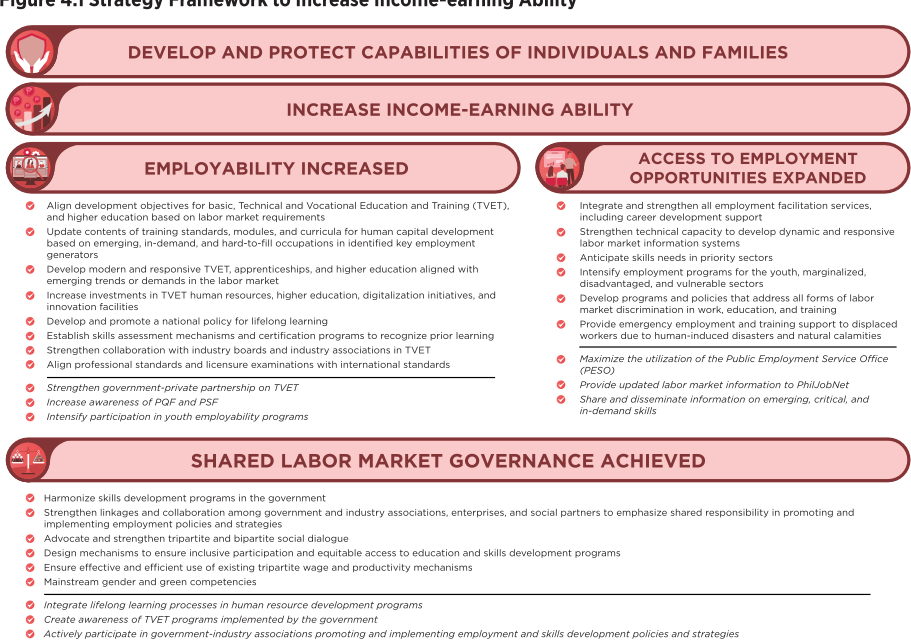

## Increase Income-earning Ability

## Increase Income-earning Ability

Increasing the income-earning ability of Filipinos involves developing the workforce and increasing their employability in the market, ensuring that skills are aligned not just with the current in-demand requirements but also with critical and emerging skills. Effective and efficient employment facilitation processes will also enable faster and more strategic job search. A vibrant social partnership, based on shared responsibility for achieving a responsive, fair, and efficient labor market, will also be crucial. By 2028, Filipinos will have enhanced income-earning ability that can better support their aspirations to have a stable and comfortable lifestyle, secure in the knowledge that they have enough for their daily needs and unexpected expenses.

This chapter presents the challenges in increasing income-earning ability and the outcomes to be pursued to address these challenges during the Plan period. These outcomes are as follows: (a) employability increased; (b) access to employment opportunities expanded; and (c) shared labor market governance achieved.

## Assessment and Challenges

The Philippines' labor market from 2010 to 2019 was vibrant, leveraging on advances in policy execution. However, the coronavirus disease (COVID-19) pandemic reversed its gains. In 2010-2019, net employment generation (+7.9 million) outpaced the increase in labor force (+6.8 million), raising real wages and productivity. In 2020, as the pandemic stalled economic activities, unemployment rose to a high of 10.3 percent, leading to an additional 2.2 million workers unemployed. In response, the government initiated the Philippine Program for Recovery with Equity and Solidarity and National Employment Recovery Strategy, which provided health, mobility, and financial interventions to firms and disadvantaged households. It served as vital platforms for subsequent initiatives. 1

The labor market shows signs of recovery, but the quality of jobs remains a concern. In 2021, the labor force participation rate (LFPR) increased to 61.4 percent after dipping to 59.5 percent in 2020. The LFPR improved further to 63.3 percent in 2022. 2 The unemployment rate eased to 8.0 percent in 2021, decreasing further to 5.4 percent in 2022. At the same time, the number of wage and salary workers has also been increasing, growing by 7.6 percent (+2.0 million) and constituting 63.2 percent of total employment in 2022. However, the proportion of vulnerable employment (i.e., self-employed and unpaid family workers) to total employment remains high at 34.1 percent in 2022. Moreover, underemployment persists, remaining elevated at 14.2 percent in 2022 despite the improvement from 17.6 percent in 2021 and 16.2 percent in 2020.

Skills mismatch remains a concern despite the convergence of demand and supply structures. The skills demand associated with the country's economic structure and the skills supply reflecting the educational attainment of the workforce are slowly becoming better aligned. In recent years, with rapid employment growth in high-skilled service industries, manufacturing, and construction, the oversupply of high-skilled workers at the aggregate level was reduced. Nevertheless, a mismatch remains as the education and training systems have yet to align with the skills demanded in the labor market.

Employment continues to be disrupted through the compounded effects of automation and climate change, rendering certain jobs and roles obsolete. The labor market faces megatrends such as the Fourth Industrial Revolution, climate change, and the lingering COVID-19 pandemic. All the megatrends have varying skill implications for the Filipino workforce. Year-to-date 2022 data from the Labor Force Survey (LFS) show that 28.5 percent of employed workers are in elementary occupations, which are at greater risks of automation and digitalization.

Although youth employability has improved, full-cycle employment interventions still need to be fully integrated. The COVID-19 crisis has resulted in multiple shocks for the youth-including disruptions in their education and training, employment, and earnings, and increased job search constraints. These shocks mark today's youth as a "lockdown generation" and underscore the possibility that the pandemic could weaken future labor market prospects of the younger workforce.

As more return to school, the youth not in education, employment, or training (NEET) rate shows signs of easing at 13.1 percent year-to-date from 18.5 percent in 2020 and 16.6 percent in 2021. The youth unemployment rate also eased but remains elevated at 12.6 percent from a high of 21.5 percent in 2020 and 16.6 percent in 2021. The youth continue to face challenging employment prospects, resulting in persistent inactivity rates in education, training, and employment. 3

Emerging digital careers pose unique demands and challenges, especially in the fast-growing platform economy. Recent international assessments, such as the World Digital Competitiveness Ranking 2022, paint a weak country profile in terms of digital competitiveness and digital skills. 4 The Philippines lags behind its regional peers in terms of foundational digital skills. 5 Technological change continues to modify the task content of jobs, leading to nonstandard work arrangements or increased demand for managerial, technical, and digital skills and qualifications. The pandemic also marked a boom in the gig economy due to the shift to digital platforms and increased reliance on gig workers to home-deliver necessities to consumers. The gig economy offers job flexibility that is more appealing and increasingly becoming necessary to workers.

## Strategy Framework

Figure 4.1 Strategy Framework to Increase Income-earning Ability

## Strategies

The strategy framework (See Figure 4.1) highlights the importance of educational qualifications, training credentials, skills, and competencies that enhance employability. It also emphasizes the need to strengthen interventions that improve access to employment opportunities. Lastly, it underlines the need to improve labor market governance, with an emphasis on collaboration and shared responsibility.

## Outcome 1: Employability increased

In light of the current and emerging challenges in the labor market, the government will further strengthen its efforts to raise the quality of human resources and ensure that the current and future workforce can adapt to the changing demands of the labor market. These will be achieved through the following strategies:

Align development objectives for basic, technical and vocational education and training (TVET), and higher education based on labor market requirements

Achieving curricular alignment informed by labor market trends and complex transformations in strategic sectors, can foster better learning outcomes and better school-to-work transitions. Skill formation is linked to a life-cycle process, not a static, one-shot endeavor involving many factors that pertain to labor market conditions and policies, home and school environments, parental education, investment propensity, household resources, and constraints, to name a few (See Subchapter 2.2). Hence, a whole-of-society approach is needed to enable Filipinos to possess competencies and qualifications, including green competencies that enhance their capacity to achieve desired employment and mobility outcomes and better respond to economic opportunities. 6

Update contents of training standards, modules, and curricula for human capital development based on emerging, in-demand, and hard-to-fill occupations in identified key employment generators

In developing training modules, the government will consider the transferability of skills. Common competencies in training regulations 7 shall be upgraded, reflecting economic transformation. In other countries, occupational profiles already reflect interdisciplinary competencies (See Subchapter 2.2).

A comprehensive assessment of key TVET programs, credentialing mechanisms, and company-based training shall be undertaken by key agencies to ascertain program effectiveness and inform quality assurance mechanisms. Skills standards, competency assessments, and certification shall be benchmarked with international standards. The government shall improve the criteria for admitting private technical vocational institutions (TVI) to ensure that new programs match the complexities of sectoral economic transformation. Human resource development and planning improvements shall be implemented to keep up with the demand for quality instruction. The feasibility of establishing a market of competencies to address emerging skills needs in the short term shall be explored (See Subchapter 2.2).

## Develop modern and responsive TVET, apprenticeships, and higher education aligned with emerging trends or demands in the labor market

Technical and vocational education and training shall focus on modalities emphasizing cost-effectiveness, incentive compatibility, and employability. The government shall explore ways to incentivize the participation of industry and private companies in TVET programs, particularly enterprise-based training (EBT). Moreover, the government shall explore cost-sharing mechanisms between private firms and current and/or potential employees when designing training contracts. The government shall pursue the development of forward-looking systems that anticipate emerging skills and educational qualifications and complement industry efforts to inform training regulation development (See Subchapter 2.2).

The government shall conduct policy reviews of enterprise-based modalities. In addition, the government shall advocate for amendments to existing apprenticeship law, which modernizes applicable provisions of the Labor Code to enhance employability.

Increase investments in TVET human resources, higher education, digitalization initiatives, and innovation facilities

Modernizing TVET facilities and enhancing educational qualifications, competencies, and skills are necessary to respond to the emergence of new competencies and skills demands due to economic and technological transformations (See Subchapter 2.2).

The establishment of TVET Innovation Centers has already started in some parts of the country. Regional TVET Innovation Centers will generate benefit streams for regional economies. They can complement the delivery of area-based-demand driven TVET programs, synergizing with countryside digital learning initiatives by the Department of Information and Communications Technology. The government shall promote the role of community training and employment coordinators (CTEC) in monitoring and addressing local skills needs. The government shall also institutionalize CTEC to support devolution strategies of the Technical Education and Skills Development Authority (TESDA).

The government shall enhance the quality of TVET human resources by improving qualification and competency requirements and updating training requirements. Improvements in human capital profiles can be achieved through increased utilization of scholarship funds intended for upskilling and reskilling.

## Develop and promote a national policy for lifelong learning

Lifelong learning enables all citizens to adapt to social and technological changes. With present vulnerabilities and uncertainties of the future, lifelong learning programs need to be informed of emerging trends, flexible yet connected, certifiable to standards, and industry-related (See Subchapter 2.2).

The life-long learning and skills ecosystem hinges on operationalizing the Philippine Qualifications Framework (PQF). Therefore, the government will strengthen the PQF National Coordinating Committee and its governance structure, establish the PQF Secretariat, enable budgetary support mechanisms for institutionalized activities, implement pilot projects, develop monitoring and evaluation mechanisms, and make necessary revisions to the PQF. 8 The national government shall also conduct studies to measure qualification progression contributions to income-earning ability. 9

The government shall sustain efforts to develop a master plan for institutionalizing lifelong learning beyond formal education. 10 It shall encourage local government units (LGU) to plan and integrate lifelong learning programs to transform their jurisdictions into learning communities. 11 One important aspect of this initiative is that by institutionalizing governance mechanisms and awareness campaigns that advance lifelong learning initiatives, LGUs can promote inclusive learning in the workplace and foster a culture of learning among its constituents.

## Increase awareness of the Philippine Qualifications Framework and Philippines Skills Framework

Employers may proactively convey how changing workplace requirements should be integrated into academic curricula and training regulations. Employers should utilize the PQF Registry of Qualifications to better plan staffing requirements and understand how to design jobs. Incorporating PQF and Philippines Skills Framework (PSF) provisions and standards is needed to ensure industrial transformation that is sustained by responsive human capital and skills development strategies. Employers, industry organizations, and educational institutions may engage in skills-occupations mapping to remediate skills inadequacies and foster job mobility.

## Establish skills assessment mechanisms and certification programs to recognize prior learning

Recognition of all types of learning and an individual's knowledge, skills, and experience can provide an opportunity for people to acquire qualifications or credits without going through a formal education or training program. 12 The key characteristics of microcredentials include limited time engagement, which is potentially integral to formal qualifications, stackable, flexible, and coming in digital form. The government shall study the establishment of a national micro-credentials marketplace as part of emerging initiatives to promote lifelong learning (See Subchapter 2.2).

Online learning has become one of the dominant ways to achieve competencies, so a system must leverage available technologies that facilitate digital accreditation. Blockchain technology can be used to safeguard the integrity of earned digital certificates or badges. Coordination with micro-credential providers including companies, industry associations, online learning platforms, non-government organizations, and international organizations is also seen as imperative, together with the eventual integration of such micro-credentials in the PQF and PSF. A competency-based system will be developed through which workers and labor entrants are awarded micro-credential via training or recognition of prior learning.

## Strengthen collaboration with industry boards and industry associations in TVET

Achieving lifelong learning and skills development objectives across industries can be facilitated by industry boards and industry associations. This can encourage more industry involvement in providing high-quality TVET and shaping globally oriented human resources.

Taking off from experiences in establishing tourism and construction industry boards, the national government shall organize industry boards 13 in key or strategic sectors identified by the National Technical Education and Skills Development Plan and the PSF Initiative. It shall capacitate industry boards in skills anticipation, certification design, and training regulation formulation. Industry boards and associations shall also work to establish professional standards for emerging occupations.

## Align professional standards and licensure examinations with international standards

The labor mobility of professionals has been driven by robust demand for talent overseas on account of skill-biased technological change. The government shall continue improving professional standards in all regulated professions and ensure that licensure examinations are aligned with international standards. The government shall maximize the recognition of Philippine professions by benchmarking with international standards and improving the quality of education, training, and skills development (See Subchapter 2.2).

## Strengthen public-private partnership on TVET

While the government formulates policies that govern TVET programs and prescribe acceptable qualities of TVI, greater participation of private TVI is needed to enhance the quality and effectiveness of curricular delivery. Stronger partnerships between high-quality, better-capacitated, and well-staffed TVI and the government may be formed and sustained with the right policies and incentive systems. Private TVI may form networks within select curricular areas to promote program efficiency and relevance, improve quality access, share information about curricular design, and develop lifelong learning processes. With government direction and guidance, key industry players may form centers of training excellence to help adapt to changing industry conditions and address emerging skills needs.

## Intensify participation in youth employability programs

Educational institutions shall proactively seek effective interventions or programs that promote employability, particularly those in senior high school. Establishing partnerships between local state universities and colleges, local universities and colleges, high schools, and TESDA can improve the effectiveness of area-based skills interventions. Moreover, the private sector can help design curricula, institutionalize feedback mechanisms, and provide orientations on recruitment strategies.

## Outcome 2: Access to employment opportunities expanded

Ensuring that employment opportunities are made available and accessible to all workforce members is critical to the objective of increasing income-earning ability. This shall be achieved through the following strategies:

## Integrate and strengthen all employment facilitation services, including career development support

With technical assistance from the Department of Labor and Employment (DOLE), the Public Employment Service Offices (PESOs) can potentially transition to offering a full range of employment, career counseling, and training services for specific in-demand skills through a partnership with TESDA and educational institutions. Moreover, the government shall integrate all employment program monitoring systems, career development support, and labor market information systems in the PhilJobNet to provide a complete employment journey for target clients. Returning Overseas Filipinos will also have access to these services, facilitating their integration back to the domestic economy.

The PESOs can facilitate worker mobility and inform national interventions.

Strengthening linkages among PESO centers can create a hub of information exchange on best practices in employment facilitation. Information from a PESO network can be fed into a system capable of processing inputs for generating labor market intelligence, allowing national policymakers to rapidly assess local conditions during periods of national emergency. 14 Labor mobility can also be enhanced by creating a PESO portal, highlighting the ability of PESOs to facilitate labor reallocation across regions.

The government shall ensure that PESOs can deliver vital services mandated by local ordinances and national laws. In addition to their employment facilitation or job brokering function, PESOs implement key legislative initiatives and programs such as the First-Time Jobseekers Assistance Act 15 and JobStart Philippines. 16

## Maximize the utilization of public employment service offices

Continued business engagement remains critical for improving the performance of PESOs. To ensure the maintenance, expansion, and promotion of PESO services, increased allocation of local budgets may be necessary. Moreover, better utilization of PESOs would result in improved facilitation efficiency and visibility. To respond more effectively, LGUs can consider investing in digital platforms that automatically update the state of local labor markets and highlight job trends. Similar platforms can also be made more responsive to the needs of PESO constituents by facilitating registration, access, and application.

## Strengthen technical capacity to develop dynamic and responsive labor market information systems

Investing in dynamic labor market information systems (LMIS) will result in efficient information flow, better skills anticipation, and competency forecasts. Timely delivery of labor market information services requires forward-looking information systems. In addition, the government can leverage digital technology by mapping changing skills and qualifications, as well as identifying pathways to improving competencies through a framework for classifying similar jobs or occupations. Such mapping could enhance job mobility.

The PhilJobNet is envisioned as a one-stop-shop for labor market information, allowing employers to post vacancies, and workers to search for jobs. As the premier source of labor market information, the PhilJobNet shall evolve into a real-time system that interconnects local labor market information networks.

## Provide updated labor market information to PhilJobNet

Unregistered employers can consider enlisting as part of PhiljobNet to avail of the services, such that labor search costs can be reduced and staffing needs can be addressed. Moreover, the participation of employers can contribute to local development by enriching labor market intelligence. Linking to PhilJobNet improves the data quality and ensures proper characterization of local labor market conditions. Industry associations can also explore ways to reliably and securely link systems that continuously provide updates.

## Anticipate skills needs in priority sectors

With digital and economic transformations in key industries underway, demand for updated and new technical regulations, job-aligned curricula, and training materials has increased. Identifying and anticipating skills needed for priority sectors of the economy shall precede training decisions so that skills required are relevant for the labor market. For example, to align with the agricultural sector transformation, the government will anticipate and address the implications from mechanization, diversification, bio-based inputs production, and waste management. As the transformation in the industry intensifies, demand for social (collaboration and teamwork); cognitive (strategic problem solving, agility, and adaptability); and specialized skills (data analysis, content creation, and storytelling) will be high. The reinvigoration of services will also increase demand for a myriad of cognitive, social, technical, transversal, management, specialized, and other emerging skills or competencies. In the high-technology sector, upskilling and reskilling initiatives can focus on advanced manufacturing, robotics, artificial intelligence, the Internet of Things, and blockchain.

## Share and disseminate information on emerging, critical, and in-demand skills

As technology transforms the workplace, the government's social partners shall update key stakeholders. For example, investing in private labor market assessment tools and information systems can be helpful for firms to anticipate and relay emerging skills requirements, inform educational, training, and skills policies, and enhance market interventions, including in terms of timeliness. Moreover, employers, worker associations, and industry groups can consider participating proactively in sectoral bodies to facilitate the exchange of ideas and enhance communication flow.

## Intensify employment programs for the youth, marginalized, disadvantaged, and vulnerable sectors

TVET can be promoted to address the high incidence of youth NEET. Forming tight linkages between educational institutions, skills development authority, and PESOs can mitigate search frictions and mismatches, as information on active labor market programs can be efficiently cascaded to education providers. For example, the Special Program for Employment of Students can be reviewed to rationalize the targeting and selection of grantees, and to align program outcomes with lifelong learning objectives. In addition, the JobStart Philippines program shall be intensified to accommodate more participants from disadvantaged, marginalized, and vulnerable groups. The Career Development Support Program, which aims to provide career support to individuals, makes use of timely and relevant information on the dynamics of labor markets to address gaps in employability dimensions (i.e., personal and environmental factors, job search skills, skills gaps). 17

## Develop programs and policies that address all forms of labor market discrimination in work, education, and training

The government shall conduct impact assessments of policies, laws, and institutions designed to promote equality. Besides employment facilitation, policies shall be aimed at labor market issues such as gender, context-specific barriers, such as transportation constraints, security, technological capacities, and discrimination.

The government shall explore the development of a framework that can progressively eliminate discrimination between full-time and part-time workers. Pathways shall also be considered for workers transitioning from part-time to full-time status or vice-versa.

Provide emergency employment and training support to displaced workers due to human-induced disasters and natural calamities

Active labor market programs, such as emergency employment and training support, are needed to build and enhance resilience of displaced workers. Two notable active labor market interventions include the provision of emergency employment for displaced workers (Tulong Panghanapbuhay sa Ating Disadvantaged/ Displaced Workers or TUPAD) and the Training for Work Scholarship Program. DOLE and TESDA continue to roll out employment and national certification skills training packages to calamity-prone areas to ensure social safety net and employment opportunities for affected residents. 18 Further, in connection with the implementation of livelihood training programs, DOLE and TESDA shall study the convergence of their livelihood training programs and community-based training programs, respectively, to avoid duplication.

## Outcome 3: Shared labor market governance achieved

Attaining the objective of increasing income-earning ability is a shared responsibility among the government and social partners (i.e., private sector, civil society organizations, academe, workers organizations, and other stakeholders). This will be achieved through the following strategies:

## Harmonize skills development programs in the government

Multiple skills development programs underscore the importance of designing cost-effective and optimal interventions. The creation of an inventory of all training programs shall pave the way toward the convergence of programs with similar objectives; thus, maximizing the impact of these programs on intended stakeholders. Impact evaluation studies to determine the degree of program effectiveness and identify areas of reform shall be conducted.

Strengthen linkages and collaboration among government and industry associations, enterprises, and social partners to emphasize shared responsibility in promoting and implementing employment policies and strategies

Sustaining an education, training, and lifelong learning ecosystem hinges on the dynamic interaction among social partners. The government shall sustain and strengthen partnerships with industry associations, workers' organizations, and other institutions to improve feedback mechanisms, promote innovative practices, complement efforts to operationalize the PQF and PSF Initiative, improve skills anticipation and certification, and deliver in-factory consultations and practical workplace training. Part of the modes will include TESDA linkages with higher education institutions for courses to be offered in summer, wherein graduates will not just receive a baccalaureate degree but also a National Certificate, which in turn enhances their skills and employability, thereby enhancing their income-earning ability.

## Advocate and strengthen tripartite and bipartite social dialogue

Transitioning from routine-biased to skill-biased technological change has considerable implications for working conditions, job tasks, and responsibilities. With its social partners, the government shall update the social dialogue plan to emphasize the role of megatrends such as digitalization, automation, and climate change, including how they affect the firm organization, skill composition, qualifications, working conditions, health, and safety.

Tripartite sector skills bodies are important mechanisms for matching the sector demand for skills training, anticipating the future labor market, and addressing the adverse effects of digitalization, climate change, and globalization. To make LMIS more dynamic and forward-looking, the government shall institutionalize systematic stakeholder engagement with social partners to focus on skills anticipation systems and policy development. 19

## Design mechanisms to ensure inclusive participation and equitable access to education and skills development programs

Sustaining an education, lifelong learning, and skills ecosystem require responsive and innovative policies and mechanisms to oversee programs and anticipate problems or supply bottlenecks. The government shall remain proactive in formulating innovative and effective interventions that enhance income-generating ability throughout the worker's life cycle, especially those of the vulnerable groups and communities. Thus, assessing the capacity of labor administration to maintain such an ecosystem shall be prioritized. The government shall evaluate the mandate of the skills development authority given an environment continuously shaped by climate change, automation, and increased digitalization.

## Ensure effective and efficient use of existing tripartite wage and productivity mechanisms

The minimum wage shall be used to protect the lowest and most vulnerable wage earners from poverty. Adjustments above the minimum wage shall be based on enterprise performance and labor productivity. In this regard, the government shall continue to provide technical assistance to workers and enterprises in designing and implementing productivity-based incentive schemes to increasingly link workers' compensation and labor productivity.

## Mainstream gender and green competencies

Climate change affects the future world of work and greening the economy will inevitably create new jobs that can abolish other jobs. Therefore, the government shall intensify creating a database of green jobs, implement the Green Jobs Human Resource Development Plan, and intensify the integration and mainstreaming of green competencies in TVET and education programs. Furthermore, to achieve consistency, the government shall revisit the PQF for proper integration of environmental sustainability and green qualifications as an objective.

Key stakeholders shall ensure stability in the macroeconomy, adequacy of investments in green sectors, feasibility of creating green ecozones, and sustainability of human capital investments. Because of job dynamics in identified green sectors, adequate levels of social protection shall be in place to address the just transition of unskilled workers. As economies become more involved in greening processes and structures, those who belong to brown occupations may need assistance transitioning to other occupations.

While the country's female LFPR has been slowly improving from the previous years, there is still a need to intensify efforts, such as addressing gender bias and gender role stereotypes in basic and higher education materials, promoting entrepreneurship, and advancing economic opportunities for women, through harnessing digital technologies.

## Integrate lifelong learning processes in human resource development programs

Employers are enjoined to recognize prior learning outcomes obtained in micro-formal or formal training and provide relevant training to employees. Integrating lifelong learning processes ensure that both employers and employees benefit from learning dividends in the form of better corporate performance, productive employee engagement, and enhanced well-being.

## Create awareness of TVET programs implemented by the government

The TVI can formulate marketing strategies to promote jobs that only TVET programs render achievable. For example, within TVI networks, participants may need to organize skills fairs or competitions, showcasing technical capabilities and other attributes. Moreover, TVI can create digital platforms that popularize TVET programs, focusing on sustaining the economy's ability to cater to emerging skills. More importantly, TVET programs shall be projected as vital initiatives for advancing the country's economic interests and development.

## Actively participate in government-industry associations promoting and implementing employment and skills development policies and strategies

Social partners can participate in capacity-building programs sponsored by the government. Such programs help develop skills needed for sustaining engagement in social dialogues and solving problems. Social partners shall also be independently able to undertake comprehensive sector assessment and understand the implications of megatrends such as automation, climate change, and the ongoing pandemic on industry or sector outcomes.

## Legislative Agenda

Table 4.1 presents the priority bills for the 19 th Congress to increase income-earning ability.

Table 4.1 Legislative Agenda to Increase Income-Earning Ability

| LEGISLATIVE AGENDA                                                                                 | RATIONALE/KEY FEATURES                                                                                                                                                                                                                                                                                                                                                                                                                                                                                                        | RESPONSIBLE AGENCY                                           |
|----------------------------------------------------------------------------------------------------|-------------------------------------------------------------------------------------------------------------------------------------------------------------------------------------------------------------------------------------------------------------------------------------------------------------------------------------------------------------------------------------------------------------------------------------------------------------------------------------------------------------------------------|--------------------------------------------------------------|
| Revised National Apprenticeship Program; Enterprise-Based Education and Training to Employment Act | Harmonize the existing enterprise-based training (EBT) modalities and expand the provision of training programs being implemented within companies which can be a mix of workplace training and classroom-based learning. Institute further reforms on the apprenticeship program to make them more attractive to both the enterprises and the prospective apprentices, promoting skills acquisition and youth employment.                                                                                                    | Technical Education and Skills Development Authority (TESDA) |
| Jobs Creation Strategy Bill                                                                        | Create an Inter-Agency Council for Jobs and Investments co-headed by the Department of Trade and Industry, Department of Labor and Employment (DOLE), and TESDA, with representatives from employers' organizations and labor groups; and establish working groups that will focus on developing employment recovery and job creation in specific industries and emerging sectors, such as but not limited, to construction, tourism, agriculture, information technology and business process management, and manufacturing. | DOLE                                                         |
| Lifelong Learning Development Bill                                                                 | Develop a Lifelong Learning Development Framework through the Philippine Qualifications Framework-National Coordinating Council (PQF-NCC). The PQF-NCC shall determine and set standards for developing action components and desirable success measures for promoting lifelong learning in cities, municipalities, and educational institutions.                                                                                                                                                                             | DOLE                                                         |
| Enterprise Productivity Act (Amendments to Productivity Incentives Act)                            | Fortify the intentions of the "Productivity Incentive Act of 1990" by promoting inclusive and sustainable work productivity programs. The Act aims to reinforce labor productivity by: (a) establishing a Productivity Incentives Committee; (b) adopting productivity incentive programs; (c) granting productivity incentives to employees; and (d) providing a tax incentive to business establishments for granting incentives to employees.                                                                              | DOLE                                                         |

## Results Matrix

Table 4.2 presents the indicators and targets to increase income-earning ability.

Table 4.2 Results Matrix: Increase the Income-Earning Ability

| INDICATOR                                                                                                         | BASELINE                                            | ANNUAL PLAN TARGETS - 2023                          | ANNUAL PLAN TARGETS - 2024                          | ANNUAL PLAN TARGETS - 2025                          | ANNUAL PLAN TARGETS - 2026                          | ANNUAL PLAN TARGETS - 2026                          | ANNUAL PLAN TARGETS - 2028                          | MEANS OF VERIFICATION                               | RESPONSIBLE AGENCY/ - INTER- AGENCY BODY            |
|-------------------------------------------------------------------------------------------------------------------|-----------------------------------------------------|-----------------------------------------------------|-----------------------------------------------------|-----------------------------------------------------|-----------------------------------------------------|-----------------------------------------------------|-----------------------------------------------------|-----------------------------------------------------|-----------------------------------------------------|
| Intermediate goal: Income-earning ability increased                                                               | Intermediate goal: Income-earning ability increased | Intermediate goal: Income-earning ability increased | Intermediate goal: Income-earning ability increased | Intermediate goal: Income-earning ability increased | Intermediate goal: Income-earning ability increased | Intermediate goal: Income-earning ability increased | Intermediate goal: Income-earning ability increased | Intermediate goal: Income-earning ability increased | Intermediate goal: Income-earning ability increased |
| Outcome 1: Employability Increased                                                                                | Outcome 1: Employability Increased                  | Outcome 1: Employability Increased                  | Outcome 1: Employability Increased                  | Outcome 1: Employability Increased                  | Outcome 1: Employability Increased                  | Outcome 1: Employability Increased                  | Outcome 1: Employability Increased                  | Outcome 1: Employability Increased                  | Outcome 1: Employability Increased                  |
| Proportion of employed college graduates in elementary occupations (%) decreased                                  | 2.7 (2020)                                          | 1.50-1.73                                           | 1.50-1.73                                           | 1.50-1.73                                           | 1.50-1.73                                           | 1.50-1.73                                           | 1.50-1.73                                           | Labor Force Survey (LFS)                            | Social Development Committee (SDC)                  |
| Percentage of youth not in employment, education, or training (%) reduced                                         | 12.6 (average for Jan, Apr, Jul, Oct, 2022)         | 12.8-14.8                                           | 12.5-14.5                                           | 12.2-14.2                                           | 11.9-13.9                                           | 11.6-13.6                                           | 11.3-13.3                                           | LFS                                                 | SDC                                                 |
| Technical Education and Skills Development Authority (TESDA) certification rate in priority sectors (%) increased | 92 (2021)                                           | 92                                                  | 92.5                                                | 93                                                  | 93.5                                                | 94                                                  | 94.5                                                | TESDA Data                                          | TESDA                                               |

| INDICATOR                                                                                                                                                       | BASELINE                                               | ANNUAL PLAN TARGETS - 2023                             | ANNUAL PLAN TARGETS - 2024                             | ANNUAL PLAN TARGETS - 2025                             | ANNUAL PLAN TARGETS - 2026                             | ANNUAL PLAN TARGETS - 2026                             | ANNUAL PLAN TARGETS - 2028                             | MEANS OF - VERIFICATION                                | RESPONSIBLE AGENCY/ INTER- AGENCY BODY                 |
|-----------------------------------------------------------------------------------------------------------------------------------------------------------------|--------------------------------------------------------|--------------------------------------------------------|--------------------------------------------------------|--------------------------------------------------------|--------------------------------------------------------|--------------------------------------------------------|--------------------------------------------------------|--------------------------------------------------------|--------------------------------------------------------|
| Employment rate of TVET graduates a (%) increased                                                                                                               | 93.4 (average for Jan, Apr, Jul, Oct, 2022)            | 94-96                                                  | 94-96                                                  | 95-96                                                  | 95-96                                                  | 95-96                                                  | 95-96                                                  | LFS                                                    | SDC                                                    |
| Proportion of employment in middle- and high- skilled occupations (%) b increased                                                                               | 71.4 (average for Jan, Apr, Jul, Oct, 2022)            | 72.3                                                   | 73.0                                                   | 73.8                                                   | 74.53                                                  | 75.3                                                   | 76.1                                                   | LFS                                                    | SDC                                                    |
| Number of training regulations, curricula, and courses with green core competencies c increased                                                                 | 81 (2021)                                              | 89                                                     | 98                                                     | 108                                                    | 119                                                    | 131                                                    | 144                                                    | TESDA                                                  | TESDA                                                  |
| Outcome 2: Access to Employment Opportunities Expanded                                                                                                          | Outcome 2: Access to Employment Opportunities Expanded | Outcome 2: Access to Employment Opportunities Expanded | Outcome 2: Access to Employment Opportunities Expanded | Outcome 2: Access to Employment Opportunities Expanded | Outcome 2: Access to Employment Opportunities Expanded | Outcome 2: Access to Employment Opportunities Expanded | Outcome 2: Access to Employment Opportunities Expanded | Outcome 2: Access to Employment Opportunities Expanded | Outcome 2: Access to Employment Opportunities Expanded |
| Female labor force participation rate (%) increased                                                                                                             | 51.7 (average for Jan, Apr, Jul, Oct, 2022)            | 51.0- 53.0                                             | 51.5-53.5                                              | 52.0- 54.0                                             | 52.0- 54.0                                             | 52.0-54.0                                              | 52.0-54.0                                              | LFS                                                    | SDC                                                    |
| Placement rate (%) of public employment service offices increased                                                                                               | 91 (Sep. 2022)                                         | 91                                                     | 91                                                     | 91.2                                                   | 91.3                                                   | 91.4                                                   | 91.5                                                   | DOLE data                                              | DOLE                                                   |
| Percentage of educated d unemployed to total unemployed (%) reduced                                                                                             | 38.0 (average for Jan, Apr, Jul, Oct, 2022)            | 35-37                                                  | 35-37                                                  | 35-37                                                  | 30-35                                                  | 30-35                                                  | 30-35                                                  | LFS                                                    | SDC                                                    |
| Outcome 3: Shared Labor Market Governance Achieved                                                                                                              | Outcome 3: Shared Labor Market Governance Achieved     | Outcome 3: Shared Labor Market Governance Achieved     | Outcome 3: Shared Labor Market Governance Achieved     | Outcome 3: Shared Labor Market Governance Achieved     | Outcome 3: Shared Labor Market Governance Achieved     | Outcome 3: Shared Labor Market Governance Achieved     | Outcome 3: Shared Labor Market Governance Achieved     | Outcome 3: Shared Labor Market Governance Achieved     | Outcome 3: Shared Labor Market Governance Achieved     |
| Percentage of total number of establishments (%) provided with technical assistance that installed or enhanced productivity performance-based incentive schemes | 12 (2021)                                              | 10-12                                                  | 10-12                                                  | 12-15                                                  | 12-15                                                  | 15-17                                                  | 15-17                                                  | DOLE data                                              | DOLE                                                   |
| Percentage of trained micro, small, and medium enterprises (%) that implemented productivity improvement program                                                | 69 (2022)                                              | 69-70                                                  | 69-70                                                  | 70-75                                                  | 70-75                                                  | 70-75                                                  | 70-75                                                  | DOLE data                                              | DOLE                                                   |

a Baseline figure is computed using the identified post-secondary graduates from the LFS.

b Excluding elementary and armed forces occupations based on the definition of International Labour Organization. ILOStat Variable Levels. https://view.officeapps.live.com/op/view.aspx?src=https%3A%2F%2Fwww.ilo.org%2Filostat-files%2FISCO%2Fnewdocs-08-2021%2FISCO-08%2FISCO-08%252088%2520EN%2520Skills%2520.xlsx&amp;wdOrigin=BROWSELINK

c Number of training regulations and competency standards with green competencies, including newly developed and reviewed.

d Includes those with college education (undergraduates and graduates).

- 1 In 2022, Senator Joel Villanueva proposed Senate Bill 129 (19th Congress) known as the Trabaho Para sa Lahat Bill. This Senate Bill institutionalizes the National Employment Action Plan, which is an offshoot of the NERS.
- 2 Fiscal year 2022 figures are based on the quarterly LFS result, i.e., January, April, and July 2022.
- 3 Orbeta et al. (2021) "Who Are the Youth NEET in the Philippines Today?" Discussion Paper Series No. 2021-21. Quezon City: Philippine Institute for Development Studies.
- 4 The Philippines (rank: 56) lags behind Indonesia (51) and Thailand (40). See IMD World Competitiveness Center. (2022) World Digital Competitiveness Ranking. https://www.imd.org/centers/world-competitiveness-center/rankings/world-digital-competitiveness/.
- 5 See pages 14-15 in Department of Information and Communications Technology. Connect, Harness, Innovate, and Protect Implementation Plan. Quezon City.
- 6 Based on the definition of employability in Chapter 2 of International Labour Organization (ILO). 2021. Shaping Skills and Lifelong Learning for the Future. Geneva.
- 7 Training regulations serve as the bases for developing competency-based curricula and instructional materials as well as competency assessment tools. They define the competency standards for national qualifications.
- 8 The World Bank. (2021) A Review of the Philippine Qualifications Framework: Toward Improved Skills Recognition and Mobility. Washington, DC. https:// openknowledge.worldbank.org/entities/publication/40da4689-9f8a-58b6-bac0-5005d6fe03b9.
- 9 Daquio. (2021) Differentiation of Pay Scales Across Levels of TVET Qualifications in the Construction Industry.
- 10 One of the main objectives of Senate Bill No. 129 is establishing learning cities and municipalities.
- 11 This strategy is similar to Germany's Learning Regions Promotion of Networks, which later became the Learning in Place program. Both programs are designed to transform cities and/or regions into learning cities and/or regions.
- 12 ILO. (2018) Recognition of Prior Learning (RPL): Learning Package. Geneva.
- 13 Technical Education and Skills Development Authority. (2021) Implementing Guidelines for Pilot Implementation on the Establishment of Industry Boards. TESDA Circular No. 017, s. 2021. Taguig.
- 14 This is one of the objectives of the proposed Senate Bill No. 49 authored by Senator Jinggoy Ejercito Estrada.
- 15 The First Time Jobseekers Assistance Act seeks to help first-time jobseekers secure pre-employment documents that will lessen their financial burden in obtaining said documents.
- 16 JobStart Philippines is designed to provide opportunities to at-risk youth, who are provided with life skills training, career guidance and coaching, technical internships, and training with private sector employers.
- 17 ILO and European Training Foundation. (2021). Koeltz and Torres. 2016; and Fasrul and Torres. 2021
- 18 See Department of Labor and Employment-Technical Education and Skills Development Authority. DOLE-TESDA Joint Memorandum Circular No. 001-2022.
- 19 See Chapter 4 of ILO. (2021). Shaping Skills and Lifelong Learning for the Future. Geneva.