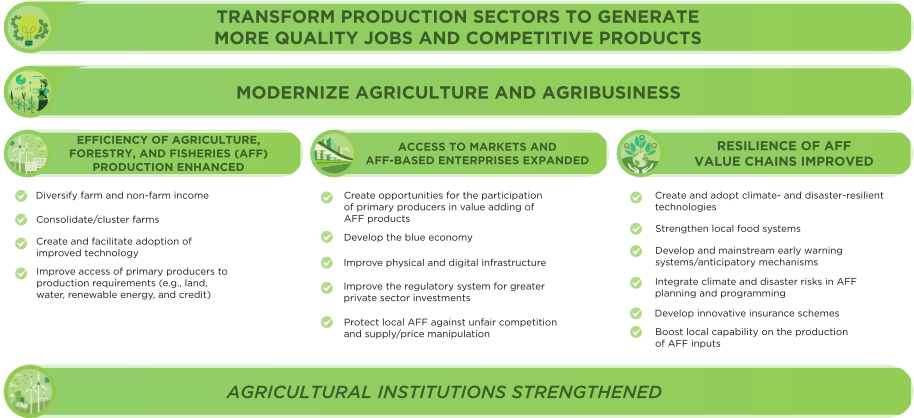

PART III

Transform Production Sectors to Generate More Quality Jobs and Competitive Products

## Modernize Agriculture and Agribusiness

## Modernize Agriculture and Agribusiness

Recognizing that the agriculture, forestry, and fisheries (AFF) sector is part of a bigger agri-food system, the Plan will be guided by transformative ideas, which will involve (a) addressing the systemic ills of AFF through a whole-of-value-chain approach that considers AFF production as tightly linked to processing, marketing, consumption, and waste management; (b) restoring the local food culture toward improving agri-food system resiliency, empowering local farmers, and linking AFF production to consumer nutrition and health of the environment; and (c) opening up more opportunities in the blue economy to leverage and optimize the country's vast coastal and marine resources and maritime domain.

In the next six years, sound agricultural development through holistic agri-food system measures espoused in the National Agriculture and Fisheries Modernization and Industrialization Plan (NAFMIP) 2021-2030 will be pursued, with the ultimate objective of raising the level of income of primary producers (i.e., farmers and fisherfolk) beyond the poverty threshold.

This chapter presents the challenges facing agriculture and agribusiness, and the outcomes to be pursued to address these challenges during the Plan period. These outcomes are: (a) efficiency of agriculture, forestry, and fisheries production enhanced; (b) access to markets and agriculture-, forestry-, and fisheries-based enterprises expanded; (c) resilience of agriculture, forestry, and fisheries value chains improved; and (d) agricultural institutions strengthened.

## Assessment and Challenges

The existing agri-food system has been dysfunctional in serving its basic roles in (a) generating decent income for the sector's stakeholders, particularly primary producers; (b) ensuring sustainable use of natural resources; and (c) providing for the health and nutrition of consumers and nurturing the local food culture (See Subchapter 3.1).

While the country has made some progress in reducing poverty prior to the pandemic, primary producers remain to be the poorest among the basic sectors. 1 The previous gains may be further eroded as the sector bears the brunt of multidimensional shocks arising from natural and biological hazards (e.g., pandemic, Avian Influenza [AI], and African Swine Fever

[ASF]) and global economic headwinds. These may also further weaken the sector's poor economic performance in the previous Plan period. As of the third quarter of 2022, AFF only grew by 0.8 percent.

The sector's sustainability is also threatened by unsustainable farming and fishing practices that deplete the resource base (terrestrial, coastal, and marine) and exacerbate pollution, amidst a changing climate (See Chapters 2.3 and 15). The AFF production relies on natural capital as inputs, especially land and water resources; at the same time, it contributes to its degradation. For instance, agricultural run-off continues to be one of the major non-point sources of water pollution. 2 The country's land degradation hotspots cover 1,910,478 hectares (ha), resulting from unsustainable farming practices that affect soil quality, among other factors. Further, the agri-food system is one of the major sources of greenhouse gas emissions, contributing to global warming. Meanwhile, the inability of the agri-food system in meeting the country's nutritional requirements emanates from a lack of scientific knowledge about human nutrition. The result is an unsustainable consumer behavior that has high preference for consuming low nutritional value commodities and imported products.

These challenges contribute to the following inefficiencies along various segments of the value chain, which continue to hamper the potential of the country's agriculture and agribusiness sector:

- Low farm/labor productivity. The Philippines is still considered to have a low level of mechanization at 1.23 horsepower (hp)/ha for all crops. 3 While there have been some improvements in the level of mechanization for rice-from 2.31 hp/ha in 2011 to 3.77 hp/ha in 2019-the country still lags behind our Asian neighbors. 4 This indicates that primary production is still greatly dependent on manual labor, which is inextricably linked to poor adoption of modern agricultural and fishery technologies and limited extension services. In addition, the low share of AFF research, development, and extension (RDE) programs in the budget of the Department of Agriculture (DA) undermines the significance of developing technologies and disseminating sustainable farm and fishery management practices.
- Low access to credit and insurance, particularly among smallholder primary producers, due to challenges

emanating from both the supply and demand side. Supply-side challenges on formal credit for the sector include: (a) limited physical network of banks and other formal lenders in rural areas; (b) perceived high risks in agriculture due to lack of familiarity or understanding of agricultural markets and borrowers as well as frequent occurrence of extreme weather events; (c) inadequate institutional capacity of lenders which limits assessment of the sector's projects for financing and designing of suitable loan products. On the other hand, demand-side constraints include: (a) high borrowing costs due to distance from bank; (b) weak financial literacy among borrowers; (c) inability to prepare financing proposals and documentation requirements; and (d) lack of collateral, especially for the agrarian reform beneficiaries (ARB) still under collective Certificate of Land Ownership Award (CLOA). Moreover, agricultural insurance provision is limited, mainly due to the minimal participation of private insurance companies and the low awareness of primary producers on the available risk insurance products and the benefits of availing them.

- Unsustainable farming practices and underutilized agro-forestry and blue economy potential. Land-based agriculture is still largely characterized by monoculture and low adoption of improved technology. Most of the country's agricultural land areas are devoted to the production of traditional crops, such as palay (32%), coconut (24.3%), and corn (17.1%). 5 Meanwhile, subsistence farming and poor market access in upland areas hinder the country's agro-forestry output. With respect to coastal and marine resources,

- illegal, unreported, and unregulated fishing continues to be a challenge. Moreover, designated mariculture parks offering opportunities for greater fisheries production remain underutilized. 6
- Weak export performance. The value of AFF exports declined by 13.9 percent in September 2022 compared to the same period in the previous year. The lack of diversity in the country's AFF exports, which comprise mostly raw materials and semi-processed products, makes it susceptible to disruptive changes in the market and price volatility.
- Weak investments in the AFF sector. Total investments in the AFF sector contracted by an average of six percent annually from 2017 to 2022. This stems from the prevailing challenges in the sector which erodes investor confidence. These include high logistics cost, lack of scale of local raw material suppliers, and low conformance of primary producers to local and international standards. Further, the incomplete land ownership transfer-with a significant balance of lands under collective ownership-adds to the perceived risks of the private sector in investing in agriculture.
- Inadequate infrastructure. Investments on public goods for the AFF sector have been inadequate or have not been rationalized, which aggravate the challenges related to high logistics and marketing costs and huge postharvest losses. Moreover, irrigation investments were mainly focused on areas geared toward rice-based production systems. There has been low support for small-scale irrigation needed in high-value crops (HVC) production. 7 Further, many existing irrigation systems require rehabilitation or restoration to improve
- efficiency and retrofitting to ensure climate resiliency (See Chapter 15).
- Fragmentation of agricultural lands. While the total number of farms increased by two-thirds, the average farm size fell from 3 ha in 1980 to 0.9 ha in 2012 due to the redistribution of lands under the Comprehensive Agrarian Reform Program (CARP) and transactions/activities involving non-CARP lands (particularly, the sale of these lands), among other factors. 8 Property rights still needs to be settled, with almost half of the ARBs still covered by collective ownership certificates. Insecure property rights contributed to limited on-farm investments and farmers' access to support services.
- High vulnerability to multidimensional shocks. The geographical location and physical environment of the Philippines make it susceptible to typhoons, earthquakes, and volcanic eruptions, among others, causing huge damage and losses to the agriculture sector. Rising temperature also threatens the AFF sector due to its effect on the physiology and reproduction of pests. In recent years, the sector has also been greatly affected by the disruptions in supply chains due to the (a) imposition of community quarantines to limit the spread of COVID-19; (b) ongoing conflict between Russia and Ukraine which has raised prices of fuel, feeds, and fertilizers, driving inflation in our key food commodities (See Chapters 3.1 and 15); and (c) other shocks emanating from domestic armed conflict and territorial disputes (See Chapter 13.1).

Weak governance and convergence among agricultural institutions/rural development agencies further aggravate these challenges.

The implementation of policies, programs, and projects has been complex and difficult considering the large DA bureaucracy. 9 Limited convergence with other government agencies-including the Department of Agrarian Reform (DAR), Department of Environment and Natural Resources (DENR), Department of the Interior and Local Government (DILG), Department of Trade and Industry (DTI), and Department of Science and Technology (DOST)-led to a fragmented and unresponsive approach toward agricultural development. Exacerbating these issues is the inadequate interface between DA and local government units (LGU), which affected the implementation of devolved agricultural functions, including support and extension services, infrastructure support, and regulatory mechanisms (e.g., registration of fishing boats). Also, the inadequate and outdated data (e.g., mechanization, investments in AFF, and catch per unit effort) and limited interoperability of management information systems hamper evidence-based planning and programming, thereby affecting our ability to bring about transformative changes in the sector.

Nevertheless, policy reforms have been enacted to make the sector more resilient and

## Strategy Framework

The Plan pursues a whole-of-society approach in modernizing agriculture and agribusiness, emphasizing the crucial role of both the government and private sector in enhancing the efficiency of AFF production, expanding access to markets and competitive both in the country and abroad. These include the (a) Rice Tariffication Law (RA 11203); (b) Coconut Farmers and Industry Trust Fund Act (RA 11524); (c) Sagip Saka Act (RA 11321); (d) Free Irrigation Service Act (RA 10969); (e) Sugarcane Industry Development Act (RA 10659); (f) Agriculture, Fisheries, and Rural Development Financing Enhancement Act (RA 11901); (g) Agricultural and Fishery Mechanization Law (RA 10601); and (h) Agricultural Free Patent Reform Act (RA 11231). Moving forward, the DA's programs and projects will build on the holistic approach to AFF development as embodied in the NAFMIP and other road maps for the major AFF sectors (e.g., National Irrigation Master Plan). The DA also established fisheries management areas and developed the Integrated Marine Environment Monitoring System to ensure that fisheries production is within ecological limits. Further, the rise of digital technology facilitated greater access of farmers to financial services as well as markets for inputs and products. This Plan will build on these positive developments to formulate strategies to address the dysfunctionalities of the existing agri-food system.

AFF-based enterprises, and improving the resilience of AFF value chains. This will be complemented with strategies to strengthen agricultural institutions that will enable the modernization of the country's agriculture and agribusiness.

Figure 5.1 Strategy Framework to Modernize Agriculture and Agribusiness

Improve coordination and convergence of government agencies in planning, programming, and budgeting

Enhance support to agricultural education and job-skills matching

## Strategies

## Outcome 1: Efficiency of AFF production enhanced

Diversification of income sources will be intensified, economies of scale through farm consolidation and clustering will be pursued, and innovative technologies will be adopted to enhance efficiency of resource use and improve the sector's productivity.

## Diversify farm and non-farm income

Diversification opens possibilities for integration and intensification. This will help in ensuring the efficient use of land, water, capital, and human resources, thereby increasing farm income, creating more full-time jobs, and generating higher wages. This will involve diversifying commodities and production activities to include value-adding and other sources of farm and non-farm incomes. This entails the (a) operationalization of various integrated farming systems and commodity system-based planning approach in the production of food and non-food commodities, value-adding, and other segments of the value chain; (b) cascading AFF planning tools at the regional and provincial levels; and (c) scaling-up value chain analyses to guide and ensure strategic interventions.

## Consolidate/cluster farms

This strategy involves contiguous farming and operational consolidation of farms, labor, and other inputs, and thereby take advantage of economies of scale in production. Farm consolidation will facilitate greater adoption of efficient mechanization practices. Buying inputs in bulk and consolidating produce will improve the market power of smallholder primary producers, leading to lower input prices and higher profits. Labor consolidation builds on the traditional bayanihan practice in the country. To achieve these, the government will: (a) strengthen support for bridging institutions, such as cooperatives and farmers associations, as channels for technology diffusion; and (b) institutionalize at the level of smallholder primary producers the implementation of farm and fisheries consolidation and clustering in the programs and projects of rural development agencies. The DA and DAR will also continue to promote private sector engagement with smallholder primary producers through agribusiness venture agreements and sugar block farms, among other modalities.

## Create and facilitate adoption of improved technology

Modernization is geared toward shifting the source of productivity from natural resources to knowledge (technology). The adoption of modern production technologies responsive to the needs of primary producers shall be scaled up (See Chapter 8) to reduce the threat of diseases, increase sustainability and yield, and reduce the overall cost of operation. Such technologies will include location-specific, sensor-based, and precision agriculture to optimize the use of production inputs in a sustainable manner; smart greenhouses; and controlled environment agricultural techniques. Thus, public-private partnerships will be deepened to address the weak spot-the "last mile" of technology delivery-by increasing investments in RDE for biological, physical, and digital technologies, establishing more innovation hubs and demonstration sites, and strengthening the Province-led Agriculture and Fisheries Extension System (PAFES).

## Improve access of primary producers to production requirements

For land resources, digital technologies will be harnessed to hasten the titling of collectively-owned land and supports programs for sustainable use of forestlands (e.g., through agro-forestry) and ancestral lands. At the same time, the protection of indigenous peoples' (IP) rights, knowledge, and practices shall be ensured. In terms of improving and protecting access to water resources, the following are prioritized: (a) investing in climate-smart irrigation technologies (e.g., solar-powered irrigation systems, drip irrigation, and water-efficient varieties of crops); (b) climate retrofitting of existing irrigation and drainage systems; (c) designing and managing flexible and durable irrigation systems for different farming systems; (d) incentivizing rainwater harvesting; (e) recycling domestic water for irrigation purposes at household and community levels; and (f) fully operationalizing the fisheries management areas (FMA), especially the convening of FMA management bodies and developing and implementing the fisheries management plans. Simultaneously, there will be greater utilization and composting of farm and non-farm wastes and biological materials, such as palm sap, wood waste, and Napier grass, as energy and fertilizer sources.

Moreover, the sector's access to capital will be further increased by (a) expanding the coverage of innovative financing schemes and processes for smallholder primary producers (e.g., crowdsourcing, digital banking, and DA-Agricultural Credit Policy Council's credit programs); 10 (b) increasing the physical network of banks and financial institutions in rural areas; (c) facilitating data sharing among banks and formal financial institutions to gain granular knowledge of the financial services needs of the sector; and

(d) intensifying agricultural guarantee services and establishing more credit surety funds to mitigate risks faced by financial institutions in extending unsecured loans to farmers and fisherfolk.

## Outcome 2: Access to markets and AFF-based enterprises expanded

## Create opportunities for the participation of primary producers in value-adding of AFF products

The primary producers will be assisted to deviate from traditional volume-oriented and single-commodity approach and practices which limit the output of farms. To this end, value-adding activities of primary producers will be intensified by (a) piloting toll-based processing facilities and investing in these through build-operate-transfer schemes; (b) developing domestic industries to use local materials for packaging (e.g., bamboo, seaweeds) and to fabricate farm and processing machinery and equipment; (c) expanding business partnerships between the private sector and primary producers (e.g., small brother-big brother arrangements, block farms, private sector-led contract growing); and (d) strengthening the capacity of smallholder primary producers to process raw materials, understand markets, and ensure that food safety and quality standards are met. To expand opportunities for upland communities, agroforestry and the establishment of commercial forest plantations will be intensified. Commercial forest plantations within integrated forest management agreements, community-based forest management agreements, and applicable areas in ancestral domains will be developed based on comparative advantage and ecosystem-based management approaches (See Chapter 15). These activities will also expand livelihood and entrepreneurial opportunities that can be made available and accessible for vulnerable groupsparticularly women, IPs, and the youth-and increase their participation along the value chains.

## Develop the blue economy

Recognizing the country's geography, history, and culture, which suggest that more of the nation's wealth rests on its coastal and marine resources, DA, DTI, DENR, DOST, and other relevant agencies, will emphasize and allocate the needed resources to harness the full potential of the blue economy (See Chapter 15). This will be attained through: (a) full implementation of FMA plans and establishment of reference points and harvest control rules and measures for priority fish species; (b) promotion of viable livelihood options for coastal communities to address the seasonality of fisheries, including adaptive, integrated, and multi-species aquaculture, engagement in agri-tourism activities, and other supplemental livelihood programs for fisherfolk and coastal communities (e.g., salt production); (c) establishment of electronic catch documentation and traceability for sustainable fisheries (e.g., tuna); (d) upgrading of Technology Outreach Stations and National Technology Centers and greater investments in hatcheries, mariculture parks, and feed mills; (f) addressing the lack of modern ship and port facilities and other barriers to efficient interisland transport and shipping (See Chapter 12); and (g) adoption of measures to secure the access of local fisherfolk to the country's fishing grounds (See Chapter 13.1).

## Improve physical and digital infrastructure

Physical and digital infrastructures (See Chapter 12) have the demonstrated ability to improve the efficiency of the agri-food system while reducing its adverse impact on the environment. The government will rationalize investments in AFF infrastructure through the use of planning tools and information systems, such as the Agricultural and Biosystems Engineering Management Information System and Geographic Information System for Agricultural and Fisheries Machinery and Infrastructure (GEOAGRI) Portal. 11 These are geared toward (a) building more and improving the interconnectedness of multimodal transport and logistics, especially those required for perishable products; (b) upgrading processing, postharvest, and storage facilities with emphasis on cold chain technology, including the operationalization of community fish landing centers across the country; (c) establishing sustainable infrastructures, such as green ports; (d) integrating and improving the interoperability of AFF information systems to harness the Fourth Industrial Revolution technologies (e.g., big data, block chain, and Internet of Things); and (e) promoting and strengthening the capacity of farmers and fisherfolk to use mobile- and web-based platforms for marketing, payment, and product delivery (e.g., Co-opBiz, 12 e-KADIWA, GCash).

The DA will also strengthen priority AFF digitalization projects, including the National Farmers and Fisherfolk Registry System (NFFRS) 13 and the Agribusiness Portal, 14 among others.

## Improve the regulatory system for greater private sector investments

A regulatory system necessary to modernize the agri-food system should put in place enabling policies and institutions conducive for private sector investments (See Chapters 10 to 14). Relevant government agencies, together with the private sector, shall focus on (a) adopting global standards for product safety and quality and business practices; (b) facilitating the entry of foreign investment and talents; and (c) promoting partnerships between foreign and domestic investors. Supporting these interventions is the strengthened implementation of Ease of Doing Business and Efficient Government Service Delivery Act (RA 11032) (See Chapter 10).

## Protect local AFF against unfair competition and supply/price manipulation

The government will strictly enforce measures intended to minimize or stop illegal and unfair practices that disincentivize local farmers and investors such as smuggling, hoarding, dumping, and other forms of unfair practices (See Subchapter 3.1).

## Outcome 3: Resilience of AFF value chains improved

## Create and adopt climate- and disaster-resilient technologies

To minimize the impact of climate change and disasters, more investments for RDE on climate-resilient technologies and nature-based solutions will be pursued (See Chapter 15), including but not limited to improved varieties and breeds of plants and animals, watersaving irrigation systems, soil erosion control technologies, and controlled environment crop production systems. Alternate wetting and drying method and the use of decentralized renewable energy in AFF production (e.g., solar, biological, and wind) shall also be intensified.

## Strengthen local food systems

Local food systems are shaped by geography, ecology, and culture. They are composed of diverse species of plants, animals, and microbes that are uniquely adapted to the local environment and have been found, through constant trial and error, to be optimal for the nutrition and health of consumers. Local food systems are then least vulnerable to international supply chain disruptions and, in the face of imperfect scientific knowledge about human nutrition, provide some guarantee of a match with the biological needs of the local population. Thus, investing in local food systems will help ensure food security by reducing food costs, shortening food miles, creating local employment, and fostering pride in the country's food heritage. In addition, RDE on indigenous species and varieties of plants and breeds of animals and promoting traditional food culture through active advocacy and formal and informal education shall be prioritized. The government will also institute policies to encourage investments in growing, processing, marketing (domestic and international), and consuming nutritious and safe local dishes (See Subchapter 3.1).

## Develop and mainstream early warning systems/anticipatory mechanisms

Systems for prediction of disasters involve hazard estimation and weather forecasting (See Chapter 15). Some existing technologies have achieved a level of granularity in terms of spatial information needed in a highly diverse Philippine geography. Thus, the government will further invest and continue the localization and deployment of these technologies to guide primary producers in making decisions

(e.g., time and place of planting/fishing). To ensure risk-informed management of multidimensional shocks, the government will (a) mainstream the use of technologies (e.g., remote sensing) to predict supply chain disruptions; (b) adopt site-specific, timely, and simplified climate outlook (e.g., La Niña and El Niño updates) and weather forecasts that can be easily and readily adopted by primary producers; (c) improve biosecurity measures and strengthen facilities/efforts to prevent and control outbreaks of transboundary plant and animal diseases (e.g., ASF, AI, and banana fusarium wilt); and (d) accelerate the development of vaccines to control livestock and poultry diseases.

## Integrate climate and disaster risks in AFF planning and programming

The DA will integrate the results of the Climate Risk and Vulnerability Assessment in agrifishery plans and programs and intensify the use of tools, such as Sustainable Land Management, Expanded Vulnerability and Suitability Assessment and Value Chain Analyses for commodity prioritization. Further, the DA, in partnership with relevant agencies (e.g., DOST, Climate Change Commission, National Disaster Risk Reduction and Management Council), will train planners on the use of available tools for integration of climate and disaster risks (e.g., hazard maps) in AFF plans, programs, and projects. Local climate change trends and projections will also be considered in the construction of disasterand climate-resilient farm structures and retrofitting of existing ones (e.g., small-scale irrigation systems).

## Develop innovative insurance schemes

With the need to mitigate losses and ensure speedy recovery from natural and economic shocks as well as outbreak of pests and diseases, the Philippine Crop Insurance Corporation (PCIC) will implement index- and weatherbased insurance schemes to provide adequate and timely compensation to primary producers. Greater digitalization of insurance programs will also be pursued for faster transactions and provision of indemnity payments.

## Boost local capability on the production of AFF inputs

The ongoing Russia-Ukraine conflict highlighted the risk of dependence on international trade for AFF inputs. Increased prices of fertilizers, fuel, and other inputs have driven food inflation and low production. Investments in the domestic production of AFF inputs will be intensified along with creating local business opportunities for the sector to lessen dependence on foreign sources and reduce supply chain disruptions. This covers the local development of seeds, propagating materials, tools, and machinery, as well as biobased fertilizers, pesticides, and packaging materials for manufacturing industries (See Chapter 6). The DA will also ensure sufficient buffer stocks of seeds and other planting materials to mitigate the impacts of global economic shocks.

## Outcome 4: Agricultural institutions strengthened

Improve coordination and convergence of government agencies in planning, programming, and budgeting

This focuses on (a) restructuring and reorganizing DA to enable a more efficient implementation of AFF plans and programs at the national and local levels; (b) filling the gaps in services (e.g., "last mile" delivery of extension services); (c) reinvigorating the National Convergence Initiative and including the DTI in its composition; (d) streamlining public RDE support system and addressing duplications among relevant agencies; (e) rationalizing land administration and management functions; and (f) completing and regular updating of registry and information systems to provide reliable data sources that will assist the government in identifying investment gaps and making sound and data-driven decisions.

Agricultural cooperatives will also be strengthened by enhancing the coordination mechanisms between the DA and Cooperative Development Authority, with the DA assuming a greater role in steering the needed development interventions to organize smallholder farmers and link them with investors. This strategy also ensures horizontal and vertical coordination and multi-sectoral approach in the delivery of devolved extension services, given the Supreme Court ruling on the Mandanas-Garcia case. This covers capacity and competency-enhancing interventions for the national and local agriculture extension workers and collaborative training engagements with other stakeholders (e.g., private sector and academe). This further covers the completion of the Technical Education and Skills Development Authority's (TESDA) skills needs assessment to guide training and other capacity building activities for primary producers.

To hasten the land titling process, the following will be pursued: (a) finalization of the Joint Administrative Order (JAO) between DAR and National Commission on Indigenous Peoples on the parcelization of collective CLOA in ancestral domain; and (b) implementation of the JAO between DAR and Land Registration Authority on the processing period for the generation, issuance, and registration of computerized CLOA titles.

## Enhance support to agricultural education and job-skills matching

This strategy includes (a) improving the responsiveness of job and skills matching programs through the participation of industry in formulating curricula in agri-fishery schools; (b) redeveloping education and training services by adopting needs-based capacity development programs for small farmers and fisherfolk and micro, small, and medium enterprises;

and (c) capacitating schools for teaching modern agri-fishery in the context of agri-food systems, with focus on innovations for best and modern techniques and applications as well as commercialization of modern farming and fishing technologies (See Subchapter 2.2). Moreover, to help in improving the quality of life of primary producers, the government will pilot-test flexible work arrangements to ease labor regulations, especially in rural areas. This will further enable primary producers to get additional sources of income from other sectors.

## Legislative Agenda

Table 5.1.1 presents the priority bills for the 19 th Congress to modernize agriculture and agribusiness.

Table 5.1.1 Legislative Agenda to Modernize Agriculture and Agribusiness

| LEGISLATIVE AGENDA                                                      | RATIONALE/KEY FEATURES                                                                                                                                                                                                                                                                                                                                                                                                               | RESPONSIBLE AGENCY                                                                                                                                                                                                                                                                                                                                                                                                                 |
|-------------------------------------------------------------------------|--------------------------------------------------------------------------------------------------------------------------------------------------------------------------------------------------------------------------------------------------------------------------------------------------------------------------------------------------------------------------------------------------------------------------------------|------------------------------------------------------------------------------------------------------------------------------------------------------------------------------------------------------------------------------------------------------------------------------------------------------------------------------------------------------------------------------------------------------------------------------------|
| National Land Use Act                                                   | This is to establish a national land use framework that will (a) define the indicative priorities for land utilization and allocation across residential, infrastructure, agricultural, and protective uses; (b) integrate efforts, monitor developments related to land use; and (c) evolve policies, regulations, and directions of land use planning processes.                                                                   | Department of Environment and Natural Resources (DENR), Department of Agrarian Reform (DAR), Department of Trade and Industry (DTI), Department of Public Works and Highways (DPWH), Department of Transportation, Department of Tourism, Department of the Interior and Local Government (DILG), Department of Justice, Department of Energy, Department of Human Settlements and Urban Development, local government units (LGU) |
| Consolidating land administration and management functions              | This will improve land administration and management services for agricultural and non-agricultural lands. This will also contribute to fast-tracking the distribution of individual titles under the Comprehensive Agrarian Reform Program (CARP).                                                                                                                                                                                  | DAR, DENR, Land Registration Authority                                                                                                                                                                                                                                                                                                                                                                                             |
| Increasing Idle Land Tax                                                | This is to promote the productive use of idle lands, even if temporary, but without prejudice to the rights of owners to security of tenure.                                                                                                                                                                                                                                                                                         | Department of Finance (DOF), DILG, LGUs                                                                                                                                                                                                                                                                                                                                                                                            |
| Soil and Water Conservation Act                                         | This aims to promote the adoption and implementation of Sustainable Land Management programs, projects, and activities for further prevention of land degradation through various soil and water conservation technologies and approaches, including rainwater harvesting.                                                                                                                                                           | Department of Agriculture (DA)                                                                                                                                                                                                                                                                                                                                                                                                     |
| New Agrarian Emancipation Act                                           | This aims to free Agrarian Reform Beneficiaries from the debt burden through the condonation of unpaid principal amortization payments for the lands awarded under CARP.                                                                                                                                                                                                                                                             | DAR                                                                                                                                                                                                                                                                                                                                                                                                                                |
| Farm-to-Market Road Development and Acceleration                        | This seeks to institutionalize the Farm-to-Market Road Development Program and funding commitment. This is to improve the Philippine barangay road network to serve the needs of the Philippine Food Systems transformation (See Chapter 12).                                                                                                                                                                                        | DA, DPWH                                                                                                                                                                                                                                                                                                                                                                                                                           |
| Strengthening the agricultural extension system                         | This aims to provide additional funding for provincial LGUs to incentivize them in investing in and/or improving the provincial agri-fishery extension system. This builds on the draft Executive Order institutionalizing the Province-led Agriculture and Fisheries Extension Systems and mandating its implementation across all provinces.                                                                                       | DA, LGUs                                                                                                                                                                                                                                                                                                                                                                                                                           |
| Amendments to the Landbank of the Philippines (LANDBANK) Charter        | This aims to increase the authorized capital of the bank for better funding assistance in government programs for primary producers. This will also enable LANDBANK to operate as a government financial institution responsible for broad-based agricultural and rural development as well as financial inclusion.                                                                                                                  | LANDBANK                                                                                                                                                                                                                                                                                                                                                                                                                           |
| Livestock, Poultry, and Dairy (LPD) Development and Competitiveness Act | The proposed law aims to (a) improve the availability and affordability of nutritious and safe LPD products; (b) pursue better government response to pests and diseases; and (c) increase the incomes of LPD and corn farmers.                                                                                                                                                                                                      | DA, DILG, LGUs                                                                                                                                                                                                                                                                                                                                                                                                                     |
| Amendment of the Rice and Corn Law (Presidential Decree [PD] No. 194)   | There is a need to amend PD 194, which places a time limit for foreign companies to operate as 100% foreign-owned entities, to attract foreign investments in the agriculture sector.                                                                                                                                                                                                                                                | DA, DTI                                                                                                                                                                                                                                                                                                                                                                                                                            |
| Amendment of Section 61 of the Fisheries Code of 1998 (RA 8550)         | The proposed law aims to improve efficiency and transparency in the trade of fishery products that would reduce trade costs and enable the timely importation of fish to augment domestic production in cases of supply deficiency.                                                                                                                                                                                                  | DA                                                                                                                                                                                                                                                                                                                                                                                                                                 |
| Strengthening the Philippine Crop Insurance Corporation (PCIC)          | This aims to strengthen and expand the agricultural insurance provision by the PCIC to protect farmers and fisherfolk from losses and damage brought about by natural calamities.                                                                                                                                                                                                                                                    | DOF, PCIC, DA                                                                                                                                                                                                                                                                                                                                                                                                                      |
| Young Farmers and Fisherfolk Challenge Act                              | This aims to (a) encourage the youth to pursue a career or engage in activities related to agriculture; (b) ensure participation of young farmers and fisherfolk in policy formulation and program implementation relative to the agriculture sector; and (c) provide institutional support for agribusiness and agri- entrepreneurship initiatives of the youth to realize fully their role as agents and partners for development. | DA, DTI, DepEd, Department of Science and Technology, Commission on Higher Education, DAR, Technical Education and Skills Development Authority, DILG, Department of Information and Communications Technology, DENR, National Youth Commission, LGUs                                                                                                                                                                              |

## Results Matrix

Table 5.1.2 presents the indicators and targets during the Plan period to modernize agriculture and agribusiness.

Table 5.1.2 Results Matrix: Modernize Agriculture and Agribusiness

| INDICATOR                                                                                                                                                                               | BASELINE (YEAR)                                                 | ANNUAL PLAN TARGETS - 2023                                      | ANNUAL PLAN TARGETS - 2024                                      | ANNUAL PLAN TARGETS - 2025                                      | ANNUAL PLAN TARGETS - 2026                                      | ANNUAL PLAN TARGETS - 2027                                      | ANNUAL PLAN TARGETS - 2028                                      | MEANS OF - VERIFICATION                                            | RESPONSIBLE - AGENCY/ - INTER-AGENCY BODY                       |
|-----------------------------------------------------------------------------------------------------------------------------------------------------------------------------------------|-----------------------------------------------------------------|-----------------------------------------------------------------|-----------------------------------------------------------------|-----------------------------------------------------------------|-----------------------------------------------------------------|-----------------------------------------------------------------|-----------------------------------------------------------------|--------------------------------------------------------------------|-----------------------------------------------------------------|
| Chapter Outcome: Agriculture and Agribusiness Modernized                                                                                                                                | Chapter Outcome: Agriculture and Agribusiness Modernized        | Chapter Outcome: Agriculture and Agribusiness Modernized        | Chapter Outcome: Agriculture and Agribusiness Modernized        | Chapter Outcome: Agriculture and Agribusiness Modernized        | Chapter Outcome: Agriculture and Agribusiness Modernized        | Chapter Outcome: Agriculture and Agribusiness Modernized        | Chapter Outcome: Agriculture and Agribusiness Modernized        | Chapter Outcome: Agriculture and Agribusiness Modernized           | Chapter Outcome: Agriculture and Agribusiness Modernized        |
| Growth in average family income of Skilled Agricultural Workers or Farm Laborers and Fisherfolk* (%)                                                                                    | 27.1** (2015-2018)                                              | -                                                               | -                                                               | 20.0- 30.0                                                      | -                                                               | 20.0- 30.0                                                      | -                                                               | Family Income and Expenditure Survey (FIES)                        | DA, DAR, LGUs                                                   |
| Growth in agriculture, forestry, and fisheries (AFF) gross value added (GVA) increased (%, in constant prices)                                                                          | 0.8 (Q1-Q3 2022)                                                | 1.8-3.3                                                         | 1.8-3.3                                                         | 1.8-3.3                                                         | 1.8-3.3                                                         | 1.8-3.3                                                         | 1.8-3.3                                                         | Philippine Statistics Authority (PSA) Macroeconomic Accounts       | DA, LGUs                                                        |
| Ratio of high-value crops (HVC) GVA to Total AFF GVA increased (%)                                                                                                                      | 21.0 (2021)                                                     | 21.3                                                            | 21.7                                                            | 22.0                                                            | 22.4                                                            | 22.8                                                            | 23.1                                                            | PSA Openstat                                                       | DA                                                              |
| Level of mechanization improved                                                                                                                                                         | Level of mechanization improved                                 | Level of mechanization improved                                 | Level of mechanization improved                                 | Level of mechanization improved                                 | Level of mechanization improved                                 | Level of mechanization improved                                 | Level of mechanization improved                                 | Level of mechanization improved                                    | Level of mechanization improved                                 |
| Rice (hp/ha)                                                                                                                                                                            | 3.77 (2019)                                                     | -                                                               | -                                                               | 4.2                                                             | -                                                               | -                                                               | 4.6                                                             | DA-Philippine Center for Postharvest Development and Mechanization | DA                                                              |
| Outcome 1: Efficiency of AFF production enhanced                                                                                                                                        | Outcome 1: Efficiency of AFF production enhanced                | Outcome 1: Efficiency of AFF production enhanced                | Outcome 1: Efficiency of AFF production enhanced                | Outcome 1: Efficiency of AFF production enhanced                | Outcome 1: Efficiency of AFF production enhanced                | Outcome 1: Efficiency of AFF production enhanced                | Outcome 1: Efficiency of AFF production enhanced                | Outcome 1: Efficiency of AFF production enhanced                   | Outcome 1: Efficiency of AFF production enhanced                |
| Growth in AFF labor productivity increased (%)                                                                                                                                          | -8.7 (2021)                                                     | 2.3-5.5                                                         | 2.3-5.5                                                         | 2.3-5.5                                                         | 2.3-5.5                                                         | 2.3-5.5                                                         | 2.3-5.5                                                         | PSA Labor Statistics                                               | DA, DAR, LGUs                                                   |
| Outcome 2: Access to Markets and AFF-based Enterprises Expanded                                                                                                                         | Outcome 2: Access to Markets and AFF-based Enterprises Expanded | Outcome 2: Access to Markets and AFF-based Enterprises Expanded | Outcome 2: Access to Markets and AFF-based Enterprises Expanded | Outcome 2: Access to Markets and AFF-based Enterprises Expanded | Outcome 2: Access to Markets and AFF-based Enterprises Expanded | Outcome 2: Access to Markets and AFF-based Enterprises Expanded | Outcome 2: Access to Markets and AFF-based Enterprises Expanded | Outcome 2: Access to Markets and AFF-based Enterprises Expanded    | Outcome 2: Access to Markets and AFF-based Enterprises Expanded |
| Growth in the total value of approved investments in agribusiness increased (%, in real terms)                                                                                          | -24.0 (2021)                                                    | 10.0                                                            | 10.0                                                            | 10.0                                                            | 10.0                                                            | 10.0                                                            | 10.0                                                            | PSA Openstat                                                       | Investment Promotion Agencies                                   |
| Growth in the value of agriculture and fisheries exports increased (%, free on board value)                                                                                             | -13.9 (Sep 2022)                                                | 6.4                                                             | 6.4                                                             | 6.4                                                             | 6.4                                                             | 6.4                                                             | 6.4                                                             | PSA Trade Statistics                                               | DA, Department of Trade and Industry                            |
| Outcome 3: Resilience of AFF Value Chains Improved                                                                                                                                      | Outcome 3: Resilience of AFF Value Chains Improved              | Outcome 3: Resilience of AFF Value Chains Improved              | Outcome 3: Resilience of AFF Value Chains Improved              | Outcome 3: Resilience of AFF Value Chains Improved              | Outcome 3: Resilience of AFF Value Chains Improved              | Outcome 3: Resilience of AFF Value Chains Improved              | Outcome 3: Resilience of AFF Value Chains Improved              | Outcome 3: Resilience of AFF Value Chains Improved                 | Outcome 3: Resilience of AFF Value Chains Improved              |
| Proportion of primary producers covered by agricultural insurance to total number of primary producers registered in the Registry System for Basic Sectors in Agriculture increased (%) | 33.4 (2021)                                                     | 37.6                                                            | 38.9                                                            | 45.7                                                            | 48.1                                                            | 50.8                                                            | 53.3                                                            | PCIC                                                               | PCIC                                                            |

* Income of families whose household head is engaged as Skilled Agricultural Workers or Farm Laborers and Fishermen

** Baseline and targets will be updated upon the release of the official 2021 data from the FIES in the 1st quarter of 2023

- 1 Based on the data from the PSA, poverty incidence among farmers has decreased from 40.8 percent (2015) to 31.6 percent (2018). It has decreased among fisherfolk from 36.9 to 26.2 percent in the same period.
- 2 NEDA. (2021). Socioeconomic Report.
- 3 Based on the latest data reported by DA-PHilMech
- 4 Data from the 2019 study of the Bureau of Agricultural Research and University of the Philippines Los Baños as reported by DA-PhilMech and Bureau of Agriculture and Fisheries Engineering
- 5 Based on the PSA OpenSTAT 2021 data.
- 6 The DA-Bureau of Fisheries and Aquatic Resources reported that there are 67 operational mariculture parks, 48 of which are non-operational.
- 7 From 2014-2022, only about PHP1.2 billion was funded out of the PHP3 billion proposed budget of the High Value Crops Development Program for small-scale irrigation.
- 8 World Bank. (2021). Realizing Scale in Smallholder-Based Agriculture: Policy Options for the Philippines.
- 9 It comprises eight bureaus, eight attached agencies, eight attached corporations, and 16 regional offices. Several attached agencies and corporations are created for a particular commodity (e.g., National Food Authority, Sugar Regulatory Administration, and Philippine Coconut Authority).
- 10 Production Loan Easy Access, Survival and Recovery Loan, Kapital Access for Young Agripreneurs, and Agri-Negosyo Loan Program, among others.
- 11 GEOAGRI is an interactive web mapping application that displays information on Farm-to-Market Road (FMR) projects.
- 12 Co-opBiz is an online platform for transaction and delivery of agricultural products of cooperatives; e-Kadiwa is an online marketing platform that directly links producers and agripreneurs to consumers, wherein agricultural produce can be bought simply using a mobile phone or computer and can be paid via cash-ondelivery or bank transfer.
- 13 The NFFRS is the flagship digitalization project of the DA. It is an online application used to update the Registry System for Basic Sectors in Agriculture. It aims to be a reliable source of data and information to be used as basis/ reference in the implementation of various AFF programs as well as the formulation and evaluation of policies.
- 14 The online Agribusiness Portal is composed of the e-Kadiwa platform (e-commerce), Price Monitoring System (Bantay-Presyo App), Commodity Trade Volume Watch System, and the Farmers and Fisherfolk Enterprise Development Information System.