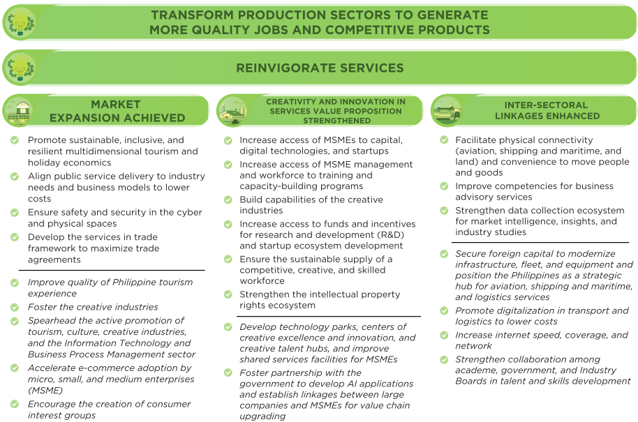

## Reinvigorate Services

## Reinvigorate Services

The services sector will shift from its current low productivity level to enable the Philippines to become a modern, productive, and resilient global leader providing higher value-adding and differentiated services. Market expansion and digital transformation will create the pathways for services firms to enhance their strong presence in markets, reach new market segments and buyer geographies, and pursue diversification. The sector will gain strength, speed, and size from the dynamic ecosystem of technology, talent and skills development, intellectual property rights protection, and competition for creativity and innovation. A strong public-private-social partnership will be nurtured to expand investments in the regions and enhance strategic inter-sectoral linkages for inclusive, resilient, and sustainable participation of the Philippines in global value chains that mark the Fourth Industrial Revolution.

This chapter presents the challenges in reinvigorating services and the outcomes to be pursued to address these challenges during the Plan period. These outcomes are: (a) market expansion achieved; (b) creativity and innovation in services value proposition strengthened; and (c) inter-sectoral linkages enhanced.

## Assessment and Challenges

For the first three quarters of 2022, the services sector grew by 8.9 percent year-onyear. Other services activities recorded the highest growth at 33.2 percent, followed by accommodation and food service activities at 29.7 percent, and transportation and storage at 25.9 percent. The services sector remains the largest sector in the economy with a share of 60.9 percent in gross domestic product (GDP). The sector is still on track to achieving the target growth of 7.3 to 8.3 percent for the year. Increased economic activities and improved consumer and business confidence brought about by the easing of pandemic restrictions are expected to accelerate the sector's full recovery in 2022.

Beyond their direct contributions to growth in terms of generating jobs, export revenues, and investments, services bind the value chain links across economic sectors. The share of services in GDP has increased over time, influenced by the rise in consumption of services by the production sectors (including services itself), from 35 percent in 2006 1 to 41 percent in 2018. 2 The embodied services (shares of services in total intermediate inputs) in manufacturing increased from 18 to 26 percent during the same period. 3 However, the Philippines' manufacturing exports have weak linkages with modern services, such as business and financial services, 4 research and development (R&amp;D), and design during pre- and postproduction stages.

While the services sector is the largest employer with an average of 57 percent share in total employment from 2017 to 2021, it is still dominated by low-pay jobs concentrated in low-skills domestic services (i.e., retail trade, administrative and support services, arts, entertainment, and recreation, and other community and personal services) that accounts for more than half of the sector's gross value-added, and employs 69.4 percent of the total workforce in the services sector.

The overall labor productivity level of services sector in 2021 (PHP0.44 million at 2018 constant prices) is low and slower than the productivity of the industrial sector (PHP0.69 million at 2018 constant prices). From 2017 to 2021, employment in services grew by an average of 3.2 percent per year while productivity increased by 1.3 percent per year. In terms of labor productivity, the information and communication services grew the fastest (5.3%), followed by finance and insurance activities (4.7%), public administration and defense (3.7%), and education (3.3%). The sectors heavily linked to production experienced decline in productivity during the same period: wholesale and retail trade (-0.4%), transportation and storage (-1.3%), and professional and business services (-5.8%).

Key opportunities for job creation and increased participation in higher valueadding services include: (a) growth trajectory of the information technology and business process management (IT-BPM) sector (8% revenue growth per year in the next six years) to create one million direct and additional 1.1 million indirect jobs by 2028; 5 (b) openness of Philippine tourism and potentials to surpass its 2019 record (12.9% share of GDP and 5.7 million employment); 6 (c) economic reforms such as the Amendments of the Public Services Act, Foreign Investment Act (FIA), and the Retail Trade Liberalization Act (RTLA) to catalyze investments and talents and skills transfer; (d) laws such as the Philippine Creative Industries Development Act (PCIDA), Innovation Act, Innovation Startup Act, and the Digital Competitiveness Act that will foster creative industries (7.9% of GDP in 2018) 7 and science-technology-innovation (STI) driven industrialization; and (e) growth of the digital economy (9.6% of GDP in 2021) 8 and use of automation and artificial intelligence (AI).

Apart from the overall low productivity of the sector, the disparity in performance of the services sector across Philippine regions also needs to be addressed to promote inclusive growth. 9 The binding constraints to increasing productivity include high shipping and logistics cost, lack of access to reliable and advanced information and communications technology (ICT) infrastructure, lack of competition, lack of access to markets and capital, mismatch in skills and lack of skilled talent for niche job roles, and vulnerabilities of communities to the impact of climate change. 10 Increasing international tourism expenditures and foreign direct investment will be greatly needed to match the expected rise in capital importation associated with upgrading the global value chain (GVC) in manufacturing. The economic reforms and their respective implementing rules and regulations will facilitate the flow of investments in the regions, modernize the services sector, accelerate the country's economic recovery from the coronavirus disease (COVID-19) pandemic, and promote inclusive growth.

## Strategy Framework

The main goal is to reinvigorate the services sector to generate more quality jobs and competitive products. During the Plan period, the government and private sector will strengthen their partnership to expand markets and achieve scale through aggressive marketing and promotions, trade, and global partnerships, and facilitate the use of digital technologies and processes to raise productivity in low-skills services. Building the capabilities of more companies is important to shift to higher value and differentiated services and high-skills jobs. To facilitate this upgrading, they need new technologies, skilled management and workforce, and a steady supply of talent. New technologies will allow them to reduce costs, create new services, and operate with new and dynamic business models. The three elements of technology, training, and talent can build a more robust and dynamic ecosystem driven by creativity and innovation. Finally, investments to enhance inter-sectoral linkages, especially in liberalized sectors enabled by the amendments to the Public Services Act, FIA, and RTLA, present opportunities to magnify the spillover effects of technology, training, and market growth toward greater inclusion and overall transformation.

Three sector outcomes are envisioned: (a) market expansion achieved; (b) creativity and innovation in services value proposition strengthened; and (c) inter-sectoral linkages enhanced (See Figure 7.1).

Figure 7.1 Strategy Framework to Reinvigorate Services

## Strategies

The following strategies will be implemented to achieve the sector and subsector outcomes and targets.

## Outcome 1: Market expansion achieved

Promote sustainable, inclusive, and resilient multidimensional tourism and holiday economics

Diversify product portfolio through multidimensional tourism that offers a range of experiences by highlighting the strengths of the Filipino people, natural and cultural endowments in culture and heritage, arts, food and gastronomy (including Halal), nature-based farm tourism, cruises, film, medical, health and wellness, meetings, incentives, conventions, and exhibitions. The Department of Tourism (DOT) will accelerate the roll out of the product development manual and training modules for local government units (LGU) to increase the readiness of products and destinations for safe, smart, and sustainable tourism.

Increase participation in high-impact international events and dedicated investment missions to build on positive perceptions and success stories of destinations and people. Promote partnerships with the Department of Trade and Industry (DTI) and Department of Foreign Affairs in securing and disseminating market intelligence and in showcasing the assets of the Philippines in creative tourism.

Improve local tourism governance by transforming LGUs into destination management organizations with strong private sector partnership. The LGUs will spearhead the development and implementation of their local tourism plans and institutionalization of tourism offices for sustainability. The LGUs, with assistance from the DOT and Tourism Infrastructure Enterprise Zone Authority, will prioritize the provision of destination infrastructure (e.g., water, sanitation, solid waste management, health care facilities, renewable energy, early warning systems) to increase the carrying and adaptive capacities of destinations against future crises and climate change impact.

Promote "holiday economics" and invest in year-round, domestic, multi-media campaign together with the LGUs, private sector, and educational institutions to encourage Filipinos to travel, promote pride of place and culture, and become ambassadors of Philippine tourism.

## Improve the quality of the Philippine tourism experience

Promote national accreditation such as the progressive accreditation system and ANAHAW Philippine Sustainable Tourism Certification to build the confidence of markets and enterprises. Advocate enterprises to offer sustainable services as key differentiators of Philippine tourism using international standards for low-carbon emission tourism value chains.

Increase the capacity of the DOT regional offices and the LGUs to assist enterprises' complete accreditation. The initiative aims to increase the number of enterprises that embrace quality standards in facilities and services for the benefit of tourists and enterprise owners.

Strengthen transfer of knowledge and practices in promoting Filipino cultural values as a competitive advantage in human capital development and in achieving sustainable tourism. In partnership with the DOT, the private sector will promote partnerships between large enterprises and micro, small, and medium enterprises (MSME) to propagate high service quality in tourism, curate mutually beneficial authentic tourism experiences with local communities, and scale up sustainable tourism practices.

## Foster the creative industries

Support the formation of the Philippine Creative Industries Development Council (CIDC) as provided under Republic Act No. 11904. The DTI will chair the CIDC, which will be composed of 19 members, ten of which should be ex-officio (government members) and nine regular members from the private sector. The CIDC will prepare the Creative Industries Development Plan, Creative Industries Investments Priority Plan, and undertake road-mapping efforts for the different identified creative sectors under the nine domains of the PCIDA.

Spearhead the active promotion of tourism, culture, creative industries, and the Information Technology and Business Process Management sector

Harness the creative industries to increase positive perception of tourism destinations and build the distinctly Filipino brand of tourism and culture. Expand marketing thrusts by actively participating in domestic and international travel trade shows, familiarization trips, and consumer activation programs supported by the government.

Partner with international organizations and networks of global Filipino communities to increase market access of Philippine destinations and Filipino creative designs and products.

Further strengthen presence in markets such as North America where the Philippines enjoys strong market shares in products, such as contact centers and financial and professional services. Protect the country's dominant position in service in these markets, with the IT and Business Process Association of the Philippines, subsector associations, and firms as prime movers guided by the industry roadmap, i.e., The Big PH IT-BPM Leap: The Philippine IT-BPM Industry Roadmap 2028.

Deepen penetration for new high value-adding and high-yielding products (e.g., financial, health care, retail, technology, media, and telecommunication, cybersecurity) in Europe and Asia-Pacific.

Demonstrate and showcase existing capabilities of the Philippines to offer high value-adding and differentiated services, such as transportation design; services using AI; digital and data services (blockchain, cloud and mobile apps, Internet of Things, augmented reality, virtual reality, mixed reality, Big Data analytics); e-gaming; animation; audio-visual services; and digital applications in health services.

## Align public service delivery to industry needs and business models to lower costs

Streamline requirements and procedures and implement 24/7 operations of agencies at ports and airports to reduce transport and logistics costs. Remove redundancies and reduce the steps involved in the submission of requirements to regulatory agencies (e.g., permits and licenses; documentary requirements; client steps; and fees in cold storage, freight forwarding, trucking, warehousing, and domestic shipping businesses). Harmonize accreditation processes between DTI and concerned agencies such as the Civil Aeronautics Board for freight forwarding companies. Ensure the availability of budget for agencies, such as the Bureau of Customs (BOC), Bureau of Animal Industry (BAI), Bureau of Plant Industry (BPI), and Bureau of Fisheries and Aquatic Resources (BFAR) to enable them to hire human resources and procure the right system and software to support efficient 24/7 operations. The LGUs are encouraged to remove costs such as pass-thru fees and ensure safe entry and exit of goods in their respective areas of jurisdiction.

Facilitate business name registration, licensing, and social protection of enterprises and gig workers (freelancers, contractors, independent professionals), and enable more women to engage in entrepreneurial activities (See Subchapter 3.2).

## Ensure safety and security in the cyber and physical spaces

Adopt a legal framework to strengthen cybersecurity and policies on minimum information security standards to protect critical information infrastructure and the ICT systems of public institutions, transportation, and e-commerce transactions, and increase capacity of the private sector to mitigate piracy of creative outputs.

Implement the Financial Consumer Protection Act that better enables financial regulators to address consumer complaints on cybercrimes and enforce sanctions against erring entities.

Establish a Transportation Safety Board to serve as an independent investigatory, research, and standards-setting agency dedicated to promoting safety in all modes of transportation (i.e., land, sea, air, and railway).

Develop the services in trade framework to maximize trade agreements (See Chapter 9)

## Accelerate e-commerce adoption by MSMEs

Engage businesses in awareness and advocacy campaigns on the benefits of e-commerce in increasing their visibility and global reach. Private technology and platform providers, industry associations, and conglomerates will be encouraged to scale up collaboration with the DTI and partner agencies to increase the adoption of e-commerce tools by MSMEs in services (e.g., wholesale and retail trade, tourism, and arts and culture) to improve their processes, and to accept digital payments toward a cash-lite economy.

Establish secure e-payment systems and ensure consumer and supplier protection online to promote trust and confidence in the digital uptake. The enhanced protection will create value through increased traceability of goods, including imported orders.

Promote cybersecurity culture. Create greater awareness of the global and local cybersecurity context, including the threat landscape among employees, industry partners, and customers.

## Encourage the creation of consumer interest groups

Expand the participation of communities in promoting competition in services through coalition-building, alliances, and partnerships. This aims to produce social capital to resolve collective issues and challenges encountered in modernizing the services sector; increasing entry of foreign players; and addressing anti-competitive practices as well as poor environmental, social, and governance practices.

Promote consumer and producer rights protection by streamlining processes for resolution of disputes and complaints that may be related to defective goods, fraud, cybercrime, payment security issues, and security of websites.

## Outcome 2: Creativity and innovation in services value proposition strengthened

Increase access of MSMEs to capital, digital technologies, and startups

Invest in STI-driven upgrading of MSMEs, including process, product, organization, and marketing. Through the Center for Artificial Intelligence Research (CAIR) and DTI's Regional Inclusive Innovation Centers, MSMEs will gain access to ideas, technology, and talents to improve firm performance. Under the Philippine Innovation Act, entities from the creative industries may avail of shared service facilities from the DTI, as well as the infrastructure and R&amp;D support programs of the Department of Science and Technology.

Increase access of MSME management and workforce to training and capacity-building programs

Enhance digital, management, and entrepreneurship competencies of MSMEs. Through the implementation of the Digital Workforce Competitiveness Act, the DTI, in coordination with relevant government agencies and the private sector, shall establish co-working or shared service facilities to support the development and enhancement of digital skills and competencies of entrepreneurs, especially women, and the current and future workforce.

The Philippine CIDC will undertake training and capacity building in business development to enhance financial literacy, ethics, digital skills, taxation, design thinking, contracts, negotiations, and entrepreneurship.

Develop technology parks, centers of creative excellence and innovation, and creative talent hubs, and improve shared services facilities for MSMEs

Match real estate development projects to the requirements of the creativity, innovation, and entrepreneurship ecosystems. The IT-BPM companies will have dedicated "creative hubs" located in campuses with flexible workspaces and common infrastructure to support creative freelancers. Creative hubs with training and advanced opportunities; advanced research labs; and business support centers (for legal, mentoring and guidance services, linkages with investors, and repositories of creative images as sources of inspiration) will be established to support MSMEs, creative entrepreneurs, and startups.

Foster partnership with the government to develop AI applications and establish linkages between large companies and MSMEs for value chain upgrading

Private sector investors will be encouraged to take part in the CAIR. This will expand the Center's business segments and increase the number and scope of AI projects that can be accommodated.

## Build capabilities of the creative industries

The DTI as Chair of the CIDC will lead the formulation and implementation of a Philippine Creative Industries Development Plan mandated under RA 11904. This plan will define the value creation, market creation and expansion, investment targets, intellectual property targets, and other strategies, among others.

Promote the Malikhaing Pinoy Creative Market Acceleration Program, which is a handholding program and support for trade and investment promotion to increase value chain participation of creative industries.

## Increase access to funds and incentives for R&amp;D and startup ecosystem development

Provide funds and incentives, such as low-interest loans, scholarships, research grants, training subsidies to promote startups, digital technology careers, innovations, and research projects that address industry needs. Financial capital is provided under the Corporate Recovery and Tax Incentives for Enterprises Act, Innovation Act, Innovation Startup Act, and Digital Workforce Competitiveness Act. These legislations support startup entrepreneurs, scientists, and researchers to achieve STI interventions, accelerate the transfer and commercialization of generated technologies, and strengthen the capability of human resources and institutions to undertake R&amp;D.

Craft and implement programs to build the startup ecosystem. Create a common understanding of the startup journey and ecosystem development among government agencies toward the alignment and harmonization of startup policies and programs. The government shall also provide strong focus on promoting innovation and entrepreneurship, create a more enabling business environment for startups, and allow more foreign participation.

## Ensure the sustainable supply of a competitive, creative, and skilled workforce

Implement the Philippine Tourism Human Capital Development Plan 2021-2025 to ensure the steady supply of trained human resources. The development of competent, world-class Filipino tourism professionals through the education system is the core of the plan. The Filipino Brand of Service Excellence Program of the DOT will continue to promote the best qualities and positive values of Filipino hospitality.

Establish a Creative Educational Plan in partnership with the private sector and the academe. The Department of Education (DepEd) and Commission on Higher Education (CHED) shall support and develop relevant programs and provide scholarships to deserving students enrolled in programs and courses related to creative industries. The Technical Education and Skills Development Authority (TESDA) shall also provide technical and vocational training through scholarship programs and continuous education. And the CIDC shall provide technical and financial assistance to providers of non-formal learning modalities.

Appropriate funds for educational institutions that will revise or develop new curricula to address learning gaps. The DepEd, CHED, and TESDA shall continue to extend incentives to academic institutions that provide funds and grants for the research of their students and faculty on the development and promotion of the services sector.

Strengthen collaboration with the private sector in mentoring programs; promotion of science, technology, engineering, entrepreneurship, arts, and mathematics careers; and interventions to build talent in differentiated services proposition. This initiative aims to increase financial, digital, and cybersecurity literacy; and develop entrepreneurial and creative skills from early schooling by revising curricula (inclusion of mandatory basic computer education, introduction of relevant electives and/or micro-credentials across courses) to support IT-BPM upgrading.

## Strengthen the intellectual property rights ecosystem

Provide capacity-building measures through the CIDC and partners in facilitating the registration of patents, and monitoring and protection of intellectual property rights, traditional cultural skills of Filipino creative industry stakeholders, and indigenous cultural communities against infringement.

Accede to the 2005 United Nations Educational, Scientific, and Cultural Organization Convention. Ratifying this Convention will further promote and protect the works of creatives in the country, as it focuses on protecting the diversity of cultural expressions all over the world. It highlights the creative industries, which have become important drivers of cultural and economic development of nations.

## Outcome 3: Inter-sectoral linkages enhanced

Facilitate physical connectivity (aviation, shipping and maritime, and land) and convenience to move people and goods

Increase access to tourist destinations through an improved and sustainable transportation network, and digitalization of tourist services to increase yields from higher spending and length of stay in a wide range of destinations. Develop and expand inter- and multi-modal tourism routes (air, shipping and maritime, land) supported by the DOT, Department of Transportation, and Department of Public Works and Highways. Provide support for update of the National Cruise Tourism Strategy to enhance the contributions of local and international cruise tourism and maritime industries to the Philippine blue ocean economy and jobs.

Promote barrier-free tourism by providing technology-enabled real-time information and assistance, and the Filipino brand of service excellence and care to visitors, particularly those with special needs.

Secure foreign capital to modernize infrastructure, fleet, and equipment and position the Philippines as a strategic hub for aviation, shipping and maritime, and logistics services

Leverage the Public Services Act, FIA, and RTLA amendments to attract global partners and innovators (See Chapter 9), to modernize services and to reduce overall transport and logistics costs. Through partnerships with foreign companies, the private sector will harness the strategic locational advantage and archipelagic endowments of the country by connecting its various islands and destinations. This supports the objectives under the Maritime Industry Development Plan 2019-2028 to accelerate the achievement of a nationally integrated and globally competitive maritime industry, and to position the country as an aviation hub in Asia. Foreign capital shall be utilized to increase the capacity of the aviation, maritime, and shipping companies to: (a) invest in green, modern, and resilient hubs, equipment, and fleet; (b) build capabilities to participate in the transportation GVCs (design, maintenance, repair, and overhaul); (c) upgrade and align education and training programs with international standards; (d) promote best safety and security practices; and (e) develop modernized gateways and clusters to attract international logistics, retail, IT-BPM, and tourism companies.

## Promote digitalization in transport and logistics to lower costs

Promote 24/7 operations of businesses, including brokerage houses, distribution centers, warehouses, shipping lines offices, and banking facilities. Advocate the BOC and partner agencies such as BAI, BPI, and BFAR

to shift to 24/7 services and match the 24/7 port operations. This initiative of the Logistics Services Philippines aims to ensure seamless, secure, and timely flow and delivery of goods to customers.

Increase utilization of technology in logistics processes to improve coordination among stakeholders (i.e., brokers, shipping lines, airlines, cargo consolidator and freight forwarders, and government). In partnership with the DTI, the Logistics Services Philippines and its partners shall collaborate to increase the use of digital technologies, disseminate correct information, and promote real-time monitoring for improved transparency and efficiency in the mobility of goods.

Expand participation in the modernization of existing airports, ports, and land transport terminals to reduce overall transportation costs and shipment delays (See Chapter 12).

## Increase internet speed, coverage, and network

Expand fiber-optic, broadband, and 5G network in areas identified by industries on a priority basis for fast speed, high density of IT-BPM workers, clustering of tourism and retail facilities, and activities, ports, airports, transport terminals, logistics facilities and creative industries.

Build and operate broadband facilities to offer internet services in underserved and unserved areas. Use direct access to all satellite systems, whether fixed, mobile, international, or domestic, to connect local businesses and tourism sites with their developing markets and to build resilience.

## Improve competencies for business advisory services

Increase readiness of local destinations and LGUs in hosting investments. Led by the DTI-Board of Investments, in collaboration with sector- or area-focused investment promotion agencies, private sector, and academe, develop an ecosystem of advisory services to enable LGUs to acquire strategic skills tand capacitate them to match local service firms with investors, build the expertise of LGUs in risk management, and conduct due diligence.

## Strengthen data collection ecosystem for market intelligence, insights, and industry studies

Promote the active participation of colleges and universities in collecting and analyzing data in the services sector. Subsequent research outputs of the academe will help increase access to information by MSMEs that can improve their linkages with markets, and enhance their services and ability to create and offer new and high-quality services. The government shall invest in the development of satellite accounts for other services, such as transportation and logistics, including subnational satellite accounts (tourism, digital economy, creative industries, and logistics), on a phased priority basis.

Increase the capacities of destination stakeholders to adopt digitally enabled data collection tools and measures. Pivoting to Big Data will complement the collection of traditional indicators, support product and market development, reduce costs and create value along the tourism supply chain, and engage local communities for improved policy-making processes.

Strengthen regular and active participation of private sector and communities to promote free flow of information with the government. Associations will share insights, market intelligence, and data on the sectors they represent and contribute to the development of online directories and registries. Councils and networks such as the Philippine Creative Cities Network and the Local Culture and Arts Council for the development of the local creative industries under the PCIDA will advance collaboration and competitiveness by enhancing linkages between industries and government.

Through the CIDC, lead the development of the Creative Industry Data and Information Management in coordination with the Philippine Statistics Authority (PSA) and other relevant national government agencies to set up a satellite account for creative industries that also covers data collection and management.

## Strengthen collaboration among academe, government, and Industry Boards in talent and skills development

Revise existing curricula or design new courses based on the needs of the industries. The private sector will work closely with the academe and government agencies in the conduct of tracer studies; design and implementation of immersion and internship programs for faculty and students in the country and abroad; and facilitation of development of labor market information systems (See Chapter 4).

Expand talent pool through the transfer of international talents and skills, and exchange programs for faculty and students (See Chapter 4). Promote diversity to nurture creativity in the private sector by partnering with international networks of suppliers, buyers, and educational institutions.

Provide information and expert advice on the must-have skills and competencies under the Philippine Skills Framework (PSF) Initiative to boost the capacity of the Philippines in skills of the future. 11 Under the PSF on logistics and supply chain, the first to be launched by the DTI under the initiative, the sector will collaborate with TESDA to develop course modules and assessment tools. 12

## Legislative Agenda

Table 7.1 presents the priority bills for the 19th Congress to reinvigorate services.

Table 7.1 Legislative Agenda to Reinvigorate Services

| LEGISLATIVE AGENDA                                                                                                                                              | RATIONALE/KEY FEATURES                                                                                                                                                                                                                                                                                                                                                                                                             | RESPONSIBLE AGENCY                                                                                              |
|-----------------------------------------------------------------------------------------------------------------------------------------------------------------|------------------------------------------------------------------------------------------------------------------------------------------------------------------------------------------------------------------------------------------------------------------------------------------------------------------------------------------------------------------------------------------------------------------------------------|-----------------------------------------------------------------------------------------------------------------|
| Update RA 10372 (An Act Amending Certain Provisions of RA 8293, otherwise known as the "Intellectual Property Code of the Philippines, and for Other Purposes") | This aims to commercialize technologies and support the development of creative industries. This will enhance the attractiveness of the Philippines as an investment destination that places high value on intellectual property creation, protection, utilization, and commercialization, as well as prevent piracy in the physical and digital markets.                                                                          | Intellectual Property Office of the Philippines                                                                 |
| Open Access in Data Transmission Act                                                                                                                            | This seeks to level the playing field in the data transmission and telecommunications market. Its passage will strengthen value chain linkages in the industry and services sectors and facilitate the realization of the full potential of e-commerce and digital trade.                                                                                                                                                          | Department of Information and Communications Technology (DICT) and National Telecommunications Commission (NTC) |
| Internet Transactions Act                                                                                                                                       | The bill aims to define the scope and coverage of internet transactions, apart from the sale or exchange of digital products, and lay down the code of conduct and qualifications for businesses who wish to engage in e-commerce. It also proposes the creation of an E-commerce Bureau to handle complaints on internet transactions, protect consumer rights, and facilitate the speedy resolution of complaints, among others. | DTI                                                                                                             |
| International Maritime Competitiveness Act                                                                                                                      | This will address the expensive shipping rates in the Philippines due largely to the imposition of "excessive, arbitrary, and unreasonable" shipping charges by foreign shipping lines, such as the "destination and origin charges," container deposit fees, container cleaning fees, detention and demurrage charges, and port congestion charges.                                                                               | Maritime Industry Authority                                                                                     |

## Results Matrix

Table 7.2 presents the indicators and targets during the Plan period to reinvigorate services.

Table 7.2 Results Matrix: Reinvigorate Services

| INDICATOR                                                                      | BASELINE - (2021)                       | TARGETS - 2023                          | TARGETS - 2024                          | TARGETS - 2025                          | TARGETS - 2026                          | TARGETS - 2027                          | TARGETS - 2028                          | MEANS OF VERIFICATION                        | RESPONSIBLE AGENCY/ INTER-AGENCY - BODY   |
|--------------------------------------------------------------------------------|-----------------------------------------|-----------------------------------------|-----------------------------------------|-----------------------------------------|-----------------------------------------|-----------------------------------------|-----------------------------------------|----------------------------------------------|-------------------------------------------|
| Intermediate Goal                                                              | Intermediate Goal                       | Intermediate Goal                       | Intermediate Goal                       | Intermediate Goal                       | Intermediate Goal                       | Intermediate Goal                       | Intermediate Goal                       | Intermediate Goal                            |                                           |
| Chapter Outcome: Services Reinvigorated                                        | Chapter Outcome: Services Reinvigorated | Chapter Outcome: Services Reinvigorated | Chapter Outcome: Services Reinvigorated | Chapter Outcome: Services Reinvigorated | Chapter Outcome: Services Reinvigorated | Chapter Outcome: Services Reinvigorated | Chapter Outcome: Services Reinvigorated | Chapter Outcome: Services Reinvigorated      | Chapter Outcome: Services Reinvigorated   |
| Gross value-added growth rate in the services sector improved (%)              | 8.9 (year-to- date, Q1-Q3 2022)         | 6.4-7.9                                 | 6.4-7.9                                 | 6.4-7.9                                 | 6.4-7.9                                 | 6.4-7.9                                 | 6.4-7.9                                 | National Income Accounts (NIA)               | DTI                                       |
| Labor productivity growth in services improved (%)                             | -6.4                                    | 5.0 - 8.5                               | 5.0 - 8.5                               | 5.0 - 8.5                               | 5.0 - 8.5                               | 5.0 - 8.5                               | 5.0 - 8.5                               | NIA, Labor Force Survey                      | Department of Labor and Employment        |
| Contribution of tourism to gross domestic product ((GDP) improved (%) 1,2      | 5.2                                     | TBD                                     | TBD                                     | TBD                                     | TBD                                     | TBD                                     | TBD                                     | Philippine Tourism Satellite Accounts (PTSA) | DOT                                       |
| Total tourism investments (as a proportion of total investments) increased 1,2 | 8.8                                     | TBD                                     | TBD                                     | TBD                                     | TBD                                     | TBD                                     | TBD                                     | PTSA                                         | DOT                                       |
| Contribution of e-commerce to GDP increased (%) 1,3                            | 1.7                                     | TBD                                     | TBD                                     | TBD                                     | TBD                                     | TBD                                     | TBD                                     | DTI eCommerce Roadmap                        | DTI                                       |

1 Satellite Accounts prepared by the Philippine Statistics Authority.

2 Targets will be based on the National Tourism Development Plan 2023-2028, expected to be completed by Q1 2023.

3 Targets will be based on the Philippine E-Commerce Roadmap 2023-2025, expected to be completed by Q1 2023.

- 1 Serafica, R.B. 2014. "Formulating the Philippine Services Strategy for Inclusive Growth." Discussion Paper Series No. 2014-22. PIDS. https://pidswebs.pids.gov.ph/ CDN/PUBLICATIONS/pidsdps1422.pdf
- 2 PSA. 2021. 2018 Input-Output Tables. https://psa.gov.ph/content/psa-releases-2018-input-output-tables.
- 3 The shares of services would be higher with the inclusion of embedded services in the inputs (e.g., in-house design of manufacturing firms) or bundled together in a good (e.g., after-sales maintenance). These values are not currently monitored.
- 4 Arenas, G. and S. Coulibaly, eds. 2022. A New Dawn for Global Value Chain Participation in the Philippines. Washington, DC: World Bank. DOI: 10.1596/978-1-4648-1848-6.
- 5 Everest Global Inc.. 2022. The Philippine IT-BPM Industry Value Proposition. Presentation during the IT and Business Process Association of the Philippines "International Innovation Summit on the Philippines IT-BPM Industry Roadmap 2028", September 27-29, 2022, Manila. https://www.everestgrp.com/ international-innovation-summit.html.
- 6 PSA. 2022. Philippine Tourism Satellite Accounts (PTSA) Report. https://psa.gov.ph/content/philippine-tourism-satellite-accounts-ptsa-report.
- 7 Mapa, C. D. S. et. al. 2022. The Philippine Creative Economy Satellite Accounts: Measurement and Challenges. Paper presented during the 15th National Convention on Statistics, 4 October 2022, Quezon City.
- 8 PSA. 2022. Philippine Digital Economy Satellite Accounts 2021. Quezon City.
- 9 Serafica, R.B., J. M. Vergara, and Q.C.A. Oren. 2021. "Regional Analysis of the Philippine Services Sector." Research Paper Series No. 2021-04. PIDS. https://www. pids.gov.ph/publication/research-paper-series/regional-analysis-of-the-philippine-services-sector.
- 10 Synthesis of assessments, studies, and inputs provided by various sectors.
- 11 IT-BPM: analytical skills, digitally skilled talent, project management, managerial and soft skills, sector-specific skills. Tourism: operational skills; soft skills; technical, quality, professional, and leadership skills; health and safety skills; and product-specific skills. E-commerce: information technology and/or digital literacy skills, marketing and customer service skills, financial literacy, entrepreneurship. Creative industries: soft skills, critical thinking and problem-solving skills, technical skills, managerial and/or entrepreneurial skills, functional creations skills.
- 12 Functional Skills: management skills (operations, procurement, and supply); staff skills (driving, warehousing, inventory, logistics and forecast planning, logistics and supply chain, transport and/or traffic load planning); enabling skills (leadership, business and ethics, professionalism, customer engagement and relationship); emerging skills (AI-driven services, robotics, analytics, critical thinking, problem solving).