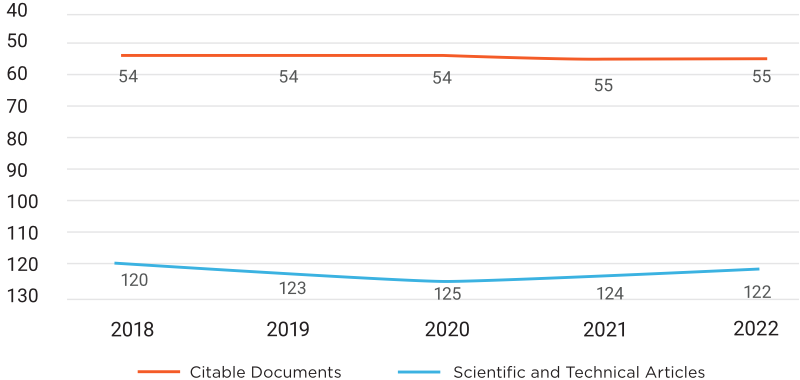
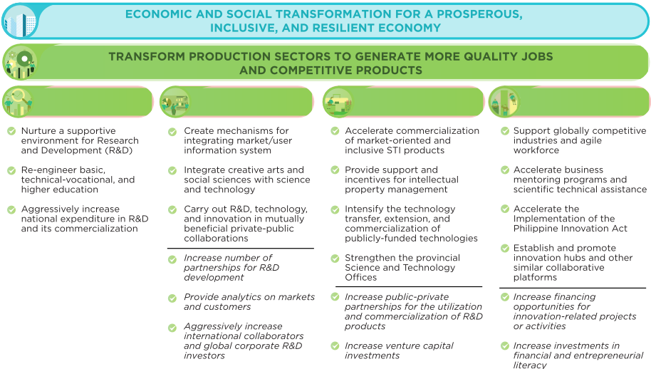

## Advance Research and Development, Technology, and Innovation

## Advance Research and Development, Technology, and Innovation

Research and development (R&amp;D) involves creative work undertaken on a systematic basis to produce knowledge that can be used to generate new technologies and innovations. R&amp;D, technology, and innovation are drivers of long-term economic growth and social progress. With the rise of digital transformation, strategies will be pursued to develop high-value R&amp;D products, technologies, and innovations that will boost the efficiency and competitiveness of various sectors.

The sector will implement a set of integrated strategies to (a) advance R&amp;D, technology, and innovation from knowledge creation to commercialization of R&amp;D products; and (b) reinforce the innovation and entrepreneurship ecosystem. The strategy framework views R&amp;D, technology, and innovation generation as a continuum encompassing theoretical conception through basic research, technical invention, and commercial use. It seeks a balanced and strong support for both the knowledge-seeking and commercializing purposes of research, and the enabling environment that fosters a culture of innovation and entrepreneurship.

This chapter presents the challenges in advancing R&amp;D, technology, and innovation, including the outcomes to be pursued to address these challenges during the Plan period. These outcomes are: (a) basic R&amp;D and knowledge creation strengthened; (b) market-driven and customer-centered research and development advanced; (c) technology extension, adoption, utilization, and commercialization scaled-up; and (d) innovation and entrepreneurship accelerated.

## Assessment and Challenges

The Philippines ranked 59th in the 2022 Global Innovation Index (GII), 1,2 sliding down eight places from its 2021 ranking. Likewise, the country's rank in innovation inputs dipped from 72nd in 2021 to 76th in 2022. Innovation outputs fell from 40th in 2021 to 51st in 2022, largely due to decreased performance scores in knowledge and technology outputs, which are mainly a function of knowledge creation, knowledge impact, and knowledge diffusion. The weakest performance recorded in the country was posted by institutions.

The critical challenges affecting the sector are as follows:

Inadequate human resources in science-technology-innovation (STI), and R&amp;D. The country's capacity to generate new knowledge and technology is dependent on its human resources. Although the country has relatively high 2022 GII score in "Graduates in Science and Engineering," it only has less than 174 full-time researchers per million population, ranking 84th out of 132 countries.

Underdeveloped research culture and productivity. The capacity to create and discover new knowledge and explore its applications are important considerations in advancing R&amp;D, technology, and innovation. Figure 8.1 illustrates the low levels of knowledge creation outputs in terms of scientific and technical publications, and citable documents, which measures both the productivity and citation impact of publications and the state of knowledge creation.

Figure 8.1 Global Innovation Index Rank in Sub-Index Related to Knowledge Creation

Sources: World Intellectual Property Organization. Various years. Global Innovation Index. Geneva. https://www.wipo.int/global\_innovation\_ index/en/; Dutta, S., B. Lanvin, L. Rivera León, and S. Wunsch-Vincent, eds. 2022. Global Innovation Index 2022: What Is the Future of Innovation-Driven Growth? Geneva: World Intellectual Property Organization.

Moreover, the present government procurement process delays the implementation of R&amp;D programs due to restrictive regulations leading to low research productivity, publication potential, and commercialization of innovations. 3

Insufficient spending on R&amp;D. The country's gross expenditure on R&amp;D (GERD) stands at 0.32 4 percent, which is substantially below the global average of 2.04 percent and the 1 percent benchmark recommended by the United Nations Educational, Scientific, and Cultural Organization. The government share to the total R&amp;D expenditure is at 39 percent, while the private sector is at 61 percent. The 2022 GII ranked the Philippines 75th in GERD.

Underdeveloped linkages among stakeholders in the R&amp;D, technology, and innovation ecosystem. The Philippines ranked 64th in the 2022 GII on UniversityIndustry Collaboration on R&amp;D. Most universities perceive assisting companies as outside of their core mission. 5

Lack of focus on information about markets or users and market system requirements. The proverbial orientation of producing knowledge for knowledge's sake appears to characterize much of the R&amp;D projects. It has been noted that considerations about markets, users or adopters of R&amp;D products and their needs are still limited in the research process. 6

Need for a more vigorous intellectual property (IP) culture. The 2022 GII report showed attestable dips in scores in Industrial Designs (ID), -10 spots in ranking; Cultural and Creative Services Exports, -9; Utility Models, -7; Patent Families, -7; and Trademarks -3. 7 The report also noted that the country dropped by 10 places in terms of innovation outputs as seen in the decrease in percentage points for the sub-indicators (knowledge and technology output pillar):

patents by origin, IP receipts, and creative and cultural exports. Although the declines may be attributed to the lack of filing activity during the pandemic, the two-year (2021 and 2022) consecutive drop in the GII ranking calls for a need to improve the country's IP culture by encouraging the registration of IPs, strengthening the enforcement of IP laws, and promoting collaborations among stakeholders to transform valuable IP assets that are relevant and useful to industries.

Barriers to building an innovative and entrepreneurial culture. Challenges remain at the formation level, such as instilling the value of innovation and entrepreneurship, integrating this orientation in the education

## Strategy Framework

The strategy framework illustrates the areas of focus in the R&amp;D, technology, and innovation generation continuum. There are four desired outcomes: (a) basic R&amp;D and knowledge creation strengthened;

curriculum at all levels, and reskilling human resources. Business regulation issues remain challenging to the growth of companies, and much of the entrepreneur-specific business services and the expertise needed to grow the startup ecosystem remain low. There are observable low levels of market-readiness and technology-readiness of innovations, which lessen the attraction of these products to external funders. 8

Notwithstanding these challenges, there are positive directions in the development of the country's R&amp;D, technology and innovation infrastructure as evidenced by new laws, policy actions, and various initiatives taken in the last six years. 9

(b) market-driven and customer-centered R&amp;D advanced; (c) technology adoption, utilization, and commercialization scaled up; and (d) innovation and entrepreneurship accelerated.

Figure 8.2 Strategy Framework to Advance Research and Development, Technology, and Innovation

## Strategies

## Outcome 1: Basic R&amp;D and knowledge creation strengthened

R&amp;D covers basic research, applied research, and experimental development. Basic research increases the 'knowledge base' available to companies and other participants in the economy to source innovation information. 10 An important starting point is to increase the quantity and develop the quality of the country's human capital that can produce basic research contributing to knowledge generation, accelerate investments in R&amp;D, and initiate meaningful reforms in the formation of human capital in basic, technical-vocational, and higher education.

## Nurture a supportive environment for R&amp;D

The government, in partnership with the private sector, will build laboratories, science and technology research facilities, Knowledge, Innovation, Science and Technology (KIST) Parks, university science and technology parks, technology business incubators, and other infrastructure that can reduce the complexity and upfront costs and risks for private R&amp;D. The government will strengthen the Balik-Scientist Program and its support to the diaspora of Filipino scientific communities in other parts of the world. It will provide a program of rewards and recognition for state university and college faculties who devote at least eight hours a week to research work and writing. It will enhance its policy to strongly support institutional and individual faculty initiatives to establish linkages with industry, foreign universities, and research institutes. It will expand the sources of public funding for full-time researchers who are working on areas or domains under the national harmonized research agenda. The government will address bottlenecks in administrative processes, including procurement and similar concerns that may hamper the conduct of publicly funded R&amp;D.

## Re-engineer basic, technical-vocational, and higher education

The Department of Education, Technical Education and Skills Development Authority, and Commission on Higher Education shall pursue programs that: (a) trigger Filipinos' drive for curiosity and discovery; (b) cultivate their critical thinking, growth mindset, communication, and decision-making skills; (c) enable them to adapt to the uncertainties of the environment; and (d) develop more trusting and more collaborative relationships with colleagues. These government agencies will promote an Industry 4.0 skills framework that maps out jobs, career pathways, occupational skills, micro-credentialing, and reskilling options.

## Aggressively increase national expenditure in R&amp;D and its commercialization

Increase investments in R&amp;D that can benefit the entire country, which can also invigorate private R&amp;D expenditures in related fields.

These investments shall promote various research and innovation areas identified under the Pagtanaw 2050. 11 Moreover, it will pursue R&amp;D that seeks to improve the production of higher value-added goods and services, reduce the country's reliance on foreign technology, and strengthen the capabilities of domestic firms to create and capture economic value.

## Box 8.1 Pagtanaw 2050: The Philippine Science, Technology, Innovation Foresight

Pagtanaw 2050, which literally translates to "looking ahead," is the first inter-disciplinal and trans-disciplinal project on Philippine-focused science-technology-innovation (STI) foresight and strategic plan. Its main goal is to chart a strategic path by anticipating the factors that will influence the development of the Philippines' scientific capital in the years leading up to 2050. It serves as a planning device toward achieving concrete goals and designing strategic plans that transcends political periods, while aiming for inclusive growth, sustainability, and competitiveness in STI. Pagtanaw 2050 suggests significant drivers of change and provides insights and reflections on plausible STI development paths that will impact the aspirations of the Filipino people and development of the nation toward 2050.

At the core of STI Foresight are 12 key operational areas, namely: (a) Blue Economy; (b) Governance; (c) Business and Trade; (d) Digital Transformation and Information and Communications Technology; (e) Science Education and Talent Retention; (f) Food Security and Nutrition; (g) Health Systems; (h) Energy; (i) Water; (j) Environment and Climate Change; (k) Shelter, Transportation, and Other Infrastructure; and (l) Space Exploration.

This STI Foresight culminates with the STI Roadmap that reiterates cluster goals for the preferred future, science, and technology enablers, drivers, and opportunities. The goal of the STI Roadmap is for the Philippines to eventually become a prosperous, archipelagic, maritime nation characterized by a society that is inclusive, productive, sustainable, educated, and healthy.

The progress of each cluster is determined by the interplay of science and technology enablers, drivers, and opportunities. Achievement of a competitive economy across clusters would bring the Philippines to its preferred stature as a prosperous, archipelagic maritime nation that supports a technology-explicit development agenda that is inclusive and sustainable, and nurtures a citizenry that is educated, healthy, and productive.

Source: National Economic and Development Authority

## Outcome 2: Market-driven and customer-centered research and development advanced

Insights about markets and consumers, and a deepened understanding of potential users will be used to drive R&amp;D and the generation of technology and innovations. To ensure sustainable technology commercialization, government-funded research in universities and research institutes will shift toward a market- and demand-oriented approach in responding to market failures or demand issues in the private sector.

## Create mechanisms for integrating a market/user information system

Working through the various collaborative hubs such as the KIST Parks, technology business incubation, regional inclusive innovation centers (RIIC), and research and extension offices of state universities and colleges (SUC), the government will establish a common and accessible portal that provides market intelligence. Social science researchers and student researchers in higher education institutions will be taught and provided support to conduct primary data collection that can capture relevant market data, such as customer needs and preferences, competitors, customer demographics, market trends, market price, and potential marketing processes. These can be used to guide or inform the R&amp;D process and aid in the generation of technology and innovation.

## Integrate creative arts and social sciences with science and technology

Capacitate human resources on the R&amp;D, technology, and innovation continuum and entrepreneurship to encourage the interaction of scientific, social, and creative talents, and intellectual capital in multidisciplinary collaborations. In particular, the government will bolster the participation of human resources from the creative arts and social sciences as they introduce perspectives on the experience and social usage of technology and innovation, and contribute to the dynamic process of creating value and competitive advantage of R&amp;D, technology, and innovation products.

## Carry out R&amp;D, technology, and innovation in mutually beneficial private-public collaborations

Support and recognize collaborative work of public researchers and private firms on R&amp;D, technology, and innovation. Compensate the time spent for industry research and consultation by faculties of state universities and colleges. Facilitate the licensing of IP generated by public universities and research institutes, including a royalty sharing scheme and/or selling, if necessary, with the industry. It will establish partnerships with countries on pioneering R&amp;D in specific sectors that will provide open access to global best practices, which can then be customized to suit the Philippine context.

## Provide analytics on markets and customers

The private sector will be encouraged to share its observations, knowledge, and insights on people's motivations and preferences, and product trends to help improve R&amp;D products in terms of function, aesthetic impressions, and market value.

## Increase number of partnerships for R&amp;D

The private sector will contribute to government R&amp;D by: (a) guiding researchers and scientists on consumer trends and market system requirements; (b) addressing market challenges and opportunities; (c) leveraging private investments in STI activities; (d) seeking solutions to broad national challenges such as climate change, public health, green growth, and energy efficiency; (e) investing or locating knowledge, science and technology parks, incubators, and entrepreneurship cells; and (f) improving academia-industry linkages.

## Aggressively increase international collaborators and global corporate R&amp;D investors

Seek international R&amp;D collaborations to develop innovative products and services.

It will help promote the attractiveness of the Philippines as a top location for R&amp;D and other innovative activities. It will focus on improving the domestic adoption, implementation, and reengineering of new technologies from domestic and international sources.

## Outcome 3: Technology extension, adoption, utilization, and commercialization scaled-up

The development from a research insight to a widely distributed product requires a good balance of: public funds and private investment; public sector research, extension programs, and private R&amp;D; and scientific, technology management, product development, diffusion, and commercialization skills.

## Accelerate commercialization of market-oriented and inclusive STI products

Provide funding for the diffusion (i.e., extension and promotion) and commercialization of products of both publicly and privately funded STI products. It will streamline the processes for technology transfer transactions. The National Innovation Council (NIC) will continue the administration of the Innovation Fund under the Philippine Innovation Act to support the commercialization of publicly or privately funded and domestically developed technologies and innovations.

## Provide support and incentives for IP management

Accelerate programs to increase awareness among policymakers, private sector, university researchers, and the general public of the value and contribution of innovation and IP to economic and social development. It will strengthen a network of IP units delivering timely, high quality, and accessible IP management services that benefit technology and creative startups. It will improve the capacity of the private sector to create, protect, utilize, commercialize, and enforce their IP rights. The Intellectual Property Office of the Philippines (IPOPHL) will provide businesses with patent mapping and analytics tools that identify trends and gaps in the technological landscape, which can be used as a basis for strategic direction and business decisions for pursuing R&amp;D and investments in technology development.

## Intensify the technology transfer, extension, and commercialization of publicly funded technologies

Provide public research institutions and SUCs with platforms, including avenues, to pitch their R&amp;D products and technology developed, to successfully commercialize their technologies. Programs will also be implemented which involve private sector participation through the promotion, utilization, and commercialization of investments in these products.

The government will seek the most effective modes of technology transfer of commercially ready and publicly funded R&amp;D outputs from qualified private entrepreneurs and enterprises. This will further capacitate the research and extension offices of SUCs and the technology transfer and business development offices. A framework that will standardize the procedures for research and development institutions and SUCs for valuing their IP assets shall be adopted.

## Strengthen the provincial Science and Technology (S&amp;T) Offices

Fast track the implementation of Republic Act 11914 or Provincial Science and Technology Offices (PSTO) Act. The PSTOs are mandated to identify the STI needs in the provinces, implement DOST programs that will be beneficial in rural areas, and develop the institutional linkages among provincial offices, academe, and local government units. The PSTOs will lead the promotion and transfer of technologies and services to enhance the technology-livelihood enterprises in the countryside.

## Increase public-private partnerships for the utilization and commercialization of R&amp;D products

Engage with the private sector in adopting emerging technologies that can compete in rapidly changing world markets, especially in the sphere of digital transformation. Working with SUCs and public research institutes, the private sector will help facilitate the transition from the laboratory to the marketplace, and from demonstration of technical "proof of concept" to commercial introduction of a new technology product or service in the marketplace.

## Increase venture capital investments

The private sector will provide support for startup technology innovators through "angel" investors (i.e., wealthy individuals with experience in starting up new companies), and venture capital firms specialized in early-stage or "seed" investments.

## Outcome 4: Innovation and entrepreneurship accelerated

Innovations flourish as a result of well-developed entrepreneurial skills. While innovation involves the production of a new product, service, or system, entrepreneurship consists of creating value out of these new ideas and turning them into business opportunities. The skills in innovation ideation and production must be complemented with the appropriate business mindset and skills involving risk-taking and decision making, market research and trends, collaboration, leadership, planning, and management, among others. Fostering a strong culture of innovation and entrepreneurship are vital to the pursuit of creating high-quality jobs and competitive products and services.

## Support globally competitive industries and an agile workforce

Improve the competitiveness of creative and science and technology industries through the establishment of industry hubs. It will foster the creativity and digital dexterity of the country's human capital. It will support industry ventures on digital transformation, such as the use of Artificial Intelligence, Robotic Process Automation, and Internet of Things, among others. It will support academeindustry collaborations on skills frameworks and other trainings, particularly in science and technology, to ensure that the future workforce has the necessary science, technology, engineering, and mathematics skills supporting the growth of the Philippine science and technology industry into the future.

## Accelerate business mentoring and scientific technical assistance

Strengthen current mentorship and coaching programs for science and technology startups by tapping large corporations to teach the different aspects of business operations. It will expand access to the One-stop Laboratory Services for Global Competitiveness, Shared Service Facilities, Advanced Device and Testing Laboratory, Electronics Product Development Center, Regional Standards and Testing Laboratories, and other specialized laboratories for product development and improvement.

Provide a venue where researchers and technology developers can meet and pitch their products to possible investors or industries. In the same way, the venue will also provide a platform for industries and investors to share market demands and consumer preferences where R&amp;D, technology development, and innovation can be directed.

## Accelerate the implementation of the Philippine Innovation Act

As mandated by the law, the NIC will formulate and implement the National Innovation and Agenda Strategy Document (NIASD), which will set the country's innovation goals and provide the strategies and action plans for improving the country's innovation governance. The NIC will also continue to administer the National Innovation Fund which aims to strengthen entrepreneurship and enterprises engaged in developing innovative solutions. To generate public support on the country's innovation priorities, the NIC will also develop a National Innovation Communication Plan. The NIC together with the Regional Research, Development, and Innovation Committee of the Regional Development Councils will monitor innovation policies and programs (i.e., NIASD), as guided by the National Innovation Monitoring and Evaluation Matrix. Further, the NIC will establish the Diaspora for Innovation Development Program to engage high level experts, especially overseas Filipinos.

## Establish and promote innovation hubs and other similar collaborative platforms

Establish industry-academe centers that seek fundamental, and multi- and interdisciplinary solutions with high societal relevance. These industry-academe centers and RIICs will ignite digital transformation as an essential factor in innovation and entrepreneurship that can change production and distribution processes, reduce the cost of entering markets, facilitate cross-border trade, and provide flexible access to considerable computing power without investing in physical infrastructure.

## Increase financing opportunities for innovation-related projects or activities

Motivated by the dynamism of the innovation ecosystem, the private sector will operationalize the Mandatory Credit Allocation for Innovation Development. The Mandatory Credit Allocation for Innovation Development under the Philippine Innovation Act provides ease of access for innovation-related projects, especially startups and micro, small, and medium enterprises (MSME). Subject to applicable regulations of the government, the business

## Legislative Agenda

Table 8.1 presents the priority bills for the 19th Congress to advance R&amp;D, technology, and innovation.

Table 8.1 Legislative Agenda to Advance R&amp;D, Technology, and Innovation

| LEGISLATIVE AGENDA                                                                                                                                                                                                                                                                                                                                                                                                  | RATIONALE/KEY FEATURES                                                                                                                                                                                                                                                                                                                                                                                                                                                                                                                                                                                                   | RESPONSIBLE AGENCY                                                                      |
|---------------------------------------------------------------------------------------------------------------------------------------------------------------------------------------------------------------------------------------------------------------------------------------------------------------------------------------------------------------------------------------------------------------------|--------------------------------------------------------------------------------------------------------------------------------------------------------------------------------------------------------------------------------------------------------------------------------------------------------------------------------------------------------------------------------------------------------------------------------------------------------------------------------------------------------------------------------------------------------------------------------------------------------------------------|-----------------------------------------------------------------------------------------|
| Basic Research and Development and Knowledge Creation Strengthened                                                                                                                                                                                                                                                                                                                                                  | Basic Research and Development and Knowledge Creation Strengthened                                                                                                                                                                                                                                                                                                                                                                                                                                                                                                                                                       | Basic Research and Development and Knowledge Creation Strengthened                      |
| Establishing the Virology and Vaccine Institute of the Philippines (VIP)                                                                                                                                                                                                                                                                                                                                            | The creation of the VIP will make the Philippines become globally competitive in the field of Science and Technology, particularly in virology, when it comes to detecting, identifying, and responding to viruses that affect our people and our resources.                                                                                                                                                                                                                                                                                                                                                             | Department of Science and Technology (DOST), Department of Health                       |
| Providing for a Comprehensive Atomic Regulatory Framework, Creating for the Purpose the Philippine Atomic Regulatory Commission, and Appropriating Funds Therefor                                                                                                                                                                                                                                                   | The bill aims to provide a legal framework that adequately protects public health and safety, and the environment against the harmful effects of ionizing radiation; and ensures the safety and security of radiation sources. It also aims to establish the Philippine Atomic Regulatory Commission which will exercise regulatory control over the peaceful uses of ionizing radiation, including the production, possession, use, import, export, transport, transfer, handling, and management of radioactive materials                                                                                              | DOST                                                                                    |
| Strengthening the National Measurement Infrastructure System Amending Republic Act 9236 also known as the National Metrology Act of 2003 and for Other Purposes                                                                                                                                                                                                                                                     | The bill supports the harmonization of national metrological standards with international standards, mutual recognition arrangements and statistical controls as envisioned in the ASEAN economic integration, the World Trade Organization, and international agreements and covenants, resulting in globally competitive and quality products and services.                                                                                                                                                                                                                                                            | DOST                                                                                    |
| Market-Driven and Customer-Centered Research and Development Advanced                                                                                                                                                                                                                                                                                                                                               | Market-Driven and Customer-Centered Research and Development Advanced                                                                                                                                                                                                                                                                                                                                                                                                                                                                                                                                                    | Market-Driven and Customer-Centered Research and Development Advanced                   |
| Promoting the Development of the Bamboo Industry by Strengthening the Philippine Bamboo Industry Development Council, Creating the Bamboo Industry Research and Development Center, Providing Incentives for Bamboo Plantation Development, and Appropriating Funds Therefor                                                                                                                                        | The bill seeks to promote the development of the Philippine bamboo industry through policies and programs that promote the planting of bamboo and accelerate the development of bamboo-based designs and products. It proposes the creation of a Bamboo Industry Research and Development Center, which is tasked to ensure the effective implementation of the goals and objectives of the measure through research and development; and trade and propagation promotion, education, and capacity-building initiatives for farmers, processors, designers, and other stakeholders in the bamboo industry, among others. | Department of Environment and Natural Resources, Department of Trade and Industry, DOST |
| Technology Adoption, Utilization, and Commercialization Scaled-up                                                                                                                                                                                                                                                                                                                                                   | Technology Adoption, Utilization, and Commercialization Scaled-up                                                                                                                                                                                                                                                                                                                                                                                                                                                                                                                                                        | Technology Adoption, Utilization, and Commercialization Scaled-up                       |
| Providing for the Development of a National Defense Industry through the Strengthening and Revitalizing of the Self-Reliant Defense Posture (SRDP) Program, Incentivizing In- country Enterprises, Rationalizing Defense Acquisition, and Creating the Office of the Undersecretary for Defense Technology Research and Industry Development under the Department of National Defense, and Providing Funds therefor | The bill aims to revitalize the SRDP Program, incentivize in-country enterprises, rationalize defense acquisition, and create the Office of the Undersecretary for Defense Technology Research and Industry Development under the Department of National Defense.                                                                                                                                                                                                                                                                                                                                                        | Department of National Defense                                                          |

and MSME sectors are encouraged to avail of loans under this program to invest in innovative and market-oriented technologies.

## Increase investments in financial and entrepreneurial literacy

The private sector will increase investments and strengthen programs to enable science and technology startups to make sound financial decisions and expand their business development skills. It will share financial and entrepreneurial expertise by providing trainings on finance and entrepreneurship.

| LEGISLATIVE AGENDA                                                                                                                                                                 | RATIONALE/KEY FEATURES                                                                                                                                                                                                                                                                                                                                                                                                                                                                                                                 | RESPONSIBLE AGENCY                              |
|------------------------------------------------------------------------------------------------------------------------------------------------------------------------------------|----------------------------------------------------------------------------------------------------------------------------------------------------------------------------------------------------------------------------------------------------------------------------------------------------------------------------------------------------------------------------------------------------------------------------------------------------------------------------------------------------------------------------------------|-------------------------------------------------|
| Amending Section 177 and Section 216 of RA No. 8293, Otherwise Known as the Intellectual Property (IP) Code of the Philippines, as Amended by RA No. 10372, and for Other Purposes | The bill seeks to amend the following sections of the IP Code: (a) Section 177 to consider rampant digital reproduction of copyrightable works; and (b) Section 216 of the IP Code, as amended, to address increasing concerns on secondary liability and online copyright infringement issues, such as those related to Peer-to-Peer networks and Internet Service Providers. This bill considers the right of copyright owners to prevent others from copying, uploading, scanning, digitizing, or distributing their creative work. | Intellectual Property Office of the Philippines |
| Innovation and Entrepreneurship Accelerated                                                                                                                                        | Innovation and Entrepreneurship Accelerated                                                                                                                                                                                                                                                                                                                                                                                                                                                                                            | Innovation and Entrepreneurship Accelerated     |
| Establishing the Science for Change Program and Appropriating Funds Therefor                                                                                                       | The bill seeks to institutionalize the Science for Change (S4C) Program of the DOST to address the inadequacies in the field of research and development and to enable the nation to be globally competitive, and equipped to provide knowledge-driven solutions and evidence-based responses in resolving the nation's challenges.                                                                                                                                                                                                    | DOST                                            |

## Results Matrix

Table 8.2 presents the indicators and targets during the Plan period to advance R&amp;D, technology, and innovation.

Table 8.2 Results Matrix: Advance R&amp;D, Technology, and Innovation

| INDICATOR                                                                                   | BASELINE (YEAR)                                                       | TARGETS - 2023                                                        | TARGETS - 2024                                                        | TARGETS - 2025                                                        | TARGETS - 2026                                                        | TARGETS - 2027                                                        | TARGETS - 2028                                                        | MEANS OF VERIFICATION                                                                                                                                                                                 | RESPONSIBLE AGENCY/ INTER-AGENCY BODY                                                                                                                                          |
|---------------------------------------------------------------------------------------------|-----------------------------------------------------------------------|-----------------------------------------------------------------------|-----------------------------------------------------------------------|-----------------------------------------------------------------------|-----------------------------------------------------------------------|-----------------------------------------------------------------------|-----------------------------------------------------------------------|-------------------------------------------------------------------------------------------------------------------------------------------------------------------------------------------------------|--------------------------------------------------------------------------------------------------------------------------------------------------------------------------------|
| Basic Research and Development and Knowledge Creation Strengthened                          | Basic Research and Development and Knowledge Creation Strengthened    | Basic Research and Development and Knowledge Creation Strengthened    | Basic Research and Development and Knowledge Creation Strengthened    | Basic Research and Development and Knowledge Creation Strengthened    | Basic Research and Development and Knowledge Creation Strengthened    | Basic Research and Development and Knowledge Creation Strengthened    | Basic Research and Development and Knowledge Creation Strengthened    | Basic Research and Development and Knowledge Creation Strengthened                                                                                                                                    | Basic Research and Development and Knowledge Creation Strengthened                                                                                                             |
| Gross expenditure on research and development (R&D) as proportion of gross domestic product | 0.32 (2018)                                                           | 0.35                                                                  | 0.40                                                                  | 0.5                                                                   | 0.6                                                                   | 0.8                                                                   | 1.0                                                                   | Department of Science and Technology (DOST) survey                                                                                                                                                    | DOST                                                                                                                                                                           |
| Market-driven and Customer-centered Research and Development Advanced                       | Market-driven and Customer-centered Research and Development Advanced | Market-driven and Customer-centered Research and Development Advanced | Market-driven and Customer-centered Research and Development Advanced | Market-driven and Customer-centered Research and Development Advanced | Market-driven and Customer-centered Research and Development Advanced | Market-driven and Customer-centered Research and Development Advanced | Market-driven and Customer-centered Research and Development Advanced | Market-driven and Customer-centered Research and Development Advanced                                                                                                                                 | Market-driven and Customer-centered Research and Development Advanced                                                                                                          |
| Academe-Industry- Government R&D linkages increased and strengthened                        | 64th                                                                  | 62nd                                                                  | 59th                                                                  | 57th                                                                  | 55th                                                                  | 52nd                                                                  | 50th                                                                  | Global Innovation Index (GII) Annual Report                                                                                                                                                           | Commission on Higher Education, DOST, Department of Trade and Industry (DTI), Department of National Defense, Department of Agriculture, state universities and colleges (SUC) |
| Technology Adoption, Utilization, and Commercialization Scaled-up                           | Technology Adoption, Utilization, and Commercialization Scaled-up     | Technology Adoption, Utilization, and Commercialization Scaled-up     | Technology Adoption, Utilization, and Commercialization Scaled-up     | Technology Adoption, Utilization, and Commercialization Scaled-up     | Technology Adoption, Utilization, and Commercialization Scaled-up     | Technology Adoption, Utilization, and Commercialization Scaled-up     | Technology Adoption, Utilization, and Commercialization Scaled-up     | Technology Adoption, Utilization, and Commercialization Scaled-up                                                                                                                                     | Technology Adoption, Utilization, and Commercialization Scaled-up                                                                                                              |
| Percentage increase in public R&D products adopted by users and/or commercialized           | TBD 1                                                                 | Increasing                                                            | Increasing                                                            | Increasing                                                            | Increasing                                                            | Increasing                                                            | Increasing                                                            | Final reports from R&D grantees, Startup grantees, Products demonstrated in National Science and Technology Week, Philippine Startup Week, SUC Fairs, regional inclusive innovation centers, DA Fairs | DOST                                                                                                                                                                           |
| Innovation and Entrepreneurship Accelerated                                                 | Innovation and Entrepreneurship Accelerated                           | Innovation and Entrepreneurship Accelerated                           | Innovation and Entrepreneurship Accelerated                           | Innovation and Entrepreneurship Accelerated                           | Innovation and Entrepreneurship Accelerated                           | Innovation and Entrepreneurship Accelerated                           | Innovation and Entrepreneurship Accelerated                           | Innovation and Entrepreneurship Accelerated                                                                                                                                                           | Innovation and Entrepreneurship Accelerated                                                                                                                                    |
| Number of successful startups                                                               | TBD 2                                                                 | Increasing                                                            | Increasing                                                            | Increasing                                                            | Increasing                                                            | Increasing                                                            | Increasing                                                            | Philippine Startup Week participation, other government-recognized startup events/fairs, ISA registry of startups, NDC startup grantees                                                               | DTI, DOST, Department of Information and Communications Technology, National Economic and Development Authority (NEDA)                                                         |
| GII ranking                                                                                 | 59th (2022)                                                           | 57th                                                                  | 54th                                                                  | 52nd                                                                  | 49th                                                                  | 46th                                                                  | 43rd                                                                  | GII Annual Report                                                                                                                                                                                     | NEDA                                                                                                                                                                           |

1 No available immediate data

2 Registration on the Startup Website is still in beta testing phase. Official numbers will be provided based on the number of startups registered.

- 1 The GII serves as the global benchmark that measures innovation using seven pillars, namely (a) Institutions; (b) Human Capital and Research; (c) Infrastructure; (d) Market Sophistication; (e) Business Sophistication; (f) Knowledge and Technology Outputs; and (g) Creative Outputs. It ranks the innovation performance of around 132 economies in the world by highlighting innovation strengths and weaknesses.
- 2 Dutta, S., B. Lanvin, L. Rivera León, and S. Wunsch-Vincent (Eds.) (2022). Global Innovation Index 2022 What is the future of innovation-driven growth? Geneva, Switzerland: World Intellectual Property Organization.
- 3 RTI International-Science, Technology, Research, and Innovation for Development (STRIDE) Project. (2019). Philippines Innovation Ecosystem Assessment. RTI International for the United States Agency for International Development. North Carolina: RTI International.
- 4 DOST Survey on R&amp;D Expenditures and Human Resources in Government, Higher Education, and Private Non-Profit Sectors, 2009, 2011, 2013, 2015, and 2018
- 5 RTI International-Science, Technology, Research, and Innovation for Development (STRIDE) Project. (2014). Philippines Innovation Ecosystem Assessment. RTI International for the United States Agency for International Development. North Carolina: RTI International.
- 6 Inputs and discussion during the Virtual Regional Consultations for the PDP 2023-2028, October 19, 2022.
- 7 Dutta, S., B. Lanvin, L. Rivera León, and S. Wunsch-Vincent (Eds.) (2022). Global Innovation Index 2022 What is the future of innovation-driven growth? Geneva, Switzerland: World Intellectual Property Organization.
- 8 RTI International-Science, Technology, Research and Innovation for Development (STRIDE) Project. (2014, 2019). Philippines Innovation Ecosystem Assessment. RTI International for the United States Agency for International Development. North Carolina: RTI International.
- 9 "Philippine Innovation Act" declares the policy of the state to foster innovation as a vital component of national development and sustainable growth; Act to Enhance the Digital Workforce Competitiveness aims to ensure that citizens are provided with the necessary digital skills and competencies that are at par with global standards and shall encourage digital innovations and entrepreneurship. The Act aims to provide the necessary infrastructure, and undertake upskilling re-skilling, and training of workforce on digital technology and innovations for employability and competitiveness in the Fourth Industrial Revolution; Innovative Startup Act provides benefits and incentives for startups and startup enablers; Public Telecommunications Policy Act aims to promote and govern the development of Philippine telecommunications and the delivery of public telecommunications services; Science for Change Program (S4CP) Act (Senate Bill No. 1548) seeks for increased budget of PHP 21 billion for R&amp;D (from 5.8B) for 2018, to double yearly for 5 years, capped at PHP 672 billion by 2022.
- 10 Kim, Jungsuk and Castillejos-Petalcorin, Cynthia. (2020). The Role of Government Research &amp; Development in Fostering Innovation in Asia. Asian Development Outlook 2020 Background Papers. Manila: Asian Development Bank.
- 11 National Academy of Science and Technology, Philippines. (2021). PAGTANAW 2050: The Philippine Foresight on Science, Technology, and Innovation. Manila: National Library of the Philippines.