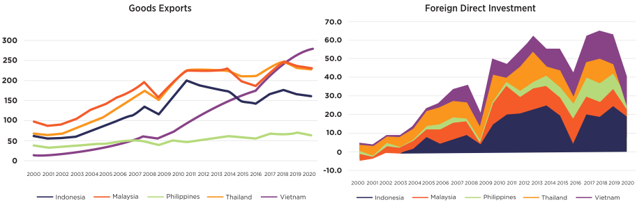
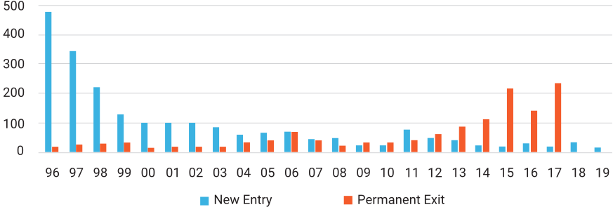
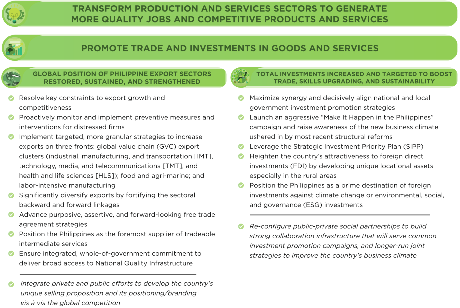

## Promote Trade and Investments

## Promote Trade and Investments

Over the medium term, the trade and investment sectors will be strong and positive contributors to overall national growth. This will require taking more informed risks and making harder choices to propel the country's global position upward. To meet these ambitions, both the public and private sectors, together with major social partners, will act as one, and powerfully recharge trade and investments as motors of job creation, skills development, and poverty reduction.

This chapter presents the challenges facing trade and investments and the twin outcomes to be pursued to address these challenges during the Plan period. These outcomes are: (a) global position of Philippine export sectors restored, sustained, and strengthened; and (b) total investments increased and targeted to boost trade, skills upgrading, and sustainability.

## Assessment and Challenges

Philippine exports have lost tremendous ground in the global market (See Figure 9.1), averaging only four percent growth for the last two decades while our regional neighbors have been experiencing exponential growth in their exports. The inability of the country to exploit the waves of surging foreign direct investment (FDI) in the region has resulted in widening gaps between the country and its immediate neighbors, stunted the dynamic shifts away from low value-added tasks in the global value chains (GVC), and limited the diversification of the product space toward a more complex set of exports. Compared to the country's position in the late 1990s, the overall level of sophistication of Philippine exports is much lower in 2021. 1

Figure 9.1 Philippine Export and Foreign Direct Investment Performance Relative to the Association of Southeast Asian Nations, 2000-2020 (USD billion)

Source: World Bank. World Integrated Trade Solution. https://wits.worldbank.org/

Notwithstanding the sharp drop of trade and investment due to the coronavirus disease (COVID-19) pandemic, the Philippines has managed to increase its exports of goods in 2021 by 5 percent relative to 2019. However, this still puts the country behind five other Association of Southeast Asian Nations (ASEAN) countries. Philippine exports amounted to only 31 percent that of its closest regional competitor, Indonesia. Exports of agriculture have been stagnant at around USD5 to 6 billion since 2013, which is on average 32 percent that of Vietnam during the same period. Services exports fare better, growing at an average of 9 percent from 2016 to 2019, and ranking fourth in ASEAN, behind Singapore, Thailand, and Malaysia. 2 However, compared to pre-pandemic levels in 2019, services exports dropped 18 percent in 2021. As for FDI, 2021 was a record year that saw investments reach USD12.4 billion, which is 21 percent higher than the previous peak in 2017. Yet, despite what seems to be robust growth, the country still lags behind, ranking 7 th in FDI flows into ASEAN in 2021.

The number of jobs that are created by trade and FDI is difficult to ascertain due to insufficient or unmatched data, e.g., between the Philippine Standard Commodity Classification and the Philippine Standard Industrial Classification data. The latest 2018 enterprise census data indicated that employment (and the number of enterprises) in sectors linked to exports have fallen or at best, remained stagnant compared to 2012. The list of establishments reported only a meager 0.2 percent increase in small enterprises and 0.8 percent net annual increase in medium-sized enterprises from 2012 to 2021. This is due to the falling rates of new entry of firms in the export markets, 3 and the increasing trend toward automation and robotization, which adversely affect the capacity of industry to generate jobs and threaten services jobs that are routine and have weak creative or interpersonal demand. 4 While the Philippines could potentially be well placed to exploit the current boom in trade in intermediate services, the overall low level of skills ensures that growth will mostly likely be concentrated in few highly urbanized areas, consequently leading to limited national impact on the rates of productive employment.

The main market access barriers today are the high standards that exporters must meet in terms of consumer health and safety, environmental protection, and overall product quality. The country's relatively cheap wages are no longer sufficient to carve a niche in the global market. Enhancing the country's ability to meet such standards is crucial to supporting the efforts of local firms to venture into new export markets, and being considered as preferred suppliers to lead firms in GVCs. Without know-how and access to standards and certification testing facilities nationwide, local exporters will be unable to exploit premium prices in organic goods, produced according to environmentally and socially responsible practices, for instance.

A particular concern is the weak or falling export growth rates of the most firm-populous sectors. The survival of these sectors, such as garments, handicrafts, and wooden products, is imperative since they have strong domestic sectoral and labor market linkages. The Philippines needs to recover competitiveness in sectors where the country has registered clear comparative advantages in the recent past, as well as maintain the country's remaining lead in the global market (See Figure 9.2).

Figure 9.2 Philippine Product Dynamics: New Entry and Permanent Exit of Export Products, 1996-2019

Note: Estimates based on Harmonized System at the 6-digit level.

Source: World Bank. World Integrated Trade Solution. https://wits.worldbank.org/

Public export financing schemes are fragmented, insufficient, or inadequately communicated. Despite available financing facilities from the Development Bank of the Philippines, Land Bank of the Philippines, and the Small Business Corporation, a number of Philippine traders still resort to private financing, which carry higher costs and add to their cost disadvantage relative to their foreign competitors. 5 Exporters are relatively low-risk and thus are prime clients of private banks since they typically supply on invoice to trusted buyers (i.e., with repeat orders). The lack of buffers to bridge finance their transactions often leads to undue burden that impact their production capacities.

Proactive policies that render timely interventions and preventive measures for distressed firms are lacking. In a highly competitive global market, even the market shares of the country's strongest home-grown export pillars are contestable. Signs of firm distress must be recognized, else the only remaining option is firm closure, which not only leads to job loss but also to the wastage of scarce local entrepreneurial capital. Large GVC subsidiaries, which account for more than 60 percent of the country's exports, are often well sheltered from market shocks and competitive pressures by their lead firms. Many local firms, however, will not survive in the presence of extensive domestic market failures such as lack of critical infrastructure, access to financing, real-time market information, etc.

The country's weakening ability to develop and retain a skilled workforce. The 2022 Global Talent Competitiveness Index of INSEAD saw the Philippines ranking 80 th out of 133 countries (down 10 spots from 2021). This may undermine the country's first-mover advantage in information technology-business process outsourcing commercial services, and affect its ability to secure high value-added niches in intermediate services. This will also affect the country's ability to achieve inclusive growth. The institutionalization of major FDI reforms in 2022 is expected to significantly improve the investment environment, but fundamental problems remain pertaining to red tape especially at the level of local government units (LGU); insufficient coordination of investment promotion efforts; scarcity of local suppliers that are able to deliver the necessary quality and scale; and overall high costs of doing business due to inadequate and inefficient provision of key infrastructure (e.g., electricity, transport networks, telecommunications). These issues need to be addressed to raise the attractiveness of the country as an FDI destination relative to neighboring countries with similar endowments and level of development.

## Strategy Framework

Amid a crowded policy agenda and limited fiscal space, priorities must be made, especially at the national level, and innovation in policy approaches are needed, especially at the local levels (See Figure. 9.3). On one hand, renewed focus will be given to the survival, growth, and expansion of local firms in the export and domestic markets to drive productive employment, and increase incomes. On the other hand, FDI will be harnessed as drivers of export growth, sources of vital technology, and critical enablers of the country's long-term climate action.

Figure 9.3 Strategy Framework to Promote Trade and Investments

## Strategies

## Outcome 1: Global position of Philippine export sectors restored, sustained, and strengthened

## Resolve key constraints to export growth and competitiveness

The country's high-cost business environment due to high electricity costs and logistics costs relative to other ASEAN countries must not be further saddled by unnecessary regulatory costs. The government will therefore ensure tight collaboration with LGUs (this will be a special focus of the Anti-Red Tape Authority), stricter timeframe for resolving exporters' issues to reduce exporters' costs, full implementation of the TradeNet platform, and institutionalization of a dedicated unit to oversee the implementation of the National Single Window. To facilitate the flow of trade in goods, the government will review, identify, and recommend the removal of regulatory measures that have become irrelevant, trade-restrictive, and costly or burdensome in doing business. The government will also capacitate exporters to increase their online presence and make use of digital platforms 6 that will increase market presence of Philippine goods and services. The government will likewise review the efficacy of existing financing facilities to further lower exporters' costs and raise their competitiveness.

The provision of real-time market information is a critical assistance for the country's exporters. The Tradeline Philippines will be revamped and given more resources to enable the platform to identify emerging products and market opportunities; better capture information on local suppliers and their capabilities; and create a dedicated space for market information sharing to and from trade and agricultural attachés, and diplomatic posts.

## Proactively monitor and implement preventive measures and interventions for distressed firms

The government will design and implement an effective Early Warning System; 7 Rapid Assistance mechanisms; and farsighted preventive measures to support export pillar sectors as well as micro, small, and medium enterprises (MSME), which are in critical stages of transition (e.g., local to foreign markets; scale shifts). This requires immediate solutions to the information bottleneck caused by existing data confidentiality laws and fortressed data silos within the government. In the meantime, the Philippine Statistics Authority will ensure the updating of its merged Trade Transaction and Firm Survey database, which will be the basis for distinguishing more granular firm typologies and monitoring the health of local firms, particularly exporting firms. Armed by such firm typologies, the Department of Trade and Industry (DTI) will be able to determine the reasons behind the weak survival and falling net entry of firms in the export markets, and to identify unnecessary cost pressures (e.g., informal fees in ports and LGUs). This will be the basis for developing customized programs, especially for sectors and firms in distress, as well as support measures to assist exporters in maximizing opportunities in key markets.

Implement targeted, more granular strategies to increase exports on three fronts: global value chain export clusters (industrial, manufacturing, and transportation, technology, media, and telecommunications, and health and life sciences); food and agri-marine; and labor-intensive manufacturing

Multiple priorities signal no priorities; thus, strategies will be further sharpened to make them credible for local and foreign investors. Given the tight fiscal space for the provision of incentives and subsidies, the government will draw the most specific information possible to identify concrete entry points for local firms in GVCs (industrial, manufacturing, and transportation; technology, media, and telecommunications; and health and life sciences). This entails the scanning of opportunities benchmarked on an in-depth (and honest) analysis of the country's current skills set and not only on the GVC's technological profile. The Philippine Export Development Plan will outline the specific strategies to promote development of identified sectors.

Due to the utmost goal of generating jobs, especially for unskilled workers, renewed focus and targeted support programs will be implemented for agri-marine-based and labor-intensive manufacturing, such as processed food and garments. Problem-oriented coordination mechanisms, especially in the rural areas to address context-specific bottlenecks, will be actively utilized as an approach to resolve these constraints as well as address general problems of inadequate access to financing and insufficient provision of agricultural extension to transform antiquated production practices.

## Significantly diversify exports by fortifying the sectoral backward and forward linkages

The shrinking export product space will be transformed by identifying and supporting local firms that have trigger roles in linking upstream and downstream sectors in the economy. The agri-processing sector, for instance, is populated by these types of firms. Middle-sized enterprises, for instance, often fall through the policy cracks, 8 explaining their trivial net 0.8 percent annual increase in number.

The servicification of manufacturing and agriculture has now been known to increase the competitiveness of exports. 9 This will entail the expansion of government agencies assistance and work toward implementing these in the regions, such as DTI's Shared Services Facilities to include common business services (e.g., marketing, digitization, administrative and finance, promotions, logistics, distribution, assistance in consolidation), especially for MSMEs and cooperatives with potential export transitions. Value chain interventions will go beyond mere provision of physical inputs but focus on organizational development, and brokering multi-sectoral partnerships to capacitate smallholders and make value chains inclusive.

Concrete indicators will be developed to gauge the ability of local suppliers to replace a significant share of inputs imported by GVC subsidiaries. This requires: (a) firm and sector analysis based on the least cost disadvantage relative to benchmark estimates of foreign competitor positions; and (b) close collaboration with the private sector, particularly with professional specialists'

groups (e.g., engineers, research and development practitioners).

## Advance purposive, assertive, and forward-looking Free Trade Agreement strategies

A Free Trade Agreement (FTA) Sustainability Impact Assessment and FTA Utilization System will be institutionalized and led by the DTI to define short-, medium- and long-term opportunities in specific sectors and markets as well as provide easy access for timely data on trade in goods and services and utilization of Philippine FTAs. The assessment will aim to scan other potential high-impact FTAs and other related trade agreements, highlighting specific areas where these may act as catalyst for facilitating trade and investments from target-source countries. This assessment will also identify possible stakeholders and industries that will be adversely affected and accordingly formulate safety nets for these sectors. The system, on the other hand, will assist government and relevant private stakeholders in designing programs and activities to promote FTAs and optimize utilization by exporters.

Trade negotiations will be employed as a decisive tool in pushing the frontiers of our markets as defined by current origin rules. FTA negotiations will also be utilized to distinguish between legitimate and trade-restricting non-tariff measures. The double transformation rules of origin requirements of the European Union (EU) hampers the local garments sector's utilization of the highly advantageous EU Generalised Scheme of Preferences+ (EU GSP+). This puts the competitive position of our local manufacturers at risk, especially vis-à-vis countries with an FTA

with the EU (e.g., Vietnam). The government will therefore actively seek derogations for EU GSP+ and similar mechanisms (e.g., cumulation), pursue liberal rules of origin for products of interest, and seek inclusion of export pillars in zero tariffs product liberalization of countries' FTAs.

Conformity to technical regulations and sanitary and phytosanitary standards usually comprise an important hurdle for exports to enter foreign markets. This challenge will be transformed into an opportunity by using FTA partnerships to help the country strengthen its National Quality Infrastructure (NQI) to the benefit of local producers. The government will negotiate sharing of knowledge, technology, and best practices to comply with standards in foreign markets and maximize the market access offered through FTAs.

## Position the Philippines as the foremost supplier of tradeable intermediate services

The country has a first-mover advantage in some tradeable services sectors in the region and makes it well-placed in being a hub for sectors with high creative and interpersonal demand. This would entail a credible and coordinated commitment both from the private and public sectors to invest in the rapid development of digital skills in order to build a concentration of digital talents in the country. To secure first-mover gains and take advantage of future lucrative niches in creatives and digital skills, the government, in close partnership with the private sector and academe, will identify where the first-mover advantages in these sectors lie so these areas could be developed and appropriate support mechanisms designed for firms in these sectors.

The country's large pool of young digital talents is a huge asset that needs to be harnessed by collaborative (regional) strategies. The government, by mobilizing its regional growth centers, will create a visible concentration of digital savvy pool of talents in various parts of the country. This will entail tight partnerships among industry players, knowledge institutes, LGUs, and the national government. Studies predict that the prime mover of efficiency-seeking foreign investments will increasingly be the availability of digital hubs instead of mere low-cost production centers. 10 Moreover, since local digital talents are being aggressively poached by other countries, new incentive measures will be designed to try and arrest this trend.

## Ensure integrated, whole-ofgovernment commitment to deliver broad access to the National Quality Infrastructure

Exports, as well as products geared toward domestic consumers, must be embedded with more technology, innovation, and skills in order for local firms to win market shares in both global and local markets. The government will definitively integrate and harmonize national standards and certification policies, and agencies in order to open up the path for many local firms (especially SME) toward quality-exigent foreign markets. In this regard, the government will strongly pursue passage of the NQI Act and direct relevant agencies to address institutional fragmentation and pursue adoption of harmonized quality infrastructure.

## Outcome 2: Total investments increased and targeted to boost trade, skills upgrading, and sustainability

Maximize synergy and decisively align national and local government investment promotion strategies

The establishment of the Inter-Agency Investment Promotion Coordination Committee under the Amended Foreign Investments Act (Republic Act No. 11647) will be hastened in order to integrate all the promotion and facilitation efforts to encourage foreign investments and make the new investment environment credibly improved for investors. Strong government partnership with the private sector is critical to ensure that investment promotion and facilitation strategies are fit-for-purpose, given the current market realities and demands. Pioneering enterprises and promising startups that utilize advanced technologies will be the primary drivers of job creation and innovative entrepreneurial culture in the Philippines.

Launch an aggressive "Make it Happen in the Philippines" campaign and raise awareness of the new business climate ushered in by most recent structural reforms

With the institution of major FDI reforms in 2022, an all-out campaign is needed to bring across the message that a new FDI regime exists, making the country truly open for business. The government will maximize the opportunities opened up by the Corporate Recovery and Tax Incentives for Enterprises (CREATE) Act, the amended Foreign Investments Act (RA 11647), the Retail Trade Liberalization Act (RA 11595), and the Public Service Act (RA 11659), through local and international user-friendly information dissemination programs, and coordinated communications campaign done in collaboration with the private sector and social partners. However, an equally strong internal campaign is likewise needed, especially among LGUs.

## Leverage the Strategic Investment Priority Plan

Promotion of the Strategic Investment Priority Plan (SIPP) through sector-focused and company-specific promotion in target markets will be intensified. The implementation of SIPP, pursuant to the CREATE Act, will incentivize highly attractive investments and will yield more diversified, complex, and sophisticated products and services in the country. This will likewise be monitored by an Early Warning System, especially to help increase the realization rates of approved investments.

## Heighten the country's attractiveness to foreign direct investment by developing unique locational assets, especially in the rural areas

The role of domestic investor firms especially in rural areas in drawing foreign partnerships in greenfield investments will be strengthened. To support the thrust toward regional development, there is a need to reinvigorate investment promotion in the regions to bring investments to the countryside. Focus must be given on capacitating LGUs in making their localities investment-ready and investor-friendly, leveraging on the presence of growth opportunities, minimal market saturation, and absence of congestion and pollution compared to urban areas.

The government will examine unique public-private partnership (PPP) transaction arrangements with the private sector, especially for the agriculture and fisheries (A&amp;F) sector. This will be carried out not only at the national level (for what can be considered "big ticket" A&amp;F PPPs), but also PPPs in the A&amp;F sector that have more localized focus.

The Local Economic Development and Investment Promotion Offices in all LGUs (province, cities, and municipalities) will be institutionalized to facilitate and coordinate local economic development and investment promotion advocacies, policies, programs, projects, and activities.

## Position the Philippines as a prime destination of foreign investments against climate change or environmental, social, and governance investments

The world's biggest companies have been building up their investment funds to offset their carbon footprints, in the form of carbon credits, as failure to do so may arrest their production growth. There is also an increasing number of firms that are linking their financial returns with environmental, social, and governance norms as a part of their business operations and long-term sustainability strategies. This poses a huge opportunity for the Philippines that could offer environmental, social, and governance (ESG) investment opportunities, specifically in the areas of reforestation combined with food security and sustainable livelihood for buffer communities. At present, the Philippines does not have a carbon pricing instrument but studies have been conducted in coordination with the World Bank. The Innovative Payment for Environmental Services (PES) is already being piloted in the country, offering a more accessible alternative to the United Nations Programme on Reducing Emissions from Deforestation and Forest Degradation Warsaw Framework, or UN REDD+ schemes, among others.

To make the Philippines a prime destination of ESG investments in the world, an ESG Investments Task Force will be established. This will be composed of the public sector (e.g., National Economic and Development Authority, Department of Environment and Natural Resources,

## Legislative Agenda

Table 9.1 presents the priority bills for the 19th Congress to promote trade and investments.

Table 9.1 Legislative Agenda to Promote Trade and Investments

| LEGISLATIVE AGENDA                                                                                                                                                                                  | RATIONALE/KEY FEATURES                                                                                                                                                                                                                                                                                                                                                                                                            | RESPONSIBLE AGENCY                                                                                       |
|-----------------------------------------------------------------------------------------------------------------------------------------------------------------------------------------------------|-----------------------------------------------------------------------------------------------------------------------------------------------------------------------------------------------------------------------------------------------------------------------------------------------------------------------------------------------------------------------------------------------------------------------------------|----------------------------------------------------------------------------------------------------------|
| Outcome 1: Global position of Philippine export sectors restored, sustained, and strengthened                                                                                                       | Outcome 1: Global position of Philippine export sectors restored, sustained, and strengthened                                                                                                                                                                                                                                                                                                                                     | Outcome 1: Global position of Philippine export sectors restored, sustained, and strengthened            |
| Urgent ratification of the Regional Comprehensive Economic Partnership (RCEP) Agreement                                                                                                             | Joining the RCEP will be beneficial to the Philippines to enhance its market access and investments. As of date, only the Philippines has not yet deposited its Instrument of Ratification to the Association of Southeast Asian Nations Secretariat. In 2020, RCEP accounted for 30 percent of the world's population, 30 percent of gross domestic product, 29 percent of trade, and 33 percent of global inward investments. a | Department of Trade and Industry (DTI)                                                                   |
| National Quality Infrastructure (NQI) Act                                                                                                                                                           | Establishment of an NQI will help boost best practices and competitiveness. Compliance with standards can be a source of advantage (especially in context of e-commerce). This will also facilitate secure market access and utilization of free trade agreements.                                                                                                                                                                | DTI, Department of Science and Technology, Development Academy of the Philippines                        |
| Export and Industry Development Act                                                                                                                                                                 | Amendments to the law will provide targeted and strategic policy, program, and project support, including non-fiscal incentives, for the development of local industries toward export competitiveness. Most of the provisions of the Export Development Act have lapsed already.                                                                                                                                                 | DTI                                                                                                      |
| Outcome 2: Total investments increased and targeted to boost trade, skills upgrading, and sustainability                                                                                            | Outcome 2: Total investments increased and targeted to boost trade, skills upgrading, and sustainability                                                                                                                                                                                                                                                                                                                          | Outcome 2: Total investments increased and targeted to boost trade, skills upgrading, and sustainability |
| Executive Order for a whole-of- government, harmonized, and structured Investment Facilitation Mechanism, including resolution of critical issues and concerns for identified priority investments. | Issuance of an EO will provide cross-cutting facilitation services for priority investments.                                                                                                                                                                                                                                                                                                                                      |                                                                                                          |

a Based on 2020 data (World Bank, ITC TradeMap, UNCTAD World Investment Report).

DTI-Board of Investments, Department of Finance, Department of Social Welfare and Development, Department of the Interior and Local Government, Department of Energy, Climate Change Commission, and Philippines Space Agency), private sector, academe, and other social partners. The task force will spearhead the work in building transparent and credible Standards and Certification schemes by stimulating dynamic institutional entrepreneurship in this arena. This will be done in close cooperation with the Bangsamoro Autonomous Region government and stakeholders given the availability of large possible reforested land, and the potential link with the aim of sustaining the peace process, which adds significant value to ESG investment instruments.

## Results Matrix

Table 9.2 presents the indicators and targets during the Plan period to promote trade and investments.

Table 9.2 Results Matrix: Promote Trade and Investments

| INDICATOR                                                                                                       | BASELINE - (YEAR)                                                                                        | TARGETS - 2023                                                                                           | TARGETS - 2024                                                                                           | TARGETS - 2025                                                                                           | TARGETS - 2026                                                                                           | TARGETS - 2027                                                                                           | TARGETS - 2028                                                                                           | MEANS OF VERIFICATION                                                                                    | RESPONSIBLE AGENCY/ INTER-AGENCY - BODY                                                                  |
|-----------------------------------------------------------------------------------------------------------------|----------------------------------------------------------------------------------------------------------|----------------------------------------------------------------------------------------------------------|----------------------------------------------------------------------------------------------------------|----------------------------------------------------------------------------------------------------------|----------------------------------------------------------------------------------------------------------|----------------------------------------------------------------------------------------------------------|----------------------------------------------------------------------------------------------------------|----------------------------------------------------------------------------------------------------------|----------------------------------------------------------------------------------------------------------|
| Outcome 1: Global position of Philippine export sectors restored, sustained, and strengthened                   | Outcome 1: Global position of Philippine export sectors restored, sustained, and strengthened            | Outcome 1: Global position of Philippine export sectors restored, sustained, and strengthened            | Outcome 1: Global position of Philippine export sectors restored, sustained, and strengthened            | Outcome 1: Global position of Philippine export sectors restored, sustained, and strengthened            | Outcome 1: Global position of Philippine export sectors restored, sustained, and strengthened            | Outcome 1: Global position of Philippine export sectors restored, sustained, and strengthened            | Outcome 1: Global position of Philippine export sectors restored, sustained, and strengthened            | Outcome 1: Global position of Philippine export sectors restored, sustained, and strengthened            | Outcome 1: Global position of Philippine export sectors restored, sustained, and strengthened            |
| Merchandise exports increased (USD billion)                                                                     | 54.2 (2021) a                                                                                            | 58.09                                                                                                    | 61.58                                                                                                    | 65.27                                                                                                    | 69.19                                                                                                    | 73.34                                                                                                    | 77.74 e                                                                                                  | Bangko Sentral ng Pilipinas (BSP) Balance of Payments                                                    | DTI                                                                                                      |
| Non-electronics exports increased (USD billion) c                                                               | 32.16 (2021) b                                                                                           | 37                                                                                                       | 42                                                                                                       | 48.6                                                                                                     | 56.1                                                                                                     | 63.3                                                                                                     | 70.9 f                                                                                                   | Philippine Statistics Authority International Trade Merchandise Statistics                               | DTI                                                                                                      |
| Number of commodities with revealed comparative advantage increased d                                           | 440 (2021)                                                                                               | 480                                                                                                      | 520                                                                                                      | 560                                                                                                      | 600                                                                                                      | 640                                                                                                      | 680                                                                                                      | World Bank World Integrated Trade Solution database                                                      | DTI                                                                                                      |
| Services exports increased (USD billion) a                                                                      | 33.6 (2021) a                                                                                            | 42.85                                                                                                    | 45.42                                                                                                    | 48.15                                                                                                    | 51.03                                                                                                    | 54.10                                                                                                    | 57.34 e                                                                                                  | BSP Balance of Payments                                                                                  | DTI                                                                                                      |
| Outcome 2: Total investments increased and targeted to boost trade, skills upgrading, and sustainability        | Outcome 2: Total investments increased and targeted to boost trade, skills upgrading, and sustainability | Outcome 2: Total investments increased and targeted to boost trade, skills upgrading, and sustainability | Outcome 2: Total investments increased and targeted to boost trade, skills upgrading, and sustainability | Outcome 2: Total investments increased and targeted to boost trade, skills upgrading, and sustainability | Outcome 2: Total investments increased and targeted to boost trade, skills upgrading, and sustainability | Outcome 2: Total investments increased and targeted to boost trade, skills upgrading, and sustainability | Outcome 2: Total investments increased and targeted to boost trade, skills upgrading, and sustainability | Outcome 2: Total investments increased and targeted to boost trade, skills upgrading, and sustainability | Outcome 2: Total investments increased and targeted to boost trade, skills upgrading, and sustainability |
| Philippine foreign direct investment (FDI) to gross domestic product (GDP) ratio increased (%)                  | 2.7 (2021)                                                                                               | 2-5                                                                                                      | 2-5                                                                                                      | 2-5                                                                                                      | 2-5                                                                                                      | 2-5                                                                                                      | 2-5                                                                                                      | United Nations Conference on Trade and Development FDI and GDP data                                      | DTI-Board of Investments (BOI)                                                                           |
| Share of PH FDI to total Association of Southeast Asian Nations (ASEAN) FDI increased (%)                       | 6 (2021)                                                                                                 | 5-10                                                                                                     | 5-10                                                                                                     | 5-10                                                                                                     | 5-10                                                                                                     | 5-10                                                                                                     | 5-10                                                                                                     | ASEAN Stats                                                                                              | DTI-BOI                                                                                                  |
| Rank in Organisation for Economic Co-operation Development (OECD) FDI regulatory restrictiveness index improved | 3 rd most restrictive (2020)                                                                             | Lower                                                                                                    | Lower                                                                                                    | Lower                                                                                                    | Lower                                                                                                    | Lower                                                                                                    | Lower g                                                                                                  | OECD FDI Regulatory Resrictiveness Index                                                                 | DTI-BOI                                                                                                  |
| Green, Social, and Sustainability Bonds issued increased (USD billion)                                          | 6.33 (Oct 2022)                                                                                          | 6-8                                                                                                      | 6-8                                                                                                      | 8-10                                                                                                     | 8-10                                                                                                     | TBD                                                                                                      | TBD                                                                                                      | Securities and Exchange Commission Sustainable Finance Market Update                                     | Department of Finance                                                                                    |

a Based on BSP Balance of Payments data.

b Based on PSA data.

c Refers to total exports excluding electronics exports.

d Based on Harmonized System at the 6-digit level.

e Targets based on DBCC projections approved during the 183 rd DBCC meeting on December 5, 2022.

f Based on export projections in the draft Philippine Export Development Plan 2023-2028, subject to revision pending approval of draft PEDP.

g The OECD FDI Regulatory Restrictiveness Index gauges the country's statutory restrictions with values ranging from 0 (least restrictive) to 1 (most restrictive). Countries are ranked from least restrictive to most restrictive where higher numerical ranking indicates more regulatory restrictions.

- 1 Balaoing, A. and A. Mendoza. 2021. Diversification, Jobs and the COVID-19 Recovery: Exploring Opportunities for Economic Diversification and Productive Employment in the Philippines. Makati City: United Nations Philippines.
- 2 United Nations Conference on Trade and Development; ranking based on 2016-2019 annual average levels.
- 3 From 88% in 1998 to 12% in 2012 (last estimate available).
- 4 Frey, C.B. and M. Osborne. 2018. Automation and the Future of Work: Understanding the Numbers. https://www.research.ox.ac.uk/article/2018-10-15automation-and-the-future-of-work-understanding-the-numbers.
- 5 All of the country's direct regional competitors offer such facility, for example: Export-Import Bank of Thailand, Export Credit Agency in Malaysia, Indonesia EXIM Bank, Export Credit Agency, and Export Credit - Vietnam Development Bank, which are all state-owned.
- 6 Such as the ASEAN-wide Self-Certification Scheme; ASEAN Single Window; ASEAN Solutions for Investments, Services and Trade; Philippine National Trade Repository; and ASEAN Trade Repository.
- 7 This includes monitoring of firm-level export growth, firm market shares, and market exits (e.g., product and country destinations); job creation impact of trade and investments; and monitoring of revealed comparative advantage. Information on the geographic location of firms is essential to mobilize provincial and even municipal resources to assist ailing firms.
- 8 They are too big to qualify for most government aid (especially during the COVID-19 pandemic), and yet too small to accumulate buffers to weather external shocks and competitive pressures. They also often finance their own participation in trade fairs, as well as expensive standards and certification compliance measures.
- 9 Lodefalk, M. 2015. Servicification of Manufacturing Firms Makes Divides in Trade Policy-Making Antiquated. https://www.diva-portal.org/smash/get/ diva2:827797/FULLTEXT01.pdf.
- 10 Kearney. 2021. Toward a Global Network of Digital Hubs: The 2021 Kearney Global Services Location Index. https://www.kearney.com/digital/article/-/insights/ the-2021-kearney-global-services-location-index.