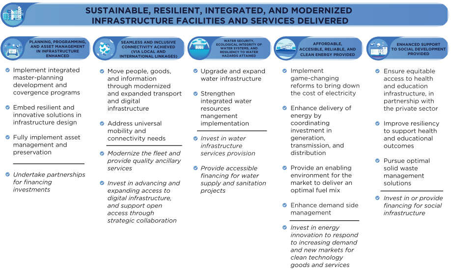

## Expand and Upgrade Infrastructure

## Expand and Upgrade Infrastructure

Enabling economic transformation builds on sustainable, resilient, integrated, and modern infrastructure systems as a solid foundation. Anchored on the long-term vision, the government will steer the nation toward a future where movement of people and goods is safely and efficiently facilitated by adequate and accessible transportation. Filipinos are empowered through cost-effective and reliable flow and exchange of information and are able to partake opportunities in the digital economy. Families have access to safe and adequate water and sanitation services; to reliable, clean, and affordable fuel and electricity; and to quality education, health, solid waste management, and other social infrastructure facilities. Communities and industries are served by green infrastructures that are not only adaptive and resilient against shocks and natural disturbances, but also contribute toward a low-carbon future.

## Assessment

Annual public infrastructure spending in 2017-2021 during the administration of former President Rodrigo Roa Duterte ranged from 4.2 percent to 5.8 percent of gross domestic product (GDP), which is nearly double the average annual spending over the previous decades. Overall, however, infrastructure facilities and services remain inadequate in terms of accessibility, quality, safety, and affordability. Moreover, the country's continuing vulnerability to climate change already threatens infrastructure provision and operation and thereby undermine significant infrastructure investments.

## Connectivity

Mobility of majority of Filipinos is hampered by inadequate transportation facilities. There is a shortage in public transport supply. This is evidenced by long queues of commuters and passengers who spend long hours waiting for their rides, and, when they get one, stand inside buses or trains overcrowded with other commuters.

The Philippine rail system's capacity is inadequate to meet the ridership post-pandemic. The country has four operational rail lines with a total length of

76.9 km. 1 Meanwhile, the number of train cars increased to 978 in 2022 from 224 in 2016. New mass transit railways were also approved in the last six years, with the two largest now under construction. While a drop of 68 percent in total rail ridership was recorded from 2019 (327.68 million) to 2021 (103.79 million), 2 ridership increased by at least 23.45 percent from January (9.14 million) to May 2022 (11.94 million). 3 Should this trend continue and as the economy opens up after the coronavirus disease (COVID-19)

pandemic, the existing rail network will not be able to accommodate the increasing demand, which rose to as high as 29.4 million monthly ridership in 2019 to the 2022 total capacity of about 31.8 million per month. 4

Transport facilities deemed inaccessible and unsafe, especially for vulnerable groups. According to the National Council on Disability Affairsin in 1982, the physical design of the rail infrastructure falls below the standards set in the 1982 Accessibility Law, 5 and thus makes them difficult to access and use by pregnant women, parents with very young children, older people, and persons with disabilities (PWD). Stations with non-functional elevators and escalators, defective restrooms, missing signages, poor security measures such as lack of security cameras, overcrowding, and insufficient lighting in passenger set down further aggravate the risks of accidents, crime, and violence faced by commuters, especially females. Gender-based violence, sexual exploitation, abuse, and harassment and discrimination are common and possibly under-reported in public spaces including the transport sector. 6

Shortage of road-based public transportation persists in many urban areas. Since 2003, public transport services franchising has been under a moratorium. This has not helped reduce the shortage of public transport in many cities. Besides being obsolete, most of the public transport fleet in 2022 also do not comply with modern design and emission standards. Meanwhile, the rollout of the Public Utility Vehicle Modernization Program launched in 2017 has progressed slowly since many vehicle owners found the financial terms of the program unattractive and the funding support from the government in the form of subsidy for vehicle procurement was limited.

As of September 14, 2022, a total of 174,164,758 riders have benefitted from the Land Transportation Franchising and Regulatory Board Service Contracting Program (SCP) Phase III, versus the target of 93,000,000. While the SCP has provided a means for public transport operators and drivers to sustain their operations as more economic sectors open post-pandemic, the program does not cover the whole country and cannot be sustained given the tight fiscal space.

Use of active transportation is still not popular. The Department of Health (DOH) has issued guidelines promoting the safe use of active transport, while the Department of Public Works and Highways (DPWH) has issued an order prescribing the standards on the design of bicycle facilities along national roads. 7 To fund the building and maintenance of bike lanes and other active transport facilities, the government allocated total of PHP3 billion from 2020 to 2022. While there are four households that own bicycles to each household that own a car (4:1 bicycle-car ratio), 8 only 29 percent of households use their bicycles to go around.

Road traffic fatalities are increasing in the Philippines. Road traffic accidents exact a heavy toll. Approximately 12,000 Filipinos die on the road each year, while the resulting injuries cost about 2.6 percent of the country's GDP in 2018. 9 The government does not have a yearly budget allocation for road safety.

While progress has been made in maritime transportation, issues on infrastructure quality remain. Improvements were pursued with the opening of the Matnog, Sorsogon to Bogo City, Cebu roll-on/roll-off (RORO) route, and the issuance of the revised rules in the grant of missionary route status for RORO passenger ships, and the development of the Maritime Route Rationalization and Information System. 10 Nonetheless, only a limited number of RORO vessels can be accommodated under the size of the country's RORO ports in 2022. RORO vessels that serve medium-sized ports are smaller compared to RORO ships that use the Port of Manila. The fleet of inter-island ferries is also aging, posing safety risks to commuters.

Little progress has been made to improve airport infrastructure. The country has a total of 90 airports in operationcomprising 11 international, 41 domestic, 38 community-and 3 airports not in operation in 2022. However, not all the country's international airports and principal Class 1 and principal Class 2 airports comply with modern safety design thresholds, particularly the minimum runway strip threshold width and night landing capabilities. Proposed improvements to major gateways in the country were put on hold and are being re-assessed to consider new projections in aviation demand. Travel limitations, lockdowns, and hampered business operations due to the COVID-19 pandemic caused the decline in passenger traffic by 33.47 percent from 2020 to 2021. Over the same period, air traffic movement likewise decreased by 54.7 percent.

Civil works and utilities installation along roads are not coordinated. Road widening activities are not in sync with the relocation of electrical and communication poles, as well as pipe laying and other waterworks, causing traffic jams, road accidents, and other roadside friction. Prevalence of overhead electrical and telecommunications cables and poles along major thoroughfares poses hazards to road users. Meanwhile, the lack of coordination between road works and waterworks results in prolonged or repeated closure of roads and higher construction costs.

There are no operational cargo and/or freight rail services in the country. The movement of goods over land is limited to road-based transportation options; rail-based transportation options are non-existent. As such, long-, medium-, and short-distance shipping by land is done by trucks, which adds to road traffic congestion and to logistics cost. The roads leading to ports and airports often experience congestion and deteriorate faster due to heavy truck loads.

Port and ancillary facilities are insufficient and underdeveloped. As of December 2021, about 336.56 million metric tons (MMT) of cargo was transported through the country's port system compared to 133.74 MMT through airports. Meanwhile, 99.98 percent of the total domestic trade in 2021 was transported by sea, and the rest (0.02%) via air. 11

Despite the maritime sector's critical role in the transport of goods, most of the country's ports are operated inefficiently due to their inadequate equipment and ancillary facilities.

Such inefficiency is evident in the long queues of cargo trucks at port areas. Cargo trucks sometimes wait for days before they are able to board a RORO vessel. Such delays result in poor reliability in the delivery cargoes and spoilage of perishable goods, further straining the food supply chain, among others.

Government-operated ports, especially those of local government units (LGUs), have insufficient cargo-handling equipment. Existing LGU-operated ports have limited financial resources to procure the necessary equipment and support infrastructure such as cold chain facilities, leading to increased logistics costs.

Automated logistics processes are not yet integrated. To upgrade the country's logistics network, Unified Logistics Pass (ULP) was launched in 2022 that features a quick response (QR) code issued to cargo trucks. This ensures unhampered movement of goods and eliminates the various permits, licenses, and pass-through stickers being required by economic zones, ports, and LGUs. In addition, a single Transport Accreditation Permit and Pass for Ports (TAPPP) is being implemented in all ports under the jurisdiction of the Philippine Ports Authority (PPA). While these initiatives have already been introduced and implemented, their application is not yet integrated well in port operations across the country. Thus, trucks operating in both PPA and non-PPA ports, such as those in the economic zones, need to have the two systems installed. This translates into additional overhead cost that could have been avoided in an integrated system.

Movement of information through digital infrastructure steadily improved, but still not enough. Driven by increasing demand of Filipinos to stay informed and connected, recent years saw steady improvement in the quality of internet services with broadband speed, 12 reaching 78.69 megabits per second (Mbps) in September 2022 13 (from 4.3 Mbps in 2016). In this aspect, however, the Philippines consistently lags behind Singapore, Thailand, Malaysia, and Vietnam. Moreover, the domestic prices of fixed and mobile broadband prices 14 remained high, at 11.56 percent and 2.04 percent of monthly gross national income per capita, respectively. Both rates are above the global affordability threshold target (of below 2%). As evidence of the persistent digital divide, only about 18 percent of Filipino households have internet connections, 15 far below the average household penetration rate of 53.4 percent in the Asia-Pacific region in 2019. 16

Climate change is not systematically integrated in planning, design, operation, and maintenance. Climate change does not only adversely affect connectivity, but also places a strain on the country's economy. The resulting economic losses could be massive and would require significant additional financing to rehabilitate the damaged infrastructures. Due to Typhoon Odette in 2021, 36 percent of seaports were rendered inoperational, creating logistics challenges and disruptions in supply chains, especially for isolated islands. In addition, some municipalities had limited access to communication services for six weeks, which further hampered disaster relief and recovery operations.

## Water Resources

The country has limited water resources. The annual freshwater potential of the Philippines is estimated to be about 146.0 billion cubic meters (m 3 ), of which roughly 125.8 billion m 3 is surface water and 20.2 billion m 3 is groundwater. Based on the water permits issued by the National Water Resources Board, about 86 billion m 3 (or 58% of the total freshwater available) is allocated annually for various uses, whereby about 7.6 billion m 3 (5.6 billion m 3 from surface water and 2.0 billion m 3 from groundwater sources) is used for domestic and municipal water use.

Universal access to safe, affordable, and sustainable water supply and sanitation services has yet to be achieved. Based on the 2020 Annual Poverty Indicators Survey of the Philippine Statistics Authority, the main sources of water supply for Filipino families were water piped into their dwelling (54.1%), sourced from protected wells (21.5%), communal sources such as public taps, and developed springs (16.0%). Less than 10 percent of them rely on "unsafe sources" such as unprotected wells, undeveloped springs, rivers, ponds, lakes or rainwater, or bought from tanker trucks and/or water peddlers.

In terms of access to sanitation facilities, about 80.4 percent of Filipino families had "basic sanitation service level" (i.e., used an improved sanitation facility not shared with another households), 13.5 percent had "limited-service level" (i.e., used an improved sanitation facility shared with two or more households). Less than 10 percent had no sanitation facility (i.e., practicing open defecation), or use "unimproved service level" (i.e., used pit latrines without a slab or platform, hanging latrines ,or bucket latrines).

Irrigation service provision remains inefficient and wasteful. National irrigation systems (NIS) use about 68 billion m 3 of water annually (about 80 percent of the country's annual available freshwater) to irrigate around 1.9 million hectares (ha) of farms (mostly planted with rice). In comparison, only around 52 billion m 3 annually on average is used in other countries to irrigate the same area and crop type (for two cropping seasons per year). This suggests that about 25 percent of the water delivered by the NIS is wasted, that can be otherwise saved with proper management.

The country is highly vulnerable to water-related hazards. In a typical year, the Philippines experiences about 20 typhoons, of which eight make landfall and often hit several regions. Major typhoons such as Odette (international name: Rai) in 2021 and Ompong (international name: Mangkhut) in 2018, to name a few, have devastated the country. These two typhoons led to 487 fatalities, about PHP63.6 billion in damages to infrastructure, and PHP44.4 billion in damages to agriculture. Besides typhoons, monsoon rains, the inter-tropical convergent zones, and severe thunderstorms also visit and leave damages in the country.

## Energy

Affordability, accessibility, and reliability are the three aspects of energy security.

The Philippines, historically, has one of the highest electricity prices 17 in the Asian region (See Table 12.1). Consequently, the country fails to attract foreign direct investment (FDI), especially energy-intensive FDI-one reason domestic manufacturing growth has lagged in recent decades relative to its neighbors. A previous study 18 shows that high electricity prices are one of the contributory factors why the economic transformation of the Philippines did not follow the usual development patterns seen in high-income countries. 19

As a net importer of energy, the Philippines is highly susceptible to volatility in the prices of fuel in the international market. Any major event affecting the value chain of fuels, such as the attack on two Saudi Aramco oil facilities in 2019 and the Russia-Ukraine war, impacted domestic prices. The continuing escalation of fossil fuel prices in 2021 and 2022 increased the risk of fossil power plants becoming stranded assets.

Power supply is limited and per capita consumption is low. Comparing key economic and energy indicators in select economies 20 reveals that the Philippines has limited power supply and low per capita consumption (See Table 12.1). Electricity consumption per capita in the Philippines is the lowest compared to the other countries in the Association of Southeast Asian Nations (ASEAN). The lower electrification rates and high prices in the Philippines partly explain the low per capita consumption. As of 2019, the Philippines had a 26.2 gigawatt (GW) capacity serving 111 million Filipinos. In comparison, Thailand, Malaysia, and Singapore each has large power capacities serving smaller populations than the Philippines. Transmission and distribution losses have also been relatively high (9.4% of the total electricity output), suggesting an inefficient grid and distribution system.

Table 12.1 Key Economic and Energy Indicators in Select Countries

|             |   Per capita electricity generation (MWh/cap), 2020 |   Per capita electricity consumption (MWh/cap), 2019 |   Net installed electricity capacity (GW), 2019 |   Share of renewables in electricity production* (%), 2020 |   Population (million), 2021 |   Per capita GDP (constant 2015 USD), 2021 |   Electricity transmission and distribution losses** (% of output), 2014 |   Residential Electricity Prices (USc/kWh,) Dec 2021 |
|-------------|-----------------------------------------------------|------------------------------------------------------|-------------------------------------------------|------------------------------------------------------------|------------------------------|--------------------------------------------|--------------------------------------------------------------------------|------------------------------------------------------|
| Philippines |                                                0.88 |                                                 0.90 |                                            26.2 |                                                       23.5 |                        111.0 |                                    3,412.6 |                                                                      9.4 |                                                 16.3 |
| Indonesia   |                                                1.00 |                                                 1.00 |                                            66.8 |                                                       13.2 |                        276.4 |                                    3,855.8 |                                                                      9.4 |                                                  9.6 |
| Thailand    |                                                2.53 |                                                 2.90 |                                            45.3 |                                                       14.8 |                         70.0 |                                    6,270.4 |                                                                      6.1 |                                                 10.4 |
| Malaysia    |                                                4.69 |                                                 5.10 |                                            34.2 |                                                       12.2 |                         32.8 |                                   10,827.3 |                                                                      5.8 |                                                 5.00 |
| Singapore   |                                                8.60 |                                                 9.50 |                                            12.6 |                                                        2.0 |                          5.5 |                                   66,176.4 |                                                                      2.0 |                                                 18.3 |
| China       |                                                5.37 |                                                 5.10 |                                         2,064.7 |                                                       28.3 |                      1,412.4 |                                   11,188.3 |                                                                      5.5 |                                                  8.1 |
| Japan       |                                                7.44 |                                                 7.90 |                                           346.5 |                                                       24.6 |                        125.7 |                                   35,278.4 |                                                                      4.3 |                                                 32.6 |
| South Korea |                                               10.75 |                                                10.90 |                                           132.1 |                                                        8.9 |                         51.7 |                                   32,644.7 |                                                                      3.3 |                                                 10.0 |
| New Zealand |                                                9.28 |                                                 8.40 |                                             9.4 |                                                       78.8 |                          5.1 |                                   40,779.0 |                                                                      6.5 |                                                 18.6 |

GDP = gross domestic product, GW = gigawatt, MWh/cap = megawatt-hour per capita.

* Renewables include electricity production from hydropower, solar, wind, biomass and waste, geothermal, wave, and tidal sources.

** Electric power transmission and distribution losses include losses in transmission between sources of supply and points of distribution and in the distribution to consumers, including pilferage.

Notes: Per capita electricity generation from Our World in Data; per capita electricity consumption are from International Energy Agency; and net installed electricity capacity are from United Nations Statistics Division. Population data, per capita GDP, and electricity transmission and distribution losses are from World Development Indicators. Residential electricity prices are from Global Petrol Prices.

Sources: Our World in Data. https://ourworldindata.org; International Energy Agency. https://www.iea.org; United Nations Data. http://data.un.org; UN Statistics Division. https://unstats.un.org; World Development Indicators. https://data.worldbank.org/Global Petrol Prices; https://www.globalpetrolprices.com

Shocks brought changes in supply and demand patterns. Electricity consumption dropped during the lockdown at the height of the COVID-19 pandemic. Coal generation fell dramatically. Power generation from natural gas plants decreased, but its percentage share in terms of total generation increased. The generation of other sources stayed at about the same levels prior to the pandemic, with solar and biomass generation growing slightly. 21 The indigenous Malampaya gas generates a third of the electricity in Luzon. With its impending depletion and absence of an indigenous replacement, there is an aggressive push to develop the liquefied natural gas (LNG) industry. Two of the six projects approved by the Department of Energy (DOE) 22 are expected to supply the requirements of the existing anchor markets of Malampaya.

The frequent forced and unplanned outages of power plants resulted in supply deficiency that disrupted business operations.

Restrictions on foreign ownership of inexhaustible energy projects have been relaxed. The Implementing Rules and Regulations (IRR) of the Renewable Energy Act of 2008 restricts the exploration, development, and utilization of renewable energy (RE) resources to companies or corporations that are at least 60-percent owned by Filipino citizens, following the provisions of Article XII of the Constitution.

Nonetheless, the Department of Justice recently released a legal opinion exempting inexhaustible RE sources from 60:40 foreign equity/ownership restriction. On November 15, 2022, Department Circular No. 2022-11-0034 was issued allowing 100 percent foreign ownership of RE projects where applicable. This move is aimed at achieving the government's target to increase the share of RE in the power generation mix to 35 percent by 2030 and 50 percent by 2040.

Grid congestion continues to hamper the reliability of the energy supply. The modernization of the grid to accommodate more renewable energy is moving at a slow pace. Right-of-way issues exacerbate the problems and delays in completing transmission projects. There is also continuing threat to the resiliency of the grid due to disasters, both natural and man-made. With insufficient level of ancillary services that helps maintain the proper flow and direction of electricity and address imbalances between supply and demand, the problems on reliability of energy supply continue to persist. The national grid remains fragmented with the delayed implementation of the Mindanao-Visayas Interconnection.

Total electrification is yet to be achieved. As of 2021, 5 percent of Filipino households still live without electricity, bereft of the benefits including increased welfare and productivity, education, and improved indoor air quality. 23 Majority of these unenergized households are located in Abra, Albay, Masbate, Basilan, Sulu, Tawi-Tawi, and Lanao Del Sur, and are being catered by ailing and problematic electric cooperatives (ECs). Nonetheless, as electricity access is viewed a tool to uplift the lives of Filipinos, the government issued Executive Order (EO) No. 156 series of 2021 and Republic Act (RA) 11646 or the Microgrid Systems Act.

Many ECs are ailing financially. Outside of the Meralco franchise area, electricity is mainly supplied by ECs. Most ECs face management issues, such as lack of long-term power supply agreement, high incidence of power pilferages, unreliable distribution system (due to obsolete, aged or dilapidated distribution facilities), and inability of customers to pay. Some ECs charge lower rates than private distribution utilities, but more brownouts and low-voltage episodes attend their power supply. 24 To avoid unreliable power supply, firms that can potentially provide jobs and contribute to rural development choose to locate instead in areas served by private distribution utilities.

## Social Infrastructure

The health system is characterized by an inadequate and inequitable access to health facilities. While the country has a total capacity of 109,346 hospital beds in 2021, this translates to about one bed only per 1,000 population. As of October 2021, only 68 percent of barangays are covered by a rural health unit and health center as opposed to DOH's target of 80 percent. As reported in the Philippine Health Facility Development Plan (PHFDP) 2020-2040, only 50 percent of Filipinos in 2020 have access to frontline health facilities, i.e., within 30 minutes of travel time.

There are lingering inefficiencies still in the implementation of the Health Facilities Enhancement Program (HFEP), wherein unutilized, unimplemented, and improperly executed contracts have been identified as a source of wastage in the use of funds, per a Consequently, the failure to attract more investments that would increase demand in their services areas, in turn, contributes to the low financial viability of these ECs.

Delays in the processing and approval of energy projects unnecessarily increased the cost of doing business. Processing and approval of energy projects takes an average of 1,876 calendar days with 359 signatories from 74 agencies required. The enactment of RA No. 11234 established the Energy Virtual One-Stop Shop System to streamline the permitting processes for new power generation, transmission, or distribution projects.

2021 report from the Commission on Audit. 25 Project implementation was also sidelined at the height of the pandemic in 2020 and 2021 when temporary treatment and monitoring facilities and other COVID-19-related health facilities (e.g., isolation and quarantine facilities) were prioritized over frontline facilities. 26 In addition, climate-related events have also negatively affected the health sector. For instance, during Typhoon Odette in 2021, 210 health facilities were destroyed while the resulting water shortage increased the risks of disease outbreaks.

Meanwhile, inadequacies in infrastructure support continue to hamper the attainment of the goals in the education sector. As of August 2022, there is still a shortage of around 91,000 classrooms, which is about 10 percent of the total needed classrooms. 27 There are still 2,298 "Last Mile Schools"

in remote or marginalized areas with substandard and/or inadequate facilities and services. 28

The outbreak of the COVID-19 pandemic only exposed the insufficiency of infrastructure investment in the sector, particularly in information and communications technology (ICT) support for learners, which made distance or blendedlearning more difficult for them. As of 2021, only about 80 percent of schools have functional computers while 65 to 70 percent have stable internet access. 29

Nevertheless, there have been some gains in the provision of other basic facilities. For instance, 92 percent of public schools have access to electricity in 2021. Meanwhile, in terms of water, sanitation, and hygiene facilities, the ideal ratios for all levels of basic education were achieved in 2021. The ratio for the primary levels (K to 6) of 1:25 surpassed the target of 1:30. Meanwhile, at 1:39 for junior high school level and 1:35 for senior high school level, both ratios have already met their common ideal ratio of 1:40.

Damages to or suboptimal use of classrooms caused significant disruptions in classes. From 2015 to 2020, the Department of Education (DepEd) reported 10,675 schools as heavily damaged by natural disasters (e.g., tropical cyclones, earthquakes). Meanwhile, 35,648 classrooms in 11,522 schools in the country have been used as temporary evacuation centers, thus displacing or suspending the usual teaching or learning activities in them. 30

Solid waste continues to be a significant environmental issue. In 2020, the estimated volume of waste generated was close to 17 MMT, with almost a third of the materials coming from Metro Manila. Only 39 percent of all barangays are served by material recovery facilities (MRF), and only 29 percent by sanitary landfill facilities (SLF). 31 Solid waste diversion (i.e., recycling, composting) remained low at 54 percent as of 2021.

The National Solid Waste Management Commission (NSWMC) passed a resolution adopting Total Solid Waste Management Solution that will maximize waste diversion and optimize use of waste disposal sites. Nonetheless, diversion of plastic waste has been very low at nine percent with only 489 LGUs adopting ordinances to regulate single use plastics.

The Department of Environment and Natural Resources (DENR) has issued guidelines governing waste-to-energy (WtE) facilities for the Integrated Management of Municipal Solid Wastes. Likewise, DOE has issued policies and implemented programs that aim to promote WtE facilities as baseload RE and prescribed policies and programs to enhance the participation of the electric power industry players in the development of WtE facilities. 32

## Challenges

Infrastructure is critical in the economic transformation of the country. The provision of adequate, quality, sustainable, resilient, and safe infrastructure will require well-coordinated, huge investments not only for new constructions, expansions and improvements, but also for adequate maintenance and rehabilitation. Thus, the major challenges for the sector include financing of investments, coordination of plans and programs across agencies and across levels of government, and ensuring asset preservation and resiliency.

## Connectivity

The implementation of the National Transport Policy is difficult without a National Master Plan and sufficient data. Due to limited transport-related data and guidelines for data collection and management, most of the existing demand data do not reflect evolving travel patterns under new normal conditions. Transport demand surveys and master plans are not regularly undertaken or updated, and usually done only when assistance from development partners is available.

Public high-capacity transportation is unable to meet current and future demand. Mass transportation supply in the form of modern public utility vehicles (PUVs), busways, railways, and ferry systems is still inadequate. As a result, the use of lowercapacity transport modes like private vehicles is still prevalent and contributes to worsening traffic congestion, especially in highly urbanized cities. Transit stations and intermodal interchanges lack service standards and remain inconvenient, uncomfortable, and inefficient. Poor lastmile connectivity also discourages private motorists from shifting to public mass transportation.

Active transport will remain nonviable for commuters without adequate infrastructure and support facilities. Although most Filipinos are not car owners, for them active transport is still a nonviable commute option. For one, support facilities (e.g., bike storage and parking, shower facilities, and lockers) are insufficient. Moreover, transport corridors are designed to serve private motorists, are non-climate-responsive and unsafe (e.g., with poor lighting, uneven pavement, road hazards, and potholes), and lack separate lanes for active transport.

Pursuing or expanding the current PUV Service Contracting Program requires appropriate balancing between enhancing service standards and fiscal sustainability. Implementation of innovative transport schemes such as service contracting first introduced in Metro Manila have yet to be replicated in other parts of the country. Meanwhile, most transport operators and drivers remain strapped financially since they are mandated to keep fares affordable despite high inflation and rising fuel costs. Extending them coverage under the service contracting scheme however will require huge fiscal resources, which may not be sustainable, and therefore needs to be carefully considered.

Air traffic congestion is likely to persist, if not worsen, without the needed investments in developing, upgrading, and improving airports. Airport capacities in 2022 will be inadequate to cater to domestic and international aviation demand, which is expected to recover by 2025. Aggravating the congestion in many domestic airports is their lack of night landing capabilities. Meanwhile, the expansion of some existing airports may not be technically and/or financially feasible.

Achieving universally accessible and gender-responsive transport facility designs need a shift in construction priorities and practices, and in carrying out coordination and advocacy. Although there have been many laws and regulations that require transport facilities to be accessible for people with special mobility needs, compliance has been incomplete due to minimal investments in past decades. The physical designs of various infrastructure do not conform to the standards of the Accessibility Law, which is supposed to ease the access to and use of such facilities by those with special needs. Addressing the needs of pedestrians, cyclists, PWDs, and public transport users by modifying the priorities and changing existing policies of road projects by national and local agencies are the major challenges. Despite the enactment of the Safe Spaces Act and other laws, efforts have been weak and uncoordinated in addressing gender-based violence-sexual exploitation, abuse and harassment, and discrimination in public spaces, especially in the transport sector.

Ensuring travel safety on road transport corridors while aiming to increase travel speeds poses a challenge. Travelling along existing primary national roads could be slower than 30 kilometers per hour when passing through an urban area with over 100,000 people. Adding to the travel delays and hazards faced by road users, if not addressed, are the slow-moving vehicles plying along the national roads; uncontrolled PUV loading and unloading in road intersections; faulty traffic signals; illegally parked vehicles; on-going construction, maintenance, and water works; electric and telecommunication poles erected in roadside kerbs; and ambulant vendors plying their trade along carriageways.

Low-quality infrastructure, inconsistent regulations, and inefficient operations lead to high logistics cost. The Philippines has one of the highest logistics costs and rates of congestion among ASEAN member-states. 33 This is largely due to low-quality infrastructure, inconsistent regulations, and inefficient operations. Flow of goods to and from ports is limited by low on-site capacity for container storage and management. Funding to modernize and equip government-operated ports and LGU-operated ports is inadequate. Intermodal transport facilities must be prioritized to move goods effectively and efficiently. However, there are only a few inland container terminals, and none of them is connected to the port by freight rail.

Transport corridors supporting airports and ports will continue to impede movement of goods if not upgraded. Movement of goods and services from gateways and production areas to markets is currently limited to road-based transportation options. However, the roads leading to ports and airports are often congested and deteriorate faster due to heavy truck loads. Moreover, lack of coordination among government entities results in non-uniform and fragmented regulations such as truck ban policies and pass-through requirements. Addressing these issues and pursuing the plans to establish long-haul freight rail and waterway transport lines will speed up the transport of goods across the country.

The disparity in access to and high costs of digital services in the country indicate inadequate investments in digital infrastructure. The outdated laws and existing regulatory regime are ineffective in addressing high entry barriers in the digital services market, thereby limiting competition among service providers, affecting broadband prices, and restricting investments for infrastructure buildup and expansion, especially in geographically isolated and disadvantaged areas (GIDAs). A segment of Filipino population (including PWDs) also remains digitally excluded with the existing digital services not designed to cater to their special needs.

## Water Resources

Effective management of the country's water resources is faced with numerous challenges. These include the multiplicity of water-related agencies without a clear and/ or unified objective, increasing hydrologic variability and irregularity under a changing climate, the inadequacy of water-related information, the poor planning and financing of infrastructure, the unaddressed competing and changing priorities of water infrastructure uses, and the inefficient water utilization and delivery of irrigation systems.

The weak and fragmented institutional set-up continues to be a fundamental hindrance in the sector. As of 2021, there are over 30 water-related agencies with overlapping and at times conflicting mandates or functions over the country's water resources. The lack of coordination between said government agencies and the varied users of the resource results in unintegrated or siloed planning and policy making, characterized by subsector-, program-, or project-specific government interventions in water supply, sewerage and sanitation provision, irrigation delivery, flood management, watershed management, and coastal management, without proper regard for the other uses of the resource. Water decisions and financing priorities are often made according to political jurisdictions and influences without due regard for hydrologic boundaries such as river basin or aquifer boundaries as planning or management units. Said fragmentation issue is further aggravated when comprehensive land use plans are divorced or unharmonized from water use and resource plans.

Hydrologic variability and erracity further complicates water resources management and planning. The increase in hydrologic variability (i.e., large fluctuations of seasonal rainfall or extreme weather events) as an impact of climate change is another major challenge to the sector. Extreme weather events such as intense rainfall (resulting in floods), strong winds and typhoons (resulting in storm surges), and prolonged hot seasons (resulting in droughts and decreased agricultural productivity) have become more frequent in recent years. Weather patterns fluctuate over time and vary widely in different parts of the country, thus requiring location-specific flood and drought mitigation schemes, as well as water infrastructures that are adaptable to changing climate conditions. Climate change effects on the water cycle will continue to strain built infrastructures through increased evaporation, salinization, and physical damages. These will not only affect service provision efficiency, but also incur recovery costs, economic losses, and societal impacts.

Water-related data collection remains inadequate. The inability of the government to properly assess the state of water resources in the country is due to insufficient and scant water-related data collection, in as far as time-space sampling frequency and consideration of climate projections on water cycle are concerned. For instance, the DPWH's Bureau of Design only has a total of 249 streamflow gaging stations all over the country. Groundwater data is also scarce and generally collected either on project basis or during the conduct of well development pumping tests for one-time water permit applications. There are no proper management or surveillance techniques to detect users that extract surface water or groundwater excessively. The impacts of watershed degradation especially by deforestation, which results in excessive soil erosion and reduced water infiltration, are not properly monitored.

Poor water infrastructure planning, financing, and management persists. The absence of an updated and comprehensive inventory of all water-related infrastructure (e.g., water supply, irrigation facilities, and flood control infrastructures) hinders the facilitation of a harmonized rehabilitation and maintenance program, leading to the unmanaged deterioration of many water-related infrastructures. Said challenge is exacerbated by the inadequate financial and technical capacities of institutions in planning and implementing water related infrastructure projects.

Competing and changing priorities of water infrastructures remain unaddressed. A challenge in multi-purpose water infrastructures is the competing priorities of the different water users involved with its operations. For example, when a dam's design is built for the purposes of water supply, irrigation, and hydropower, the reduced irrigation water allocation due to the conversion of agricultural areas to residential, commercial, and industrial areas, results in the under-utilization and reduced power generation of its hydropower plant. Likewise, a multipurpose reservoir with water supply as its primary purpose will prioritize conserving water for the dry season by accumulating water during the wet season, and yet its flood control function would require ensuring available reservoir capacity for flood allocation storage by releasing water before the expected heavy rainfall.

Existing irrigation infrastructure facilities require significant overhaul or redesign. The use of open irrigation ditches or canals is prone to leakage due to damages during the typhoon season. Likewise, open canals are susceptible to sedimentation, thus, reducing the canal's capacities resulting in water spillage and slow water conveyance.

## Energy

The challenges in the sector are making energy more secure and cost-competitive, achieving an optimal energy mix and adequate energy supply, and ensuring efficient delivery of electricity and judicious use of energy. With AmBisyon Natin 2040, electricity consumption was projected to grow to nearly four times its 2019 level by 2040. While the implementation of the Electric Vehicle Industry Development Act is desirable for low-carbon growth, the switch to electric vehicles is expected to increase electricity demand. Thus, there is an urgent need for a replacement to the depleting Malampaya gas to avoid supply shortage. Mandatory and preferential dispatch of RE 34 is expected to boost RE investments; however, such policy must not conflict with the objective of reducing energy costs. Likewise, cushioning the impact on low-income households of rising energy prices brought about by the continuing disruption in the global value chain is also an immediate challenge. Achieving energy security likewise requires resiliency against climate-related events that cause power disruptions.

## Social Infrastructure

The state of the Philippine health infrastructure has to catch up with globally accepted standards. The country's public spending on health is at 1.69 percent of GDP (in 2019), which is among the lowest in the ASEAN 35 and is very far from the 4-6 percent of GDP level of spending needed to attain universal health coverage. 36 The country's health system remains hospital-centric. Hospital care accounted for 50 percent of total health spending in 2018. Primary care accounted for only 4 percent in same year. 37 Corollary to this, average bed density in the Philippines is way below the four beds per 1,000 population recommended for an upper-middle income country.

As proven during the COVID-19 pandemic and in times of natural disasters, the health infrastructure is still not ready to respond to public health emergencies. In addition to the continued provision of essential services, capacities for basic epidemiology and disease surveillance, especially at the subnational level, need to be enhanced.

While the PHFDP 2020-2040 was formulated to guide the equitable development of the country's health infrastructure, its implementation is challenged by uncoordinated planning and lack of sustained financing, causing substantial delays and inadvertently constrains the public's access to health care.

Poor implementation and disasters resulted in the weak delivery and inefficient use of education facilities. Disbursement of the Basic Education Facilities Fund remains low with an average rate of 48.4 percent from 2017 to 2021. 38 This resulted in the actual delivery of only 44 percent of the targeted classrooms from 2018 to 2021. 39 Among the problems encountered in the implementation of school infrastructure projects include site unavailability, rigid pricing and specifications, procurement issues, and delayed identification of project list. 40

As the country is highly vulnerable to natural disasters, the lack of infrastructure dedicated for disaster and calamity preparedness and resilience will continue to exacerbate the inadequacy of classrooms, which are used as temporary evacuation centers.

Solid waste management (SWM) facilities remain inadequate to cope with the increasing rate of waste generation, especially in urban areas. Majority of local areas are still unserved by common waste facilities, including material recovery facilities and by sanitary landfill facilities. The sector continues to be hampered by the following challenges, among others:

- a) lack of updated data on sources and composition of waste;
- b) lack of clear policy direction on clustering of LGUs;
- c) lack of technical and financial capacities of LGUs in implementing solid waste management projects;
- d) low willingness of LGU constituents to pay for SWM services;
- e) availability, suitability, and social acceptability issues in site selection for common waste disposal facilities; and
- f) limited segregation-at-source due to low awareness on waste recycling, recovery, and composting technologies.

## Strategy Framework

To enable economic transformation for a prosperous, inclusive, and resilient society, the overarching objective for the infrastructure sector over the medium term is to "Build Better More."

The strategic framework for Chapter 12 (Figure 12.1) is geared toward the delivery of sustainable, resilient, integrated, and modern infrastructure systems. It comprises cross-cutting strategies and specific strategies corresponding to each of the infrastructure subsectors: connectivity (physical and digital), water resources, energy, and social infrastructure.

Figure 12.1 Strategy Framework to Expand and Upgrade Infrastructure

## Strategies

## Outcome 1: Planning, programming, and asset management in infrastructure enhanced

## Implement integrated master-planning development and convergence programs

As master plans provide a sound basis for rational prioritization and a holistic approach to socioeconomic development, master plan formulation for infrastructure will be harmonized and strategically integrated to guide the planning, programming, budgeting, and implementation of infrastructure projects. The different government master planning processes will be enhanced and rationalized to ensure that master plans are coordinated across all government levels, and remain synergistic, responsive to the emerging issues, and consistent with priority development strategies of the sector.

Moreover, the government will continue to implement convergence programs to ensure complementarity of efforts in the roll out of infrastructure identified in sectoral or spatial master plans.

Over a reasonable transition period, the responsibilities for local infrastructure planning and development will be fully devolved to local governments. Capacities of local governments to assume the responsibility and accountability for infrastructure outcomes within their jurisdictions will be built.

## Embed resilient and innovative solutions in infrastructure design

The Philippines is highly vulnerable to climate change and natural disasters. For this reason, mainstreaming resiliency and sustainability considerations in the present infrastructure planning and investment is imperative to withstand future economic shocks and to reduce additional costs and financial burdens caused by climate change and natural disasters. Enhancing the resilience of infrastructure to the impacts of climate-related extreme events can also protect lives and human health, as well as help sustain economic growth.

Resilient infrastructure will ensure continuous service delivery and extend the useful life of assets. Climate resilience will be mainstreamed in infrastructure planning and investment so that climate risks are considered and managed across all types of infrastructure and throughout the lifecycle of infrastructure assets and operations. Moreover, innovative technologies, including nature-based solutions (NBS), will be employed in infrastructure planning and design.

## Fully implement asset management and preservation

To ensure the cost-effective management of assets, the government will analyze the lifecycle, capacity, and utilization of infrastructure assets individually and collectively, with the view to optimizing government funds and targeting scarce resources to the most critical asset needs. The government will ensure that infrastructure assets will be efficiently and effectively maintained and rehabilitated, as necessary, to maximize their economic life.

## Undertake strategic partnerships for financing investments

Annual public infrastructure spending in 2017-2021 ranged from 4.2 percent to 5.8 percent of GDP, which is about twice as much as the average spending over the previous five decades. Over the next Plan implementation period, annual spending on infrastructure will be sustained at 5 percent to 6 percent of GDP. In line with this, the government will continue to tap viable funding mechanisms to augment the public resources in financing critical infrastructure projects.

By leveraging the private sector's efficiency, resources, expertise, and innovativeness, the government can reinvigorate PPPs in financing priority infrastructure projects. This will ensure the sustainability of operations of infrastructure facilities and free up fiscal space for other social programs and development priorities. While reinvigorating PPPs, the government will clarify allocation of responsibilities to integrate climate risks in planning, management, or operation of infrastructure. To attract additional private investors, the government will develop projects and promote infrastructure plans with prospects of good financial returns.

The government will continue to strategically engage multilateral and bilateral development partners for external financing to capitalize on their comparative advantages and benefit from knowledge and technology transfers.

To ensure that the increase of available financial resources of LGUs pursuant to the Mandanas-Garcia ruling contributes maximally to socioeconomic development, the national government will assist LGUs by providing technical assistance and setting service delivery standards. Together with LGUs, the national government will explore appropriate cost-sharing arrangements in the implementation of devolved infrastructure projects. LGU capacity to prepare and structure PPPs will also be improved.

## Connectivity

## Outcome 2: Seamless and inclusive connectivity via local and international linkages achieved

Move people, goods and information through modernized and expanded transport and digital infrastructure, with active participation of the private sector

A National Transportation Master Plan will be formulated and adopted. The National Transportation Master Plan, which will integrate land use and urban planning methodologies (e.g., transit-oriented development, township approach, and high-density development), will guide the rational development of an intermodal transport infrastructure network that takes into consideration compatibility, economic feasibility, comparative advantages, climate risks, and linkages of desired transportation modes. Baseline data and information will be regularly collected, updated, consolidated, and managed.

Intermodal transport facilities will be constructed and upgraded to achieve seamless connectivity. Rationalizing intermodal linkages and hubs will provide order in passenger movement and decrease traffic congestion inside urban centers and across regions. Trains and buses shall serve medium- and long-distance travel demands. Last mile connectivity through active transport shall be enhanced to improve access to transit stations and encourage mass transportation usage.

Design standards for transit stations and interchanges shall be adopted with emphasis on convenient transfers, high levels of service, universal accessibility, gender inclusivity, and sustainability. The standards and regulation for a national automated fare collection system shall be adopted to establish interoperability across all transport modes.

Active transport networks will be developed. Pedestrians and cyclists will be accorded highest priority in the hierarchy of road users. Provisions for active mobility will be integrated into the transportation system. Existing thoroughfares and bridges will be redesigned and retrofitted for the protection and expansion of bikers and pedestrians. Shade trees will be planted in urban areas to lessen the urban heat island effect, improve climate resiliency, and improve biodiversity. Ancillary infrastructure such as segregated active mobility corridors, showers, widened sidewalks, lockers, and storage facilities will be constructed.

Safe and well-connected active mobility networks will be established. This will involve, among others, widening of sidewalks; adding segregated micro-mobility corridors; developing greenways, car-free zones and bike-only roads, and other public open spaces; redesigning and reconstructing existing intersections; and re-evaluating interchanges and grade separators to accommodate at-grade pedestrian crossings and bike turning spaces.

Local government units and private developers will be incentivized to have pedestrian-friendly and bikeable developments and programs. LGUs will also be encouraged to measure walk scores, walkability, bikeability, and accessibility within their jurisdictions.

Applicable mass transportation systems (i.e., railways, road-based, and ferry systems) will be developed in metropolitan areas. Mass transportation systems will be prioritized. The roll-out of the planned rail infrastructure projects will be pursued aggressively. Railways will be expanded from north to south and from east to west, connecting growth nodes and strategic infrastructure. Inter-city rails will be built in metropolitan regions across the country. Policies will be adopted to ensure availability of highly specialized spare parts and supplies.

Bus rapid transit systems will be adopted to enhance the efficient use of public transport vehicles and existing road spaces. Existing ferry systems will be upgraded and other coastal and inland waterways transport systems will be established as an alternative sustainable transport mode to further improve the connectivity of ports to the national transport system.

Reforms in the provision of public transport services will be strengthened. Performance- and incentive-based service plans and alternative financing arrangements will be explored. Transition of public transport operations from competition among individual operators toward industry consolidation and common fleet management using higher capacity and environmentally sustainable vehicles will be facilitated.

The Public Utility Vehicle Modernization Program will be re-designed so that the supply of modern public transport can be increased while managing its resulting fiscal impact.

The nautical highway will be improved. Seaports will be constructed and expanded to support economic sectors such as agriculture and trade. New linkages and strategic location of new ports will be assessed to create new rural growth areas. The capacity of RORO facilities will be increased and processes digitized to address congestion and delays. Larger RORO ports will be constructed to accommodate larger-capacity RORO vessels. These will be supported with modern ancillary facilities for passengers. The application of electronic terminal management systems such as electronic ticketing and manifest submissions will be streamlined. Aging fleets will also be replaced or retrofitted to mitigate the risk of maritime accidents. Implementation of the Maritime Industry Development Plan will be continued to achieve a more sustainable and globally competitive maritime sector through maritime education, technology, and innovations.

The construction, expansion, and upgrading of roads and routes that are aligned with the nautical highway network will be pursued. The missing links in the road network will be completed and viable inter-island bridges will be constructed. Road transport corridors leading to airports and ports will be upgraded, including installation of weighbridges to prevent overloading.

Existing airports will be improved and new ones will be strategically developed to address future demand. Existing airports will be upgraded to meet aerodrome design safety standards set by international and local airport authorities, including development and improvement of access roads. Bundling of airports as possible Public-private Partnerships (PPP) projects will be pursued to encourage private sector investments.

Gateway airports will be developed and connected to feeder airports to facilitate access to the country's various tourist destinations. Development of new airports will consider optimal sites outside urban areas to allow rooms for future expansion and possible upgrade to international airports.

Level of service standards will be adopted in all airports to quantitatively measure the adequacy of airport passenger facilities and plan for the applicable interventions. To alleviate airport traffic congestion, "night-rating" of airports will be continued.

Cargo and freight rail infrastructure to connect strategic infrastructure such as ports will be developed and expanded. Railway development for cargo and freight will be prioritized, particularly for long-distance deliveries. Meanwhile, truck routes will be established to service medium- and short-distance deliveries. Dry ports and other inland cargo terminals will be connected by freight rail to ease the movement of goods to or from the ports.

Cold chain logistics and management facilities will be developed. Government will implement cold chain logistics projects to secure the transportation throughout the supply chain of temperature-sensitive commodities and products, such as perishable food products, medical supplies, and other pharmaceutical supplies.

The implementation of the ULP and Transport Accreditation, Permit and Pass for Ports (TAPPP) will be made seamless and well-integrated. To facilitate the transport of basic goods and necessities, the ULP and TAPPP will be implemented cohesively throughout the country. This will further streamline the varying and burdensome pass-through requirements and restrictions of ports, economic zones, and LGUs, as well as promote a more businessconducive environment in the logistics sector.

Transport safety and security will be ensured. The government will ensure that transport hubs are equipped with additional safety features such as closed-circuit television, baggage scanner, proper lighting, and real-time passenger information system. The Philippine Coast Guard will pursue its modernization program involving, among others, the procurement of modern air and floating assets and interoperable communication systems. Safety audits on transport corridors will be continued to inform the allocation of sufficient budgetary support. Other potential financing sources from congestion pricing and parking levies, among others, will be explored.

Underground utility corridors for electricity and telecommunications cables, water supply, sewage, and other utilities will be established to secure public safety. Through these corridors, utility lines will be placed in accessible spaces so as to minimize traffic disruptions and other surface activities when system upgrades or repairs will be done.

Digital infrastructure will be modernized and expanded. Advancing the country's digital infrastructure entails effective government stewardship of the sector, in order to facilitate private sector investments toward modernizing digital infrastructures, to expand access in GIDAs, and to encourage strategic collaborations for pursuing open-access networks that will benefit all market players.

To foster effective competition and level the playing field, the government will strongly push for necessary reforms and undertake the following:

- a) Review the regulatory landscape and strengthen the policy and regulatory environment to encourage just and transparent interconnection among the industry players and establish effective open-access network;
- b) Nurture and promote facilities-based competition so that industry players consistently invest to advance their digital infrastructures, thereby benefitting the general public; and
- c) Streamline bureaucratic processes and relax the administrative procedures and licensing requirements to ease market entry.

To facilitate the roll-out of broadband infrastructure in less profitable or remote areas, the government will strategically use its existing assets and adequately invest to help meet the requirements in the domestic backbone and middle-mile segments. It will also encourage infrastructure sharing among industry players.

## Address universal mobility and connectivity needs

Gender mainstreaming, inclusion, and accessibility will be main considerations in all stages of transport project implementation. The Philippine Harmonized Gender and Development Guidelines (HGDG) will be integrated in all phases of infrastructure project development and implementation. Facilities for the mobility needs of women and men commuters from all sectors (i.e., PWDs, senior citizens, and indigenous peoples or IPs) will be provided. Gender mainstreaming, inclusion, and accessibility will be integrated in the monitoring and evaluation (M&amp;E) mechanism. Collection of sex-disaggregated data and other gender and social inclusion data will be strengthened.

Universal digital connectivity needs will be addressed. To help in building a digitally connected and inclusive society, the government will promote accessibility and assistive technology innovations. This will further ensure equal access such that all people are encouraged and empowered to use digital services (See Chapter 8).

## Water Resources

## Outcome 3: Water security, ecological integrity of water systems, and resiliency to water hazards attained

The strategy in the water sector is to implement effective water governance through IWRM as applied in the planning and management of land, water, and coastal resources. The major pillars in this strategy are as follows:

- a) Ensure water availability through efficient water infrastructures and management.
- b) Allocate and utilize water efficiently especially over competing water uses.
- c) Maintain and enhance surface and ground water quality.
- d) Ensure good sanitation and drainage (including proper disposal).
- e) Protect land, water, and coastal resources.
- f) Protect life and property from water and coastal hazards including dam-related hazards.
- g) Manage flood effectively (with sediment control) and mitigate droughts.

## Upgrade and expand water infrastructure

1. Implement the Philippine Water Supply and Sanitation Master Plan, the National Irrigation Master Plan, the National Water Security Road Map, and various Flood Master Plans for Metro Manila and major river basins. As necessary, the master plans should be revised and modified based on location-specific conditions and prioritization and timing of investments. In essence, the plans shall

be adaptive, and the planning process iterative and interactive.

2. The following infrastructure will be prioritized:
- a) Effective and sustainable water supply system (WSS) services with cost-efficient and well-designed WSS structures. Adequate institutional capability to efficiently operate and maintain WSS systems in terms of service coverage, performance, and financial sustainability will be developed.
- b) Water storage reservoirs for water supply and drought mitigation, or multi-purpose dams with flood control functions. Reservoirs should be planned with infinite life so that sediment deposition can be avoided through sediment flushing (built-in facility and operations), and integrated with climate risks assessments to increase the reliability of service provision and asset life.
- c) Irrigation systems with pipe or closed conduits or conveyance systems. These will be prioritized rather than open channel or gravity canals to eliminate sedimentation problems.
- d) Proper flood drainage systems in irrigation service areas.

- e) Flood control and coastal protection infrastructures with hybrid systems, that is, a combination of NBS and engineered or gray structures. In NBS, floodplains, wetlands, and forests are to be restored and enhanced to store and attenuate flood waters, while engineered structures such as flood walls, embankments, and detention ponds should be skillfully designed in combination with the NBS.
3. Country-wide guidelines shall be developed for rainwater harvesting considering seasonal availability and regional variability of rainfall associated with water use, storage requirement, and economic benefit. In urban areas in particular, rainwater harvesting can be multipurpose, such as for household water supply, stormflow reduction, and groundwater recharge. Investments in smart metering and pricing of household water use and demand management shall be promoted. Public-private partnerships (PPP) shall be encouraged to enhance and strengthen investments in managing and developing water infrastructures and services. Obstacles to private sector participation shall be managed.

## Strengthen implementation of integrated water resource management

For IWRM management instruments include water resources assessment, data collection networks, allocation and conflict resolution, allocation through market instruments, risk management tools, regulatory instruments, communication and information for informed stakeholder participation, and use of technology for research and development.

The following priority strategies in terms of management instruments will be pursued:

- a) The institutional fragmentation of the water resources sector shall be addressed. The main motivation of applying institutional reforms within the bureaucracy is to efficiently orchestrate, coordinate, and integrate the development and management of water resources using IWRM principles (covering integrated management and harmonization of land and coastal resources with water resources including control of waterrelated hazards) and science-based decision support systems.
- b) The government's capacity to conduct continuous scientific studies will be ensured. The institutional capacities of existing agencies to conduct continuous scientific studies (i.e., data analyses, modeling, scenario simulations) will be enhanced, with adequate and regular funding provided.
- c) Decision support system for purposes of science-based water resources planning and management as well as for multi-stakeholder consultation and public participation will be developed and maintained. Such decision support system shall be based on digital ecosystem framework with interoperable set of data, algorithms, methods, and analysis tools to provide real-time information and actionable knowledge and insights that can be easily understood by decision makers and stakeholders or citizens.

- d) University- or college-based water resource centers will be tapped to undertake problem-oriented research, development, extension, and training activities related to the water sector on a sustained basis. These centers provide regional or local presence and can proactively engage in developing the water research program in the country taking cognizance of the public interest in general as well as facilitating interaction with local or regional agencies, policymakers, and stakeholders. Outsourcing to university-based water resource centers is more sustainable and efficient for provision of scientific and technical support especially with their experiences and knowledge in water resources development and management in the countryside.
- e) Investments in data monitoring systems will be made. A rationally designed sampling network for long-term data monitoring of surface water, ground water, water quality, and sediments data will be established all over the country. Proper (statistically and/or physically based) temporal and spatial sampling frequency of data collection shall be ensured throughout the said network. Inefficient irrigation water utilization especially for upland rice production may be addressed with "smart monitoring" of soil moisture conditions to optimize irrigation scheduling, and by timing the cropping season according to type of water calendar, which is location-specific in the country (i.e., the rice cropping season cannot be uniform for the entire country).
- f) Dam safety measures shall be prescribed and operations shall be stringently monitored. A dam safety body shall be created through executive action, with the goal of ensuring that all dams are safely operated, thereby protecting lives and property particularly in times of extreme weather events. All dam operators shall be made to comply with established safety standards in dam operations through rigorous monitoring and assessments.

Invest in water infrastructure services provision and provide accessible financing for water supply and sanitation projects

PPPs will be tapped to deliver needed water infrastructure facilities and services. In particular, for water supply and sanitation projects, the economic regulatory environment will be rationalized and strengthened to address the fragmented, poorly enforced, and low-coverage regulatory regime in the WSS sector. This entails, among others, the consolidation and harmonization of tariff-setting methodologies, setting of performance and technical standards, and establishing policies and processes for the granting and revocation of licenses. A credible and effective economic regulatory regime is seen to induce the expansion and improvement of services, encourage further private sector participation, protect the interests of consumers, and address the conflicts of interest inherent in the current regulatory agencies.

In addition, a framework for rationally allocating resources for WSS will be established, where government support will be provided for viability gap funding to economically viable but financially unviable projects, performance-based grants to enable equitable access to WSS services, and funds or subsidies to leverage access to market-based lending or private equity.

## Energy

## Outcome 4: Affordable, accessible, reliable, and clean energy provided

Implement game-changing reforms to bring down the cost of electricity

Reforms stipulated in the Electric Power Industry Reform Act (EPIRA) will be completed. The primary strategy to reduce cost and make energy more cost-competitive is to ensure the completion of the reforms as stated in EPIRA and fast-track the full implementation of Retail Competition and Open Access (RCOA). The end goal is to set up a competitive retail sector serving households and commercial customers by relaxing the requirements for participation of end-users in RCOA. The full implementation of the Green Energy Option ProgramRCOA's counterpart with emphasis on RE-also empowers consumers with a 100-kilowatt demand to choose RE as their preferred power supply.

The tax (value-added) base will be rationalized so that consumers are not taxed for the electricity they do not consume. The government shall endeavor to accelerate the privatization of assets, strengthen the competitive selection process in securing bilateral power supply contracts, and revisit the rules and regulations on cross-ownership between retail electricity suppliers and generation companies or distribution utilities. These measures will foster transparency and promote fair competition in the implementation of the retail competition and open access.

The government will explore ways to open and set up new windows of competition: the forward market, reserves market, and capacity market. Such measures can help approximate the full benefits of competition even with a concentrated generation sector, provided retailers and generators actively use them instead of bilateral contracts. Nonetheless, these will be introduced in phases to allow greater participation and adjustments as challenges arise.

The entry of more players in renewable energy due to the relaxation of the 60-40 ownership restriction will likely result in increased generation capacity, consequently contributing to cost reduction. 41 The recent issuance on the Renewable Portfolio Standards furthers utilization of renewables as the policy provides a quota for consumers (through the mandated participants) to purchase RE from 1 percent to 2.52 percent annually starting 2023. As more entrants venture into the sector, the country's transmission network will need to be prepared as well. The DOE's exercise of oversight on the transmission concessionaire is necessary. The concessionaire will be responsible for incorporating the proposed transmission projects in the Competitive Renewable Energy Zones.

The government will enhance the reliability of existing power plants and improve their maintenance scheduling. Complete adherence to the Grid Operation and Maintenance Program (GOMP) is critical as it establishes the timetable of scheduled outages of power generating units and transmission facilities. The government will also pursue the conduct of the Performance Assessment and Audit for power generation facilities and distribution utilities to identify the issues, challenges, and appropriate policy measures to improve power systems operations. Finally, the government will take measures to incorporate climate risks in energy infrastructure operations and maintenance.

## Enhance the delivery of energy by coordinating investment in generation, transmission, and distribution

The government will endeavor to enhance the market's ability to coordinate investment in generation, transmission, and distribution infrastructure and achieve total electrification across the country. A well-conceived master plan, oriented to coordination, not coercion, of key industry players and that accounts for the existing assessment of the industry and provides incentive-compatible arrangements will attract investors to bet on the country for the long term.

The government will rationalize bureaucratic processes and remove local-central government impasse when undertaking investments in generation. The LGU Energy Code 42 also espouses a convergent framework to facilitate putting-up energy projects. The passage of the Ease of Doing Business and the Energy Virtual One-stop Shop 43 are promising ways forward. However, the implementation and practices of the various permit-issuing agencies will be reviewed to ensure the realization of the law's true intent.

The government will facilitate the upgrading and modernization of transmission and distribution lines to support efficient transition to cleaner energy. The government will also resolve transmission congestion, especially between Luzon and the Visayas grid, whether by adding transmission lines or avoiding subsidies that cause the buildup of excess capacity. Once the government has the needed fiscal space, it should revisit and re-evaluate financing investment in transmission. Financing and investment will be separated from the regulatory structure of transmission tariffs. Investment in transmission expansion offers enormous potential benefits for efficiency by increasing access to low-cost generation, improving reliability, and counterbalancing market power.

Energy will be delivered to consumers in off-grid or missionary areas. The subsidies to these areas will be gradually reduced as they are progressively connected to the main grid. Related policies have been issued on pushing for off-grid development. 44 Enhancing private sector participation is a strategy that needs to be reinforced and strengthened.

The shift from vehicles that rely on conventional fuel modes to electric vehicles will be pursued. Pursuant to the Electric Vehicle Industry Development Act, 45 the government will implement the Comprehensive Roadmap for Electric Vehicle Industry. While the switch to electric vehicles is expected to increase the electricity demand, such increase may also encourage the entry of more investments in the electric vehicle markets.

## Provide an enabling environment for the market to deliver an optimal fuel mix

Besides facilitating the market's ability to provide an optimal fuel mix, the government should also provide correct market incentives for appropriately clean and reliable power. An optimal fuel mix is a combination of fuel sources that will deliver adequate and the least-social-cost supply of energy toward a smooth transition to cleaner energy according to the level of a country's development. The social cost of pollution includes both the domestic cost of carbon emissions and the costs of local pollutants (sulfur oxides, nitrous oxides, and particulate matter) that impinge on health. The government will endeavor to provide an enabling environment for an efficient energy transition that respects technological neutrality and a level playing field. New investment in generation will use the most cost-competitive fuel sources. For the market to promote these, regulations will be streamlined, and pollution taxes will replace mandates and feed-in-tariff subsidies to reflect the negative value of pollution.

With the impending depletion of Malampaya gas resources, the government will expedite the development of the natural gas industry. Importing LNG is an immediate solution to this threat. To secure LNG supply overtime, investments in the sector should be promoted and guided. Toward this, creating an enabling legal and regulatory framework for the natural gas industry should be prioritized. New oil and gas fields shall likewise be explored. As the LNG industry develops, potential demand outside of electricity generation will also be explored. 46

Liberalization of foreign ownership of RE generation will be pursued to stimulate investments toward efficient energy transition. 47 The government will revisit the IRR of the RE Act to remove the nationality requirement imposed on businesses engaged in the exploration, development, and utilization of inexhaustible energy resources. The strategy is to allow the entry of foreign capital into the country's RE industry and thereby lower the cost of RE projects, and make clean energy more accessible to the public. All these measures will help achieve the targeted 35 percent share of RE in the power generation mix by 2030 and 50 percent share by 2040.

To facilitate the entry of more renewables, intermittency problems shall be addressed. The mandatory and preferential dispatch of RE is expected to facilitate the increase in RE investments. Capacity markets shall be developed to allow for more generation plants with flexibility to adjust generated output as needed to compensate for the intermittency of renewable sources. Electricity generated from sources such as solar, wind, tidal, and wave are intermittent as they are not continuously available due to external factors that cannot be controlled. The natural gas industry's development will encourage investment in gas-fired generation plants with quick start and shutdown capabilities needed to balance the intermittent supply. Along with capacity markets are innovative gamechangers in the sector for deployment such as energy storage systems and digitalization of energy systems through the use of ICT (network-connected devices) and smart meters (for real-time monitoring of energy consumption). Other ways to address intermittency such as diversification of the wind-solar portfolio by type and location and thermal storage (i.e., heat water when solar makes price low or make ice used later for air conditioning) will be pursued.

The government will explore the inclusion of nuclear energy in the mix. EO 164 on adopting a national position toward a nuclear energy program has set the stage for re-evaluating the entry of nuclear energy into the fuel mix. Rigorous scientific studies will be undertaken first before the government will allow investment in nuclear plants. The government, through DOE, will also endeavor to make these scientific studies and actions to be taken, transparent and consistent with the guidelines of the International Atomic Energy Agency and accepted by the public. DOE will closely work with Congress and the Department of Science and Technology in crafting the legal and regulatory framework for nuclear energy.

The government will maximize utilization of indigenous energy resources. To maximize the country's existing indigenous energy sources and enhance the promotion and awarding of Petroleum Services

(PSCs) in the country, the government will continue its implementation of the Philippine Conventional Energy Contracting Program. Moving forward, the government will address the challenges of the upstream sector related to exploration activities in the West Philippine Sea. 48

## Enhance the demand side management

Government will lead energy efficiency and conservation efforts. The Energy Efficiency and Conservation (EEC) Act will be fully implemented so that energy efficiency will contribute to improving national productivity at the most reasonable cost. The EEC Roadmap and the National Energy Efficiency and Conservation Plan will be updated and enhanced to provide the policy and program direction on making EEC a way of life for all energy consumers.

The government will lead by example through the Government Energy Management Program, which promotes fuel and electricity consumption reduction by 10 percent. In the medium term, a Demand Side Management Circular will be issued on initiatives and technologies that will encourage consumers to optimize their energy use. The government will collaborate with the energy service companies and the private sector to assess the implementation of their respective EEC projects. The Philippine Energy Labeling Program will be expanded to cover more energy-consuming products. 49 Own-use and participation in the Interruptible Load Program and Net-Metering program will be encouraged.

## Invest in energy innovation to respond to increasing demand and new markets for clean technology goods and services

The government shall provide a conducive environment to encourage the private sector investments in game-changing innovations that will facilitate entry of cleaner energy in the market and respond to increasing demand. On the supply side,

## Social Infrastructure

## Outcome 5: Enhanced support to social development provided

Ensure equitable access to health and educational infrastructure, in partnership with the private sector

Develop health infrastructure guided by the PHFDP 2020-2040. In line with the Universal Health Care Act, a health care provider network will be established in every province or highly urbanized city to ensure comprehensive and adequate provision of health care services. LGUs and private providers will work with the national government to ensure that the primary care network (barangay health stations and primary health care facilities), hospitals, standalone or specialized facilities, and other ancillary facilities (i.e., private medical outpatient clinics, infirmaries, birthing homes, dental clinics), whether publicly or privately owned, are functionally integrated within the health care provider network.

A comprehensive needs assessment of critical health facilities involved in service delivery networks will be regularly conducted. The assessment results will form part of the basis for determining which facilities will be constructed upgraded, or expanded under the HFEP. National government support for health infrastructure will be guided by the National Allocation Framework, which gives priority to low-capacity and high-gap areas.

To ensure equitable access to quality and affordable health care goods and services, proposed interventions will prioritize GIDAs, marginalized populations, and IP communities. Multisectoral partnerships will also be pursued to deliver telemedicine, remote health care services, emergency medical service through ambulance and patient transport services, and other innovations for health. The national government will issue guidance regarding appropriate financing for such services to reach more underserved and unserved areas with timely healthcare.

Issues in the implementation of the Basic Education Facilities Fund will be addressed. DepEd, in coordination with

the innovative solutions include thermal storage, digitalization of energy systems through the use of ICT (network-connected devices), and development and deployment of energy storage systems. On the demand side, innovative technologies include smart meters for real-time monitoring of energy consumption, and energy-efficient appliances, among others.

LGUs, will improve the identification of classroom gaps at the local level to better inform the planning and programming, and facilitate the implementation by DPWH. DPWH will revisit the uniform pricing and specifications for school buildings to account for possible variances in prices and technical requirements by location. Procurement by lot or package will be pursued, as applicable, to encourage more bid participants.

Adopt modern learning spaces. The need to transform the education system to address the enduring education crisis in the country brings forth the need to modernize learning spaces and ensure adequate, safe, and resilient facilities for students. As such, classrooms shortages will be addressed, while adhering to ideal classroom size to maintain safety and health protocols and ensure optimal learning environment.

In all schools, universal access to basic utilities such as electricity, internet, and water supply will be pursued. Provision of basic facilities, including water, sanitation, and hygiene facilities, libraries, and science laboratories will be ensured. Learning spaces will be designed, configured, and equipped to emulate the classroom of the future. 50 Government allocation for education spending will be prioritized while aid and resources from the private sector, non-government organizations, and civil society organizations will be sought.

## Improve resiliency to support health and educational outcomes

In cooperation with the national government and private stakeholders, LGUs will identify locations within their jurisdiction for health facilities, school buildings, and evacuation centers taking into consideration not only accessibility and demand, but also long-term resilience to natural and anthropogenic hazards and risks, including those associated with climate change.

National and local government funding, coupled with multi-sectoral partnerships, will be pursued to adequately provide for the construction, retrofitting, and repair of health facilities and schools; to better withstand the impact of hazards and calamities; and to minimize disruption of services or classes. In every LGU there will be permanent disaster-resilient evacuation centers, equipped with adequate Gender Equality, Disability and Social Inclusion (GEDSI)- responsive basic facilities constructed for families displaced during emergencies.

Health system structures that contribute to the ability to prepare for and respond to diseases of public health concern will be established and/or strengthened. Among the top priority structures are the proposed Virology and Vaccine Institute of the Philippines, Center for Disease Prevention and Control, and the Philippine Public Health Laboratory System.

## Pursue optimal solid waste management solutions

Facilitate clustering of LGUs to take advantage of economies of scale. The Department of Environment and Natural Resources will assist the LGUs in consolidating their efforts, services, and resources for the purpose of delivering common facilities for waste management to take advantage of economies of scale. This will alleviate their budget burden for capitalintensive projects and enhance the financial viability of these projects, thus making them attractive to private investors.

Explore technology options and financing schemes for SWM based on updated LGU waste data. Results of scientific research and development, and of demonstration projects shall guide the promotion and adoption of low-carbon (See Chapter 15), new modern, and innovative technologies, including WtE. A menu of technology options and financing schemes for the implementation of SWM projects will be provided, taking into consideration the composition of waste per source, the availability of suitable sites, and greenhouse gas emissions avoidance and reduction targets under the country's Nationally Determined Contribution (See Chapter 15). Alongside these, waste analysis and characterization studies will be regularly conducted.

Supporting SWM programs will be intensified. Capacity-building programs will be undertaken to develop the technical capacities of LGUs to undertake waste analysis and characterization studies and assess technical and financial options for implementing SWM projects. Information, education, and communication campaigns will be aggressively conducted to promote greater waste diversion, thus, optimizing the use of disposal sites and enhancing willingness to pay for SWM services.

## Legislative Agenda

Table 12.2 presents priority bills for the 19th Congress during the Plan period to expand and upgrade infrastructure.

Table 12.2 Legislative Agenda to Expand and Upgrade Infrastructure

| LEGISLATIVE AGENDA                                                                                                                                                                                       | RATIONALE/KEY FEATURES                                                                                                                                                                                                                                                                                                                                                                                                                                                                                                                                         | RESPONSIBLE AGENCY                                                                                                                   |
|----------------------------------------------------------------------------------------------------------------------------------------------------------------------------------------------------------|----------------------------------------------------------------------------------------------------------------------------------------------------------------------------------------------------------------------------------------------------------------------------------------------------------------------------------------------------------------------------------------------------------------------------------------------------------------------------------------------------------------------------------------------------------------|--------------------------------------------------------------------------------------------------------------------------------------|
| General Infrastructure Policy                                                                                                                                                                            | General Infrastructure Policy                                                                                                                                                                                                                                                                                                                                                                                                                                                                                                                                  | General Infrastructure Policy                                                                                                        |
| Public-Private Partnership (PPP) Act                                                                                                                                                                     | This amends the Build-Operate-Transfer Law to enhance the principal framework governing PPPs in the Philippines by fostering a more competitive and enabling environment for PPPs, addressing the ambiguities in the existing law, and addressing the bottlenecks and challenges affecting the PPP program.                                                                                                                                                                                                                                                    | Public-Private Partnership Center, National Economic and Development Authority (NEDA)                                                |
| Amendment of RA No. 10752 or The Right-of-Way Act (ROWA)                                                                                                                                                 | This will address difficulties in complying with the law's strict requirements (such as valuation, compensation, and expropriation problems) and further expedite the implementation of infrastructure projects; to provide clearer, fairer, and simpler terms for ROW acquisition for both property owners and the government.                                                                                                                                                                                                                                | Department of Public Works and Highways (DPWH)                                                                                       |
| Physical Connectivity                                                                                                                                                                                    | Physical Connectivity                                                                                                                                                                                                                                                                                                                                                                                                                                                                                                                                          | Physical Connectivity                                                                                                                |
| National Transport Policy Act                                                                                                                                                                            | This aims to help achieve a safe, secure, efficient, competitive, dependable, integrated, environmentally sustainable, and people-oriented Philippine transportation system by setting forth policies that will serve as boundary conditions to guide all entities involved in the transportation sector in the exercise of their functions, including the creation of metropolitan transit authorities, and clarifying the roles and responsibilities of national and local governments.                                                                      | Department of Transportation (DOTr), DPWH                                                                                            |
| Magna Carta for Commuters                                                                                                                                                                                | This seeks to address the long-standing plight of Filipinos in public transportation by laying down the rights of the commuting public; promoting an efficient, safe, convenient, accessible, and inclusive public transportation system; and setting key performance indicators and service standards for commuters.                                                                                                                                                                                                                                          | DOTr                                                                                                                                 |
| Enactment of a law institutionalizing the use of bicycles and other active and sustainable modes of transportation, including updating standards for accessible and safe pathways, and green open spaces | This aims to shift the role of bicycles and other forms of non-motorized and active transportation, from being an "alternative mode" toward an institutionalized mode of transport that is integrated in the transportation network of the country. This will be done by providing the necessary infrastructure and support services, establishing safety and design standards for universally accessible and safe pathways and green open spaces, and increasing public awareness on road safety and road sharing among motorists, cyclists, and pedestrians. | DOTr                                                                                                                                 |
| Rationalizing the mandates of transport agencies                                                                                                                                                         | This seeks to separate the regulator and operations functions of existing government entities; empowering local government units to assume greater responsibility and accountability for transportation and mobility outcomes                                                                                                                                                                                                                                                                                                                                  | DOTr                                                                                                                                 |
| Creating an independent body for transport safety and security                                                                                                                                           | This will place all transport safety and security matters under a single independent body that will, among others, investigate transport accidents and provide transport safety recommendations, thereby eliminating conflicting and overlapping functions of existing agencies or entities.                                                                                                                                                                                                                                                                   | DOTr                                                                                                                                 |
| Digital Connectivity                                                                                                                                                                                     | Digital Connectivity                                                                                                                                                                                                                                                                                                                                                                                                                                                                                                                                           | Digital Connectivity                                                                                                                 |
| National Broadband Act                                                                                                                                                                                   | The bill proposes to institutionalize the National Broadband Program, public safety and emergency communications, and policies for the use of other passive infrastructures-poles, ducts, and dark fiber.                                                                                                                                                                                                                                                                                                                                                      | Department of Information and Communications Technology (DICT), Department of Energy (DOE), Department of National Defense, and DPWH |
| Amendment to the National Building Code                                                                                                                                                                  | This seeks to ensure that buildings are capacitated toward achieving universal access to quality, reliable, and secure ICT services by incorporating minimum electronic requirements, i.e., telecommunications facilities, in multi-dwelling buildings, commercial, buildings, government buildings, office buildings, schools, and hospitals, among others.                                                                                                                                                                                                   | DICT, DPWH                                                                                                                           |

| LEGISLATIVE AGENDA                                                               | RATIONALE/KEY FEATURES                                                                                                                                                                                                                                                                                                    | RESPONSIBLE AGENCY                                                               |
|----------------------------------------------------------------------------------|---------------------------------------------------------------------------------------------------------------------------------------------------------------------------------------------------------------------------------------------------------------------------------------------------------------------------|----------------------------------------------------------------------------------|
| Water Resources                                                                  |                                                                                                                                                                                                                                                                                                                           |                                                                                  |
| Department of Water Resources                                                    | This will address the weak and fragmented institutional set-up in the sector by streamlining all water-related functions in the government, and separate resource regulation from economic regulation.                                                                                                                    | NEDA                                                                             |
| Water Regulatory Commission                                                      | The body will create a business and regulatory environment that is fair, transparent, and conducive for public and private domestic and foreign investment in water supply and sanitation services by implementing fair, just, and reasonable tariffs, rates, and charges for water supply and sanitation services.       | NEDA                                                                             |
| Energy                                                                           |                                                                                                                                                                                                                                                                                                                           |                                                                                  |
| Revisit RA 9136 Electric Power Industry Reform Act                               | This revisits the policy thereby ensuring its responsiveness to the power industry.                                                                                                                                                                                                                                       | DOE, Energy Regulatory Commission, National Electrification Administration (NEA) |
| Development and Regulation of Philippine Midstream & Downstream Natural Gas      | This aims to consolidate and enhance various executive issuances and policies governing the natural gas transmission, distribution, and supply.                                                                                                                                                                           | DOE                                                                              |
| Drafting of the Comprehensive Atomic Energy Regulatory Framework                 | This will create a nuclear regulatory body for the peaceful uses and application of nuclear energy.                                                                                                                                                                                                                       | DOE, Department of Science and Technology                                        |
| Revisiting RA 10531 [National Electrification Administration Reform Act of 2013] | This is to enhance and streamline the mandate of NEA to ensure quality, reliability, and security of electric power supply.                                                                                                                                                                                               | DOE, NEA                                                                         |
| Enhance the Energy Regulatory Commission                                         | This will provide a more streamlined and stronger power regulatory body                                                                                                                                                                                                                                                   | DOE, ERC                                                                         |
| Amendment of RA 8479 (Downstream Oil Industry Deregulation Act of 1998)          | This clarifies the functions of DOE, Department of Trade and Industry (DTI), and Philippine Competition Commission (PCC) to ensure regulatory compliance of oil companies                                                                                                                                                 | DOE, DTI, PCC, Department of Finance (DOF)                                       |
| Amendment of RA 9367 (Biofuels Act of 2006)                                      | This aims to provide for time-bound suspension or reduction of the biofuels component in the event that oil prices are lower than biofuels.                                                                                                                                                                               | DOE, Department of the Interior and Local Government (DILG)                      |
| Amendment of PD No. 87 (The Oil Exploration and Development Act of 1972)         | This seeks to revitalize interest and encourage more drilling activity in the country.                                                                                                                                                                                                                                    | DOE, Department of Environment and Natural Resources (DENR), DILG, DOF           |
| Amendment of PD No. 972 (The Coal Development Act of 1976)                       | This will revise the income/sharing scheme and incentives granted to industry stakeholders; to increase the government share in coal operations and define the role of mining operators in environmental protection.                                                                                                      | DOE, DENR, DILG, DOF                                                             |
| Social Infrastructure                                                            |                                                                                                                                                                                                                                                                                                                           |                                                                                  |
| Public Schools of the Future in Technology (PSOFT) Act                           | This aims to integrate digital technology and innovation into public basic education by, among others, ensuring adequate investment in digital and technological infrastructure in public schools.                                                                                                                        | Department of Education                                                          |
| Waste-to-Energy (WtE) Act                                                        | This bill will provide the necessary regulatory framework for facilities utilizing WtE, the insufficient safeguards against potential environmental and health concerns surrounding WtE, ambiguities in the roles of government agencies and inefficiencies in carrying out these roles, and lack of investor confidence. | DOE/DENR                                                                         |

Notes: The Open Access in Data Transmission Act is discussed in Chapter 6; the e-Government Act is discussed in Chapter 14.

## Results Matrix

Table 12.3 presents the indicators and targets to expand and upgrade infrastructure.

Table 12.3 Results Matrix: Expand and Upgrade Infrastructure

| INDICATOR                                                                                                                                                                                                       | BASELINE (YEAR)                                                                                                                                                                                                 | TARGETS - 2023                                                                                                                                                                                                  | TARGETS - 2024                                                                                                                                                                                                  | TARGETS - 2025                                                                                                                                                                                                  | TARGETS - 2026                                                                                                                                                                                                  | TARGETS - 2027                                                                                                                                                                                                  | TARGETS - 2028                                                                                                                                                                                                  | TARGETS - EOP                                                                                                                                                                                                   | MEANS OF VERIFICATION                                                                                                                                                                                           | RESPONSIBLE AGENCY/ INTER-AGENCY BODY                                                                                                                                                                                                                                                                                   |
|-----------------------------------------------------------------------------------------------------------------------------------------------------------------------------------------------------------------|-----------------------------------------------------------------------------------------------------------------------------------------------------------------------------------------------------------------|-----------------------------------------------------------------------------------------------------------------------------------------------------------------------------------------------------------------|-----------------------------------------------------------------------------------------------------------------------------------------------------------------------------------------------------------------|-----------------------------------------------------------------------------------------------------------------------------------------------------------------------------------------------------------------|-----------------------------------------------------------------------------------------------------------------------------------------------------------------------------------------------------------------|-----------------------------------------------------------------------------------------------------------------------------------------------------------------------------------------------------------------|-----------------------------------------------------------------------------------------------------------------------------------------------------------------------------------------------------------------|-----------------------------------------------------------------------------------------------------------------------------------------------------------------------------------------------------------------|-----------------------------------------------------------------------------------------------------------------------------------------------------------------------------------------------------------------|-------------------------------------------------------------------------------------------------------------------------------------------------------------------------------------------------------------------------------------------------------------------------------------------------------------------------|
| Intermediate Goal: DELIVER SUSTAINABLE, RESILIENT, INTEGRATED, AND MODERNIZED INFRASTRUCTURE FACILITIES AND SERVICES Chapter Outcome: Connectivity, Water Resources, Energy, and Social Infrastructure Improved | Intermediate Goal: DELIVER SUSTAINABLE, RESILIENT, INTEGRATED, AND MODERNIZED INFRASTRUCTURE FACILITIES AND SERVICES Chapter Outcome: Connectivity, Water Resources, Energy, and Social Infrastructure Improved | Intermediate Goal: DELIVER SUSTAINABLE, RESILIENT, INTEGRATED, AND MODERNIZED INFRASTRUCTURE FACILITIES AND SERVICES Chapter Outcome: Connectivity, Water Resources, Energy, and Social Infrastructure Improved | Intermediate Goal: DELIVER SUSTAINABLE, RESILIENT, INTEGRATED, AND MODERNIZED INFRASTRUCTURE FACILITIES AND SERVICES Chapter Outcome: Connectivity, Water Resources, Energy, and Social Infrastructure Improved | Intermediate Goal: DELIVER SUSTAINABLE, RESILIENT, INTEGRATED, AND MODERNIZED INFRASTRUCTURE FACILITIES AND SERVICES Chapter Outcome: Connectivity, Water Resources, Energy, and Social Infrastructure Improved | Intermediate Goal: DELIVER SUSTAINABLE, RESILIENT, INTEGRATED, AND MODERNIZED INFRASTRUCTURE FACILITIES AND SERVICES Chapter Outcome: Connectivity, Water Resources, Energy, and Social Infrastructure Improved | Intermediate Goal: DELIVER SUSTAINABLE, RESILIENT, INTEGRATED, AND MODERNIZED INFRASTRUCTURE FACILITIES AND SERVICES Chapter Outcome: Connectivity, Water Resources, Energy, and Social Infrastructure Improved | Intermediate Goal: DELIVER SUSTAINABLE, RESILIENT, INTEGRATED, AND MODERNIZED INFRASTRUCTURE FACILITIES AND SERVICES Chapter Outcome: Connectivity, Water Resources, Energy, and Social Infrastructure Improved | Intermediate Goal: DELIVER SUSTAINABLE, RESILIENT, INTEGRATED, AND MODERNIZED INFRASTRUCTURE FACILITIES AND SERVICES Chapter Outcome: Connectivity, Water Resources, Energy, and Social Infrastructure Improved | Intermediate Goal: DELIVER SUSTAINABLE, RESILIENT, INTEGRATED, AND MODERNIZED INFRASTRUCTURE FACILITIES AND SERVICES Chapter Outcome: Connectivity, Water Resources, Energy, and Social Infrastructure Improved | Intermediate Goal: DELIVER SUSTAINABLE, RESILIENT, INTEGRATED, AND MODERNIZED INFRASTRUCTURE FACILITIES AND SERVICES Chapter Outcome: Connectivity, Water Resources, Energy, and Social Infrastructure Improved                                                                                                         |
| Public infrastructure spending increased (% share in gross domestic product [GDP]) a                                                                                                                            | 5.9 (Q1-Q3 2022)                                                                                                                                                                                                | 5.2                                                                                                                                                                                                             | 5.1                                                                                                                                                                                                             | 5.0                                                                                                                                                                                                             | 5.0                                                                                                                                                                                                             | 5.4                                                                                                                                                                                                             | 6.0                                                                                                                                                                                                             | 6.0                                                                                                                                                                                                             | Actual spending                                                                                                                                                                                                 | All concerned implementing agencies, Development Budget Coordination Committee (DBCC)/ Department of Budget and Management                                                                                                                                                                                              |
| Physical Connectivity                                                                                                                                                                                           | Physical Connectivity                                                                                                                                                                                           | Physical Connectivity                                                                                                                                                                                           | Physical Connectivity                                                                                                                                                                                           | Physical Connectivity                                                                                                                                                                                           | Physical Connectivity                                                                                                                                                                                           | Physical Connectivity                                                                                                                                                                                           | Physical Connectivity                                                                                                                                                                                           | Physical Connectivity                                                                                                                                                                                           | Physical Connectivity                                                                                                                                                                                           | Physical Connectivity                                                                                                                                                                                                                                                                                                   |
| Travel time (decreased) via land per key corridor (hours)                                                                                                                                                       | 3.285 (2019) 2.38 (2021)                                                                                                                                                                                        | 3.272                                                                                                                                                                                                           | 3.258                                                                                                                                                                                                           | 3.246                                                                                                                                                                                                           | 3.233                                                                                                                                                                                                           | 3.220                                                                                                                                                                                                           | 3.207                                                                                                                                                                                                           | 3.207                                                                                                                                                                                                           | Agency reports                                                                                                                                                                                                  | Metro Manila Development Authority, Department of Public Works and Highways (DPWH)                                                                                                                                                                                                                                      |
| Percentage of cycling households in the Philippines increased (% of total households)                                                                                                                           | 29 (2020)                                                                                                                                                                                                       | 30.00                                                                                                                                                                                                           | 31.00                                                                                                                                                                                                           | 32.00                                                                                                                                                                                                           | 33.50                                                                                                                                                                                                           | 35.00                                                                                                                                                                                                           | 36.00                                                                                                                                                                                                           | 36.00                                                                                                                                                                                                           | Agency reports; Third-party independent surveys                                                                                                                                                                 | Department of Transportation (DOTr)                                                                                                                                                                                                                                                                                     |
| Passenger trips via rail in Metro Manila increased (% share to total passenger trips, cumulative)                                                                                                               | 1.00 (2021)                                                                                                                                                                                                     | 11.00                                                                                                                                                                                                           | 12.00                                                                                                                                                                                                           | 12.50                                                                                                                                                                                                           | 13.00                                                                                                                                                                                                           | 13.50                                                                                                                                                                                                           | 14.00                                                                                                                                                                                                           | 14.00                                                                                                                                                                                                           | Agency reports                                                                                                                                                                                                  | DOTr, Light Rail Manila Corporation/ LRT Line 1 Project Management Office, Light Rail Transit Authority, Philippine National Railways (PNR), DOTr-MRT3                                                                                                                                                                  |
| Passengers transported via air and sea increased (number of passengers, cumulative)                                                                                                                             | 35.72 million (2021)                                                                                                                                                                                            | 158.54                                                                                                                                                                                                          | 166.47                                                                                                                                                                                                          | 174.79                                                                                                                                                                                                          | 183.53                                                                                                                                                                                                          | 192.71                                                                                                                                                                                                          | 202.34                                                                                                                                                                                                          | 202.34                                                                                                                                                                                                          | Agency reports                                                                                                                                                                                                  | DOTr, Civil Aviation Authority of the Philippines (CAAP), Manila International Airport Authority (MIAA), Mactan Cebu International Airport Authority (MCIAA), Clark International Airport Corporation (CIAC), Davao International Airport Authority (DIAA), Philippine Ports Authority (PPA), Cebu Port Authority (CPA) |

| INDICATOR                                                                                                                | BASELINE (YEAR)           | TARGETS - 2023       | TARGETS - 2024       | TARGETS - 2025       | TARGETS - 2026       | TARGETS - 2027       | TARGETS - 2028       | TARGETS - EOP        | MEANS OF VERIFICATION                                                                                            | RESPONSIBLE AGENCY/ INTER-AGENCY BODY                                                                                            |
|--------------------------------------------------------------------------------------------------------------------------|---------------------------|----------------------|----------------------|----------------------|----------------------|----------------------|----------------------|----------------------|------------------------------------------------------------------------------------------------------------------|----------------------------------------------------------------------------------------------------------------------------------|
| Cargo transported via air and sea increased (international and domestic) (metric ton, cumulative)                        | 470.30 million (2021)     | 1,302                | 1,400                | 1,470                | 1,570                | 1,700                | 1,850                | 1,850                | Agency reports                                                                                                   | DOTr, CAAP, MIAA, MCIAA, CIAC, DIAA, PPA, CPA, Subic Bay Metropolitan Authority, Economic zones                                  |
| Road traffic accident (crash) rate reduced (number of incidents per 100,000 population) - incidents of accidents (crash) | 3.85 (2021)               | 3.50                 | 3.40                 | 3.30                 | 3.00                 | 2.75                 | 2.50                 | 2.50                 | Vital Statistics Report, Philippine Statistics Authority                                                         | DOTr                                                                                                                             |
| Digital Connectivity                                                                                                     | Digital Connectivity      | Digital Connectivity | Digital Connectivity | Digital Connectivity | Digital Connectivity | Digital Connectivity | Digital Connectivity | Digital Connectivity |                                                                                                                  |                                                                                                                                  |
| Average download speed (Mbps)                                                                                            | 78.69 (Sep 2022)          | 100.00               | 125.00               | 150.00               | 200.00               | 250.00               | 300.00               | 300.00               | Ookla Speedtest Global Index                                                                                     | Department of Information and Communications Technology (DICT)                                                                   |
| Households with internet access (% total HHs)                                                                            | 17.70 (2019)              | 35.00                | 40.00                | 45.00                | 50.00                | 55.00                | 60.00                | 60.00                | International Telecommunication Union (ITU)                                                                      | Department of Information and Communications Technology (DICT)                                                                   |
| Affordability of mobile and fixed broadband service (% gross national income per capita)                                 |                           |                      |                      |                      |                      |                      |                      |                      | ITU                                                                                                              | DICT                                                                                                                             |
| Mobile broadband                                                                                                         | 2.04 (2021)               | 2.00                 | 2.00                 | 2.00                 | < 2.00               | < 2.00               | < 2.00               | < 2.00               | ITU                                                                                                              | DICT                                                                                                                             |
| Fixed broadband                                                                                                          | 11.56 (2021)              | 8.50                 | 6.50                 | 5.00                 | 4.00                 | < 3.00               | 2.00                 | 2.00                 | ITU                                                                                                              | DICT                                                                                                                             |
| Water Resources                                                                                                          | Water Resources           | Water Resources      | Water Resources      | Water Resources      | Water Resources      | Water Resources      | Water Resources      | Water Resources      | Water Resources                                                                                                  | Water Resources                                                                                                                  |
| Safe water supply coverage (% of families)                                                                               | 91.60 (2020)              | 93.28                | 94.12                | 94.96                | 95.80                | 96.64                | 97.48                | 97.48                | Data from surveys (e.g., Annual Poverty Indicators Survey or APIS, Family Income and Expenditure Survey or FIES) | Metropolitan Waterworks and Sewerage System (MWSS)/ Water Districts (WDs)/ Rural Water System (WS)/ Water Service Provider (WSP) |
| Access to basic sanitation (% of families)                                                                               | 93.90 (2020)              | 95.12                | 95.73                | 96.34                | 96.95                | 97.56                | 98.17                | 98.17                | Data from surveys (e.g., APIS, FIES)                                                                             | MWSS/ WDs/ Rural WS/WSP                                                                                                          |
| Zero open defecation (ZOD) (based on % of municipalities with ZOD)                                                       | 43.02 (as of August 2022) | 80.12                | 95.01                | 100                  | 100                  | 100                  | 100                  | 100                  | Department of Health (DOH) Admin data                                                                            | DOH, local government units (LGU)                                                                                                |

| INDICATOR                                                                                | BASELINE - (YEAR)                            | TARGETS - 2023                               | TARGETS - 2024                               | TARGETS - 2025                               | TARGETS - 2026                               | TARGETS - 2027                               | TARGETS - 2028                               | TARGETS - EOP                                | MEANS OF VERIFICATION                                                                     | RESPONSIBLE AGENCY/ INTER-AGENCY BODY        |
|------------------------------------------------------------------------------------------|----------------------------------------------|----------------------------------------------|----------------------------------------------|----------------------------------------------|----------------------------------------------|----------------------------------------------|----------------------------------------------|----------------------------------------------|-------------------------------------------------------------------------------------------|----------------------------------------------|
| Energy                                                                                   | Energy                                       | Energy                                       | Energy                                       | Energy                                       | Energy                                       | Energy                                       | Energy                                       | Energy                                       | Energy                                                                                    | Energy                                       |
| Proportion of households with access to electricity increased (% of total households) b/ | 95.41 (2021)                                 | 95.50                                        | TBD                                          | TBD                                          | TBD                                          | TBD                                          | TBD                                          | TBD                                          | Department of Energy (DOE) Annual Report                                                  | DOE                                          |
| Electricity Consumption per capita increased (kilowatt-hour/ person)                     | 804.21 (2021)                                | 897                                          | 945                                          | 996                                          | 1,051                                        | 1,110                                        | 1,172                                        | 1,172                                        | DOE Annual Report                                                                         | DOE                                          |
| Share of renewable energy in the power generation mix increased (%)                      | 22.40 (2021)                                 | 24                                           | 26                                           | 28                                           | 30                                           | 32                                           | 33                                           | 33                                           | DOE Power Statistics                                                                      | DOE                                          |
| Social Infrastructure                                                                    | Social Infrastructure                        | Social Infrastructure                        | Social Infrastructure                        | Social Infrastructure                        | Social Infrastructure                        | Social Infrastructure                        | Social Infrastructure                        | Social Infrastructure                        | Social Infrastructure                                                                     | Social Infrastructure                        |
| Percent of provinces with adequate hospital bed-to- population ratio increased (%) c/    | 33.30 (2020)                                 | 35                                           | 40                                           | 45                                           | 50                                           | 55                                           | 60                                           | 60                                           | DOH Admin Data                                                                            | DOH                                          |
| Percent of provinces with adequate primary care facilities increased (%)                 | 20.90 (2021)                                 | 25                                           | 30                                           | 35                                           | 40                                           | 45                                           | 50                                           | 50                                           | DOH Admin Data                                                                            | DOH                                          |
| Classroom-to- pupil ratio                                                                | Classroom-to- pupil ratio                    | Classroom-to- pupil ratio                    | Classroom-to- pupil ratio                    | Classroom-to- pupil ratio                    | Classroom-to- pupil ratio                    | Classroom-to- pupil ratio                    | Classroom-to- pupil ratio                    | Classroom-to- pupil ratio                    | Classroom-to- pupil ratio                                                                 | Classroom-to- pupil ratio                    |
| Primary                                                                                  | 1:32 (2021)                                  | 1:32                                         | 1:32                                         | 1:32                                         | 1:32                                         | 1:32                                         | 1:32                                         | 1:32                                         | Enhanced Basic Education Information System (EBEIS), Department of Education (DepEd) data | DepEd                                        |
| Junior High School (HS)                                                                  | 1:44 (2021)                                  | 1:43                                         | 1:42                                         | 1:41                                         | 1:40                                         | 1:40                                         | TBD1:40                                      | TBD1:40                                      | EBEIS, DepEd data                                                                         | DepEd                                        |
| Senior HS                                                                                | 1:41 (2021)                                  | 1:41                                         | 1:40                                         | 1:40                                         | 1:40                                         | 1:40                                         | 1:40                                         | 1:40                                         | EBEIS, DepEd data                                                                         | DepEd                                        |
| Water and sanitation facility to pupil ratio                                             | Water and sanitation facility to pupil ratio | Water and sanitation facility to pupil ratio | Water and sanitation facility to pupil ratio | Water and sanitation facility to pupil ratio | Water and sanitation facility to pupil ratio | Water and sanitation facility to pupil ratio | Water and sanitation facility to pupil ratio | Water and sanitation facility to pupil ratio | Water and sanitation facility to pupil ratio                                              | Water and sanitation facility to pupil ratio |
| Primary                                                                                  | 1:26 (2021)                                  | 1:26                                         | 1:26                                         | 1:26                                         | 1:25                                         | 1:25                                         | 1:25                                         | 1:25                                         | EBEIS, DepEd data                                                                         | DepEd                                        |
| Junior HS                                                                                | 1:39 (2021)                                  | 1:39                                         | 1:38                                         | 1:36                                         | 1:32                                         | 1:30                                         | 1:28                                         | 1:28                                         | EBEIS, DepEd data                                                                         | DepEd                                        |

| INDICATOR                                                                         | BASELINE (YEAR)   | TARGETS - 2023   | TARGETS - 2024   | TARGETS - 2025   | TARGETS - 2026   | TARGETS - 2027   | TARGETS - 2028   | TARGETS - EOP   | MEANS OF VERIFICATION                                                                               | RESPONSIBLE AGENCY/ INTER-AGENCY BODY                |
|-----------------------------------------------------------------------------------|-------------------|------------------|------------------|------------------|------------------|------------------|------------------|-----------------|-----------------------------------------------------------------------------------------------------|------------------------------------------------------|
| Senior HS                                                                         | 1:35 (2021)       | 1:35             | 1:34             | 1:32             | 1:30             | 1:28             | 1:26             | 1:26            | EBEIS, DepEd data                                                                                   | DepEd                                                |
| Proportion of public schools with internet access d/                              |                   |                  |                  |                  |                  |                  |                  |                 |                                                                                                     |                                                      |
| Primary                                                                           | 64.20 (2021)      | 70               | 75               | 80               | 85               | 90               | 98               | 98              | EBEIS, DepEd data                                                                                   | DepEd                                                |
| Junior HS                                                                         | 72.20 (2021)      | 75               | 80               | 82               | 88               | 92               | 96               | 96              | EBEIS, DepEd data                                                                                   | DepEd                                                |
| Senior HS                                                                         | 67.30 (2021)      | 72               | 80               | 84               | 88               | 92               | 96               | 96              | EBEIS, DepEd data                                                                                   | DepEd                                                |
| Proportion of barangays served by material recovery facilities                    | 41 (2021)         | 43               | 45               | 47               | 49               | 51               | 53               | 53              | Department of Environment and Natural Resources (DENR) - Environmental Management Bureau (EMB) data | DENR-EMB/ National Solid Waste Management Commission |
| Proportion of cities and/or municipalities served by sanitary landfill facilities | 32 (2021)         | 35               | 38               | 41               | 44               | 47               | 50               | 50              | DENR-EMB data                                                                                       | DENR                                                 |

TBD = to be determined.

a Indicative and subject to updating. Projections pertain to disbursements from national government infrastructure, infrastructure subsidy, and/or equity to government-owned and controlled operations, and transfers to LGUs intended for infrastructure activities. Includes payables from current year's budget and prior years' obligations. 2022 figures are programmed (Source: 183 rd Minutes of DBCC Meeting, December 5, 2022).

b Targets will be provided upon completion of the national electrification Master Plan by March 2023.

c Based on the Philippine Health Facility Development Plan (PHFDP) 2020-2040, the adequate hospital bed-to-population ratio is 2.7 beds per 1,000 population. The PHFDP 2020-2040 recommends having an average hospital bed-to-population ratio of 2.7 per 1,000 population to meet the present health needs of the population. This gap may be addressed by constructing new hospitals or by expanding the existing hospitals or infirmaries.

d Targets are schools located in areas with internet signal.

- 1 Department of Transportation (DOTr). Railways Sector. Retrieved from https://dotr.gov.ph/railways-sector.html.
- 2 DOTr. Annual Report, 2021. Pampanga; data from the Philippine National Railways.
- 3 DOTr. Railways Sector Data Sets. Retrieved from https://dotr.gov.ph/data-sets/railways-sector-d1.html, excluding PNR data.
- 4 Based on DOTr Ridership Data, excluding PNR data, and assuming a 30-day operation period per month.
- 5 National Council on Disability Affairs. Batas Pambansa Blg. 344: An Act to Enhance the Mobility of Disabled Persons by Requiring Certain Buildings, Institutions, Establishments and Public Utilities to Install Facilities and Other Devices. Retrieved from https://www.ncda.gov.ph/disability-laws/batas-pambansa/bataspambansa-blg-344/.
- 6 In the MRT Incident Monitoring System 2016-2018, there were 30 reported cases of sexual harassment against women, and six against men.
- 7 Currently, two major policies have been issued for the continued integration of active transport in the transport infrastructure network: DOH-DILG-DPWH-DOTr Joint Administrative Order No. 2020-0001 covering the promotion and safe use of all types of active transport during and after the COVID-19 pandemic; and DPWH Department Order No. 88, Series of 2020, that prescribes standards for bicycle operating spaces and classification of bicycle facilities in our roadways.
- 8 Based on Social Weather Stations. (2022). Survey on Bicycle Ownership, Usage, and Attitudes of Filipino Household Heads on Cycling as Transportation.
- 9 World Health Organization. (2022). New WHO Report Highlights Progress, but Cites Need for More Actions to Tackle Road Safety in the Philippines. Retrieved from https://www.who.int/philippines/news/detail/21-12-2018-new-who-report-highlights-progress-but-cites-need-for-more-actions-to-tackle-road-safety-in-thephilippines.
- 10 The Maritime Route Rationalization and Information System estimates the number of vessels required per route through a route capacity measurement system, and determines the number of possible trips, passenger capacity, and perceived profitability of the fleet in a selected route.
- 11 Philippine Statistics Authority. (2022). Highlights of the Domestic Trade Statistics in the Philippines First Quarter 2022 (Preliminary). Retrieved from https://psa. gov.ph/sites/default/files/attachments/itsd/specialrelease/1\_Textual%20Analysis%201st%20Qtr%202022%20DomStat%20v2\_TSD\_ONS-signed.pdf.
- 12 Fixed broadband download speed.
- 13 Speedtest Global Index. (2022). Philippines Mean Country Speeds. Retrieved from https://www.speedtest.net/global-index/philippines (accessed day Month year).
- 14 The United Nations Broadband Commission for Sustainable Development targets to bring the cost of entry-level broadband services below 2 percent of GNI per capita by 2025. See International Telecommunications Union (ITU). ICT Price Baskets (IPB). Retrieved from https://www.itu.int/en/ITU-D/Statistics/Dashboards/ Pages/IPB.aspx
- 15 Department of Information and Communications Technology (DICT), National ICT Household Survey 2019, DICT Website Retrieved from https://dict.gov.ph/ ictstatistics/nicths2019/
- 16 ITU. Digital Trends in Asia and the Pacific in 2021: Information and Communication Technology Trends and Developments in the Asia-Pacific Region, 2017-2020. Retrieved from https://www.unapcict.org/sites/default/files/2021-03/Digital%20Trends%20in%20Asia%20Pacific%202021.pdf.
- 17 Ravago, M.V. (2023). The Nature and Causes of High Philippine Electricity Price and Potential Remedies. Ateneo Department of Economics Working Paper No. 2023-01. Quezon City: Ateneo de Manila University.
- 18 Ravago, M.V., A. Brucal, J. Roumasset, and J. Punongbayan. (2019). The Role of Power Prices in Structural Transformation: Evidence from the Philippines. Journal of Asian Economics 61:20-33.
- 19 Rodrik, D. (2016). Premature Deindustrialization. Journal of Economic Growth 21(1): 1-3.
- 20 For a more detailed comparison, see Ravago, M.V. (2022). The Cost Structure of Electricity in the Philippines and Other Asian Countries: A comparative note. Ateneo Department of Economics Working Paper 2022-02. Quezon City: Ateneo de Manila University..
- 21 For a discussion on this paradoxical result, see Ravago, M.V. and J. Roumasset. (2021). COVID-19, Generation Fuels, and the Energy Transition in the Philippines. Transactions National Academy of Science &amp; Technology Philippines No. 43. Retrieved from https://transactions.nast.ph/wp-content/uploads/2022/02/2021Plenary-Paper-Ravago-MV.pdf.
- 22 See Annex A, which provides the list of projects approved by the Department of Energy (DOE), with FGEN LNG Corporation and Linseed Field Corporation expecting to fill the gap of the depleting Malampaya gas, in Gas Policy and Development Project. 2022. Natural Gas Development Plan. Retrieved from http:// gpdp.online/outputs-reports/technical-assistance-to-government/natural-gas-development-plan/.
- 23 Chakravorty, U., K. Emerick, and M. V. Ravago. (2016). Lighting the Last Mile: The Costs and Benefits of Extending Electricity to the Rural Poor. Resources for the Future Discussion Paper No. 93. Retrieved from https://2012.ateneo.edu/ls/soss/economics/publication/10/08/19/lighting-last-mile-costs-and-benefitsextending-electricity.
- 24 Fabella, R., D. Bajaro, and J. Gapay. (2018). Electric Cooperatives: What's the Score and Where Do We Go from Here? In M.V Ravago, J. Roumasset, and R. Danao, eds. Powering the Philippine Economy: Electricity Economics and Policy. Quezon City: University of the Philippines Press.
- 25 Commission on Audit. Annual Audit Report 2021. Retrieved from https://www.coa.gov.ph/reports/annual-audit-reports/aar-ngs/#49-5456-department-ofhealth-1658122476.
- 26 National Economic and Development Authority. 2021 Socioeconomic Report. Retrieved from https://neda.gov.ph/wp-content/uploads/2022/07/SER-2021Chapter-19.pdf
- 27 Based on a report by DepEd during the Senate Hearing of the Committee on Basic Education held on August 19, 2022.
- 28 Department of Education (DepEd). (2022). Basic Education Development Plan 2030. Pasig City. Retrieved from https://www.deped.gov.ph/wp-content/ uploads/2022/05/DO\_s2022\_024.pdf.
- 29 DepEd. (2022). DepEd Data: Functional Computers and Internet Connectivity SY 2020-2021. Retrieved from https://www.deped.gov.ph/wp-content/ uploads/2022/04/DepEd-Databits-Functional-Computers-and-Internet-Connectivity-4.pdf
- 30 Department of Education (DepEd). (2022). Basic Education Development Plan 2030. Pasig City. Retrieved from https://www.deped.gov.ph/wp-content/ uploads/2022/05/DO\_s2022\_024.pdf.
- 31 Based on data obtained from 2021 Philippine Statistical Indicators on Philippine Development, as reported by DENR-EMB/NSWMC.
- 32 Department of Energy. DOE Department Circular No. DC2022-02-002: Prescribing the Policies and Programs to Promote and Enhance the Development of Biomass Waste-to-Energy (WtE) Facilities. Taguig City.
- 33 World Bank. (2018). Logistics Performance Index. https://lpi.worldbank.org/international/global. Washington, DC; TomTom. 2020. Annual Traffic Index. Retrieved from https://www.tomtom.com/traffic-index/

- 34 A recent policy issuance accorded preferential dispatch to all qualified and registered generating units utilizing RE in the wholesale electricity spot market. Intermittent or variable RE, which includes wind, solar, run-of-river hydro, and ocean energy, retain their "must dispatch" status. Meanwhile, the option to enjoy "preferential dispatch" is given to those that are not "must dispatch" such as biomass, geothermal, and impounding hydro plants.
- 35 World Health Organization. (2022). Global Health Expenditure Database. Retrieved from https://apps.who.int/nha/database/ViewData/Indicators/en (accessed December 27, 2022).
- 36 World Health Organization. (2010). World Health Report, 2010. Geneva. Retrieved from https://www.who.int/publications/i/item/9789241564021.
- 37 Department of Health. Philippine Health Facility Development Plan 2020-2040. Manila. Retrieved from https://doh.gov.ph/sites/default/files/publications/ DOH\_PHILIPPINE%20HEALTH%20FACILITY%20DEVELOPMENT%20PLAN%202020\_2040\_0.pdf.
- 38 DepEd. Various years. Statement of Appropriations, Allotments, Obligations, Disbursements and Balances (SAAODB) 2017-2021. Pasig City.
- 39 DepEd. Annual Physical Report of Operations/Physical Plan 2018-2021. Pasig City.
- 40 Navarro, A.M. (2022). School Infrastructure in the Philippines: Where Are We Now and Where Should We Be Heading? Quezon City: Philippine Institute for Development Studies. Retrieved from https://pidswebs.pids.gov.ph/CDN/PUBLICATIONS/pidsdps2210.pdf.
- 41 The Green Energy Auction in June 2022, which accommodated around 1,966.9 MW of RE capacity that will be online 2023, is seen to contribute to reduction of cost.
- 42 Department of the Interior and Local Government and Department of Energy. 2020. Joint Memorandum Circular No. 2020-01: Guidelines for LGUs to Facilitate the Implementation of Energy Projects. 30 April.
- 43 RA 11032 in 2018 and RA 11234 in 2019.
- 44 This includes off-grid electrification, Renewable Portfolio Standards for off-grid, and omnibus guidelines in enhancing off-grid power development.
- 45 See details in RA 11697.
- 46 Ravago, M.V., K. Jandoc, R. Fabella, R. Friaz, and J. Magadia. (2021). Gauging the Market Potential for Natural Gas among Philippine Manufacturing Firms. Energy 237: 121563.
- 47 As cited in the Department of Justice's opinion, exploration, development, and utilization of inexhaustible renewable energy resources are not subject to the 60:40 onstitutional foreign equity limitation.
- 48 Currently, PSC holders are required to secure clearance from the National Task Force - West Philippine Sea; and the Security, Justice, and Peace Coordinating Cluster prior to any activity to be conducted in the West Philippine Sea area.
- 49 These products include: (a) Cleaning and Laundry Appliances; (b) Cooking and Food Processing Appliances; (c) Cooling, Heating and Ventilating Appliances; (d) Grooming and Personal Care Equipment; (e) Information and Communication Technology (ICT) Equipment; and (f) Lighting Products
- 50 Classroom of the future is an arrangement conducive for teaching and learning (i.e., expanded expertise of teachers and stimulated learning of students) characterized by sufficient, flexible space, and excellent facilities that are resilient and adaptive to climate change, disasters, urban migration and land shortage; and by the adoption of technology and developments in ICT, including online classes, among others.