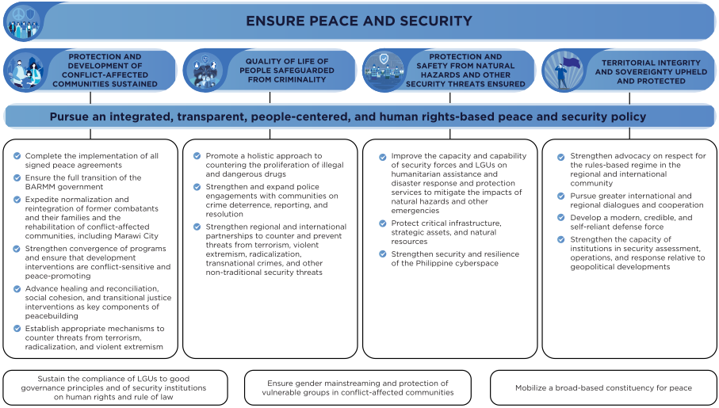
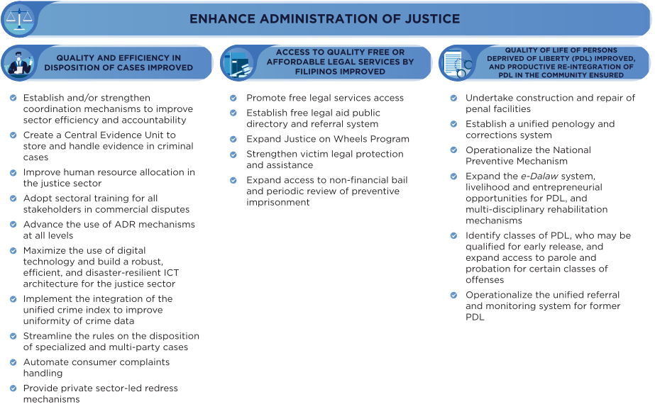

## Ensure Peace and Security and Enhance Administration of Justice

## Ensure Peace and Security and Enhance Administration of Justice

A secure and peaceful community where guns are silenced, food and basic services are sufficient, and community life has normalized and shown signs of progress-this reality is now within the reach of geographically isolated and conflict-affected communities.

In pursuing economic transformation, the manifestation of peace and security is a necessary condition in allowing the implementation of development activities that could bring in more and better opportunities for the people. This is attainable if conflict-vulnerable areas are protected and developed, the quality of life is safeguarded from criminality, and communities are safe from natural hazards and other security threats.

Likewise, an efficient administration of justice is critical in ensuring sustained economic progress. A stable and accountable justice system, whether traditional or alternative, must inspire trust and confidence among stakeholders through integrity, fairness, and accessibility.

The Philippine Development Plan (PDP) 2023-2028 puts forward the premise that a whole-ofgovernment approach with cross-cutting strategies is required in ensuring peace and security. It asserts that economic justice is a pillar of a strong and vibrant economy and requires a sector-based approach anchored on strong coordination among justice sector institutions, agencies, and actors to drive public engagement and trust in the justice system.

## Subchapter 13.1 Ensure Peace and Security

Peace agreements between the government and non-state armed groups have stabilized security in many areas, normalizing a life free of violence and allowing the implementation of development projects that have opened new and better opportunities for the Filipinos.

Investing in peace and security continues. This is realized by completing the commitments of signed peace agreements and in helping former combatants, their families, and conflict-affected communities to return to civilian life. In areas not covered by peace agreements, localized peace engagements will be intensified, with local government units facilitating a whole-of-society approach. Affirmative action on law enforcement operations on land and at sea including disaster response will be strengthened. Ongoing modernization of the armed forces and other security sector agencies will be intensified to protect the country's territorial integrity.

## Assessment and Challenges

The signing and implementation of peace agreements, 1 together with sustained law enforcement efforts, have stabilized security in geographically isolated and conflict-affected (GICA) communities and resulted in an increase in economic activities. However, challenges remain in the implementation of these agreements and groups with criminal and terrorist activities still exist. At the same time, natural hazards with devastating effects and the protection of territorial and national interests remain a challenge.

In the Bangsamoro Autonomous Region in Muslim Mindanao (BARMM), the peace process is steadily moving forward with the ratification of the Bangsamoro Organic Law (Republic Act No. 11054). The establishment of the Bangsamoro Transition Authority in 2019 and its extension to 2025 2 have laid the critical foundation for a fully functioning autonomous region. With this, significant progress was made in terms of the region's socioeconomic development. In 2021, BARMM registered the second-highest economic growth (7.5%) in the country, a significant improvement from 2016 when BARMM posted the lowest growth rate (0.3%) among all regions. 3 Poverty incidence also declined significantly, from 61.8 percent in 2018 to 37.2 percent in 2021. 4

The creation of the intergovernmental relations bodies between the national government and the Bangsamoro government addressed and resolved some of the key issues in the implementation of the Bangsamoro Organic Law. In 2021, the second phase of the decommissioning process was completed, with 12,000 combatants and 2,100 weapons demobilized. 5 The third phase is currently ongoing, aiming to decommission 91 percent of the combatants and their weapons. Likewise, the Camps Transformation Plan 2021-2026 6 is presently implemented, outlining the efforts toward a meaningful transformation of camps into productive and resilient communities.

Similarly, strategic interventions under the Bangon Marawi Comprehensive Rehabilitation and Recovery Program are being implemented in areas affected by the 2017 siege. These include the provision of social and financial aid, health care services, educational support, and psychosocial healing for those affected. More recently, the Marawi Siege Victims Compensation Act of 2022 (RA 11696) was enacted to provide compensation for properties destroyed during the siege.

The peace process with non-state armed groups 7 and development interventions for affected communities are in various stages of implementation. The demilitarization of arms and munition of the Cordillera Bodong Administration-Cordillera Peoples Liberation Army (CBA-CPLA) and the Rebolusyonaryong Partido Manggagawang Pilipinas-Revolutionary Proletariat ArmyAlex Boncayao Brigade (RPMP-RPA-ABB) has been completed. 8 In the affected areas, socioeconomic and livelihood interventions continue to be implemented. Meanwhile, the people of the Cordillera continue to pursue a meaningful regional autonomy. 9

Moreover, local peace engagements were initiated in communities affected by the presence of the Communist Party of the Philippines-New People's Army-National Democratic Front (CPP-NPA-NDF). Communist rebels who surrendered are provided with socioeconomic and legal assistance support through the Enhanced Comprehensive Local Integration Program (E-CLIP) and community development interventions such as the Payapa at Masaganang Pamayanan (PAMANA) Program 10 and the Barangay Development Program (BDP). 11 The PAMANA Program set the foundations for conflict-sensitive development efforts and empowered partners for peace. 12 From 2017 to 2021, PAMANA has supported 4,000 projects amounting to PHP18 billion. 13 Similarly, PHP16.4 billion was released to support 2,276 socioeconomic 14 and infrastructure projects in 2,228 communist-terrorist group-cleared barangays under the BDP. 15

The implementation of a whole-ofgovernment and whole-of-nation approach 16 fostered a more holistic and cohesive government response, addressing the interrelated drivers of armed conflict in the country. Various clusters and regional and local task forces under the National Task Force to End Local Communist Armed Conflict (NTF-ELCAC) 17 were activated. Key strategies in the National Action Plan on Preventing and Countering Violent Extremism were also rolled out.

Similarly, there has been significant reduction in crimes due to intensified law enforcement efforts. 18 The Philippine National Police (PNP) Intensified Cleanliness Program was launched to address problems in the service. Interventions based on the Philippine Anti-Illegal Drugs Strategy institutionalized a convergence system among government agencies to achieve drug-free communities. A science-health-security based approach on the drug problem is critical, and support for the professionalization and modernization of the PNP and drug enforcement bodies is needed.

Significant progress has also been made in terms of increasing the capacity of the security sector to respond to the adverse impacts of natural hazards and other security threats. The recently enacted Bureau of Fire Protection (BFP) Modernization Act (RA 11589) is expected to upgrade fire protection services in the country. The BFP also initiated the Oplan Ligtas na Pamayanan to capacitate barangays with systemic and comprehensive methods and procedures to prevent and respond to fires and other emergency and disaster risks. In addition, trainings on public safety were given to Barangay Peacekeeping Action Teams and non-government organization teams in areas. The National Chemical, Biological, Radiological, and Nuclear (CBRN) Action Plan was also formulated but is yet to be cascaded to relevant agencies.

The updating of the National Disaster Risk Reduction and Management Plan 2020-2030 outlines actions to ensure coordination and efficient logistics operations before and during disasters. Many local government units (LGU) have made significant progress in disaster preparedness and response, such as the adoption of standard operating procedures, activation of the Incident Command System, prepositioning of relief, and search and rescue. 19 However, data on population, critical facilities, and infrastructure exposed to natural and other security threats are still fragmented and incomplete.

Despite substantial improvements and actions toward ensuring peace and security, there remain challenges that must be addressed. In BARMM, all other intergovernmental relations mechanisms still need to be operationalized, such as the newly created Bangsamoro Sustainable Development Board and other intergovernmental arrangements between BARMM, the national government, and relevant LGUs. There are also challenges in the process of assisting former combatants in their return to civilian life and in the necessary enhancements in the healing, reconciliation, and gender mainstreaming components in GICA communities.

Moreover, the implementation of the peace and development interventions is not fully institutionalized at the regional and local levels. Gaps in efforts geared toward threat assessment, programming of responses, community engagement, dismantling of private armed groups, and strategic communication also need to be addressed.

Criminality and threats to public safety, including non-traditional security issues, also persist. The rapid growth and sophistication of cybercrimes and cyberattacks have increased the vulnerability of data, people, and structures. Hyperconnectivity has also expanded the attack surface of cybercriminals. Despite the initial efforts of the government, such as the formulation of the National Cybersecurity plan and activation of the National Computer Emergency Response Team and the National Cybersecurity Operations Center, a more concerted effort in cybersecurity is still needed.

Various issues on development and management of the country's territory and maritime domain, including enforcement, regulation, conservation, and security need to be tackled. The 2016 Permanent Court of Arbitration (PCA) Ruling on the West Philippine Sea issue was a clear victory of a rules-based international order. However, the Association of Southeast Asian Nations (ASEAN)-China Code of Conduct in the South China Sea remains unfinished.

Cross-border and transnational criminal activities are still major concerns, given the porous borders and structural inadequacy of relevant state institutions. Current global political developments involving inter-state and intra-state conflicts further magnify the vulnerability of the country. Hence, support for the modernization of the Armed Forces of the Philippines (AFP), Philippine Coast Guard (PCG), and other relevant security sector agencies is critical, underscoring the force structure, capability and materiel upgrade needed to be more effective in undertaking internal and external security functions.

## Strategy Framework

Ensuring peace and security is an essential foundation of sustainable development. The government will consistently pursue peace by mainstreaming peacebuilding and development interventions and utilizing a conflict-sensitive-and-peace-promoting paradigm in government programming. Toward this end, the gains of the peace processes in conflict-affected communities will be sustained; security and law enforcement operations, cybersecurity, and disaster response will be strengthened so that the quality of life is safeguarded from criminality; protection and safety from natural hazards and other threats will be ensured; and the country's territorial integrity, maritime rights, and entitlements will be protected (See Figure 13.1.1). These outcomes will be realized through an integrated, transparent, people-centered, and human rights-based peace and security policy, supported by relevant cross-cutting strategies.

Figure 13.1.1 Strategy Framework to Ensure Peace and Security Figure 13.1

## Strategies

## Outcome 1: Protection and development of conflictaffected communities sustained

## Complete the implementation of all signed peace agreements

The government will remain steadfast in completing the commitments under all signed peace agreements. These include: (a) implementing peace and development interventions in RPMP-RPA-ABB-Tabara Paduano Group and CBA-CPLA communities; (b) supporting initiatives toward Cordillera autonomy; (c) facilitating the healing and reconciliation process in affected communities; and (d) providing legal assistance to qualified individuals. Relative to the Bangsamoro peace process, the national government will support the coordinating committees and security mechanisms on the remaining commitments under the 1996 Government of the Philippines-Moro National Liberation Front (MNLF) Final Peace Agreement and support the political track and normalization mechanisms in the implementation of the Comprehensive Agreement on the Bangsamoro. 20,21

## Ensure full transition of the BARMM Government

Support will be extended to the Bangsamoro Transition Authority in institution building, personnel development, and economic management toward an inclusive BARMM government. Necessary policy and processes will be implemented to ensure a smooth BARMM elections in 2025. All intergovernmental relations mechanisms will be operationalized and strengthened to resolve remaining and potential issues between the national and the Bangsamoro governments.

Expedite normalization and reintegration of former combatants and their families, and the rehabilitation of conflict-affected communities, including Marawi City

Normalization and transformation programs for the Bangsamoro, 22,23 as supported by the Inter-Cabinet Cluster Mechanism on Normalization (ICCMN), 24 will continue. Demobilization of former combatants 25 and former violent extremists, 26 including the demilitarization of arms and munition, will be completed. The national and Bangsamoro governments will work closely in neutralizing armed threat groups to prevent and curb peace spoilers. 27 Systems and procedures in the delivery of socioeconomic support packages for decommissioned combatants, their families, and communities, and vulnerable groups (children, elderly, persons with disabilities [PWD], indigenous groups, internally displaced persons) will be made more efficient and effective.

Moreover, the government will fast-track the rehabilitation and catch-up development of communities through the implementation of various interventions, such as E-CLIP, PAMANA, and BDP. Furthermore, the government will complete the delivery of social, financial, and socioeconomic assistance necessary for the recovery of affected individuals in Marawi. The government will complete infrastructure projects such as bridges; schools; health centers; markets; ports; and the 2,800 permanent housing units for Marawi's most affected to be utilized by target beneficiaries by 2024.

## Strengthen convergence of programs, and ensure that development interventions are conflict-sensitive and peace-promoting

To improve conflict-sensitive and peace-promoting compliance, a monitoring and evaluation tool for GICA areas will be developed. Project targeting and implementation strategies will be further localized to ensure greater ownership of local communities. 28 More infrastructure projects will be rolled out in GICA areas and coordination between LGUs' Peace and Order Councils and Local Development Councils will be strengthened. Closer cooperation with domestic and international groups to support the various aspects of peace-building will be facilitated.

## Advance healing and reconciliation, social cohesion, and transitional justice interventions as key components of peacebuilding

The legal process, including granting of amnesty to qualified individuals, will be facilitated. Training and skills improvement will be initiated for social workers and other relevant government agencies to improve capacity in dealing with former combatants and child soldiers.

## Establish appropriate mechanisms to counter threats from terrorism, radicalization, and violent extremism

To neutralize peace spoilers, national and local agencies will strengthen their threat assessment capacity and response protocols. These involve: (a) institutionalizing preventing and countering violent extremism interventions in national and local bodies; (b) sustaining neutralization efforts against armed threat groups including law enforcement operations, case build-up against high-value targets, legal offensive, intelligence cooperation, military operations, and neutralization of illicit financial sources; (c) institutionalizing local peace engagements and transformation program for former rebels; 29 (d) strengthening the LGUs' peace and order council (POC); (e) sustaining the efforts of the National Task Force on Disbandment of Private Armed Groups; (f) developing a strategic communication plan aimed as social cohesion; and (g) developing a de-radicalization program for GICA communities.

## Outcome 2: Quality of life of people safeguarded from criminality

## Promote a holistic approach in countering the proliferation of illegal and dangerous drugs

To ensure that government efforts are people-centered, holistic, and human rights-based, the government will: (a) use a science-health-security based approach to curbing drug and illegal substance abuse, alongside restorative interventions for drug users and their dependents; (b) strengthen partnership with stakeholders; and (c) strengthen the reward and punishment mechanism in police and drug enforcement institutions. The PNP modernization program will continue giving stronger emphasis on professionalization, rights-based policing, and improving capability against traditional and non-traditional security threats.

## Strengthen and expand police engagements with communities on crime deterrence, reporting, and resolution

Law enforcement will be strengthened by expanding police presence in communities and establishing more police stations in strategic areas. Active partnership with communities will be forged. Barangay Peacekeeping Action Teams, civil society organizations, and community volunteers will be engaged through community and service-oriented policing scheme. Public safety and law enforcement agencies will converge efforts in patrolling, internal security, and law enforcement operations, both in land and at sea. Systems for responding to crime and emergencies will be made more efficient and relevant. Likewise, neutralization efforts against criminal groups will be sustained, internal cleansing in security institutions will be continued, and executive and legislative oversight over the police and other uniformed personnel will be enforced.

Strengthen regional and international partnerships to counter and prevent threats from terrorism, violent extremism, radicalization, transnational crimes, and other non-traditional security threats

Context-specific programs will be initiated to address radicalization efforts of violent extremist groups. As transnational crimes require rigorous national and local cooperation, 30 close partnerships with neighboring states will be sustained particularly on matters involving sea patrol, intelligence gathering, information exchange, rapid bilateral investigations, and apprehension of criminal elements in the porous borders of Southern Philippines 31 and other critical areas. 32 Bilateral and multilateral engagements in law enforcement and defense against violent extremist groups will be intensified and surveillance and inspection in air transportation 33 will be strengthened. Similarly, mandates and functions of various agencies relative to coastal management and maritime security will be reviewed and harmonized to ensure efficiency and effectiveness in addressing maritime security threats, while the modernization of the PCG and relevant maritime security institutions will be actively pursued.

## Outcome 3: Protection and safety from natural hazards and other security threats ensured

Improve capacity and capability of security forces and LGUs on humanitarian assistance and disaster response and protection services to mitigate the impacts of natural hazards and other emergencies

To manage disaster risks, the National Disaster Risk Reduction and Management Plan 2020-2030 will be fully and effectively implemented. The National Chemical, Biological, Radiological, and Nuclear Action Plan will be integrated in national and local disaster mitigation and response planning, together with the established protocols and standard operating procedures in dealing with CBRN-related concerns. The BFP Modernization Act will be fully implemented to ensure more responsive fire protection services across the country. 34 A program to enhance citizen volunteerism in disaster response will be established, with resources and training support and using the AFP Reservists Act 35 and the National Service Reserve Corps 36 as platforms. The assessment of the exposure and vulnerabilities of LGUs to disaster risks will be expanded. Likewise, capacity building on public safety and disaster preparedness will be intensified. Local and international cooperation in humanitarian assistance and disaster response operations, joint exercises, training activities, and information sharing will be scaled up.

## Protect critical infrastructure, strategic assets, and natural resources

Scenario-based planning, preparedness, and response mechanisms, as well as the protocols to protect critical infrastructure and assets, will be enhanced. Capacity to respond and manage maritime-based disasters like oil spills and hazardous and noxious substances spills will be improved by mobilizing coastal barangay information networks and Bantay-Dagat volunteer organizations, and by establishing marine pollution centers in strategic locations. Meanwhile, existing mechanisms and procedures to protect critical infrastructure assets will be strengthened 37 through improved coordination and capacity of various government agencies and LGUs in critical infrastructures mapping, vulnerability scanning, and threat assessment.

## Strengthen security and resilience of the Philippine cyberspace

To strengthen security against cyberattacks on critical information infrastructure (CII), the government will: (a) capacitate CII sectoral cybersecurity emergency response teams; (b) develop a manual of operations and standard protocols on cybersecurity for public and private institutions; (c) ensure interoperability and intelligence fusion of security and law enforcement agencies in tracking and monitoring online transactions of criminal elements, terrorist groups, and illegal drug traders; (d) strengthen capacity and upgrade technical skills of strategic agencies on cybersecurity; (e) strengthen cyber defense component in the modernization of the AFP; (f) forge stronger collaboration with local and international partners; (g) institute minimum information security and cybersecurity standards for CII and government agencies; (h) develop cybersecurity curriculum in academic and technical education institutions; and (i) institute a national policy framework on cybersecurity. In addition, the country will optimize space science and technology applications through the Philippine Space Agency (PhilSA). 38

## Outcome 4: Territorial integrity and sovereignty upheld and protected

## Strengthen advocacy on respect for rules-based regime in the regional and international community

Particularly for territorial sovereignty concerns and protection of fisherfolk in territorial waters, the government will advocate the 2016 PCA ruling favoring the Philippine position (See Chapter 5). The completion of the code of conduct in the South China Sea will be pursued. A wholeof-nation approach will be adopted in influencing local, regional, and international bodies.

## Pursue greater international and regional dialogues and cooperation

Bilateral, minilateral, and multilateral diplomatic arrangements in promoting regional security will be strengthened and expanded, while greater people-topeople dialogue among allied states will be promoted.

## Develop a modern, credible, and self-reliant defense force

Capacity and materiel upgrade will be pursued to achieve a minimum deterrence capability of the AFP. Cooperative joint military and intelligence exercises with friends and allies will be strengthened, while defense cooperation arrangements, such as the Mutual Defense Treaty and Visiting Forces Agreements, will be maximized by involving other security institutions in the training exercises. 39

The self-reliant defense posture program will be revived and supported to rebuild the defense industry. Technical cooperation will be pursued in areas of capacity building and technology development in defense science and industry, including space science and technology applications. Monitoring and information systems and technical interoperability of maritime security agencies will be harmonized to ensure a holistic and integrated policy on maritime domain.

## Strengthen capacity of institutions in security assessment, operations, and response relative to geopolitical developments

The government will increase the capacity of security institutions on maritime security and territorial defense, particularly on intelligence and counterintelligence operations, and intensify international cooperation. Policies relative to the role of the AFP, PNP, and other relevant security agencies in internal security operations will be reviewed. Moreover, the ability of relevant agencies to implement rescue and expatriation operations of overseas Filipinos in difficult and/or dangerous situations will be enhanced.

## Cross-cutting Strategies

Cross-cutting strategies will be carried out to support the sectoral outcomes and priorities.

## Sustain compliance of LGUs to good governance principles and of security institutions on human rights and rule of law

Good governance and the protection and promotion of human rights directly contribute to peace-building, conflict prevention, and post-conflict recovery. The government will foster efficient, inclusive, and accountable LGUs to boost the confidence of people toward the government and human rights-based security institutions in strengthening partnership with communities. In addition, better reward schemes, intensified mainstreaming efforts, and appropriate penalties on violators will be put in place.

## Ensure gender mainstreaming and protection of vulnerable groups in conflict-affected communities

Affirmative action will be done to protect and promote women and gender rights; and safeguard the welfare of vulnerable groups, including children, youth, elderly, PWDs, and internally displaced persons, during conflict situations and post-conflict recovery.

## Mobilize a broad-based constituency for peace

Peace education will be integrated in formal and informal learning platforms, as well as a sustained culture of peace campaigns. The establishment of a National Peace Institute under the Office of the Presidential Adviser on Peace, Reconciliation and Unity (OPAPRU) will be pursued to institutionalize and sustain the gains of the peace process. A strategic communication plan will be carried out to increase public awareness on peace and security strategies of the government, while an inclusive communication plan will be initiated to entice members of armed threat groups to abandon a life of violence and return to civilian life.

## Legislative Agenda

Table 13.1.1 contains priority bills for the 19 th Congress during the Plan period to ensure peace and security.

Table 13.1.1 Legislative Agenda to Ensure Peace and Security

| LEGISLATIVE AGENDA                                            | RATIONALE/KEY FEATURES                                                                                                                                                                                                                        | RESPONSIBLE AGENCY                                             |
|---------------------------------------------------------------|-----------------------------------------------------------------------------------------------------------------------------------------------------------------------------------------------------------------------------------------------|----------------------------------------------------------------|
| National Defense Act                                          | This aims to amend Commonwealth Act No. 1 (National Defense Act of 1935) by streamlining and further professionalizing the Department of National Defense (DND) and its bureaus.                                                              | DND                                                            |
| Mandatory Citizens' Service Training Act                      | This aims to unify the three training programs of the current National Service Training Program into a single and comprehensive citizens' civil and military training in the first two years of a baccalaureate degree program.               | DND                                                            |
| Self-Reliant Defense Posture Act                              | This aims to strengthen the capabilities of the DND to support the development of the defense industry and provide incentives for firms to participate in the effort.                                                                         | DND                                                            |
| Philippine Maritime Zones Act                                 | This aims to establish maritime zones and sovereignty jurisdictions where maritime rights can be exercised against unnecessary and dangerous maneuvers of foreign vessels traversing and entering the Philippine territory.                   | National Coast Watch Council (NCWC)                            |
| Philippine Archipelagic Sea Lanes Act                         | This aims to designate sea lanes and air routes for safe and innocent passage consistent with the provisions of the United Nations Convention on the Law of the Sea to prevent arbitrary international passage in the Philippine archipelago. | NCWC                                                           |
| Critical Information Infrastructure Protection Act            | This aims to protect CIIs by prescribing minimum standards for compliance by government agencies.                                                                                                                                             | Department of Information and Communications Technology (DICT) |
| Cybersecurity Act                                             | This aims to strengthen the cybersecurity workforce in the country and strengthen capabilities of the DICT by providing it with regulatory authority over CIIs and the cybersecurity industry.                                                | DICT                                                           |
| Enabling law creating an autonomous region in the Cordilleras | This will provide an operational basis for future convergence efforts between local government units, national government agencies, and stakeholders in the organization of the Cordillera as an autonomous region.                           | OPAPRU                                                         |

## Results Matrix

Table 13.1.2 contains year-by-year and end-of-plan indicators and targets that the government seeks to attain within each of the outcomes during the Plan period to ensure peace and security.

Table 13.1.2 Results Matrix: Ensure Peace and Security

| INDICATORS                                                                                                           | BASELINE (YEAR)                                                                                          | ANNUAL PLAN TARGETS - ANNUAL                                                                             | ANNUAL PLAN TARGETS - EOP                                                                                | MEANS OF VERIFICATION                                                                                    | RESPONSIBLE AGENCY/INTER- AGENCY BODY                                                                    | REPORTING ENTITY                                                                                         |
|----------------------------------------------------------------------------------------------------------------------|----------------------------------------------------------------------------------------------------------|----------------------------------------------------------------------------------------------------------|----------------------------------------------------------------------------------------------------------|----------------------------------------------------------------------------------------------------------|----------------------------------------------------------------------------------------------------------|----------------------------------------------------------------------------------------------------------|
| Subchapter 1 Intermediate Goals: Ensure Peace and Security                                                           | Subchapter 1 Intermediate Goals: Ensure Peace and Security                                               | Subchapter 1 Intermediate Goals: Ensure Peace and Security                                               | Subchapter 1 Intermediate Goals: Ensure Peace and Security                                               | Subchapter 1 Intermediate Goals: Ensure Peace and Security                                               | Subchapter 1 Intermediate Goals: Ensure Peace and Security                                               | Subchapter 1 Intermediate Goals: Ensure Peace and Security                                               |
| Outcome 1: Protection and development of conflict-affected and conflict-vulnerable communities sustained             | Outcome 1: Protection and development of conflict-affected and conflict-vulnerable communities sustained | Outcome 1: Protection and development of conflict-affected and conflict-vulnerable communities sustained | Outcome 1: Protection and development of conflict-affected and conflict-vulnerable communities sustained | Outcome 1: Protection and development of conflict-affected and conflict-vulnerable communities sustained | Outcome 1: Protection and development of conflict-affected and conflict-vulnerable communities sustained | Outcome 1: Protection and development of conflict-affected and conflict-vulnerable communities sustained |
| Living conditions in conflict-affected and conflict-vulnerable communities improved                                  |                                                                                                          |                                                                                                          |                                                                                                          |                                                                                                          |                                                                                                          |                                                                                                          |
| Percentage of Barangay Development Program beneficiary-barangays provided with socioeconomic interventions           | 822 beneficiary barangays (2021)                                                                         | 100% of barangays provided with interventions by 2023                                                    | 100%                                                                                                     | National Task Force to End Local Communist Armed Conflict (NTF- ELCAC) progress reports                  | NTF-ELCAC, DILG, LGUs                                                                                    | NTF-ELCAC                                                                                                |
| Percentage of Barangay Development Program beneficiary-barangays provided with socioeconomic interventions           | 1,406 beneficiary barangays (2022)                                                                       | 100% of barangays provided with interventions by 2024                                                    | 100%                                                                                                     | NTF-ELCAC progress reports                                                                               | NTF-ELCAC, DILG, LGUs                                                                                    | NTF-ELCAC                                                                                                |
| Percentage of implementation of peace agreements: Comprehensive Agreement on the Bangsamoro                          | 43% (2021)                                                                                               |                                                                                                          | 100%                                                                                                     | OPAPRU Report                                                                                            | BARMM, OPAPRU                                                                                            | OPAPRU                                                                                                   |
| Percentage of implementation of peace agreements: 1996 Final Peace Agreement with the Moro National Liberation Front | 50% (2021)                                                                                               |                                                                                                          | 100% (by 2025)                                                                                           | OPAPRU Report                                                                                            | OPAPRU                                                                                                   | OPAPRU                                                                                                   |
| Percentage of implementation of peace agreements: 2000 Peace Agreement with the RPMP-RPA-ABB                         | 44% (TPG, 2021) 0% (NDCG, 2021)                                                                          |                                                                                                          | 100% (by 2023) 100% (by 2024)                                                                            | OPAPRU Report                                                                                            | OPAPRU                                                                                                   | OPAPRU                                                                                                   |
| 5-Year Normalization Program with the Government of the Philippines (GPH)-CBA-CPLA Peace Process                     | 52% (2021)                                                                                               |                                                                                                          | 100% (by 2024)                                                                                           | OPAPRU Report                                                                                            | OPAPRU                                                                                                   | OPAPRU                                                                                                   |
| Outcome 2: Quality of life of people safeguarded from criminality                                                    | Outcome 2: Quality of life of people safeguarded from criminality                                        | Outcome 2: Quality of life of people safeguarded from criminality                                        | Outcome 2: Quality of life of people safeguarded from criminality                                        | Outcome 2: Quality of life of people safeguarded from criminality                                        | Outcome 2: Quality of life of people safeguarded from criminality                                        | Outcome 2: Quality of life of people safeguarded from criminality                                        |
| Average monthly index crime rate reduced (Sustainable Development Goal [SDG] indicator) 40                           | 3.01 (2021)                                                                                              | Decreasing                                                                                               | Below baseline target                                                                                    | Crime Incident Reporting and Analysis System (CIRAS)                                                     | Philippine National Police (PNP)                                                                         | PNP                                                                                                      |
| Proportion of families that feel safe walking alone in the community at night (SDG indicator)                        | 89.8% (2020)                                                                                             | Increasing                                                                                               | Above baseline target                                                                                    | APIS                                                                                                     | PNP, LGUs                                                                                                | Philippine Statistics Authority                                                                          |
| Outcome 3: Protection and safety from hazards and other threats ensured                                              | Outcome 3: Protection and safety from hazards and other threats ensured                                  | Outcome 3: Protection and safety from hazards and other threats ensured                                  | Outcome 3: Protection and safety from hazards and other threats ensured                                  | Outcome 3: Protection and safety from hazards and other threats ensured                                  | Outcome 3: Protection and safety from hazards and other threats ensured                                  | Outcome 3: Protection and safety from hazards and other threats ensured                                  |
| Percentage of cyber incident reports processed and/or closed and remediated                                          | 80% (2022)                                                                                               | Increasing                                                                                               | Above baseline target                                                                                    | DICT Reports                                                                                             | DICT                                                                                                     | DICT                                                                                                     |
| Outcome 4: Territorial integrity and sovereignty upheld and protected a                                              | Outcome 4: Territorial integrity and sovereignty upheld and protected a                                  | Outcome 4: Territorial integrity and sovereignty upheld and protected a                                  | Outcome 4: Territorial integrity and sovereignty upheld and protected a                                  | Outcome 4: Territorial integrity and sovereignty upheld and protected a                                  | Outcome 4: Territorial integrity and sovereignty upheld and protected a                                  | Outcome 4: Territorial integrity and sovereignty upheld and protected a                                  |
| Maritime domain awareness improved                                                                                   |                                                                                                          |                                                                                                          |                                                                                                          |                                                                                                          |                                                                                                          |                                                                                                          |
| Air domain awareness improved                                                                                        |                                                                                                          |                                                                                                          |                                                                                                          |                                                                                                          |                                                                                                          |                                                                                                          |

a Indicators for internal monitoring only; not for publication.

## Subchapter 13.2 Enhance Administration of Justice

A stable and accountable justice system is essential in achieving economic transformation. In such a system, the needs and expectations of litigants are reliably managed within definite timeframes by impartial actors, supported by a technologically adaptive and disaster-resilient infrastructure. The system entails the provision of cost- and time-effective dispute resolution mechanisms, whether traditional or alternative, which inspire faith and confidence among stakeholders.

Efficient justice administration is realized when stakeholders from all sectors of society, including the business sector, can resolve legal disputes within the justice system. When there is confidence in the justice system, more entrepreneurs and business leaders are willing to expand their businesses through investments in assets and people. 41

## Assessment and Challenges

A well-functioning justice system contributes to creating a healthy business environment. 42 Literature has shown that there is strong correlation between the efficiency of the justice system and commercial and entrepreneurial activity. 43 If uncertainties exist in how economic disputes are resolved, capitalists may shy away from investing their money for fear that aside from known business risks, they will also have to allocate resources on costly and delayed litigation.

The overall percentile rank of the Philippines in cross-country indices remains low. The country failed to meet the 2022 targets in the fundamental rights (29.00 vis-à-vis 15.71), civil justice (27.00 vis-à-vis 25.71), and criminal justice (29.00 vis-à-vis 16.43) sub-indicators under the World Justice Project. 44 It likewise failed to meet the 2021 target in rule of law index (50.00 vis-à-vis 26.92) under the Worldwide Governance Indicators. 45

In 2020, the Philippines posted an improvement in the Doing Business Report of the World Bank from 124 th to 95 th out of 190 economies, 46 It scored high in terms of starting a business, dealing with construction permits, and protecting minority investors. However, it lagged in terms of enforcing contracts and resolving insolvency, especially among its ASEAN counterparts. 47

Nonetheless, the Philippines has enacted and amended legislations and regulations toward improvement in the justice system. These include RA 11576, 48 which amended the jurisdictions of the First Level and Second Level Courts in civil cases; and RA 10951, 49 which updated the penalties for offenses based on pecuniary value. Moreover, the Implementing Rules and Regulations of the Good Conduct Time Allowance Law and the 2018 New Bail Bond Guide of the Department of Justice (DOJ) have also been implemented.

The Judiciary has also issued guidelines to ensure that the disposition of actions and proceedings is just, prompt, and inexpensive. Among these are the 2019 Amendments to the 1997 Rules of Civil Procedure, the 2019 Amendments to the 1989 Revised Rules on Evidence, and the Rules on Expedited Procedures in the First Level Courts.

Despite these positive developments, several policy reforms and key legislations remain unattained.

Fragmentation of the criminal justice system remains a challenge. The criminal justice system in the Philippines has five pillars-law enforcement, prosecution, the courts, correction, and the community. Its administration is shared by the Executive and Judiciary branches of government, resulting in a fragmented system. It has achieved better coordination through the Justice Sector Coordinating Council (JSCC), which has facilitated thoughtful identification of common problems and development of sector-based solutions in selected areas called Justice Zones. At present, nine Justice Zones have been established in Quezon City, Cebu City, Davao City, Angeles City, Bacolod City, Naga City, Calamba City, Balanga City, and Baguio City. In these Justice Zones, six information systems have been operationalized, leading to enhanced delivery of swift and fair justice. 50

Backlogs in resolving cases, delays caused by inefficient practices, and aging persist. Both the National Prosecution Service (NPS) of the DOJ and the Supreme Court of the Philippines (SC) have adopted reforms in case decongestion and delay. The NPS undertook a decongestion program that cleared backlogs in the most congested prosecution offices. Meanwhile, the SC amended the 1997 Rules of Civil Procedure, allowing an electronic mode of filing, service of pleadings, and court submissions. The National Justice Information System (NJIS), which has been implemented to address case delays particularly in criminal actions, is also being expanded to include the Single Carpeta System (Inmate Management Information System) and is laying the groundwork for a unified penology system.

However, more measures to prevent docket congestion should be put in place. Based on the 2021 data from the NPS, only 92 percent of all criminal complaints have completed preliminary investigation. Meanwhile, the judiciary has achieved only 93 percent clearance rate. These measures include, among others, the nationwide rollout of the Prosecution Case Management System, streamlining of court rules and procedures, strengthening of case build-up between the prosecution and the law enforcers, and review of human resource requirements. Procedures in the justice sector should likewise be automated and digitalized to expedite proceedings and for data accuracy and consistency.

Limited resources weaken the justice sector. The judiciary has consistently received less than 1 percent of the annual budget since 2003, 51 leading to compounded problems including shortage of courts and insufficient human resources particularly in key justice sector positions. This has compelled the judiciary to designate judges in interim capacities or pairing them in vacant branches. In the meantime, prosecutors and public attorneys are assigned to two or more courts at a time despite the existence of laws prescribing the ideal ratio (1:1) of Prosecutor and Public Attorney's Office (PAO) Lawyer to courts. A sector approach, which entails close coordination among justice sector institutions, agencies, and actors, is thus necessary to determine and maintain the appropriate ratio of justice sector professionals to every court.

Low public confidence in the justice system undermines the rule of law. While justice sector actors generally received good net trust ratings in the 2021 Justice Needs Survey, 52 public perception on the justice sector remains rather negative. As a result, many ordinary Filipinos tend to turn to media personalities and other non-legal sources such as online forums and even social media to air their grievances and attempt to resolve them.

## Strategy Framework

The strategy framework in Figure 13.2.1 emphasizes the need for coordinated action to enhance justice administration by increasing case disposition quality and efficiency and improving the plight of persons deprived of liberty (PDL) and other vulnerable groups.

Figure 13.2.1 Strategy Framework to Enhance Administration of Justice

## Strategies

## Outcome 1: Quality and efficiency in disposition of cases improved

## Establish and/or strengthen coordination mechanisms to improve sector efficiency and accountability

The JSCC will launch a new Justice Zone per quarter within the plan period, while existing Justice Zones expand functions to include monitoring and assessment of their coordination mechanisms, implementation of reporting to the JSCC, and sharing of best practices. The DOJ, together with relevant law enforcement agencies or through the JSCC, will streamline criminal investigation, prosecution, and case management processes, including those for heinous crimes and illegal drugs. RA 10867, 53 or the National Bureau of Investigation (NBI) Reorganization and Modernization Act, will be fully implemented. It will improve scientific investigation capabilities, strengthen witness and whistleblower protection, and other special enforcement and protection programs, to increase investigative and prosecutorial effectiveness.

Justice Hubs will also be established in selected LGUs. These will serve as a one-stop venue for criminal justice and have an infrastructure that houses courts, prosecutors, public attorneys, the police, and a jail with classified housing for surrendered or apprehended drug offenders.

Moreover, legislative and policy reforms will be pursued to institutionalize cooperation between prosecutors and law enforcers such as the PNP and NBI, among others. This cooperation will facilitate case build-up through proper collection, preservation, and presentation of evidence, and will ensure successful prosecution, inclusive of legal and technical guidance.

## Create a Central Evidence Unit to store and handle evidence in criminal cases

Relevant justice sector agencies will pursue the establishment of a Central Evidence Unit as a main component of the Justice Hubs, which will serve as the main repository of all evidence in criminal cases including storage of electronic evidence. 54 To address inefficient processing of evidence, an integrated system handled by sector-representative personnel will be put in place. This system will be used for electronic and physical validation and documentation of evidence coming from various agencies, including from law enforcement, prosecution, and the courts.

## Improve human resource allocation in the justice sector

A JSCC enabling law that adopts a sector-based approach will be enacted. This legislation will support the creation of human resource positions that cover justice sector actors in both the Judiciary and the Executive Department and will ensure the required ratio of court to prosecutor to public attorney. Sectoral human resource planning will be strengthened to facilitate timely and coordinated creation of new positions and appointments, as well as establishment of new courts and prosecution offices, among others. Likewise, data analytics will be adopted to enhance the planning process.

## Adopt sectoral training for all stakeholders in commercial disputes

A sector-based approach will be adopted in the settlement of commercial disputes, which include intra-corporate cases, intellectual property cases, cases involving admiralty and maritime laws, financial rehabilitation and liquidation of insolvent debtors, competition cases, and cybercrime cases, among others. It will support the conduct of sectoral capacity building and information exchange activities to facilitate case disposition with the least delay, while still providing all relevant information required by the courts that are in the control and custody of various agencies in the Executive Department.

## Advance the use of Alternative Dispute Resolution mechanisms at all levels

The SC will revisit the Rules of Court to include a filtering mechanism that will require litigants to first exhaust all available Alternative Dispute Resolution (ADR) mechanisms before judicial recourse. Relevant to this, the Office for Alternative Dispute Resolution (OADR) will continue to undertake capacity building, and advocacy and informative programs on different ADR mechanisms, including the Katarungang Pambarangay. It will update, harmonize, and improve the Philippine legal framework to strengthen the use of ADR in the public and private sectors in accordance with international standards.

Moreover, the Katarungang Pambarangay or the Barangay Justice System will be explored to consider expansion of its existing jurisdiction, which is currently limited to disputes involving parties that reside within the same city or municipality or in adjoining cities or municipalities. The exemption of criminal cases involving offenses punishable by a maximum penalty of imprisonment exceeding one year or a fine over PHP5,000 from the Katarungang Pambarangay will also be revisited to ensure alignment with RA 10951, which adjusted the fines and the property values on which penalties are based under the Revised Penal Code.

## Maximize the use of digital technology and build a robust, efficient, and disaster-resilient ICT architecture for the justice sector

Robust internet infrastructure will be established within the justice sector to further support online hearings and case management systems. The courts will be automated, and personnel will be upskilled to support a suite of digitalized services, such as video conferencing hearings. The NJIS will be fully implemented through the Single Carpeta System as the first step in information sharing among justice sector actors. It will be expanded eventually to include the Judiciary. To facilitate full implementation of the NJIS, the government will allocate sufficient financial and human resources for digital transformation initiatives across the justice sector, which include the implementation of the Criminal Justice Information Exchange

(CJiX) as the platform that will bridge the NJIS and the eCourt System (See Box 13.2.1).

In conjunction with the eCourt System and NJIS, the justice sector will also adopt a simplified system of court-bound and court-issued papers, where templates are made available in the eCourt system portal and publicly, through the Trial Courts Automation Project.

## Box 13.2.1 The National Justice Information System and the Criminal Justice Information Exchange

The National Justice Information System (NJIS)- led by the Department of Justice (DOJ) and supported by the Department of Information and Communications Technology (DICT), and funded by Congress since 2012-is a project that involves the development and setup of core agency information management systems and inter-agency exchange mechanisms. The NJIS is composed of two discrete clusters: the Law Enforcement Cluster composed of the DOJ National Prosecution Service, PNP, NBI, Philippine Drug Enforcement Agency, Dangerous Drugs Board, and Bureau of Immigration; and the Corrections Cluster involving the Bureau of Jail Management and Penology (BJMP); Bureau of Corrections (BuCor); Board of Pardons and Parole; and Parole and Probation Administration.

The Criminal Justice Information Exchange (CJiX) will be established linking all justice sector agencies. Each agency will develop its own ICT system, which will then be linked to the CJiX. This will build the structure necessary to facilitate interchange of crimerelated data pertinent to civil actions and special proceedings, such as fraud in commercial transactions, unfair competition, infringement on intellectual property rights, and infrastructure and land disputes. Agencies at the core of this network are the DOJ, DILG, and the judiciary. A key feature of the CJiX is the harmonization of criminal definitions and procedures, as well as consensus on data capture, storage and retrieval.

## Implement the integration of the unified crime index to improve uniformity of crime data

A unified crime index database will be utilized in all applicable processes to support the rollout of technology-based case management solutions. All forms or logs that list crimes will follow the exact nomenclature of the index database that is compliant with the International Classification of Crimes for Statistical Purposes, which is the international standard for crime statistics. The DOJ and University of the Philippines Law Center, in partnership with the DILG and the SC, will conduct capacity building on the use of the index database, including its integration to existing data-related processes.

## Streamline the rules on the disposition of specialized and multi-party cases

The rules on land disputes will be streamlined to impose the mandatory consolidation of causes of action relating to the same real property, whether for possession, ownership, or damages. The rule on expropriation will also be clarified to ensure that courts are compliant with issuing partial judgments at the different stages of an expropriation case. The jurisdiction of the National Commission on Indigenous Peoples on claims of indigenous peoples and indigenous cultural communities on ancestral domains will also be considered. Furthermore, the SC will study the need to designate special courts on land dispute settlement.

To handle multi-party cases, special rules of procedure will be crafted. The procedures will be simplified to give access to those who seek redress in mass injury cases, whether through civil or criminal proceedings.

## Automate consumer complaints handling

The Department of Trade and Industry (DTI) will develop and implement the Philippine Online Dispute Resolution System, which will serve as a web-based consumer complaint portal and automate the entire consumer complaints-handling process of the government. This will be done by interlinking all the member agencies of the Consumer Network, a collective of government agencies with consumer protection functions.

## Provide private sector-led redress mechanisms

Through the Bagwis Awards Program of the DTI, business owners will be encouraged to establish consumer welfare desks or an equivalent customer relations office inside their establishments. These desks or offices will provide a mechanism for the speedy resolution of consumer complaints, among other parameters that seek to provide immediate redress and at the same time prevent additional cases for the court.

## Outcome 2: Access to quality free or affordable legal services by Filipinos improved

## Promote limited law practice

The government will fully implement the Revised Law Student Practice Rule under Rule 138-A of the Rules of Court for the under-privileged to address scarce legal services. Under said rule, law schools are required to establish legal aid clinics and provide accredited law students the opportunity to assist Filipinos who do not have representation in court.

## Establish free legal aid public directory and referral system

The SC, through the Strategic Plan for Judicial Innovations 2022-2027, will strengthen legal aid initiatives as among its primary objectives for ensuring access to justice. In particular, the SC, together with the DOJ, PAO, Integrated Bar of the Philippines, Philippine Association of Law Schools, and other legal aid clinics will map available legal aid services per locality. Moreover, a database of free legal aid providers will be available online to ensure that law enforcers and detainees have immediate access, pursuant to the United Nations Principles and Guidelines on Access to Legal Aid in Criminal Justice Systems.

To ensure the expansion of legal services, the DOJ will also establish the DOJ Action Center in the regions. These action centers will act on complaints, requests for legal assistance, and queries of walk-in clients.

## Expand the Justice on Wheels Program

The SC will expand the scope of the Justice on Wheels Program to address specialized issues like tenurial disputes in agrarian reform, and climate and environmental cases. Bringing the courts closer to litigants will ensure speedy resolution of disputes in tenurial arrangements and environmental actions.

## Strengthen victim legal protection and assistance

Access to justice will be made more inclusive especially among marginalized sectors such as women, children, PWDs, senior citizens, and indigenous peoples through victim-centered, child-friendly, and gendersensitive assistance mechanisms. Coordination among the DOJ, the PNP, and the Department of Social Welfare and Development (DSWD) will be strengthened to address fragmented mechanisms in existing witness protection and victim assistance programs. The DOJ will intensify the Victims Compensation Program by pursuing the amendment of RA 7309. This amendment will increase the compensation for victims of unjust imprisonment and violent crimes and improve the accessibility and the administration of the program.

At the same time, the Commission on Human Rights (CHR) will intensify its efforts to improve access to justice by: (a) empowering the poor and marginalized to seek responses and remedies for injustice; (b) improving legal protection, awareness, and aid; (c) improving civil society and parliamentary oversight; (d) addressing human rights violations in the justice sector; (e) strengthening linkages between formal and informal structures; and (f) monitoring and evaluating such interventions.

## Expand access to non-financial bail and periodic review of preventive imprisonment

The Recognizance Act of 2012 (RA 10389) 55 will be revisited to expand the application of recognizance. An automated notification system will likewise be implemented and integrated in the eCourt system. This notification system will alert the accused, who are availing of non-financial bail, of approaching court dates.

The courts will periodically review all criminal cases involving preventive imprisonment to safeguard the rights of preventively imprisoned persons against unreasonable prolonged detention. The review will be reinforced by automating the computation of time served by the detainee, integrating an alert system in the eCourt system that will prompt the judge on the release date of the detainee.

## Outcome 3: Quality of life of PDL improved, and productive re-integration of PDL in the community ensured

## Undertake construction and repair of penal facilities

The government will expand existing penal facilities and establish new ones to house the inmate population adequately. Construction and repair of penal facilities will adhere to international standards 56 to guarantee dignity and health of detainees, as well as support effective rehabilitation and social re-integration of PDL. Likewise, concerned agencies will adopt digitalization of jail records. Toward this end, the DOJ, DILG, and the LGUs will also secure the required annual budgetary allocation and seek the assistance of the Department of Public Works and Highways and the DICT to ensure uninterrupted project implementation.

## Establish a unified penology and corrections system

A single agency will be created to manage all seven national prisons and 926 city, district, municipal, and provincial jails, as well as administer rehabilitation programs for convicted offenders. This new agency and the courts will work together through information sharing to guarantee the timely release of detainees or convicted offenders.

## Operationalize the National Preventive Mechanism

Champions in Congress will be tapped to enact a law that will comply with the UN Convention Against Torture and Other Cruel, Inhuman, or Degrading Treatment or Punishment (UN CAT) and its Optional Protocol (OPCAT). The UN CAT and OPCAT require the formation of visiting bodies for the prevention of torture and other cruel, inhumane, or degrading treatment of punishment, as well as inspect the treatment and living conditions in detention and penal facilities.

## Expand the e-Dalaw system, livelihood, and entrepreneurial opportunities for PDL, and multi-disciplinary rehabilitation mechanisms

The e-Dalaw system will be expanded to afford unhampered access to justice and enforce social reintegration. Infrastructure to support video conferencing for visitations and hearings will be established to reduce possible risks associated with in-person contact, such as smuggling of prohibited items.

To provide livelihood opportunities for PDL, the DTI will continue its product development and marketing trainings for PDL who are skilled in handiwork. These trainings will provide PDL opportunities to earn their keep and for their families. The government will also provide tax incentives or other non-monetary incentives and recognition to employers and business establishments that will provide capacity-building, livelihood, or employment, as well as entrepreneurial opportunities to PDL. It will also conduct a study to determine whether expungement of criminal records adopted in other jurisdictions is viable to remove the stigma associated with incarceration.

A law that unifies the holistic reintegration strategy of formerly incarcerated offenders will be enacted, involving a multi-disciplinary program that ensures the successful rehabilitation of convicted offenders. The program will be directed toward improving the offenders' behaviors, skills, mental health, social functioning, and access to education and employment.

## Identify classes of PDL who may be qualified for early release and expand access to parole and probation for certain classes of offenses

The Revised Penal Code, the Indeterminate Sentence Law, and the Probation Law will be reviewed and revised to allow convicted offenders to avail of the benefits provided by said laws. The revision, however, will depend on data from the DOJ regarding which parolees and pardonees are highly unlikely to be recommitted to prison on account of recidivism. The classes of repeat offenders (recidivist, habitual delinquent, reiteracion, and quasi-recidivist) will be simplified.

Distinctions in our penal laws with respect to heinous, violent, and non-violent offenders, rather than a simplistic penalty-based classification, will be considered.

## Operationalize the unified referral and monitoring system for former PDL

The government will assess postincarceration outcomes in the form of facilities for psychiatric support and supportive residential housing, such as halfway houses. It will give due consideration to certain classes of offenders. For instance, in drug cases, the rehabilitation program will be designed to address underlying problems of substance abuse that might lead to reoffending. Furthermore, the functions of the Barangay Anti-Drug Abuse Council will be expanded to include monitoring of former PDL to assist in their complete rehabilitation and reintegration into communities.

## Legislative Agenda

Table 13.2.1 contains priority bills for the 19th Congress during the Plan period to enhance the administration of justice.

Table 13.2.1 Legislative Agenda to Enhance Administration of Justice

| LEGISLATIVE AGENDA                                                                    | RATIONALE/KEY FEATURES                                                                                                                                                                                                                                                                                  | RESPONSIBLE AGENCY                       |
|---------------------------------------------------------------------------------------|---------------------------------------------------------------------------------------------------------------------------------------------------------------------------------------------------------------------------------------------------------------------------------------------------------|------------------------------------------|
| Justice Sector Coordinating Council (JSCC) enabling law                               | This aims to formally recognize the JSCC as a government body, with a permanent secretariat, to be charged with institutionalizing coordination mechanisms in the justice sector.                                                                                                                       | DOJ and DILG as JSCC principals          |
| Justice Sector human resources rationalization                                        | This adopts a sector-based approach to creating positions in the justice sector by matching the creation of courts with corresponding increases in the number of prosecutors, public attorney's positions, etc.; and creates more justice sector positions to deal with workload and case congestion.   | DOJ, PAO                                 |
| Expand Katarungang Pambarangay                                                        | This will reassess exemptions of cases that may be brought before the Lupong Tagapamayapa, particularly with respect to residence and thresholds of criminal cases.                                                                                                                                     | DILG                                     |
| Unified Penology System                                                               | This aims to unify all penal institutions under one agency, with close collaboration among courts for the disposition of detention prisoners and convicted offenders.                                                                                                                                   | BuCor, BJMP, DILG                        |
| Commission on Human Rights (CHR) as lead agency for the National Preventive Mechanism | This will strengthen the CHR as a National Human Rights Institution, compliant with the requirements of the United Nations Paris Principles, United Nations Convention against Torture, and Optional Protocol to the Convention Against Torture.                                                        | CHR                                      |
| Unified Reintegration Strategy                                                        | This creates a comprehensive and holistic program for the reintegration of PDL post-incarceration, including employment opportunities in the public sector and providing incentives for the private sector that will accept PDL as employees.                                                           | DOJ (lead), BJMP (lead), DTI, DOLE, DSWD |
| Strengthening and/or modernization of the Parole and Probation Administration (PPA)   | This will strengthen human resource allocation and improve or promote the social, moral, and economic well-being of probation and parole workers to address the disproportionate number of probation and parole officers vis-à- vis the applicants, to ensure efficient and effective service delivery. | PPA                                      |

## Results Matrix

Table 13.2.2 contains year-by-year and end-of-plan indicators and targets that the government seeks to attain within each of the outcomes during the Plan period to enhance the administration of justice.

Table 13.2.2. Results Matrix: Enhance Administration of Justice

| INDICATORS                                                         | BASELINE (YEAR)                                                    | ANNUAL PLAN TARGETS - 2023                                         | ANNUAL PLAN TARGETS - 2024                                         | ANNUAL PLAN TARGETS - 2025                                         | ANNUAL PLAN TARGETS - 2026                                         | ANNUAL PLAN TARGETS - 2027                                         | ANNUAL PLAN TARGETS - 2028                                         | MEANS OF VERIFICATION                                              | RESPONSIBLE AGENCY/INTER- AGENCY BODY                              |
|--------------------------------------------------------------------|--------------------------------------------------------------------|--------------------------------------------------------------------|--------------------------------------------------------------------|--------------------------------------------------------------------|--------------------------------------------------------------------|--------------------------------------------------------------------|--------------------------------------------------------------------|--------------------------------------------------------------------|--------------------------------------------------------------------|
| Subchapter 2 Intermediate Goal: Enhance Administration of Justice  | Subchapter 2 Intermediate Goal: Enhance Administration of Justice  | Subchapter 2 Intermediate Goal: Enhance Administration of Justice  | Subchapter 2 Intermediate Goal: Enhance Administration of Justice  | Subchapter 2 Intermediate Goal: Enhance Administration of Justice  | Subchapter 2 Intermediate Goal: Enhance Administration of Justice  | Subchapter 2 Intermediate Goal: Enhance Administration of Justice  | Subchapter 2 Intermediate Goal: Enhance Administration of Justice  | Subchapter 2 Intermediate Goal: Enhance Administration of Justice  | Subchapter 2 Intermediate Goal: Enhance Administration of Justice  |
| Outcome 1: Quality and efficiency in disposition of cases improved | Outcome 1: Quality and efficiency in disposition of cases improved | Outcome 1: Quality and efficiency in disposition of cases improved | Outcome 1: Quality and efficiency in disposition of cases improved | Outcome 1: Quality and efficiency in disposition of cases improved | Outcome 1: Quality and efficiency in disposition of cases improved | Outcome 1: Quality and efficiency in disposition of cases improved | Outcome 1: Quality and efficiency in disposition of cases improved | Outcome 1: Quality and efficiency in disposition of cases improved | Outcome 1: Quality and efficiency in disposition of cases improved |
| Quality in disposition of cases improved                           | Quality in disposition of cases improved                           | Quality in disposition of cases improved                           | Quality in disposition of cases improved                           | Quality in disposition of cases improved                           | Quality in disposition of cases improved                           | Quality in disposition of cases improved                           | Quality in disposition of cases improved                           | Quality in disposition of cases improved                           | Quality in disposition of cases improved                           |
| Case completion period in judicial dockets improved a              | 86                                                                 | 87                                                                 | 88                                                                 | 89                                                                 | 90                                                                 | 91                                                                 | 92                                                                 | SC Annual Report                                                   | SC                                                                 |

| INDICATORS                                                                                                        | BASELINE (YEAR)                                                                                           | ANNUAL PLAN TARGETS - 2023                                                                                | ANNUAL PLAN TARGETS - 2024                                                                                | ANNUAL PLAN TARGETS - 2025                                                                                | ANNUAL PLAN TARGETS - 2026                                                                                | ANNUAL PLAN TARGETS - 2027                                                                                | ANNUAL PLAN TARGETS - 2028                                                                                | MEANS OF VERIFICATION                                                                                     | RESPONSIBLE AGENCY/INTER- AGENCY BODY                                                                     |
|-------------------------------------------------------------------------------------------------------------------|-----------------------------------------------------------------------------------------------------------|-----------------------------------------------------------------------------------------------------------|-----------------------------------------------------------------------------------------------------------|-----------------------------------------------------------------------------------------------------------|-----------------------------------------------------------------------------------------------------------|-----------------------------------------------------------------------------------------------------------|-----------------------------------------------------------------------------------------------------------|-----------------------------------------------------------------------------------------------------------|-----------------------------------------------------------------------------------------------------------|
| Percentage of successful prosecution improved (convictions vis-à-vis acquittal) b                                 | 91.05 (2021)                                                                                              | 91.05                                                                                                     | 91.07                                                                                                     | 91.09                                                                                                     | 91.11                                                                                                     | 91.13                                                                                                     | 91.15                                                                                                     | DOJ Annual Report                                                                                         | DOJ                                                                                                       |
| Completion rate of cases handled improved                                                                         | 40.74 (2021)                                                                                              | 41.24                                                                                                     | 42.44                                                                                                     | 43.64                                                                                                     | 45.24                                                                                                     | 46.84                                                                                                     | 48.44                                                                                                     | Public Attorney's Office (PAO) Annual Report                                                              | PAO                                                                                                       |
| Efficiency in disposition of cases improved                                                                       | Efficiency in disposition of cases improved                                                               | Efficiency in disposition of cases improved                                                               | Efficiency in disposition of cases improved                                                               | Efficiency in disposition of cases improved                                                               | Efficiency in disposition of cases improved                                                               | Efficiency in disposition of cases improved                                                               | Efficiency in disposition of cases improved                                                               | Efficiency in disposition of cases improved                                                               | Efficiency in disposition of cases improved                                                               |
| Disposition rate for all court levels improved                                                                    | 39 (2021)                                                                                                 | 41                                                                                                        | 43                                                                                                        | 45                                                                                                        | 47                                                                                                        | 49                                                                                                        | 51                                                                                                        | SC Annual Report                                                                                          | SC                                                                                                        |
| Percentage of criminal complaints resolved on preliminary investigation improved                                  | 92.29 (2021)                                                                                              | 92.29                                                                                                     | 92.30                                                                                                     | 92.31                                                                                                     | 92.32                                                                                                     | 92.33                                                                                                     | 92.34                                                                                                     | DOJ Annual Report                                                                                         | DOJ                                                                                                       |
| Clearance rate of all courts improved                                                                             | 93 (2021)                                                                                                 | 95                                                                                                        | 97                                                                                                        | 99                                                                                                        | 101                                                                                                       | 103                                                                                                       | 105                                                                                                       | SC Annual Report                                                                                          | SC                                                                                                        |
| Settlement rate of Alternative Dispute Resolution (ADR) cases improved                                            | Settlement rate of Alternative Dispute Resolution (ADR) cases improved                                    | Settlement rate of Alternative Dispute Resolution (ADR) cases improved                                    | Settlement rate of Alternative Dispute Resolution (ADR) cases improved                                    | Settlement rate of Alternative Dispute Resolution (ADR) cases improved                                    | Settlement rate of Alternative Dispute Resolution (ADR) cases improved                                    | Settlement rate of Alternative Dispute Resolution (ADR) cases improved                                    | Settlement rate of Alternative Dispute Resolution (ADR) cases improved                                    | Settlement rate of Alternative Dispute Resolution (ADR) cases improved                                    | Settlement rate of Alternative Dispute Resolution (ADR) cases improved                                    |
| Settlement rate of ADR cases by the Katarungang Pambarangay (KP) improved                                         | 77 (2021)                                                                                                 | 79                                                                                                        | 80                                                                                                        | 81                                                                                                        | 82                                                                                                        | 83                                                                                                        | 84                                                                                                        | Department of the Interior and Local Government (DILG) KP Case Statistics Report                          | DILG, Office for Alternative Dispute Resolution (OADR)                                                    |
| Settlement rate of ADR cases by the judiciary improved c                                                          | 51 (2021)                                                                                                 | 53                                                                                                        | 55                                                                                                        | 57                                                                                                        | 59                                                                                                        | 61                                                                                                        | 63                                                                                                        | SC Annual Report                                                                                          | SC                                                                                                        |
| Settlement rate of ADR cases by the executive branch improved                                                     | 48.49 (2021)                                                                                              | 50                                                                                                        | 51                                                                                                        | 52                                                                                                        | 53                                                                                                        | 54                                                                                                        | 55                                                                                                        | OADR                                                                                                      | OADR                                                                                                      |
| Outcome 2: Access to quality free or affordable legal services by Filipinos improved                              | Outcome 2: Access to quality free or affordable legal services by Filipinos improved                      | Outcome 2: Access to quality free or affordable legal services by Filipinos improved                      | Outcome 2: Access to quality free or affordable legal services by Filipinos improved                      | Outcome 2: Access to quality free or affordable legal services by Filipinos improved                      | Outcome 2: Access to quality free or affordable legal services by Filipinos improved                      | Outcome 2: Access to quality free or affordable legal services by Filipinos improved                      | Outcome 2: Access to quality free or affordable legal services by Filipinos improved                      | Outcome 2: Access to quality free or affordable legal services by Filipinos improved                      | Outcome 2: Access to quality free or affordable legal services by Filipinos improved                      |
| Public attorney-to-court ratio improved                                                                           | 1:2 (2021)                                                                                                | 1:1                                                                                                       | 1:1                                                                                                       | 1:1                                                                                                       | 1:1                                                                                                       | 1:1                                                                                                       | 1:1                                                                                                       | PAO Annual Report                                                                                         | PAO                                                                                                       |
| Prosecutor-to-court percentage ratio improved                                                                     | 45.6                                                                                                      | 45.6                                                                                                      | 55                                                                                                        | 73                                                                                                        | 82                                                                                                        | 91                                                                                                        | 100                                                                                                       | DOJ Plantilla                                                                                             | DOJ                                                                                                       |
| Outcome 3: Quality of life of PDL improved, and productive re-integration of PDL in the community ensured         | Outcome 3: Quality of life of PDL improved, and productive re-integration of PDL in the community ensured | Outcome 3: Quality of life of PDL improved, and productive re-integration of PDL in the community ensured | Outcome 3: Quality of life of PDL improved, and productive re-integration of PDL in the community ensured | Outcome 3: Quality of life of PDL improved, and productive re-integration of PDL in the community ensured | Outcome 3: Quality of life of PDL improved, and productive re-integration of PDL in the community ensured | Outcome 3: Quality of life of PDL improved, and productive re-integration of PDL in the community ensured | Outcome 3: Quality of life of PDL improved, and productive re-integration of PDL in the community ensured | Outcome 3: Quality of life of PDL improved, and productive re-integration of PDL in the community ensured | Outcome 3: Quality of life of PDL improved, and productive re-integration of PDL in the community ensured |
| Congestion rate in jail and prison facilities reduced                                                             | Congestion rate in jail and prison facilities reduced                                                     | Congestion rate in jail and prison facilities reduced                                                     | Congestion rate in jail and prison facilities reduced                                                     | Congestion rate in jail and prison facilities reduced                                                     | Congestion rate in jail and prison facilities reduced                                                     | Congestion rate in jail and prison facilities reduced                                                     | Congestion rate in jail and prison facilities reduced                                                     | Congestion rate in jail and prison facilities reduced                                                     | Congestion rate in jail and prison facilities reduced                                                     |
| Average congestion rate in jail facilities reduced                                                                | 390 (July 2022)                                                                                           | 356                                                                                                       | 341                                                                                                       | 328                                                                                                       | 315                                                                                                       | 302                                                                                                       | 290                                                                                                       | Bureau of Jail Management and Penology (BJMP) data                                                        | BJMP                                                                                                      |
| Congestion rate in prison facilities reduced                                                                      | 304 (July 2022)                                                                                           | 328                                                                                                       | 291                                                                                                       | 302                                                                                                       | 313                                                                                                       | 252                                                                                                       | 262                                                                                                       | Bureau of Corrections (BuCor) data                                                                        | BuCor                                                                                                     |
| Percentage of parolees and pardonees not recommitted into prison due to reoffending or other infractions improved | 98.94 (2021)                                                                                              | 98.94                                                                                                     | 98.95                                                                                                     | 98.96                                                                                                     | 98.98                                                                                                     | 99                                                                                                        | 99.02                                                                                                     | DOJ Open Government data                                                                                  | BuCor                                                                                                     |

a

Percentage of pending cases that are less than five years old from filing.

b Prosecution success rate is computed as total conviction/total conviction and acquittal.

c This represents the total cases mediated by the judiciary mechanisms, as follows: court-annexed mediation, mobile court-annexed mediation, appellate court mediation, judicial dispute resolution, and tax cases before the Court of Tax Appeals.

- 1 These are the 1976 Tripoli Agreement and 1996 Final Peace Agreement with the Moro National Liberation Front (MNLF); the ceasefire agreements with the CBA-CPLA in 1986 and the RPMP-RPA-ABB in 2000; the Framework Agreement on Bangsamoro in 2012; and the Comprehensive Agreement on Bangsamoro in 2014 with the Moro Islamic Liberation Front (MILF).
- 2 Presidential Communications Office (PCO). 2021. RA 11593: An Act Resetting the First Regular Elections in the Bangsamoro Autonomous Region in Muslim Mindanao, Amending for the Purpose, Section 13, Article XVI of RA No. 11054, otherwise known as the "Organic Law For The Bangsamoro Autonomous Region In Muslim Mindanao. https://www.officialgazette.gov.ph/downloads/2021/10oct/20211028-RA-11593-RRD.pdf.
- 3 PSA. 2022. All Economies of 17 Regions Recovered from the 2020 Pandemic and Recorded Positive Growths in 2021; CALABARZON was the Fastest Growing Region at 7.6 Percent. https://psa.gov.ph/grdp/grdp-id/167338.
- 4 PSA. 2022. Proportion of Poor Filipinos was Recorded at 18.1 Percent in 2021. https://psa.gov.ph/poverty-press-releases/nid/167972.
- 5 OPAPRU. 2021. Annual Accomplishment Report 2021: The Philippine Peace Process. https://peace.gov.ph/wp-content/uploads/2022/07/FY-2021-OPAPP-AnnualReport.pdf.
- 6 Sarmiento, B. S. 2022. "Turning MILF Camps into Productive Ecozones: Still Much Work to be Done." MindaNews. https://www.mindanews.com/topstories/2022/03/turning-milf-camps-into-productive-ecozones-still-much-work-to-be-done/.
- 7 These include the peace agreements with the RPMP-RPA-ABB, CBA-CPLA, MNLF, and MILF.
- 8 Office of the Presidential Adviser on the Peace Process (OPAPP). 2019. RPA-ABB Preps Weapons for Disposition. https://peace.gov.ph/2019/09/rpa-abb-prepsweapons-for-disposition/.
- 9 OPAPP. 2020. Symbolic Destruction of CBA-CPLA Firearms Signify Firm Commitment To Genuine Peace in the Cordillera. https://peace.gov.ph/2020/10/symbolicdestruction-of-cba-cpla-firearms-signify-firm-commitment-to-genuine-peace-in-the-cordillera/.
- 10 PAMANA is the government's peace and development convergence program, which extends development interventions to communities in isolated and hard-toreach conflict-affected and conflict-vulnerable areas. It commenced under the administration of former President Benigno S. Aquino Jr.
- 11 The Barangay Development Program (BDP) is a peace and development program that aims to provide socioeconomic interventions, e.g., farm to market roads, school buildings, health stations, and livelihood support to barangays cleared from CPP-NPA-NDF. The BDP was instituted under the administration of former President Rodrigo Roa Duterte. https://www.ntfelcac.org/bdp.
- 12 Haim, D., M.C. Fernandez, and M. Cruz. 2019. Evaluation Report: Evaluation of the Payapa at Masaganang Pamayanan (PAMANA) Program. National Economic and Development Authority. https://nep.neda.gov.ph/evaluations/70.
- 13 OPAPP. 2021. "Philippine Peace Process Milestones Take Center Stage in Pre-SONA Forum." https://peace.gov.ph/2021/07/philippine-peace-process-milestonestake-center-stage-in-pre-sona-forum/.
- 14 Support to beneficiaries include scholarships, health insurance, educational assistance, livelihood support.
- 15 Bolledo, J. 2021. "NTF-ELCAC Releases 16 billion to 812 'NPA-free' Barangays." Rappler.com. https://www.rappler.com/nation/ntf-elcac-fund-npa-freebarangays/.
- 16 PCO. 2018. Institutionalizing the Whole-of-Nation Approach in Attaining Inclusive and Sustainable Peace, Creating a National Task Force To End Local Communist Armed Conflict, and Directing the Adoption of a National Peace Framework. https://www.officialgazette.gov.ph/2018/12/04/executive-order-no-70-s-2018/.
- 17 Executive Order 70, s. 2018 institutionalized the whole-of-nation approach to peace and established the NTF-ELCAC.
- 18 Caliwan, C. 2022. "PH Crime Rate Drops by 73.7% in 5 Years Under PRRD: DILG." Philippine News Agency. https://www.pna.gov.ph/articles/1168274.
- 19 Office of Civil Defense. 2022. The Philippines' Midterm Review of the Implementation of the Sendai Framework for Disaster Risk Reduction 2015-2030 with a Short-term Review of the National Disaster Risk Reduction and Management Plan (2020-2030). National Disaster Risk Reduction and Management Council. https://www.preventionweb.net/media/84407/download.
- 20 OPAPP. 2019. GPH-MNLF Jikiri Group Coordinating Committee Convenes to Discuss Remaining Commitments Under 1996 FPA. https://peace.gov.ph/2019/12/ gph-mnlf-jikiri-group-coordinating-committee-convenes-to-discuss-remaining-commitments-under-1996-fpa/.
- 21 OPAPP. 2020. Joint GPH-MILF Facility to Ensure Protection of Decommissioned Weapons Completed. https://peace.gov.ph/2020/02/joint-gph-milf-facility-toensure-protection-of-decommissioned-weapons-completed/.
- 22 These communities include those affected by the presence of the Communist Terrorist Group and Local Terrorist Groups.
- 23 Including the normalization of MILF camps, transformation program of MNLF communities, socioeconomic support to communities, and employment provision for former combatants.
- 24 The Inter-Cabinet Cluster Mechanism on Normalization and its member agencies are mandated to support the Normalization Program as provided for in E.O. 79, s. 2019. However, its component agencies should also be supporting the parallel transformation program of the MNLF, which will contribute to ensuring the security and stability of the region in preparation for the 2025 regional elections.
- 25 MILF; MNLF; CBA-CPLA; RPMP-RPA-ABB; and CPP-NPA-NDF.
- 26 Abu Sayaff Group, Maute Group, Daulah Islamiya, and Bangsamoro Islamic Freedom Fighters.
- 27 These are armed groups with terroristic goal or self-serving agenda.
- 28 This strategy is among the recommendations under the 2019 Evaluation of the PAMANA Program.
- 29 The Transformation Program will be implemented by the LGUs, in coordination with the Armed Forces of the Philippines, to help former rebels and their families to become productive and resilient members of society.
- 30 The Global Initiative Against Transnational Organized Crime. 2021. Comparison of Criminalities Between Philippines and United States. https://ocindex.net/ country/philippines/united\_states.
- 31 The porous borders of Southern Philippines, coupled with the debilitated border control in Sulu and Tawi-Tawi are major reasons for its utilization as a transshipment route of trafficking of persons and goods.
- 32 Other areas considered critical are Ilocos Sur, Dagupan City, and Bicol Province.
- 33 Leones, C. and Caparas, D. 2003. Trafficking in Human Beings from the Philippines: A Survey of Government Experts and Law Enforcement Case Files. National Police Commission. https://www.unodc.org/pdf/crime/human\_trafficking/Exec\_Summary\_NAPOLCOM.pdf.
- 34 The Bureau of Fire Protection modernization law serve as basis in fire protection services.
- 35 Presidential Communications Office (PCO). 1991. RA 7077: Citizen Armed Force or Armed Forces of the Philippines Reservist Act. https://www.officialgazette.gov. ph/1991/06/27/republic-act-no-7077/.
- 36 PCO. 2002. Republic Act No. 9163: National Service Training Program (NSTP) Act of 2001. https://www.officialgazette.gov.ph/2002/01/23/republic-act-no-9163/.

- 37 PNP. 2020. Memorandum Circular No. 2020-081, PNP Critical Incident Management Operational Procedure. https://law.upd.edu.ph/wp-content/ uploads/2021/04/PNP-Memorandum-Circular-No-2020-081.pdf.
- 38 PCO. 2019. Executive Order No. 95, s. 2019, Reorganizing the National Cybersecurity Inter-Agency Committee, Amending Executive Order No. 189 s. 2015 and for Other Purposes. https://www.officialgazette.gov.ph/2019/11/15/executive-order-no-95-s-2019/.
- 39 This includes the Philippine Coast Guard and other maritime law enforcement agencies.
- 40 Number of crime incidents per month/100,000 population.
- 41 World Bank Group. 2004. World Development Report 2005: A Better Investment Climate for Everyone. World Bank and Oxford University Press. https://ieg. worldbankgroup.org/sites/default/files/Data/reports/development\_effectiveness\_0.pdf.
- 42 WB. 2022. Pre-Concept Note: Business Enabling Environment. https://www.worldbank.org/content/dam/doingBusiness/pdf/BEE-Pre-Concept-Note--- Feb-8-2022.pdf.
- 43 Ippoliti, R., Melcarne, A., Ramello, G.B. 2015. "Judicial Efficiency and Entrepreneurs' Expectations on the Reliability of European Legal Systems." European Journal of Law and Economics 40 (1): 75-94.
- 44 World Justice Project. 2022. Rule of Law Index, Country: Philippines. https://worldjusticeproject.org/rule-of-law-index/country/2022/Philippines.
- 45 WB. 2022. Worldwide Governance Indicators: Philippines. https://info.worldbank.org/governance/wgi/Home/Reports.
- 46 WB. 2020. Doing Business 2020. Washington, DC. https://documents1.worldbank.org/curated/en/688761571934946384/pdf/Doing-Business-2020-ComparingBusiness-Regulation-in-190-Economies.pdf.
- 47 It should be noted that data collection for the Doing Business 2020 Report, which gave a 0.0 score for the Philippines in terms of court automation, was completed in May 2019. The report states that it had no mechanism for the electronic filing of the initial complaint or electronic payment of court fees, among others. A year later, the Supreme Court issued Administrative Matter No. 19-10-20-SC, or the 2019 Amendments to the 1997 Rules of Civil Procedure, which specifically addresses the gap by allowing filing of pleadings electronically. In 2021, the Supreme Court launched the Judiciary ePayment system for small claims cases.
- 48 PCO. 2021. RA No. 11576: An Act Further Expanding the Jurisdiction of the Metropolitan Trial Courts, Municipal Trial Courts in Cities, Municipal Trial Courts, and Municipal Circuit Trial Courts, Amending for the Purpose Batas Pambansa Blg. 129, Otherwise Known As "The Judiciary Reorganization Act Of 1980". https://www. officialgazette.gov.ph/2021/07/30/republic-act-no-11576/.
- 49 PCO 2017. RA No. 10951: An Act Adjusting the Amount or the Value of Property and Damage on which a Penalty is Based, and the Fines Imposed Under the Revised Penal Code, Amending for the Purpose Act No. 3815, Otherwise Known As "The Revised Penal Code" as Amended. https://www.officialgazette.gov. ph/2017/08/29/republic-act-no-10951/.
- 50 These information systems are the E-Warrant System, E-Subpoena System, the Crime Information Reporting and Analysis System, the National Police Clearance System, the Prosecution Case Management System, and the Case Information Database Management System.
- 51 Batalla, E.V., Romana, M., Rodrigo, K. 2018. "The Judiciary Under Threat." Routledge Handbook of the Contemporary Philippines. New York. Routledge.
- 52 This survey was conducted by the Social Weather Stations (SWS) and commissioned by the Governance in Justice (GOJUST) II Program. See SWS. Justice Needs Survey 2021: Final Survey Report. 3 December 2021. Quezon City.
- 53 PCO. 2016. RA No. 10867: National Bureau of Investigation Reorganization and Modernization Act. https://www.officialgazette.gov.ph/ downloads/2016/06jun/20160623-RA-10867-BSA.pdf.
- 54 SC of the Philippines. 2001. Administrative Memorandum No. 01-7-01-SC on Rules on Electronic Evidence. https://www.doj.gov.ph/files/rules%20on%20 electronic%20evidence.pdf.
- 55 PCO. 2013. RA No. 10389: Recognizance Act of 2012. https://www.officialgazette.gov.ph/2013/03/14/republic-act-no-10389/.
- 56 United Nations Minimum Rules for the Treatment of Prisoners or the Nelson Mandela Rules, and the United Nations Rules for the Treatment of Women Prisoners and Non-custodial Measures for Women Offenders or the Bangkok Rules, among others.