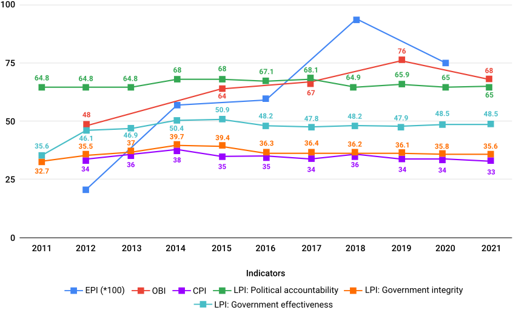
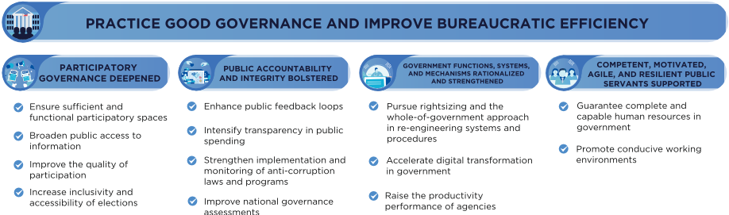

14

## Practice Good Governance and Improve Bureaucratic Efficiency

## Practice Good Governance and Improve Bureaucratic Efficiency

Achieving a prosperous, inclusive, and resilient society through economic transformation requires the practice of open, efficient, and accountable governance. In this desired future, citizens, civil society organizations, and the private sector are able to access clear and capable platforms that effectively receive and respond to their agenda at all levels of government. Citizen participation is inclusive, fair, and empowering, allowing Filipinos to transact conveniently with the government through digital technologies and maximizing the benefits of an integrated and productive bureaucracy. Furthermore, public servants are agile, resilient, and accountable; and citizens trust that they will consistently perform at the highest levels of inclusion, productivity, and integrity.

This chapter presents the challenges facing good governance and bureaucratic efficiency as well as the outcomes to be pursued to address these challenges during the Plan period. These outcomes are: (a) participatory governance deepened; (b) public accountability and integrity bolstered; (c) government functions, systems, and mechanisms rationalized and strengthened; and (d) competent, motivated, agile, and resilient public servants supported.

## Assessment and Challenges

The Philippines has made progressive improvements in its performance in various global governance indices, such as the e-Participation Index (EPI), 1 Open Budget Index (OBI), 2 and the Legatum Prosperity Index (LPI)-Political Accountability (See Figure 14.1). 3,4 This may be attributed to the implementation of the Freedom of Information (FOI) policy; 5 the National Government Portal and its subsequent provision of over 200 online government services; 6 and the expansion of open data features of government information. 7 Likewise, enhancements in the Philippine Government Electronic Procurement System and the increase in free public Wi-Fi hotspots nationwide 8 have also contributed to this achievement. At the same time, full disclosure and public financial management reforms brought about by the Seal of Good Local Governance Act of 2019 or Republic Act No. 11292, have increased transparency among local government units (LGUs).

Higher rates of civil society organizations (CSO) participation were facilitated by the Fiscal Openness Program of the Department of Budget and Management (DBM), the Support for Local Governance Program of the Department of the Interior and Local Government (DILG), and the commitments made under the Philippine Open Government Partnership (PH-OGP). Similarly, the Citizens Participatory Audit (CPA) program of the Commission on Audit (COA) improved citizen participation in the public audit process, and was recently recognized as the best of its kind in the AsiaPacific region. 9

However, the decline in the scores at the onset of the coronavirus disease (COVID-19) pandemic in 2020 highlighted the disruption of transparency and participatory mechanisms when the government diverted its resources to more urgent service delivery issues. Nevertheless, the continuous implementation of the Ease of Doing Business (EODB) and Efficient Government Service Delivery (EGSD) Law, as well as reforms in public fiscal management policies, enabled the country to sustain its LPI scores despite the challenges brought about by the pandemic. In fact, the Philippines emerged as one of only four countries and the only Asian country that demonstrated an adequate level of accountability in its early COVID-19 fiscal policy responses. 10

Figure 14.1 Philippines' Score in Selected International Governance Indices, 2011-2021

CPI = Corruption Perceptions Index, EPI = e-Participation Index, LPI = Legatum Prosperity Index, OBI = Open Budget Index.

Sources: United Nations United Nations (UN). UN E-Government Knowledgebase: Philippines. UN E-Government Development Database (accessed October 23, 2022). https://publicadministration.un.org/egovkb/en-us/Data/Country-Information/id/134-Philippines; International Budget Partnership (IBP). 2021. "Country Results: Philippines." Open Budget Survey 2021. https://internationalbudget.org/sites/default/files/country-surveys-pdfs/2021/open-budget-survey-philippines-2021-en. pdf; Transparency International. Corruption Perceptions Index 2021. https://www.transparency.org/en/cpi/2021/index/phl (accessed October 22, 2022); and Legatum Institute Foundation. 2021. The Legatum Prosperity Index-Changes Made Since 2020 Index and Summary of Indicator Details. https://docs.prosperity. com/3716/3643/5991/The\_2021\_Methodology\_-\_Part\_3\_-\_Sources\_And\_Indicators.pdf.

The Philippines' scores in the LPIGovernment Integrity 11 and Corruption Perceptions Index (CPI) 12 have declined in recent years. In 2021, Transparency International 13 reported that the Philippines, like other countries in the Asia-Pacific, may be merely mitigating petty corruption but is unable to curb grand corruption.

Moreover, Freedom House 14 observed some instances when certain civil liberties were curtailed, the government's transparency and accountability, and thus, its ability to mitigate corruption are undermined. As government integrity is measured by the impartiality, openness, and accountability of its institutions, corruption may in turn, erode trust in the public sector, thereby affecting the overall effectiveness of governance.

Aside from addressing the obstacles to good governance, the government also needs to resolve structural and multifaceted challenges to bureaucratic efficiency. These include uneven resource capacities to digitalize transactions and services at both the national and local levels; issues on data privacy, sharing, coordination, and interoperability; and the limited capacity of public servants

## Strategy Framework

Figure 14.2 presents the strategies to facilitate good governance and improve bureaucratic efficiency that will contribute to the enabling environment of the Philippine Development Plan (PDP) 2023-2028. The framework highlights the strategic pursuit of more to adapt to accelerated innovations. 15 The government must also anticipate and mitigate the impacts of the ongoing COVID-19 pandemic and the transition due to the Mandanas-Garcia 16 ruling implementation, as both expose bottlenecks, silos, and variances in participatory practices and service delivery efficiency across different government sectors. Finally, socio-political barriers to inclusion and the meaningful participation of marginalized sectors must be strategically addressed, particularly, the gaps in implementing the Magna Carta for Women (RA 9710), the Indigenous People's Rights Act (RA 8371), the mandatory representation of the 14 basic sectors, and inclusionary policies espousing government support of CSO participation at all levels of governance.

meaningful inclusion and better quality of participation, more intensified information transparency and access, rightsizing of government functions and structure, and the competence and future readiness of the government and its public servants.

Figure 14.2 Strategy Framework to Practice Good Governance and Improve Bureaucratic Efficiency Figure 14.2

## Strategies

The first two outcomes (participatory governance deepened; public accountability and integrity bolstered) provide strategies for practicing good governance, while the latter two (government functions, systems, and mechanisms rationalized and strengthened; and competent, motivated, agile, and resilient public servants supported) are for improving government efficiency. These strategies complement each other and contribute to other outcomes in the focus areas in other chapters of this PDP. For instance, a rightsized and productive government with capable civil servants contributes to bolstering public accountability. These strategies also require coherence with other chapter outcomes in the PDP, such as promoting competition and improving regulatory efficiency (See Chapter 10), ensuring sound fiscal management (See Subchapter 11.2), upgrading infrastructure (See Chapter 12), and enhancing the administration of justice (See Subchapter 13.2).

## Outcome 1: Participatory governance deepened

Deepening participatory governance not only means establishing functional participatory platforms that inform or consult citizens, but also ensuring that citizens and CSOs have concrete roles and significant influence in all stages of public decision-making. 17 Achieving this outcome will require a deeper understanding of the nuances and priorities of marginalized sectors such as women, children, indigenous peoples, overseas Filipinos and overseas Filipino workers, persons with disabilities, agricultural communities, and geographically isolated and disadvantaged areas.

## Ensure sufficient and functional participatory spaces

To ensure sufficient and functional participatory spaces, the government will increase the availability and accessibility of protected spaces for various sectors and concerns, while functionality will be secured through platforms that are established and convened according to policy standards. To this end, the DBM will intensify CSOs' participation in the national budget preparation process. Meanwhile, the DILG will expand the monitoring of the functionality of the local special bodies (LSB) and People's Councils; and enhance policy guidelines to make CSO accreditation and local networking more inclusive. The PH-OGP Steering Committee will involve more agencies in the national action plan, and mainstream PH-OGP mechanisms at the regional and local levels. Agencies will ensure that their decision-making bodies with sufficient sectoral representation, particularly from marginalized sectors, are created, reviewed for functionality and effectiveness, and enhanced accordingly.

## Broaden public access to information

Broadening public access to information not merely entails publicizing more information, but also observing open data formats, removing barriers to internet connectivity, and providing seamless experiences for citizens who are requesting government information. Pursuant to this strategy, the government will build on the gains of the FOI implementation in national agencies, improve on the e-FOI portal services, and intensify partnerships with LGUs for FOI policies. The Department of Information and Communications Technology (DICT) will also enhance the volume and scope of information in Open Data Philippines (online repository of open data from different government agencies), and the provision of free public Wi-Fi services nationwide.

## Improve the quality of participation

The quality of participation is improved when it is free from cooptation and tokenism 18 and conducted not for mere compliance with policy guidelines. 19 To improve the quality of participation, the DBM and DILG, with PH-OGP partner agencies, will mainstream the implementation of Participatory Governance Metrics 20 for assessing the quality of participation in LSBs and national programs. The DILG will also strengthen the Council on Good Local Governance and intensify capacity development interventions for CSO members of LSBs. The PH-OGP will continue to implement collaborative practices with CSOs in developing, implementing, and monitoring government programs; and will strengthen the capacity of national and local CSOs to engage the government effectively.

## Increase inclusivity and accessibility of elections

Drawing from challenges and lessons learned from conducting national and local elections during the pandemic, the Commission on Elections will expand the use of satellite and special registrations, innovate voting modalities, intensify voters' education and information campaigns outside of the election period, and strengthen election laws and procedures to build resilience against health and natural hazards. For structural reforms, policies on strengthening political parties, regulating political dynasties, and enhancing competition in the political sphere will be jointly pursued by the relevant agencies and Congress. 21

## Outcome 2: Public accountability and integrity bolstered

To address the complex challenges of building integrity and preventing corruption, the government will implement strategies that will foster higher levels of trust, satisfaction, and political efficacy among the public. These strategies will bolster reporting and redress mechanisms; increase the precision and responsiveness of government agencies and programs to public concerns; and improve policy integration and coherence among concerned national and local units.

## Enhance public feedback loops

Effective feedback loops provide precise and timely responses to citizens' demands. Thus, enhancing these loops presents a transformative potential for social accountability and improving citizens'

trust and confidence in government. To operationalize this strategy, the government will ensure the functionality, efficiency, and effectiveness of helplines, hotlines, and helpdesks outlined in existing laws. At the national level, the monitoring and resolution of citizen reports will be improved through the EODB and EGSD Acts, the Anti-Red Tape Authority's (ARTA) Harmonized Client Satisfaction Measurement, the Civil Service Commission's (CSC) Contact Center ng Bayan, and people's feedback mechanisms required in national agency websites. The DBM will also institute a CSO desk to receive and respond to CSOs' budget-related concerns. At the local level, the DILG will monitor the functionality and responsiveness of feedback mechanisms, including the CSO desks and Barangay Violence Against Women helpdesks; 22 improve the Citizen Satisfaction Index System implementation with CSOs; and pursue third-party monitoring of state-funded projects. Moreover, digital technologies will be used to augment the implementation of these mechanisms with due emphasis on access, inclusion, context-sensitivity, and empowerment of marginalized sectors. 23

## Intensify transparency in public spending

Complementary to the strategies for broadening access to information, intensifying transparency in public spending will help ensure that health emergencies and natural hazards, such as the COVID-19 pandemic, will not disrupt the timely and accessible disclosure of public spending information. 24 This will be achieved through the full implementation of the EODB and EGSD Act; better integration of government units and the observance of Open Contracting Data Standards 25 in the modernized Philippine Government Electronic Procurement System; the timely publication of budget and financial accountability reports through the Transparency Seal among agencies; and the expansion of COA's CPA implementation to other audit sectors. The DILG will intensify monitoring transparency practices in LSBs, extending these to the local Bids and Awards and Project Monitoring Committees. More joint agency initiatives will also help break down barriers to transparency 26 in data privacy policies.

## Strengthen implementation and monitoring of anti-corruption laws and programs

Fulfilling the Philippines' commitment to the United Nations Convention Against Corruption requires a whole-of-government approach. This involves the sectoral capacity assessment of the anti-corruption infrastructure in the country; strengthening and harmonizing the development, implementation, monitoring, and evaluation of anti-corruption programs and laws; and developing a dynamic and multi-disciplinary information technology-enabled, multi-year innovation plan. 27 The Office of the Ombudsman, the CSC, and their partner agencies and stakeholders will build on lessons learned from programs such as the Integrity Management Program; Integrity, Transparency, and Accountability in Public Service; Statement of Assets, Liabilities, and Net Worth declaration; and public integrity campaigns. 28 The observance of a code of conduct for all government employees and capacity development in integrity management and corruption controls will be pursued to reduce corruption vulnerabilities. The DILG will also enable and monitor the local Sangguniang Bayan or municipal council's quasi-judicial functions and act on various corruption-related complaints filed against local officials.

## Improve national governance assessments

As a cross-cutting strategy, the government will ensure the effective and timely conduct of governance assessments and improve the policy learning environment at all government levels. Monitoring and evaluation of government processes, service delivery, and outcomes enhance transparency and accountability, while policy responses to assessments contribute to improving government efficiency. In this endeavor, the government will hasten the development and roll-out of a National Governance Index 29 and intensify the National Evaluation Policy Framework. 30 The DILG and the Council of Good Local Governance will maintain the implementation of the Seal of Good Local Governance assessment of LGUs. This will further ensure that the evaluation framework reflects the political capacity indicators of LGUs' resilience to the COVID-19 pandemic and other risks, as well as service delivery standards, in order to transition national and local governments effectively to the post-Mandanas-Garcia scenario.

## Outcome 3: Government functions, systems, and mechanisms rationalized and strengthened

Improving bureaucratic efficiency is foundational to an enabling environment for economic transformation and in facilitating the Philippines' transition to an upper middle-income country. An efficient bureaucracy exercises the best use of its resources including operational costs, time, and human resources (HR), 31 while effecting coherence, 32 rationality, and uncertainty reduction to deliver the intended results. Strategies for this outcome include rightsizing and digitalizing government functions, while enhancing productivity.

Pursue rightsizing and the whole-of-government approach in re-engineering systems and procedures

The government will enact the National Government Rightsizing Program 33 to implement structural and procedural reforms in the executive branch and advocate rightsizing among LGUs, the legislature, the judiciary, and other constitutional bodies. To do this, appropriate diagnostic frameworks, upholding economic principles, and strategic reviews of the role, mandates, functions, and structure of government will be employed. 34 The government will also optimize the performance of national agencies' core functions, and ensure the effective and efficient implementation of public services. Precursory to this priority reform, agencies will improve the implementation of complementary policies such as the authority of the Governance Commission for Government-Owned or -Controlled Corporations (GOCCs) to reorganize, streamline, abolish, or privatize GOCCs; ARTA's mainstreaming of the Whole-of-Government Re-engineering Manual; 35 and streamlining of audits and systems development across agencies. 36

In addition, the government will facilitate the strategic delineation of functions, structure, and staffing of national agencies and LGUs concerning the Supreme Court's Mandanas-Garcia ruling and Executive Order (EO) No. 138, s. 2021. 37 Led by the DBM and DILG, concerned national agencies will expedite their respective transitions into capable policy development and oversight bodies that can provide sound and timely service delivery standards and capacity development interventions for LGUs. The functions of inter-agency and multi-stakeholder bodies and committees that support the transition at the subnational levels will be streamlined as part of the functions of the Regional Development Councils.

## Accelerate digital transformation in government

The COVID-19 pandemic response emphasized the importance of digital information and services. 38 Accordingly, the government will adopt digital technologies for the optimization and integration of its services to improve efficiency and rightsize the government. 39 To accelerate digital transformation, the government will strengthen its legal and institutional framework; adopt paperless, cashless, and data-empowered transactions at all levels; and develop civil service capacity for implementation. To this end, the government will pass an e-Governance law to establish an integrated, interconnected, and interoperable information, resource-sharing, and communications network to deliver public services. Building up to the legislative reform, the government will ensure the effective implementation of policies and programs such as the adoption of digital payments for government disbursements and collections, 40 DICT's E-Government Masterplan 2022 on digitalization of frontline government transactions and administrative functions, 41 DBM's Budget and Treasury Management System, 42 the Philippine Business Hub, 43 DICT's Integrated Business Permits and Licensing System with LGUs, 44 and the integration of government services into the Philippine Identification System. 45

## Raise the productivity performance of agencies

To pursue this strategy, the government will strengthen productivity performance frameworks across government sectors and levels and translate these into more coherent capacity development programs and incentive structures. Contributory to this strategy is the strengthening of the implementation of the Government Quality Management Program, 46 resultsbased performance management system standards, and the Development Academy of the Philippines' (DAP) productivity capability development programs; 47 as well as the adoption of the Philippine Quality Award performance excellence framework. The Government Quality Management Program assessments, Citizen Satisfaction e-Survey, 48 and Business Satisfaction e-Survey 49 will contribute to the development of broader national governance assessments. Likewise, guidance and assistance will be pursued in utilizing data from the national satisfaction surveys to identify standards and improvement priorities as well as balancing outside-in and inside-out approaches to improve citizen-centered design and delivery performance.

## Outcome 4: Competent, motivated, agile, and resilient public servants supported

Transformation in government systems and mechanisms will not be possible without the development of public servants' competence, motivation, agility, and resilience. The ability, motivation, and productivity of government personnel are key determinants of government capability. 50 This outcome advances the policy capacity (micro-level dimensions of analytical, operational, and evaluation capacity) of civil servants. It also accounts for the profound set of skills and competencies identified as necessary during the COVID-19 pandemic such as digital skills, agility, futures thinking, foresight, and innovation competencies.

## Guarantee complete and capable human resources in government

To advance human capital development and harmonize capacity-building initiatives among agency providers, 51 the government will adopt a purposive and programmatic approach to developing new competency frameworks for the public sector. The competency framework will involve coherently linking the Public Management Development Program and the revitalized National Government Career Executive Service (CES) Development Program with the CES process to hasten and enhance the quality of senior public officials and their successors. The competency framework will also develop a set of functional and behavioral competencies essential to being a qualified regulator and making substantive contributions not only to government, but also to society, as a whole.

Moreover, the Career Executive Service Board (CESB) will develop the new competency profile of career officials to be more adaptable to the ever-changing times. The CES system will be strengthened through merit and fitness, and continuous updating of its program offerings. Potential and qualified third-level officials will undergo the four-stage CES eligibility examination process, the CES Leadership Management and Proficiency Program, and other CES lifelong learning programs for appointment to CES ranks to build up a critical mass of CES officers and eligibles.

Learning and development 52 (delivered through pandemic-responsive modalities); and awards and incentives 53 programs will support public servants at all stages of their careers while advocating for higher levels of employee engagement. 54 Contributing to the strategy implementation are the CSC's Program to Institutionalize Meritocracy and Excellence in Human Resource Management 55 and the CES system. Legislating the creation of HR management offices in LGUs will also be pursued.

## Promote conducive working environments

Conducive working environments enable qualified, impartial, values-driven, professional, and ethical civil servants 56 who are sufficiently supported to be motivated and productive even in challenging scenarios, as what was experienced during the pandemic. To achieve this, the government will institutionalize alternative working arrangements in the public sector. 57 This entails establishing clear performance standards for remote functions; strengthening capabilities for the effective

## Legislative Agenda

Table 14.1 contains priority bills for the 19th Congress during the Plan period to practice good governance and improve bureaucratic efficiency.

Table 14.1 Legislative Agenda to Practice Good Governance and Improve Bureaucratic Efficiency

| LEGISLATIVE AGENDA                                                                       | RATIONALE/KEY FEATURES                                                                                                                                                                                                                                                                                                                                                                                                                                                                                                                                                                                                                                                                                                                |
|------------------------------------------------------------------------------------------|---------------------------------------------------------------------------------------------------------------------------------------------------------------------------------------------------------------------------------------------------------------------------------------------------------------------------------------------------------------------------------------------------------------------------------------------------------------------------------------------------------------------------------------------------------------------------------------------------------------------------------------------------------------------------------------------------------------------------------------|
| Rightsizing the Government                                                               | This will implement transformational improvements to streamline the functions, mandates, structure, and staffing of departments and agencies and simplify systems and processes to deliver public goods and services in the most efficient, effective, and economical manner.                                                                                                                                                                                                                                                                                                                                                                                                                                                         |
| E-Governance a                                                                           | This will promote the use of information and communications technology in improving government service delivery and providing access to reliable data and information.                                                                                                                                                                                                                                                                                                                                                                                                                                                                                                                                                                |
| Budget Modernization                                                                     | This seeks to institutionalize the cash-based budgeting system to strengthen fiscal discipline in the allocation and use of budget resources. It will also promote public participation in the local budgeting process for shared accountability.                                                                                                                                                                                                                                                                                                                                                                                                                                                                                     |
| National Evaluation Policy                                                               | This will strengthen legal and institutional frameworks for the regular measurement, reporting, and utilization of the results of public policies, programs, and projects toward supporting evidence-based decisions, ensuring program improvement, and promoting transparency and accountability in the government. It also seeks to advance the culture and practice of evaluation in the public sector, emphasizing accountability for results and strengthening government collaboration to institutionalize the National Evaluation Policy Framework. Moreover, the proposed bill will ensure credible and quality evaluations to support the planning, formulation, budgeting, and implementation of development interventions. |
| Freedom of Information                                                                   | The bill will require government agencies to allow the public to review and copy all official information, and to promote meaningful and increased participation in government decision-making and public accountability. This expands the coverage of Executive Order 2, s. 2016 to the entire bureaucracy, and not just the executive branch.                                                                                                                                                                                                                                                                                                                                                                                       |
| Creation of Human Resource and Management (HRM) Offices in local government units (LGUs) | The bill seeks to establish HRM Offices and mandate regular (plantilla) HRM officers in LGUs to develop competent and credible employees at the local level. It amends the Local Government Code's optional designation of such local officers.                                                                                                                                                                                                                                                                                                                                                                                                                                                                                       |
| Recognition of Indigenous People (IP) Mandatory Representatives                          | This will ensure that IP Mandatory Representatives are recognized in local legislative bodies and their capabilities for local legislation are harnessed for more effective representation and promotion of IP rights through policymaking.                                                                                                                                                                                                                                                                                                                                                                                                                                                                                           |

a This is separate from the E-Government Act, which merely institutionalizes the E-Government Masterplan. Both bills may be harmonized into a single measure as there are overlaps in the proposed bills.

use of information and communications technology (ICT) tools; providing support for remote work; and improving policies on authorizations, data management, and audit. 58 Initiatives will also include advocating occupational health and safety, ensuring public service continuity, and strengthening mental wellness programs. 59 The CSC will develop a bureaucracy-wide HR Management Information System, shifting HR management from transactional to the more proactive strategic through digital or web-based systems.

## Results Matrix

Table 14.2 contains year-by-year and end-of-plan indicators and targets that the government seeks to attain within each of the outcomes during the Plan period to practice good governance and improve bureaucratic efficiency.

Table 14.2 Results Matrix: Practice Good Governance and Improve Bureaucratic Efficiency

| INDICATOR                                                                                                                                               | BASELINE - (YEAR)                                                                      | ANNUAL PLAN TARGETS - 2023                                                             | ANNUAL PLAN TARGETS - 2024                                                             | ANNUAL PLAN TARGETS - 2025                                                             | ANNUAL PLAN TARGETS - 2026                                                             | ANNUAL PLAN TARGETS - 2027                                                             | ANNUAL PLAN TARGETS - 2028                                                             | MEANS OF VERIFICATION                                                                  | RESPONSIBLE AGENCY/INTER- - AGENCY BODY                                                |
|---------------------------------------------------------------------------------------------------------------------------------------------------------|----------------------------------------------------------------------------------------|----------------------------------------------------------------------------------------|----------------------------------------------------------------------------------------|----------------------------------------------------------------------------------------|----------------------------------------------------------------------------------------|----------------------------------------------------------------------------------------|----------------------------------------------------------------------------------------|----------------------------------------------------------------------------------------|----------------------------------------------------------------------------------------|
| Outcome 1: Participatory governance deepened                                                                                                            | Outcome 1: Participatory governance deepened                                           | Outcome 1: Participatory governance deepened                                           | Outcome 1: Participatory governance deepened                                           | Outcome 1: Participatory governance deepened                                           | Outcome 1: Participatory governance deepened                                           | Outcome 1: Participatory governance deepened                                           | Outcome 1: Participatory governance deepened                                           | Outcome 1: Participatory governance deepened                                           | Outcome 1: Participatory governance deepened                                           |
| Percentage of provinces (P), cities (C), and municipalities (M) (PCMs) compliant with Local Development Council (LDC) functionality standards increased | P: 85% C: 83% M:74% (2022)                                                             | P: 87% C: 83% M: 76%                                                                   | P: 89% C: 85% M: 79%                                                                   | P: 91% C: 87% M: 82%                                                                   | P: 93% C: 89% M: 85%                                                                   | P: 95% C: 91% M: 88%                                                                   | P: 100% C: 100% M: 91%                                                                 | Department of the Interior and Local Government (DILG) Annual Report                   | DILG                                                                                   |
| Outcome 2: Public accountability and integrity bolstered                                                                                                | Outcome 2: Public accountability and integrity bolstered                               | Outcome 2: Public accountability and integrity bolstered                               | Outcome 2: Public accountability and integrity bolstered                               | Outcome 2: Public accountability and integrity bolstered                               | Outcome 2: Public accountability and integrity bolstered                               | Outcome 2: Public accountability and integrity bolstered                               | Outcome 2: Public accountability and integrity bolstered                               | Outcome 2: Public accountability and integrity bolstered                               | Outcome 2: Public accountability and integrity bolstered                               |
| Open Budget Index (OBI) score improved*                                                                                                                 | 68 (2021)                                                                              | 71                                                                                     | N/A                                                                                    | 72                                                                                     | N/A                                                                                    | 73                                                                                     | 73                                                                                     | OBI Report                                                                             | Department of Budget and Management                                                    |
| Outcome 3: Government functions, systems, and mechanisms rationalized and strengthened                                                                  | Outcome 3: Government functions, systems, and mechanisms rationalized and strengthened | Outcome 3: Government functions, systems, and mechanisms rationalized and strengthened | Outcome 3: Government functions, systems, and mechanisms rationalized and strengthened | Outcome 3: Government functions, systems, and mechanisms rationalized and strengthened | Outcome 3: Government functions, systems, and mechanisms rationalized and strengthened | Outcome 3: Government functions, systems, and mechanisms rationalized and strengthened | Outcome 3: Government functions, systems, and mechanisms rationalized and strengthened | Outcome 3: Government functions, systems, and mechanisms rationalized and strengthened | Outcome 3: Government functions, systems, and mechanisms rationalized and strengthened |
| Percentage of PCMs conferred with the Seal of Good Local Governance increased                                                                           | 21% or 350 PCMs (2022)                                                                 | Increasing                                                                             | Increasing                                                                             | Increasing                                                                             | Increasing                                                                             | Increasing                                                                             | Increasing                                                                             | DILG Annual Report                                                                     | DILG                                                                                   |
| Number of government agencies/offices onboarded and contributing to the Open Data Philippines Portal increased                                          | 0 (2022)                                                                               | 21                                                                                     | 30                                                                                     | 40                                                                                     | 40                                                                                     | 40                                                                                     | 40                                                                                     | Department of Information and Communications Technology (DICT) Annual Report           | DICT                                                                                   |
| Outcome 4: Competent, motivated, agile, and resilient public servants supported                                                                         | Outcome 4: Competent, motivated, agile, and resilient public servants supported        | Outcome 4: Competent, motivated, agile, and resilient public servants supported        | Outcome 4: Competent, motivated, agile, and resilient public servants supported        | Outcome 4: Competent, motivated, agile, and resilient public servants supported        | Outcome 4: Competent, motivated, agile, and resilient public servants supported        | Outcome 4: Competent, motivated, agile, and resilient public servants supported        | Outcome 4: Competent, motivated, agile, and resilient public servants supported        | Outcome 4: Competent, motivated, agile, and resilient public servants supported        | Outcome 4: Competent, motivated, agile, and resilient public servants supported        |
| Percentage of Career Executive Service (CES) positions occupied by CES Officers and CES eligibles increased                                             | 45%**                                                                                  | 50%                                                                                    | 51%                                                                                    | 52%                                                                                    | 53%                                                                                    | 54%                                                                                    | 55%                                                                                    | CESB Occupancy Report                                                                  | CESB                                                                                   |

* Targets are reflected every other year due to the survey's frequency.

** As of September 2022.

- 1 As a supplementary index to the United Nations E-Government Survey, EPI assesses the use of online services to facilitate the provision of information by governments to citizens ("e-information sharing"), interaction with stakeholders ("e-consultation"), and engagement in decision-making processes ("e-decisionmaking). See United Nations (UN). UN E-Government Knowledgebase: Philippines. UN E-Government Development Database. Retrieved from https:// publicadministration.un.org/egovkb/en-us/Data/Country-Information/id/134-Philippines (October 23, 2022).
- 2 The OBI score is a component of the Open Budget Survey that assesses public access to central government budget information. See International Budget Partnership (IBP). Country Results: Philippines. Open Budget Survey 2021. Retrieved from https://internationalbudget.org/sites/default/files/country-surveyspdfs/2021/open-budget-survey-philippines-2021-en.pdf.
- 3 As the LPI is a composite measure of domains of prosperity, the assessment and targets for this chapter only focus on the Governance Pillar under the Inclusive Societies domain. See Legatum Institute Foundation. (2021). The Legatum Prosperity Index- Changes Made Since 2020 Index and Summary Of Indicator Details. Legatum Institute. Retrieved from https://docs.prosperity.com/3716/3643/5991/The\_2021\_Methodology\_-\_Part\_3\_-\_Sources\_And\_Indicators.pdf.
- 4 Political accountability is the degree to which the public can hold public institutions accountable, considering the degree of political pluralism and other accountability mechanisms.
- 5 Duterte, R. R. Executive Order No. 02, s. 2016: Operationalizing in the Executive Branch the People's Constitutional Right to Information and the State Policies to Full Public Disclosure and Transparency in the Public Service and Providing Guidelines therefor. July 23, 2016. Retrieved from https://www.officialgazette.gov. ph/2016/07/23/executive-order-no-02-s-2016/.
- 6 Department of Information and Communications Technology (DICT). Full List of e-Services. Retrieved from https://www.gov.ph/services/ (October 23, 2022).
- 7 This includes the Open Data Portal, Transparency Seal across all government websites, and the Full Disclosure Policy, among others.
- 8 DICT. About Free Wi-Fi for All. Retrieved from https://dict.gov.ph/freewifi/# (October 22, 2022).
- 9 During the 2021 OGP Impact Awards, the CPA strategy was selected first place for the Asia Pacific region. See COA. (2021). "COA's Citizen Participatory Audit (CPA) Strategy Wins First Place in OGP Impact Award." December 16, 2021. Retrieved from https://www.coa.gov.ph/coas-citizen-participatory-audit-cpa-strategy-winsfirst-place-in-ogp-impact-award/.
- 10 International Budget Partnership. (2021). Managing COVID Funds: The Accountability Gap. Retrieved from https://internationalbudget.org/covid/wp-content/ uploads/2021/05/Report\_English-2.pdf.
- 11 The LPI's definition of "government integrity" encompasses both the absence of corruption and the degree to which government fosters citizen participation and engagement through open information and transparent processes.
- 12 The CPI assesses and ranks countries by their perceived levels of public sector corruption, using a scale of 0-100 where 0 = highly corrupt and 100 = very clean. See Transparency International. (2022). Corruption Perceptions Index 2021. Retrieved from https://www.transparency.org/en/cpi/2021/index/phl (October 22, 2022).
- 13 Transparency International. (2022). CPI 2021 for Asia Pacific: Grand Corruption and Lack of Freedoms Holding Back Progress. Retrieved from https://www. transparency.org/en/news/cpi-2021-for-asia-pacific-grand-corruption-holding-back-progress (October 22, 2022).
- 14 Freedom House. (2022). Freedom in the World 2022: Philippines. Retrieved from https://freedomhouse.org/country/philippines/freedom-world/2022 (October 22, 2022).
- 15 World Bank. (2022). Philippines: Government Efficiency Policy Notes. Washington, DC.
- 16 The Supreme Court ruling in the Mandanas case (General Register No. 199802, July 3, 2018) significantly expands the tax base for LGUs' share in national taxes to include not only national internal revenue taxes but also customs duties and fees.
- 17 International Association for Public Participation (IAP2). IAP2 Public Participation Spectrum. Retrieved from https://iap2.org.au/resources/spectrum/ (October 22, 2022).
- 18 Arnstein, S. (1969). "A Ladder of Citizen Participation." Journal of American Planning Association 35 (4): 216-224. Retrieved from https://doi. org/10.1080/01944366908977225
- 19 Caucus of Development NGO Networks and Alternative Law Groups, CIVICUS, International Center for Not-for-Profit Law, World Movement for Democracy, and Article 19. 2016. Assessment of the Enabling Environment for Civil Society Organizations in the Philippines. Retrieved from https://www.civicus.org/images/ EENA\_Philippines\_En.pdf.
- 20 Medina-Guce, C. (2022). Participatory Governance Metrics for the Philippine Open Government Partnership Commitments: Lessons and Recommendations from Pilot Customizations. Manila: United Nations Development Programme and Department of the Interior and Local Government.
- 21 Mendoza, R., M. Banaag, J. Hiwatig, and M. H. Yusingco. (2020). Term Limits and Political Dynasties in the Philippines: Unpacking the Links. Asia-Pacific Social Science Review 20 (4): 88­-99.
- 22 Ladia, M.A. and N. Parreno. 2021. Philippines: Gender-based Violence Policy and Institutional Mapping Report. Washington, DC: The World Bank. https://thedocs. worldbank.org/en/doc/e1575832e43d4030373f9a616975364f-0070062021/philippines-gender-based-violence-policy-and-institutional-mapping-report.
- 23 Medina-Guce, C. 2022. "Civic Tech for Social Accountability in Philippine Local Governments." In Decentralization, Digitalization, and Development: Strengthening Local Governance for Crisis Response, Recovery, Resilience, and the Sustainable Development Goals. Manila: UNDP Philippines.
- 24 Canares, M. and F. van Scalkwyk. (2021). Inclusive Responses to the COVID-19 Pandemic: The Role of Open Contracting. Hivos. Retrieved from https:// stepupconsulting.files.wordpress.com/2021/10/summary-paper.pdf.
- 25 Open Contracting Data Publication is a country commitment to the OGP. This pertains to the mandatory publication of contracting data (from planning to implementation) in machine-readable formats. See Open Government Partnership. Open Contracting Data Publication (PH0066). Retrieved from https://www. opengovpartnership.org/members/philippines/commitments/PH0066/
- 26 Philippine Center for Investigative Journalism (PCIJ). (2018). Public Contracting in the Philippines: Breakthroughs and Barriers. PCIJ, Hivos, and Article19. Retrieved from https://pcij.org/uploads/5bea32964f0bf-PCIJ\_-Open-Contracting-in-Philippines-Report\_01102018\_b.pdf.
- 27 17th Congress. Republic Act No. 11293 (Philippine Innovation Act). Manila; and NEDA, DOST, and DTI. 2020. Administrative Order No. 01, s. 2020: Promulgating the Implementing Rules and Regulations of Republic Act No. 11293 Otherwise Known as the Philippine Innovation Act. February 7, 2020. Manila.
- 28 Campaigns include the OMB's Campus Integrity Crusaders, Sikhay Laban sa Korupsyon, and Aral at Asal Project (with the University of the Philippines System and the Commission on Higher Education).
- 29 The Index will serve as the local counterpart of global governance indices, based on the nuances of the Philippine context.
- 30 NEDA and DBM. (2015). Joint Memorandum Circular No. 2015-01: National Evaluation Policy Framework of the Philippines. July 15, 2015 Retrieved from https://nep.neda.gov.ph/document/NEDA-DBM%20Joint%20Memorandum%20Circular%20No.%202015-01%20-%20National%20Evaluation%20Policy%20 Framework%20of%20the%20Philippines.pdf.
- 31 Organisation for Economic Co-operation and Development (OECD). Evaluation Criteria. Retrieved from https://www.oecd.org/dac/evaluation/ daccriteriaforevaluatingdevelopmentassistance.htm (October 22, 2022).

- 32 Gajduschek, G. (2003). Bureaucracy: Is It Efficient? Is It Not? Is That The Question?: Uncertainty Reduction: An Ignored Element of Bureaucratic Rationality. Administration &amp; Society 34 (6): 700-723.
- 33 DBM. (2022). Briefer on NGRP. Manila.
- 34 Diokno-Sicat, C.J. (2018). Economic Principles for Rightsizing Government. Philippine Institute for Development Studies Discussion Paper Series No. 2018-46. Retrieved from https://pidswebs.pids.gov.ph/CDN/PUBLICATIONS/pidsdps1846.pdf.
- 35 ARTA. (2021). Memorandum Circular No. 2021-09 Series of 2021: Issuance of the Whole-of-Government Reengineering Manual. June 25, 2021. Retrieved from https://arta.gov.ph/wp-content/uploads/2021/11/Memorandum-Circular-No.-2021-09-Issuance-of-WOG-Reengineering-Manual.pdf.
- 36 Such as rightsizing and/or streamlining reviews stipulated in Section 88, General Provisions of the FY 2022 and the Philippine Government Asset Management Policy. See Official Gazette of the Republic of the Philippines. 2022. General Appropriations Act: General Provisions Fiscal Year 2022. Official Gazette 118 (1). Retrieved from https://dbm.gov.ph/wp-content/uploads/GAA/GAA2022/VolumeI/GENPRO.pdf; and DOF, DBM, and NEDA. 2020. Joint Memorandum Circular No. 2020-1: Implementation of a Philippine Government Asset Management Policy. September 24, 2020. Retrieved from https://www.dbm.gov.ph/wp-content/ uploads/Issuances/2020/Joint-Memorandum-Circular/DOF-DBM-NEDA-JOINT-MEMORANDUM-CIRCULAR-NO-2020-1.pdf.
- 37 Duterte, R.R. Executive Order No. 138, s. 2021: Full Devolution of Certain Functions of the Executive Branch to Local Governments, Creation of a Committee on Devolution, and for Other Purposes. June 1, 2021. Retrieved from https://www.officialgazette.gov.ph/2021/06/01/executive-order-no-138-s-2021/.
- 38 Tubuga, A., S. Domingo, C.J. Diokno-Sicat, and V. G. Ulep. (2020). Innovating Governance: Building Resilience against COVID-19 Pandemic and Other Risks. Philippine Institute for Development Studies Discussion Paper Series No. 2020-23. September 2020. Retrieved from https://pidswebs.pids.gov.ph/CDN/ PUBLICATIONS/pidsdps2023.pdf.
- 39 World Bank. Philippines: Government Efficiency. 3-8. Washington, DC.
- 40 Duterte, R.R. (2022). Executive Order No. 170, s. 2022: Adoption of Digital Payments for Government Disbursements and Collections. May 12, 2022. Retrieved from https://www.officialgazette.gov.ph/2022/05/12/executive-order-no-170-s-2022/.
- 41 DICT. (2019). E-Government Masterplan 2022. Quezon City. Retrieved from https://dict.gov.ph/ictstatistics/wp-content/uploads/2020/03/EGMP-2022.pdf.
- 42 The Budget and Treasury Management System is a core element of the Integrated Financial Management Information System, which seeks to: (a) facilitate an efficient and secure government financial transactions and (b) strengthen the monitoring and reporting of financial and fiscal data.
- 43 The Philippine Business Hub - Central Business Portal (https://business.gov.ph/home) serves as a central system to receive applications and capture application data involving business-related transactions.
- 44 iBPLS is a software that enables LGUs and their constituents to apply and process building permits and occupancy permits electronically. See ARTA. (2020). ARTA To LGUs: Automate Business and Building Permits Now using DICT's IBPLS. ARTA Press Releases. September 15, 2020. https://arta.gov.ph/press-releases/arta-tolgus-automate-business-and-building-permits-now-using-dicts-ibpls/.
- 45 Duterte, R.R. (2022). Memorandum Circular No. 95, s. 2022: Directing All Government Agencies, Offices, Instrumentalities, as Well as Local Government Units, to Prepare for the Implementation of the Philippine Identification System and Its Integration into Government Processes, Databases, Systems and Services. February 7, 2022. Retrieved from https://www.officialgazette.gov.ph/2022/02/07/memorandum-circular-no-95-s-2022/.
- 46 DAP. Government Quality Management Program. Retrieved from http://pdc.dap.edu.ph/index.php/government-quality-management-program/ (October 22, 2022).
- 47 DAP. Capability Development. Retrieved from Retrieved from https://coe-psp.dap.edu.ph/capability-development (October 22, 2022).
- 48 DAP. Citizen Satisfaction e-Survey (e-CitSat). Retrieved from http://pdc.dap.edu.ph/index.php/citizen-satisfaction-e-survey-e-citsat/ (October 22, 2022).
- 49 DAP. Business Satisfaction e-Survey (e-BizSat). Retrieved from http://pdc.dap.edu.ph/index.php/business-satisfaction-e-survey-e-bizsat/ (October 22, 2022).
- 50 World Bank Group. (2019). Innovating Bureaucracy for a More Capable Government. Washington, DC. Retrieved from https://openknowledge.worldbank.org/ handle/10986/31284 (February 12, 2019).
- 51 Agency providers include the CSC, DAP, and CESB.
- 52 Includes DAP's Local Government Executives and Managers Class under the Public Management Development Program, and CESB's Leadership and Management Proficiency Program.
- 53 CSC has harmonized the Strategic Performance Management System with the Program Expenditure Classification and the Results-based Performance Management System.
- 54 OECD. (2021). The Future of the Public Service: Preparing the Workforce for Change in a Context of Uncertainty. OECD iLibrary. Retrieved from https://www.oecdilibrary.org/sites/1a9499ff-en/index.html?itemId=/content/component/1a9499ff-en (October 22, 2022).
- 55 This program aims to elevate public sector HR management to a level of excellence through the assessment, assistance, and awarding processes of HRM Systems, Practices, and Competencies using HRM maturity level indicators that are at par with global HRM standards.
- 56 OECD. (2017). Skills for a High Performing Civil Service. OECD Public Governance Reviews. OECD Publishing. Retrieved from https://www.oecd.org/gov/skills-fora-high-performing-civil-service-9789264280724-en.htm (October 22, 2022).
- 57 CSC. (2022). Flexible Work Arrangements in the Public Sector May Now be Adopted Anytime. Retrieved from https://csc.gov.ph/csc-approves-flexi-work-for-gov-t-employees (October 22, 2022).
- 58 DAP. n.d. The Public Sector Amidst the COVID-19 Pandemic: A Case Study on the Adoption of Alternative Working Arrangement. Retrieved from https://coe-psp. dap.edu.ph/knowledge-products/the-public-sector-amidst-the-covid-19-pandemic-a-case-study-on-the-adoption-of-alternative-working-arrangements/ (October 22, 2022).
- 59 CSC, Department of Health, and Department of Labor and Employment. (2020). Joint Memorandum Circular No. 1, s. 2020: Occupational Safety and Health (OSH) Standards for the Public Sector. Retrieved from https://oshc.dole.gov.ph/wp-content/uploads/2021/06/JMC-no.1-V2.pdf.