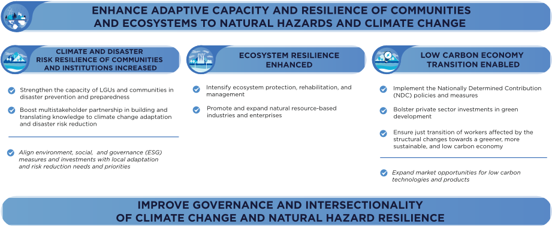

## Accelerate Climate Action and Strengthen Disaster Resilience

## Accelerate Climate Action and Strengthen Disaster Resilience

By 2028, communities, institutions, and the natural and built environment in the Philippines are more resilient to the impacts of natural hazards and climate change. To realize this goal, the government will strengthen cross-sectoral convergence and coordination and implement a comprehensive risk management approach to reduce intersecting vulnerabilities and address complexities in managing the compounding and cascading risks posed by climate change across different sectors. The government will collaborate with the private sector and international community to scale up sustainable and green investments that propel economic transformation for a prosperous, inclusive, and resilient society. Innovative policies and measures to advance low-carbon development will also be pursued while ensuring just transition and job creation. Rehabilitation and protection of natural resources will be accelerated to sustain the provision of ecosystem goods and services. A green and blue economy will be promoted and developed to optimize their contribution to livelihood and employment generation while improving environmental and social well-being. Lastly, improved governance will underpin the country's collective effort to ensure long-term climate and disaster resilience.

This chapter presents the challenges faced in climate action and strengthening disaster resilience as well as the outcomes to be pursued to address these challenges during the Plan period. These outcomes are: (a) climate and disaster risk resilience of communities and institutions increased, (b) ecosystem resilience enhanced, and (c) low carbon economy transition enabled.

## Assessment and Challenges

Several enabling policies and plans have been adopted to ramp up climate action and strengthen disaster resilience. These include the adoption of a framework and guidelines to mobilize sustainable and green finance, such as the Sustainable Finance Framework and Roadmap, and Securities and Exchange Commission Guidelines on the issuance of Green and Sustainability Bonds. Plans and guidelines have also been formulated to better manage climate and disaster risks, including the National Climate Risk Management Framework, 1 National Disaster Risk Reduction and Management Plan (NDRRMP) 2020-2030, and Guidelines for Mainstreaming Disaster Risk Reduction (DRR) and Climate Change Adaptation (CCA) in the Comprehensive Development Plan. Multi-hazard early warning systems and tools have also been established. The government has also adopted the roadmaps on Water Security and Natural Capital Accounting and prepared flood risk master plans for major river basins to improve the state of ecosystems and enhance their resilience to the impacts of climate change and natural hazards. Moreover, local government units (LGU) were able to integrate climate and disaster risk resiliency measures into their local plans, through their Local Climate Change Action Plans and Local Disaster Risk Reduction and Management Plans. However, these plans require updating, and the LGUs need more support for their implementation. The NDRRMP 2020-2030 also noted that the lack of consistency and standardization of tools for local flood early warning systems caused confusion in the operationalization of the disaster management plan, especially at the sub-national and local levels.

## Government budget allocation for climate and disaster resilience has been inadequate.

The government's budget for climate change adaptation and mitigation increased from PHP195 billion in 2017 to PHP289 billion in 2022. However, its share in the total budget declined from 6.99 to 5.77 percent in the same period. The monitoring of actual expenditures at the agency and LGU levels also remains inadequate, making it difficult for the government to track and assess the progress in the climate agenda. For the National Disaster Risk Reduction and Management Fund (NDRRMF), an annual average of PHP20 billion was allocated from 2016 to 2021. However, analysis showed that the NDRRMF was mainly used for post-disaster activities such as cash assistance, resettlement, and quick response funds of agencies. This mirrors the expenditure pattern at the local level, where Local DRRM Funds were highly skewed toward disaster response, recovery and rehabilitation. 2

Meanwhile, the 2016 People's Survival Fund appropriation has not yet been fully utilized with only six LGUs able to access the fund.

The coronavirus disease (COVID-19) pandemic slowed down environmental and climate action. The pandemic negatively affected the achievement of targets in the previous Philippine Development Plan and other government plans (e.g., National Climate Change Action Plan [NCCAP], NDRRMP). For instance, land titling and delineation of municipal waters, which are vital for securing property rights and effective management, slowed down following the imposition of mobility restrictions due to COVID-19. The quarantine measures also hampered the government's ability to assess improvements in local capacities and disaster preparedness. They also resulted in a significant decline in employment from ecotourism and sustainable resource-based industries.

Overall, the progress in environmental and climate action in the last six years has been modest. The implementation of programs supporting natural resources management and climate actions has shown some progress. For instance, forest cover increased by 3.03 percent from 2015 to 2020, and the management of protected areas generally improved. However, these positive gains still fall short in improving the country's overall performance in these sectors. In the 2022 Environmental Performance Index ranking, the Philippines placed 158 th out of 180 countries in environmental sustainability ranking, which covers performance indicators on ecosystem vitality (e.g., biodiversity, water resources), environmental health

(e.g., air quality, waste management) and climate change. The country's overall score of 28.9 points fell below the Asia-Pacific median score of 35.1. 3 The Sixth Assessment Report of the Intergovernmental Panel on Climate Change concluded that global average temperature would exceed 1.5°C in the 21 st century under the intermediate, high, and very high greenhouse gas (GHG) emission scenarios. With this, more frequent and intense extreme events will continue to cause widespread adverse impacts and related losses and damage to nature and people, beyond natural climate variability. This changing global risk landscape and the broad range of hazards-current, emerging, cascading and complex-have disproportionately impacted less developed and developing countries and communities.

Historical data revealed that temperature indices across the country (depending on elevation) have high spatial variability. However, with the projected increase in average temperature by the mid-21 st century (2036-2065)-specifically, 1.9°C under the moderate Representative Concentration Pathway (RCP) or RCP 4.5 and 2.3°C under the high (RCP 8.5) emission scenarios-a spatially uniform warming trend across the country is to be expected, with increasing magnitude, frequency, and duration. Projected changes in precipitation show a general drying trend (reduced rainfall, more dry days), as well as the occurrence of localized extreme rainfall events. Projections on sea level rise reveal an increase of about 20 centimeters by the end of the 21 st century under the RCP 8.5 scenario, which could worsen storm surge hazards on coastal communities. Moreover, tropical storms are also expected to increase in frequency and intensity. 4

The Philippines is one of the most vulnerable countries to the impacts of climate change, despite its minimal contributions to global GHG emissions at 0.40 percent. In the 2022 World Risk Index, the Philippines ranked first among 193 countries with the highest disaster risks. 5 Between 2011 and 2021, the country incurred PHP673.30 billion worth of damage and losses due to tropical cyclones alone. 6 These damage and losses from climate change are expected to increase under a business-as-usual scenario, reaching up to 7.6 percent of the country's gross domestic product by 2030 and 13 percent by 2040. 7 Without adequate action, climate change could worsen poverty and inequality in terms of access to resources and opportunities. This compels the government to prioritize mobilizing domestic resources for adaptation as the priority climate action in the country.

In its Nationally Determined Contribution (NDC) submitted to the United Nations Framework Convention on Climate Change in 2021, the Philippines commits to reduce and avoid 75 percent of its projected GHG emissions against the business-as-usual scenario (2020-2030). Of this mitigation target, 2.71 percent are unconditional, and 72.29 percent are conditional on resources to be provided by developed countries to implement mitigation actions in the agriculture, waste, industrial processes and product use, transport, and energy sectors. However, the plan to operationalize the NDC policies and measures (PAM) and their corresponding financing, technology, and capacity development are yet to be developed, as well as the necessary measurement, reporting, and verification system to track, monitor, and report the progress of NDC implementation.

As with other developing countries, the Philippines faces substantial challenges in implementing adaptation and risk reduction strategies, strengthening community and ecosystem resilience, and transitioning to green growth pathways. Limited financial resources and technical capacity of many LGUs to utilize risk information, including CCA and DRR assessment tools, hinder them from effectively implementing local resiliency programs. Funds from other sources will need to supplement LGU funds,

## Strategy Framework

The Strategy Framework for climate action and disaster resilience responds to economic transformation that benefits the welfare of Filipino communities, households, and individuals (See Figure 15.1). In particular, it adopts a "well-being lens" where efforts on climate change adaptation, and mitigation, and DRR contribute to increased income and job opportunities, improved public health, and enhanced knowledge and skills, among others. At the same time, these actions contribute to enhancing economic, natural, and social capital toward sustaining well-being over time.

The strategies discussed below aim to achieve the following outcomes: (a) climate and disaster risk resilience of communities even with the expected increases due to the implementation of the Mandanas-Garcia ruling. However, financial risks around climate change investments hamper the mobilization of significant private sector financing to drive climate-resilient and lowcarbon transition. In addition, potential investors would need to deal with complex regulatory requirements, inconsistent transition standards, and lack of credible risk data. Moreover, the government has yet to fully account for the value of natural capital and ecosystem services to better inform its policies and decisions, including in CCA and DRR.

and institutions increased; (b) ecosystem resilience enhanced; and (c) low carbon economy transition enabled. Implementing the specific strategies requires decisive and sustained financing, knowledge build-up, technology and innovation, strong institutions, and concerted action among the government and its stakeholders at all levels. These stakeholders include the private sector, civil society, academe, local communities, and peoples' organization. Climate and disaster risk governance will be comprehensive and science- and evidence-based for the effective and efficient delivery of these actions.

Figure 15.1 Strategy Framework to Accelerate Climate Action and Strengthen Disaster Resilience

Note: Strategies above the dashed lines require action by government entities, and those below by non-government entities.

## Strategies

The operationalization of the above framework will require a whole-ofsociety and all-hazard approaches where the knowledge and capacity of academic institutions, non-government or civil society organizations, and vulnerable groups are harnessed or enabled by increased public investment. This will jumpstart adaptation strategies to mitigate and better prepare for the increase in the frequency and severity of natural hazards with significant negative impacts on communities. Localized and adaptive approaches will be implemented considering the different levels of climate and disaster risks. Rehabilitation, protection, and management of ecosystems will be intensified through nature-based solutions and integrated approaches, e.g., integrated water resources management and ecosystem-based approach. Mitigation strategies that deliver adaptation and environmental co-benefits will be pursued to support the country's climate and disaster resilience-building efforts.

## Outcome 1: Climate and disaster risk resilience of communities and institutions increased

The government will foster the resilience of communities and institutions through improved public-private-community engagements, increased public awareness and understanding of risk and vulnerability, and strengthened implementation of National Climate Risk Management Framework.

Achieving climate and disaster resilience will also require scaling up sustainable finance and de-risking climate investments (See Subchapter 11.1), as well as strengthening human and social assets in terms of income and jobs (See Chapter 4); health (See Subchapter 2.1); knowledge, skills, and financial literacy (See Subchapters 2.2 and 11.1); environmental quality (See Subchapter 2.3); agriculture (See Chapter 5); infrastructure (See Chapter 12); and governance (See Chapter 14).

## Strengthen the capacity of LGUs and communities in disaster prevention and preparedness

Geographically disaggregated climate data and related information will be updated and capacity-building programs will be conducted to better prepare communities for slow and rapid onset events and identify priority interventions. Subsequently, LGUs are expected to update their respective Local Climate Change Action Plans and Local Disaster Risk Reduction Management Plans. Program convergence budgeting will also be enhanced to efficiently address the needs of LGUs, especially those that are highly vulnerable to natural hazards, climate change, and El Niño-Southern Oscillation (ENSO). In addition, investments in disaster preparedness and prevention, such as resilient infrastructure (e.g., roads, schools, evacuation centers, hospitals, water supply and sanitation facilities, and green-grey infrastructure) will be increased to enable communities affected by disasters, especially women, children, and other marginalized groups, build forward better (See Chapter 12).

## Boost multistakeholder partnership in building and translating knowledge to climate change adaptation and disaster risk reduction

The National Disaster Risk Reduction and Management Council (NDRRMC) and the Climate Change Commission (CCC)

will collaborate with the private sector and academic institutions in (a) conducting local and sectoral vulnerability and risk assessments that incorporate public health parameters; (b) compiling and disseminating risk data and information including reports on damage and losses through a comprehensive and interoperable climate change and natural hazard database and information system; (c) capacitating LGUs to utilize risk information for developing, implementing, and monitoring relevant policies and programs; (d) maximizing the use of end-to-end early warning and communication systems for preparedness and prevention measures; and (e) enhancing the integration of climate change and DRR in the education system. These strategies will help LGUs better access available financing facilities (e.g., People's Survival Fund) for building community resilience.

## Align ESG measures and investments with local adaptation and risk reduction needs and priorities

Private sector partners will be supported in aligning their respective environment, social, and governance (ESG) 8 targets and investments (e.g., corporate social responsibility programs) with local priorities and targets on CCA and DRR to efficiently allocate limited resources toward building resilience. The Sustainable Development Goals (SDG) Stakeholders' Chambers under the Sub-committee on SDGs of the Development Budget Coordination Committee of the NEDA Board (DBCC SC-SDG) will be utilized as platform for discussing the rationalization of these efforts. To enable accounting of contributions to broader sustainability goals, the DBCC SC-SDG will conduct capacity building programs on sustainability and/ or ESG reporting for the members of the SDG Stakeholders' Chambers and other stakeholders.

## Outcome 2: Ecosystem resilience enhanced

Climate change transforms ecosystems by altering ecological patterns, species distributions, and suitability of land for specific uses, and so does their capacity to support human adaptation. Thus, rehabilitation of degraded ecosystems (e.g., forest, water, mangrove, wetlands, seagrass, coral reefs, land) will be accelerated to restore and enhance ecosystem services, particularly the ability of natural systems to protect communities against the negative impacts of climate change. Planning and implementation of interventions that address vulnerabilities across ecosystems and improve their resilience will be scienceand evidence-based and risk-informed, such as the use of climate-adjusted hazard maps in spatial planning. Also, the Philippine Action Plan for Sustainable Consumption and Production (PAP4SCP) will be operationalized. This Action Plan follows a comprehensive framework covering policy, research and development (R&amp;D), innovation, and technology, infrastructure investments, and information and education to enjoin consumers and producers to adopt sustainable strategies and practices. In addition, natural assets will be harnessed to stimulate demand for green goods, services, and technologies in order to support green jobs and generate income for resourcedependent communities.

Intensify ecosystem protection, rehabilitation, and management

The government will continue to strengthen the management and sustainable use of land, water, biodiversity, and other natural resources using integrated and ecosystem-based approaches and naturebased solutions to optimize their climate change adaptation and mitigation benefits (e.g., storm buffers and carbon sink). The interconnectivity of various ecosystems within landscapes and seascapes and its impacts on biodiversity, ecological processes, and functions will be considered in development planning. This covers the conduct of carrying capacity assessments to inform appropriate management interventions especially in protected areas and ecotourism sites. Indigenous knowledge, systems, and practices will also be employed to complement science-based approaches in managing ecosystems. In addition, the Department of Environment and Natural Resources (DENR) will strengthen the monitoring of extractive industries' compliance, including mining and quarrying, to existing environmental laws, rules, and regulations.

Likewise, scaling up the integration of sustainable land management approaches (e.g., soil and water conservation measures, climate-smart technologies) in local plans and policies will be pursued to address climate change impacts on land and water resources. Strengthening and improving the efficiency of land administration, particularly the streamlining of regulatory mechanisms for land titling, will also be prioritized to ensure land tenure security, thereby increasing people's adaptive capacity to climate change and natural hazards.

## Promote and expand natural resource-based industries and enterprises

Collaboration among the government, private sector, academe, civil society, and representatives from marginal sectors, such as women, youth and indigenous peoples, will be bolstered to (a) secure sustainable production, (b) accelerate rehabilitation and conservation efforts, (c) strengthen enforcement of environmental rules and regulations, and (d) boost the contribution of ecosystems in climate change adaptation and mitigation.

To promote the green and blue economy, the government will pursue enabling policies that will provide more livelihood and economic opportunities, particularly for the poor and vulnerable upland and coastal communities. Investments in activities that foster the sustainable management of natural resources, such as on forest and coastal protection and rehabilitation, will be increased to generate more jobs and livelihoods. The government and the private sector will also promote and develop more biodiversity-friendly enterprises and ecotourism sites within and outside protected areas. Likewise, forestry investments will be revitalized by establishing more commercial forest plantations for timber and non-timber forest products, fuelwood, and high-value crops (e.g., coffee, cacao, and rubber). Marine-based industries and enterprises, such as mudcrab fattening, blue swimming crab culture, seaweed farming, and salt production, will also be scaled up to provide employment opportunities and income for coastal communities.

The development and implementation of the Green Jobs Assessment and Certification System and Guidelines will be fast-tracked to facilitate the shift to cleaner production technologies and processes, while monitoring tools will be further harnessed to account for the contribution of green jobs to the economy. Also, government, academe, and the private sector will advance R&amp;D on genetic resources for nature-based products, pharmaceuticals, and nutritional supplements. Intellectual property rights for such products will be strengthened to optimize their economic potential and ensure equitable sharing of revenues, especially for local and indigenous communities as stewards of our natural resources.

Further, the government will partner with other stakeholders to establish market-based mechanisms, such as payments for ecosystem services (PES) that support natural resource conservation measures and accelerate ecosystems and habitat rehabilitation and restoration. The government will also ensure increased compliance with mandatory regulations (e.g., reporting of environmental protection expenditures), and encourage the private sector to adopt flexible methods to offset and compensate the ecological and social impacts of their operation and production-including extractive industries (e.g., mining and quarrying-and improve social and environmental standards to fulfill corporate responsibility.

## Outcome 3: Low carbon economy transition enabled

While adaptation remains the country's priority climate action, mitigation will be pursued given its environmental co-benefits (e.g., improved environmental quality and biodiversity) and contribution to green economic transformation (e.g., increased job creation and energy security). As such, the government will strengthen the enabling environment for private sector engagement in mitigation, promote the development of green technologies, and implement transformative policies and actions to curb GHG emissions while ensuring just transition of the workforce. The government will also prioritize actions based on the mitigation hierarchy that lead to the best outcomes for communities and the environment, wherein the following strategies are prioritized in order to: (a) avoid adverse impacts, (b) minimize impacts that cannot be avoided, (c) restore or rehabilitate damage or degradation, and (d) offset or compensate for unavoidable impacts. Hence, transitioning to a low-carbon economy will involve strengthening adaptation actions with high mitigation potential, such as restoring and protecting terrestrial and blue carbon ecosystems (e.g., mangroves and seagrasses).

## Implement the Nationally Determined Contribution policies and measures

Lead sectoral agencies, 9 in collaboration with the private sector, will adopt innovative and transformative low-carbon emitting technologies in the energy, agriculture, waste, industry, and transport sectors. For the energy sector, the Department of Energy will reduce emissions in the supply side by expanding renewable energy systems and technologies and scaling-up energy efficiency and conservation measures (See Chapter 12). The government will also explore the localization of NDC PAMs to increase the capacity and contribution of LGUs to national mitigation actions. Based on the country's emerging needs and priorities, the CCC will lead the preparation of an updated NDC, to include PAMs for adaptation and loss and damage, through a multisectoral and consultative process. The CCC will also develop an implementation and financial plan to guide the operationalization of NDC PAMs.

## Bolster private sector investments in green development

The government will foster an enabling policy environment to leverage private sector investments in green technologies and circular business models that generate green jobs. This includes exploring the feasibility of adopting carbon pricing instruments (CPI) as a cost-effective means to encourage the transition to clean energy and improve energy efficiency in high-emitting sectors (i.e., energy and industry), raise state revenues, and address environmental concerns. Local carbon markets will also be established to tap private sector financing, including foreign investments, particularly for the agriculture and forestry sectors. To this end, the DENR will identify and establish areas for carbon offsetting and encourage support for relevant initiatives such as efforts to advance the implementation of Reducing Emissions from Deforestation and Forest Degradation or REDD+ activities and rehabilitate and conserve blue carbon ecosystems. These measures will be complemented by intensified, granular geospatial carbon accounting at the sub-national level and in different property rights regimes, including ancestral domains, as well as developing a national carbon registry to monitor transactions.

The abovementioned strategies will support businesses in adopting resource-efficient and cleaner production measures and pursuing supply chain-greening initiatives that optimize the use of natural resources, minimize emissions and waste, and reduce risks to people and communities. The promotion of resource-efficient and cleaner production, particularly in the energy, transport, and industry sectors, will be supported by the full implementation of incentive mechanisms under existing laws, such as the Renewable Energy Act, Energy Efficiency and Conservation Act, Electric Vehicle Industry Development Act, Organic Agriculture Law, and Green Jobs Act (See Chapters 5 and 12). In addition, local and global partnerships for carbon capture and storage from industries such as steel and cement production and power generation will also be explored.

Ensure just transition of workers affected by the structural changes towards a greener, more sustainable, and low carbon economy

The implementation of the Green Jobs Human Resource Development Plan will be prioritized, including the provision of support and training opportunities (e.g., retooling, upskilling, or reskilling on sustainable practices and processes) for workers and enterprises affected by the transition to a sustainable and green economy (See Chapters 4 and 6).

## Expand market opportunities for low carbon technologies and products

Technology development will be promoted through partnership and collaboration among industries, civil society, and the academe. Support for the development of domestic manufacturing and production of green and climate-smart technology products for global markets will also be provided. For instance, downstream metallic and non-metallic mineral industries that produce or use renewable energy and electric vehicle technologies and components (e.g., energy storage solutions) will be supported to aid in the clean energy transition (See Chapters 6 and 12). This will increase value added in the industry sector and induce the creation of more green jobs. The government will also continue to support local industries for R&amp;D and commercialization of sustainable and green technologies and products (e.g., through the Innovation Fund) (See Chapter 8). The government will assist micro, small, and medium enterprises (MSME) and local export producers and suppliers to access international markets for these technologies and products by strengthening their compliance to sustainability standards and enhancing their competitiveness (See Chapter 9).

The implementation of the green public procurement program, ecolabelling, and other green certification schemes will be strengthened (e.g., green hotels and resorts, green buildings, sustainable agriculture) to guide consumer behavior toward green and sustainable products and services.

## Cross-cutting Strategy: Improve governance and intersectionality of climate change and natural hazard resilience

Cross-cutting measures will be pursued to enable the implementation of strategies aimed at ensuring resilient communities, institutions, and ecosystems, and fostering a low-carbon economy. This would also include addressing the intersectionality of vulnerability in priority sectors such as agriculture, water, energy, transportation, and urban-rural linkages to enhance climate and disaster resilience. These measures focus on improving existing governance structures, facilitating technology-enabled and science-based policy and planning, and mobilizing sustainable and green investments.

## Improve national and local climate and risk data and information management system

The National Framework Strategy on Climate Change and National Climate Change Action Plan (NCCAP) will be updated, and the National Adaptation Plan will be completed based on the latest climate science and aligned with the country's commitments under the 2015 Paris Agreement. The NCCAP's results-based monitoring and evaluation system will also be updated and operationalized. A framework and methodology to measure resilience will also be developed to effectively monitor the climate resilience-building efforts from the national down to the local level. The government will also support the establishment of local climate change and disaster risk reduction data management systems and climate change and natural hazard information centers to enhance the accessibility of climate information and gender-transformative early warning systems by communities, which will also facilitate the scaling up of public and private resources in resilience building. Where applicable, these information centers will adopt mobile and digital information and communication technologies such as the Internet of Things, Big Data, space science and technology applications, and artificial intelligence, thereby minimizing the fragmentation of current local disaster warning systems. The government will also develop a National Risk Registry that outlines and identifies location-specific hazards, exposure, and vulnerability, complementary to the development of localized climate models and projections. The capacity of lead sectoral agencies to conduct regular national GHG inventory will also be enhanced to enable the effective measurement and management of GHG emissions. The conduct of regional GHG inventory will also be explored to assess and determine the potential contribution of regions in attaining the NDC targets.

## Scale up natural capital accounting and valuation of ecosystem services

The Roadmap to Institutionalize Natural Capital Accounting (NCA) in the Philippines will be implemented to better inform planning and programming toward increasing the resilience of ecosystems and communities and comprehensively accounting for the country's wealth. In particular, the Philippine Statistics Authority will develop, compile, and regularly update natural capital and ecosystem accounts to: (a) monitor changes in natural capital stock; (b) pursue accounting of ecosystem damage and losses from natural hazards and estimation of corresponding monetary value; and (c) integrate the value of ecosystem; services into macroeconomic indicators.

The DENR will establish and maintain a national geospatial database and data management system for natural resources. The academe, private sector, and civil society organizations will be tapped and capacitated in collecting timely, updated, and robust environmental data, and in assisting LGUs to generate and use local geospatial information. The government will also collaborate with said stakeholders in conducting applied research on NCA.

## Scale up the mobilization of sustainable finance from public and private sources

This includes developing a sustainable, bankable, and gender-responsive pipeline of projects; implementing a blended approach in climate financing (e.g., grants, investments, and subsidies); and expanding the government's program convergence budgeting approach. Public spending will be structured such that it stimulates private sector investments, while regulations and guidelines on accessing government finance facilities will be streamlined to facilitate improved access, especially by women. Further, the government will work closely with the private sector to minimize the risks (i.e., physical and transition risks) that affect the bankability of green investments by: (a) providing information on emerging climate technologies, and climate and environmental uncertainties; (b) building capacity on conducting risk assessments among investors, capitalists, and borrowers; and (c) developing and institutionalizing tools and approaches to integrate environmental externalities into economic analyses and environmental impact assessments-allowing a holistic accounting of the economic costs and benefits of associated investments. In addition, public-private partnerships will be encouraged to attract more investors. The establishment of more Green Investment Banks will also be promoted to support the development of green markets.

The government will expand disaster risk financing beyond the NDRRMF by working with relevant institutions in financing and insurance and supporting LGUs in accessing the same, especially for localized preparedness, relief, early recovery, and reconstruction efforts. In addition, critical support for accessing green financing and risk insurance will be given to hazard-prone communities and highly vulnerable sectors such as MSMEs and small-scale farmers and fisherfolk. The country will also continue to uphold the principle of climate justice in accessing international climate finance for adaptation and loss and damage. 10

Addressing the intersecting climate vulnerabilities of development sectors requires partnership, collaboration, and convergence by all institutions. This includes sustaining actions on climate change adaptation and mitigation and disaster preparedness, relief, recovery, and reconstruction, such as: (a) crop diversification, effective fishery management, and other climate-resilient technologies and practices to improve agricultural productivity while reducing GHG emissions

## Legislative Agenda

Within the medium term, concerned national government agencies will collaborate with the legislative branch toward enacting legislative measures to strengthen the protection and management of natural resources toward a sustainable and climate-resilient development. Table 15.1 contains priority bills for the 19 th Congress during the Plan period to accelerate climate action and strengthen disaster resilience.

Table 15.1 Legislative Agenda to Accelerate Climate Action and Strengthen Disaster Resilience

| LEGISLATIVE AGENDA                        | RATIONALE/KEY FEATURES                                                                                                                                                                                                                                                                                                                                                                                                                               | RESPONSIBLE AGENCY                       |
|-------------------------------------------|------------------------------------------------------------------------------------------------------------------------------------------------------------------------------------------------------------------------------------------------------------------------------------------------------------------------------------------------------------------------------------------------------------------------------------------------------|------------------------------------------|
| Delineation of Specific Forest Limits Act | The bill intends to delineate the specific limits of forestlands for the conservation, protection, and development of the country's forest resources. Identifying the permanent boundary of forestlands will facilitate the determination of priority areas for protection, production, and utilization. This will also provide an enabling policy for the security of tenure to vulnerable forest-dependent communities.                            | DENR                                     |
| Sustainable Forest Management Act         | The bill aims to enhance forest ecosystems through reforestation and forest rehabilitation to mitigate climate change, improve and conserve biodiversity, enhance ecosystem functions and services, and provide long-term economic benefits.                                                                                                                                                                                                         | DENR                                     |
| Land Administration Reform Act            | This bill aims to upgrade, systematize, and integrate the administration, management, and operations of the country's land resources. It also aims to improve, rationalize, and systematize land records, titling, documentation, and information systems into an open, updated, and reliable system. Land security enhances people's capacity to effectively manage their land resources and implement measures to adapt to climate change impacts. | DENR                                     |
| Integrated Coastal Management (ICM) Act   | This bill aims to institutionalize ICM as a national strategy to ensure the holistic and sustainable management of various ecosystems and natural resources through the "ridge-to-reef" approach. In addition, the bill pursues the development of an ICM Framework as a guide for local government units in building the resiliency of coastal communities to climate change and other hazards.                                                     | DENR                                     |
| Natural Capital Accounting (NCA) Act      | This bill aims to enable greater stakeholder engagement and sustain budgetary support for the implementation of NCA activities at the national and subnational levels. The institutionalization of the NCA will enable the government to quantify and internalize the economic costs and benefits of environmental and climate change externalities into policies and decisions.                                                                     | DENR and Philippine Statistics Authority |

(See Chapter 5); (b) flood regulation, setting up storage systems, and promoting efficient irrigation system to reduce groundwater extraction, sedimentation, and siltation (See Chapter 12); (c) scaling up investments in renewable energy and improving distribution efficiency; (d) scaling up and prioritizing electrification of public transport and transition to renewable energy (See Chapter 12); and (e) limiting construction in hazardprone areas, allocating green spaces (See Subchapter 2.3), and improving regulation in building codes and permits.

## Results Matrix

Table 15.2 contains year-by-year and end-of-plan indicators and targets that the government seeks to attain within each of the outcomes during the Plan period to accelerate climate action and strengthen disaster resilience.

Table 15.2 Results Matrix to Accelerate Climate Action and Strengthen Disaster Resilience

| INDICATOR                                                                                    | BASELINE (YEAR)                                                                           | TARGETS - 2023                                                                            | TARGETS - 2024                                                                            | TARGETS - 2025                                                                            | TARGETS - 2026                                                                            | TARGETS - 2027                                                                            | TARGETS - 2028                                                                            | TARGETS - EOP                                                                             | MEANS OF VERIFICATION                                                                     | RESPONSIBLE AGENCY/INTER- AGENCY BODY                                                     |
|----------------------------------------------------------------------------------------------|-------------------------------------------------------------------------------------------|-------------------------------------------------------------------------------------------|-------------------------------------------------------------------------------------------|-------------------------------------------------------------------------------------------|-------------------------------------------------------------------------------------------|-------------------------------------------------------------------------------------------|-------------------------------------------------------------------------------------------|-------------------------------------------------------------------------------------------|-------------------------------------------------------------------------------------------|-------------------------------------------------------------------------------------------|
| Outcome 1: Climate and disaster risk resilience of communities and institutions increased    | Outcome 1: Climate and disaster risk resilience of communities and institutions increased | Outcome 1: Climate and disaster risk resilience of communities and institutions increased | Outcome 1: Climate and disaster risk resilience of communities and institutions increased | Outcome 1: Climate and disaster risk resilience of communities and institutions increased | Outcome 1: Climate and disaster risk resilience of communities and institutions increased | Outcome 1: Climate and disaster risk resilience of communities and institutions increased | Outcome 1: Climate and disaster risk resilience of communities and institutions increased | Outcome 1: Climate and disaster risk resilience of communities and institutions increased | Outcome 1: Climate and disaster risk resilience of communities and institutions increased | Outcome 1: Climate and disaster risk resilience of communities and institutions increased |
| Number of deaths attributed to disasters per 100,000 population decreased                    | 0.446 (2021)                                                                              | 0.4014                                                                                    | 0.3791                                                                                    | 0.3568                                                                                    | 0.3345                                                                                    | 0.3122                                                                                    | 0.2899                                                                                    | 0.2899                                                                                    | Progress Report                                                                           | Office of Civil Defense (OCD)                                                             |
| Number of missing persons attributed to disasters per 100,000 population decreased           | 0.0240 (2021)                                                                             | 0.0216                                                                                    | 0.0204                                                                                    | 0.0192                                                                                    | 0.018                                                                                     | 0.0168                                                                                    | 0.0156                                                                                    | 0.0156                                                                                    | Progress Report                                                                           | OCD                                                                                       |
| Number of directly affected persons attributed to disasters per 100,000 population decreased | 4,558.95 (2021)                                                                           | 4,103.06                                                                                  | 3,875.11                                                                                  | 3,647.16                                                                                  | 3,419.21                                                                                  | 3,191.27                                                                                  | 2,963.32                                                                                  | 2,963.32                                                                                  | Progress Report                                                                           | OCD                                                                                       |
| Outcome 2: Ecosystem resilience enhanced                                                     | Outcome 2: Ecosystem resilience enhanced                                                  | Outcome 2: Ecosystem resilience enhanced                                                  | Outcome 2: Ecosystem resilience enhanced                                                  | Outcome 2: Ecosystem resilience enhanced                                                  | Outcome 2: Ecosystem resilience enhanced                                                  | Outcome 2: Ecosystem resilience enhanced                                                  | Outcome 2: Ecosystem resilience enhanced                                                  | Outcome 2: Ecosystem resilience enhanced                                                  | Outcome 2: Ecosystem resilience enhanced                                                  | Outcome 2: Ecosystem resilience enhanced                                                  |
| Forest cover increased (%)                                                                   | 24.09 (2020)                                                                              | 24.53                                                                                     | 24.83                                                                                     | 24.84                                                                                     | 24.95                                                                                     | 25.13                                                                                     | 25.23                                                                                     | 25.23                                                                                     | Annual Progress Report of Agencies                                                        | DENR                                                                                      |
| Employment generated from resource-based enterprises or industries increased                 | 2,547 (2021)                                                                              | 1,163                                                                                     | 1,500                                                                                     | 1,500                                                                                     | 5,000                                                                                     | 7,500                                                                                     | 7,500                                                                                     | 24,163                                                                                    | Annual Report                                                                             | DENR                                                                                      |
| Outcome 3: Low-carbon economy transition enabled                                             | Outcome 3: Low-carbon economy transition enabled                                          | Outcome 3: Low-carbon economy transition enabled                                          | Outcome 3: Low-carbon economy transition enabled                                          | Outcome 3: Low-carbon economy transition enabled                                          | Outcome 3: Low-carbon economy transition enabled                                          | Outcome 3: Low-carbon economy transition enabled                                          | Outcome 3: Low-carbon economy transition enabled                                          | Outcome 3: Low-carbon economy transition enabled                                          | Outcome 3: Low-carbon economy transition enabled                                          | Outcome 3: Low-carbon economy transition enabled                                          |
| Mitigated GHG emissions increased (MtCO2e)*                                                  | Mitigated GHG emissions increased (MtCO2e)*                                               | Mitigated GHG emissions increased (MtCO2e)*                                               | Mitigated GHG emissions increased (MtCO2e)*                                               | Mitigated GHG emissions increased (MtCO2e)*                                               | Mitigated GHG emissions increased (MtCO2e)*                                               | Mitigated GHG emissions increased (MtCO2e)*                                               | Mitigated GHG emissions increased (MtCO2e)*                                               | Mitigated GHG emissions increased (MtCO2e)*                                               | Mitigated GHG emissions increased (MtCO2e)*                                               | Mitigated GHG emissions increased (MtCO2e)*                                               |
| Energy                                                                                       | 0 (2019)                                                                                  | 0.39                                                                                      | 0.44                                                                                      | 0.51                                                                                      | 0.59                                                                                      | 0.69                                                                                      | 0.78                                                                                      | 3.40                                                                                      | Unconditional Nationally Determined Contribution (NDC) policies and measures (PAM)        | Department of Energy (DOE)                                                                |
| Industrial process and product use                                                           | 0 (2019)                                                                                  | 0.33                                                                                      | 0.39                                                                                      | 0.47                                                                                      | 0.54                                                                                      | 0.62                                                                                      | 0.71                                                                                      | 3.06                                                                                      | Unconditional NDC PAMs                                                                    | DENR                                                                                      |
| Waste                                                                                        | 0 (2019)                                                                                  | 0.76                                                                                      | 0.80                                                                                      | 0.83                                                                                      | 0.89                                                                                      | 1.04                                                                                      | 1.08                                                                                      | 5.40                                                                                      | Unconditional NDC PAMs                                                                    | DENR                                                                                      |
| Transport                                                                                    | 0 (2019)                                                                                  | 3.58                                                                                      | 3.96                                                                                      | 4.13                                                                                      | 4.37                                                                                      | 4.86                                                                                      | 5.14                                                                                      | 26.04                                                                                     | Unconditional NDC PAMs                                                                    | Department of Transportation                                                              |

* Targets are limited to the unconditional policies and measures under the Philippines' Nationally Determined Contribution.

- 1 Provides the framework for harmonizing and integrating efforts of various sectors and stakeholders on climate risk management and strengthening the country's early action system in view of the increasing losses and damages from recurring extreme weather events.
- 2 OCD. 2022. The Philippines' Midterm Review of the Implementation of the Sendai Framework for Disaster Risk Reduction 2015-2030 with a Short-term Review of the National Disaster Risk Reduction and Management Plan (2020-2030). National Disaster Risk Reduction and Management Council, Philippines. https://www. preventionweb.net/media/84407/download.
- 3 In 2018, the Philippines was ranked 82nd with an Environmental Performance Index score of 57.65. The country slipped into 111th in 2020 with a score of 38.4
- 4 Department of Science and Technology-Philippine Atmospheric, Geophysical and Astronomical Services Administration ((DOST-PAGASA), Manila Observatory, and Ateneo de Manila University. 2021. Philippine Climate Extremes Report 2020: Observed and Projected Climate Extremes in the Philippines to Support Informed Decisions on Climate Change Adaptation and Risk Management. PAGASA. https://bagong.pagasa.dost.gov.ph/climate/climate-change/dynamicdownscaling#cep.
- 5 Atwii, F., K. Bergtora, S. L. Kirch, et al. 2022. WorldRiskReport 2022-Focus: Digitalization. Bochum: Bündnis Entwicklung Hilft; and Institute for International Law of Peace and Armed Conflict, Ruhr University Bochum. https://reliefweb.int/attachments/6c1c1c6f-91d8-48ed-b8b5-b5918cc426a5/WorldRiskReport-2022\_ Online.pdf.
- 6 The Social Sector (i.e., Housing, Education, Health and Nutrition, Culture, and Social Protection) contributed to 45.21% of the total amount of the loss and damage. This was followed by the Productive Sector (i.e., Agriculture and Fisheries, Industry, Trade, and Services, Tourism, and Mining) at 33.58% then Infrastructure (i.e., Transportation, Power Supply, Water Supply, Irrigation System, Telecom, Flood Control) at 11.13%. The Cross-cutting Sector (i.e,. Governance &amp; DRRM, Environment, Livelihood and Employment, Macroeconomic Assessment and Social Impact Assessment) contributed least to the country's loss and damage from 2011 to 2021 at only 10.09%.
- 7 World Bank Group. 2022. Philippines Country Climate and Development Report. CCDR Series. https://www.worldbank.org/en/country/philippines/publication/ philippines-country-climate-and-development-report.
- 8 World Bank Group. Data Bank: Environment and Social Governance. https://databank.worldbank.org/source/environment-social-and-governance?preview=on#.
- 9 Official Gazette. 2014. Executive Order 174, s. 2014: Institutionalizing the Philippine Greenhouse Gas Inventory Management and Reporting System. https://www. officialgazette.gov.ph/2014/11/24/executive-order-no-174-s-2014/.
- 10 In the context of the United Nations Framework Convention on Climate Change and Paris Agreement, L&amp;D arising from the adverse effects of climate change can include those related to extreme weather events but also slow onset events, such as sea level rise, increasing temperatures, ocean acidification, glacial retreat and related impacts, salinization, land and forest degradation, loss of biodiversity, and desertification.