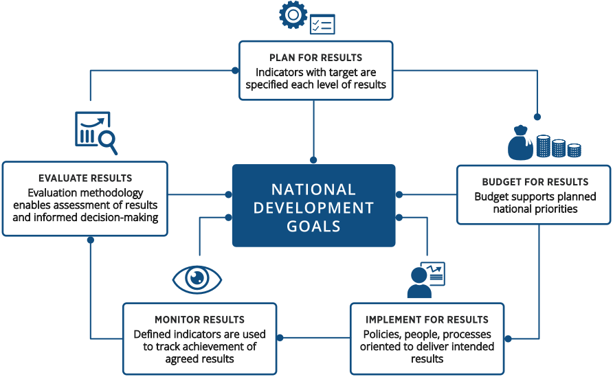

PART V

Plan Implementation, Monitoring, and Evaluation

## Plan Implementation, Monitoring, and Evaluation

## Plan Implementation, Monitoring, and Evaluation

Building on the gains of the previous Philippine Development Plan (PDP) 2017-2022 and learning from lessons of the coronavirus disease (COVID-19) pandemic, the PDP 2023-2028 shifts to higher gear toward economic transformation for a prosperous, inclusive, and resilient society.

This economic transformation calls for a whole-of-government and whole-of-society collaboration, which will be enabled through good governance, transparency, accountability, and evidence-based decision-making. Efficient and close coordination at various levels of government is crucial in implementation. The involvement and cooperation of the private sector during monitoring is deemed vital in ensuring that the government remains on track to achieving its targets. Timely assessment and evaluation will also be done to correct deviations.

## Implementation

The government will set the necessary policies and regulatory environment and implement concrete programs, activities, and projects to achieve the targets set in the PDP 2023-2028. An executive order will be issued directing all government instrumentalities to adopt and align agency plans, roadmaps, and budgetary programs with the Plan. The National Economic and Development Authority (NEDA) Secretariat will work with implementing agencies on the prioritization of identified strategies, policies, programs, and projects, including the proposed legislation.

Given the interrelatedness of the strategies, inter-agency committees were identified to lead and coordinate the implementation of the Plan. They are enjoined to regularly discuss the status of the transformation agenda and pursue measures to expedite the rollout of strategies.

The NEDA Board will oversee the implementation of measures that directly contribute to the achievement of the headline targets as enumerated in Chapter 1: A Plan for Economic and Social Transformation.

Meanwhile, the NEDA Board Committees and existing clusters will steer the implementation of the chapter strategies. Table 16.1 lists the lead inter-agencies for the chapters.

The Social Development Committee will take the lead in ensuring that strategies are implemented to achieve the targets under Chapter 2: Promote Human Capital and Social Development. The Social Development Committee will also push for measures to increase the income-earning ability of Filipinos as identified in Chapter 4: Increase Income-Earning Ability.

Table 16.1 Coordination Mechanism

| CHAPTER                                                                                | RESPONSIBLE AGENCY/INTER-AGENCY BODY                                                           |
|----------------------------------------------------------------------------------------|------------------------------------------------------------------------------------------------|
| Chapter 1: A Plan for Economic and Social Transformation                               | NEDA Board                                                                                     |
| Chapter 2. Promote Human and Social Development                                        | Social Development Committee                                                                   |
| Chapter 3. Reduce Vulnerabilities and Protect Purchasing Power                         | Economic Development Cluster*                                                                  |
| Chapter 4. Increase Income-earning Ability                                             | Social Development Committee                                                                   |
| Chapter 5. Modernize Agriculture and Agribusiness                                      | Economic Development Cluster*                                                                  |
| Chapter 6. Revitalize Industry                                                         | Economic Development Cluster*                                                                  |
| Chapter 7. Reinvigorate Services                                                       | Economic Development Cluster*                                                                  |
| Chapter 8. Advance Research and Development, Technology, and Innovation                | National Innovation Council                                                                    |
| Chapter 9. Promote Trade and Investments                                               | Inter-Agency Investment Promotions Coordination Committee; Committee on Tariff-Related Matters |
| Chapter 10. Promote Competition and Improve Regulatory Efficiency                      | Inter-Agency Committee on Good Governance                                                      |
| Chapter 11. Ensure Macroeconomic Stability and Expand Inclusive and Innovative Finance | Development Budget Coordination Committee                                                      |
| Chapter 12. Expand and Upgrade Infrastructure                                          | Infrastructure Committee                                                                       |
| Chapter 13. Ensure Peace and Security and Enhance the Administration of Justice        | National Security Council and Justice Sector Coordinating Council                              |
| Chapter 14. Practice Good Governance and Improve Bureaucratic Efficiency               | Inter-Agency Committee on Good Governance                                                      |
| Chapter 15. Accelerate Climate Action and Strengthen Disaster Resilience               | Cabinet Cluster on Climate Change Adaptation, Mitigation, and Disaster Risk Reduction*         |

* Or the equivalent NEDA Board Committee.

The Economic Development Cluster or the equivalent NEDA Board Committee will ensure that measures identified in Chapter 3: Reduce Vulnerabilities and Protect Purchasing Power are pursued. The EDC will also expedite the implementation of measures to transform the production sectors, as identified in Chapter 5: Modernize Agriculture and Agribusiness, Chapter 6: Revitalize Industry, and Chapter 7: Reinvigorate Services.

The National Innovation Council will steer the implementation of measures to advance research and development, technology, and innovation (Chapter 8: Advance Research and Development, Technology, and Innovation), driving an innovation-based transformation for various sectors.

The transformation agenda will also be supported by strategies that promote trade and investments (Chapter 9: Promote Trade and Investments), to be steered by the Inter-Agency Investment Promotions Coordination Committee, and the tariff and non-tariff policies to be tackled by the Committee on Tariff-Related Matters. Policies promoting competition and improving regulatory efficiency (Chapter 10: Promote Competition and Improve Regulatory Efficiency) will be led by the Inter-Agency Committee on Good Governance.

To promote macroeconomic stability (Chapter 11: Ensure Macroeconomic Stability and Expand Inclusive and Innovative Finance), the Development Budget Coordination Committee will ensure that fiscal and financial policies are sound and supportive of transformation. Meanwhile, the Infrastructure Committee will pursue the expansion and upgrading of the country's infrastructure (See Chapter 12: Expand and Upgrade Infrastructure).

For Chapter 13: Ensure Peace and Security and Enhance the Administration of Justice, the National Security Council will lead the implementation of strategies to ensure peace and security (See Subchapter 13.1) while the Justice Sector Coordinating Council will have oversight on enhancing administration of justice (See Subchapter 13.2). Meanwhile, good governance and the enhancement of bureaucratic efficiency (Chapter 14: Practice Good Governance and Improve Bureaucratic Efficiency) will be steered by the Inter-Agency Committee on Good Governance; and the acceleration of climate action and disaster resilience (Chapter 15: Accelerate Climate Action and Strengthen Disaster Resilience) will be steered by the Cluster on Climate Change, Adaptation, Mitigation, and Disaster Risk Reduction.

## Monitoring and Evaluation

The progress toward achievement of the identified outcomes will be monitored and assessed using indicators and interim targets as identified in the accompanying Results Matrix (RM). The RM was instituted in 2011 as an instrument designed to provide results orientation to the Plan. It is anchored on results-based management, which highlights the achievement of outcomes and impact. It aims to strengthen government-wide results orientation, which shall allow for regular performance assessment of the Plan.

The RM is a living document that should be referred to and updated regularly to ensure responsiveness to the country's continuously evolving development landscape. To assess the progress toward achieving the Plan, the NEDA Secretariat shall annually prepare the Socioeconomic Report (SER) to present actual accomplishments in terms of outputs and outcomes as contained in the PDP and the RM. This report shall also identify key challenges toward the achievement of results and provide policy directions moving forward.

Gaps and weaknesses in data generation (e.g., unavailable regional breakdown, absence of appropriate methodology to measure indicator progress) for the monitoring of the Plan will likewise be identified in the SER. To address the gaps, the following strategies will be employed:

- (a) Strengthening the collection of data. The Philippine Statistics Development Program will remain the primary mechanism to address the data requirements for the monitoring of the PDP and other sectoral plans and regional plans. It is envisioned to set the directions, thrusts, and priorities of the Philippine Statistical System in the medium term for the generation and dissemination of statistical information for policy- and decision-making

of the government, private sector, and general public.

- (b) Improving analysis, reporting, and use of monitoring data. Making the information on the annual accomplishment of RM indicators and the likelihood of attaining end-of-plan targets available in an online platform is important in maintaining public accountability and enhancing stakeholder engagement. This may be facilitated through the use of data visualization solutions such as storyboards, infographics, and dashboards, among others. Following the open data policy of the government, the creation of such a platform shall improve the

accessibility and comprehension of PDP monitoring data.

- (c) Enhancing capacities to monitor the Plan. The reporting agencies identified in the RM should continue to enhance their capacities to monitor the Plan toward ensuring the provision of quality and timely data. To facilitate this, human and financial resources to strengthen capacities for data collection, analysis, and reporting, as well as statistical literacy at the national and sub-national levels should be adequately allocated. Stronger partnerships with development partners, civil society organizations, and academe shall be pursued to support continuous enhancement of knowledge, skills, processes, and systems on monitoring.

## Evaluation Agenda for the Philippine Development Plan 2023-2028

NEDA and the Department of Budget and Management (DBM) adopted the National Evaluation Policy (NEP) Framework in 2015 1 in line with the government's continuing efforts to strengthen its results orientation (See Figure 16.1). The National Evaluation Policy Framework underscores the need to develop an evaluative culture in the government by providing the framework for the purposive conduct of evaluations in support of good governance, transparency, accountability, and evidence-based decisionmaking.

As NEDA takes the lead in the formulation of the PDP and oversees its implementation, the agency is in the strategic position to be at the helm in the systematic, rigorous, and impartial assessment of its progress.

Figure 16.1 Evaluation and the Public Sector Management Cycle

Source: Asian Development Bank. (2011). Framework for Results-Based Public Sector Management and Country Cases. Asia-Pacific Community of Practice on Managing for Development Results. Manila. https://www.oecd.org/dac/peer-reviews/Asia%20pacific%20cop%202011%20Framework%20for%20RBPSM%20 and%20Country%20Cases.pdf.

A national evaluation agenda will be crafted to set out the priority evaluations that the government will pursue as a means of measuring and obtaining evidence on results derived from strategies and priority interventions laid out in the plan and the RM. Evaluation will particularly play key roles in (a) informing further articulation of the PDP and implementation of programs; (b) conveying progress achieved against priority areas of investment; and (c) promoting transparency and accountability by making evaluation results accessible to all branches of government, and most importantly, to the public. Toward this end, the government will adopt the following key strategies:

- (a) Undertake scoping studies to identify knowledge gaps and the corresponding evaluation studies to create evidence that will inform the implementation of priority programs and projects of this administration. These evaluative studies are also intended to inform updating of the current PDP and the formulation of the successor Plan. Agencies should draw on existing evaluation initiatives if available; if not, evaluations may be commissioned.
- (b) Strengthen the collection, analysis, and use of evaluation data to promote evidence-based and data-driven decision-making. At the outcome level of the PDP, the government will continue

to collect data on the situation of the Filipino people through regular surveys and explore the application of new and innovative methods to gather data to be used for evaluation.

- (c) Support the enactment of a National Evaluation Policy to accelerate efforts in institutionalizing evaluation practice in the government. The National Evaluation Policy comprises necessary instruments for guiding the practice of monitoring and evaluation within national development programs as they provide principles and standards for data collection and management, utilization, and financing, among others. 2
- (d) Strengthen the capacity of agencies to conduct and utilize evaluations. To effectively develop capacities, technical knowledge of evaluations at the individual level should be complemented by opportunities for hands-on application. Nevertheless, the government should also aim to establish a structured training program for evaluation that is widely available, along with supplementary learning resources such as handbooks.
- (e) Effectively communicate evaluation findings to increase utilization and influence of evaluations. Capacity development and the practice of evaluations will be supported by a culture of evidence-based decision-making to ensure its mainstreaming. This entails having an institutionalized evaluation unit to manage and advocate for evaluation activities within each agency of the bureaucracy. This unit will ensure that prioritization and utilization of evaluations are integrated into higher-level processes such as agency planning and project development. Documentation of monitoring and evaluation activities and learning also ensure that new program teams can leverage institutional knowledge built from previous projects.

The NEDA Secretariat will also consult with the PDP Advisory Committee on the assessment of strategies and their effectiveness in achieving the targets and outcomes. The PDP Advisory Committee will be convened during the midterm update preparations, and more frequently if necessary.

- 1 National Economic and Development Authority and Department of Budget and Management. (2015). Joint Memorandum Circular No. 2015-01: National Evaluation Policy Framework of the Philippines. July 15, 2015. Retrieved from https://nep.neda.gov.ph/document/NEDA-DBM%20Joint%20Memorandum%20 Circular%20No.%202015-01%20-%20National%20Evaluation%20Policy%20Framework%20of%20the%20Philippines.pdf.
- 2 Mwaijande, F. (2018). Why Should Countries Have National Evaluation Policies? eVALUation Matters. Retrieved from https://idev.afdb.org/sites/default/files/ Evaluations/2020-03/Why%20Should%20Countries%20have%20National%20Evaluation%20Policies\_F%20Mwaijande\_0.pdf.